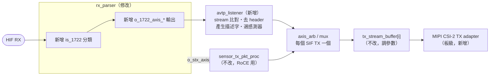

# 設計提案：HSB 1722 Listener（Ethernet → MIPI CSI-2 TX）

> 狀態：**提案**。尚未實作、尚未模擬。內容依據 `docs/` 的 RTL 分析（HSB 3.0.0，commit `41cecaa`）。

## 1. 目標與範圍

| 項目 | 內容 |
|---|---|
| 目標 | HSB 收到 IEEE 1722 串流，取出影像資料，經 `tx_stream_buffer` 送到 MIPI CSI-2 TX |
| 1722 格式 | 第一階段以 HSB 自己的 1722B CoE 格式為準（[dp_pkt_top.md §3](../docs/modules/dp_pkt_top.md#3-1722b-coe-header)），之後再對齊你的 1722 實作 |
| 不在範圍內 | 1722 控制協定（AECP / ACMP / MAAP）、presentation time 精確播放、多 Talker 合流 |

## 2. 現況

| 項目 | 現況 | 依據 |
|---|---|---|
| 1722 Talker（Sensor → Ethernet） | 已有 | `dp_pkt_top` |
| 1722 Listener（Ethernet → Sensor） | 沒有。1722 封包在 `rx_parser` 被丟棄 | [rx_parser §與 1722](../docs/modules/rx_parser.md#與-1722-listener-的關係) |
| Ethernet → SIF TX 路徑 | 有，但只接受 RoCEv2 | [sensor_tx_pkt_proc](../docs/modules/sensor_tx_pkt_proc.md) |
| 平滑輸出 FIFO | 有，與協定無關，可沿用 | [tx_stream_buffer](../docs/modules/tx_stream_buffer.md) |
| gPTP | 有（profile 1） | [others §ptp_top](../docs/modules/others.md#ptp_top) |

## 3. 架構



設計原則：

1. **不改 `sensor_tx_pkt_proc`**。RoCE 路徑保持原樣，方便跟上游同步。
2. **`rx_parser` 只做粗分類**（EtherType、subtype、MAC），stream 比對放在新模組，避免拉長 `rx_parser` 的關鍵路徑。
3. **`tx_stream_buffer` 不改 RTL**，只調參數與門檻。

## 4. 修改點

### 4.1 `rx_parser`：分類

在 `hdr_valid` 分支（[L520](https://github.com/nvidia-holoscan/holoscan-sensor-bridge/blob/41cecaa81ab906a55e7ec22e5e6989f7e602a4c8/fpga/nv_hsb_ip/rx_parser/rx_parser.sv#L520)）新增：

```systemverilog
// 提案（未驗證）
eth_type_1722  <= (eth_hdr_i.ethertype == 16'h22F0);          // 已處理 VLAN offset
avtp_subtype   <= is_vlan ? hdr_array[18] : hdr_array[14];
mac_1722_mcast <= (eth_hdr_i.dest_mac == cfg_1722_mcast_mac);
```

```systemverilog
// eth_mac_dest_match 與上面的暫存器在同一拍更新，所以在組合邏輯裡合併
assign is_1722 = cfg_1722_en && eth_type_1722
              && (mac_1722_mcast || eth_mac_dest_match)
              && (avtp_subtype == cfg_1722_subtype);
assign is_btx  = !eth_mac_dest_match && !is_arp && !is_1722;   // 避免 Bridge 模式重複轉送
```

注意 `eth_mac_dest_match_lsb/msb` 是分兩半比對再 AND（時序考量），multicast 比對建議也照這個方式切。

### 4.2 `rx_parser`：設定暫存器

| Index | Offset | 目前 | 提案 |
|---|---|---|---|
| 4 | 0x10 | `inst_dec_rsvd_1`，未使用 | `cfg_1722_mcast_mac[31:0]` |
| 5 | 0x14 | `inst_dec_rsvd_2`，未使用 | `[15:0]` `cfg_1722_mcast_mac[47:32]`、`[23:16]` `cfg_1722_subtype`、`[31]` `cfg_1722_en` |

index 6（`static_hif_qp`）雖然沒有被引用，但名稱代表上游可能有計畫，避免使用。

### 4.3 `rx_parser`：`tuser` 與輸出

新增 `is_1722` 要同時改這幾處（對照 [rx_parser §6](../docs/modules/rx_parser.md#6-tuser-側帶格式)）：

| 位置 | 修改 |
|---|---|
| `AXI_HDR_WIDTH`（[L112](https://github.com/nvidia-holoscan/holoscan-sensor-bridge/blob/41cecaa81ab906a55e7ec22e5e6989f7e602a4c8/fpga/nv_hsb_ip/rx_parser/rx_parser.sv#L112)） | + 1 |
| `hdr_din`（[L588](https://github.com/nvidia-holoscan/holoscan-sensor-bridge/blob/41cecaa81ab906a55e7ec22e5e6989f7e602a4c8/fpga/nv_hsb_ip/rx_parser/rx_parser.sv#L588)） | 加入 `is_1722` |
| `buf_axis_tuser` 宣告與重排（[L666](https://github.com/nvidia-holoscan/holoscan-sensor-bridge/blob/41cecaa81ab906a55e7ec22e5e6989f7e602a4c8/fpga/nv_hsb_ip/rx_parser/rx_parser.sv#L666)、[L709](https://github.com/nvidia-holoscan/holoscan-sensor-bridge/blob/41cecaa81ab906a55e7ec22e5e6989f7e602a4c8/fpga/nv_hsb_ip/rx_parser/rx_parser.sv#L709)、[L733](https://github.com/nvidia-holoscan/holoscan-sensor-bridge/blob/41cecaa81ab906a55e7ec22e5e6989f7e602a4c8/fpga/nv_hsb_ip/rx_parser/rx_parser.sv#L733)） | 加 1 bit，建議放在最高位，不移動既有欄位 |
| `axis_remove` 的 `W_USER`（[L748](https://github.com/nvidia-holoscan/holoscan-sensor-bridge/blob/41cecaa81ab906a55e7ec22e5e6989f7e602a4c8/fpga/nv_hsb_ip/rx_parser/rx_parser.sv#L748)） | + 1 |
| 新輸出 | `o_1722_axis_*`，仿照 `o_stx_axis_*`（[L843](https://github.com/nvidia-holoscan/holoscan-sensor-bridge/blob/41cecaa81ab906a55e7ec22e5e6989f7e602a4c8/fpga/nv_hsb_ip/rx_parser/rx_parser.sv#L843)） |
| 新輸出 | `o_1722_vlan_tci`：VLAN 在 `axis_remove` 被移除，PCP 要另外帶出 |

`HDR_BYTES = 58` 已經涵蓋 1722B CoE header（46 byte，加 VLAN 50 byte），不需要放大。

### 4.4 新模組 `avtp_listener`

```systemverilog
module avtp_listener #(
  parameter W_DATA     = 64,
  parameter N_SENSOR   = 1,
  parameter N_STREAM   = 4,    // stream_id 比對表大小
  parameter HDR_BYTES  = 46    // Ethernet + AVTPDU（VLAN 已移除）
)(
  input  logic                 i_clk, i_rst,              // HIF clk
  input  apb_m2s               i_apb_m2s,  output apb_s2m o_apb_s2m,
  // 來自 rx_parser.o_1722_axis_*（無 tready）
  input  logic                 i_axis_tvalid, i_axis_tlast,
  input  logic [W_DATA-1:0]    i_axis_tdata,
  input  logic [W_DATA/8-1:0]  i_axis_tkeep,
  // 到每個 SIF TX 的 mux（無 tready）
  output logic [N_SENSOR-1:0]  o_axis_tvalid, o_axis_tlast,
  output logic [W_DATA-1:0]    o_axis_tdata  [N_SENSOR],
  output logic [W_DATA/8-1:0]  o_axis_tkeep  [N_SENSOR],
  // 狀態
  input  logic [N_SENSOR-1:0]  i_stx_ready,               // tx_stream_buffer.o_stx_is_ready
  output logic [31:0]          o_seq_err_cnt, o_drop_cnt
);
```

處理步驟：

| 步驟 | 說明 | 可沿用 |
|---|---|---|
| 1 | 用 `axis_to_vec` 取 header（stream_id、sequence、flags、byte_offset、channel） | `axis_to_vec` |
| 2 | stream_id 查表 → 感測器 index；查不到就丟 | `misc/cam.sv` |
| 3 | 檢查 sequence_number 連續性，不連續時計數，並依設定丟掉到下一個 frame 開始 | |
| 4 | 先把感測器 index 放進 `tuser`，再用 `axis_drop` 去 46 byte | `axis_drop`、`sensor_tx_pkt_proc` 的做法 |
| 5 | 在 payload 前插入一個描述字（見 §4.5） | `axis_insert` |
| 6 | 依 `tuser` 送到對應感測器 | |

### 4.5 Frame / line 資訊：in-band 描述字

`tx_stream_buffer` 的 `tuser` 只有 1 bit，而 MIPI TX 需要 FS/FE、LS/LE、DT、VC、WC。建議在每個封包的 payload 前插入一個 `W_DATA` 寬的描述字，MIPI TX adapter 讀出後移除：

| Bit（64-bit 範例） | 欄位 | 來源 |
|---|---|---|
| [63:56] | magic（例如 `0xA5`） | 常數，供 adapter 檢查同步 |
| [55:48] | flags：bit0 FS、bit1 FE、bit2 LS、bit3 LE | CoE `flags` |
| [47:42] | VC | `channel_number` |
| [41:36] | DT | 設定暫存器（每個 stream） |
| [35:20] | 保留 | 長度由 `tlast` / `tkeep` 決定。1722B CoE header 沒有長度欄位，要在開頭放長度就得先把整包緩衝 |
| [19:0] | byte_offset 低位 | CoE `byte_offset` |

優點：不必改 `tx_stream_buffer` 與 `axis_buffer_tx` 的 FIFO 寬度。缺點：每個封包多 8 byte；adapter 要多一級解析。

替代方案：把 `tx_stream_buffer` 的 `W_USER` 加寬到 8 bit 帶 flags。FIFO 每個 entry 多 7 bit；CPNX100（4096 entry）多 28 Kbit。

### 4.6 `tx_stream_buffer` 參數

預填量要讓 MIPI TX 開始送一個 line 之後不會 underflow：

```
預填 byte 數 ≥ 最長的 Ethernet 到達間隔 × MIPI TX 輸出速率
FIFO 深度   ≥ 預填 + 最大突發量
```

範例（數值僅示意）：MIPI TX 輸出 4 lane × 1.5 Gbps = 6 Gbps；網路抖動上限 20 µs → 預填 ≥ 15 KB。CPNX100 的 `SIF_TX_BUF_SIZE = 4096`（× 64 bit = 32 KB）、預設門檻 3/4（24 KB）可以滿足。

| 設定 | 建議 |
|---|---|
| `pause_ena` | 0（TSN/AVB 網路通常不用 PAUSE） |
| `afull` / `aempty` 門檻 | 依上式設定 |
| 監控 | 定期讀 `saw_underflow`、`low_watermark` |

### 4.7 時間同步（第二階段）

- `ptp_ctrl_profile = 1`（gPTP）。
- `HOLOLINK_top` 已有 HIF 時脈的 PTP 時間（`ptp_sec_sync_hif`、`ptp_nano_sec_sync_hif`），可以拉進 `avtp_listener` 和 AVTP timestamp 比較，實作 presentation time。PTP 只走 host 埠 0。

## 5. 驗證計畫

| 階段 | 方法 | 需要 |
|---|---|---|
| 1 | `rx_parser` 單元模擬：送 1722 / RoCE / ARP 混合封包，確認分類與輸出 | 模擬器（VCS / Xcelium / Questa；或改寫成 Verilator 可編譯） |
| 2 | 擴充 `fpga/nv_hsb_ip_simple_tb`：`hololink_host2sen_stim.svh` 產生 1722 封包，檢查 `o_sif_axis_*` | 同上 |
| 3 | FPGA loopback：HSB Data Plane 設成 1722B（`configure_coe()`），dest MAC 指向自己 | CPNX100 板子 |
| 4 | 主機 Talker：`src/hololink/emulation/` 的 `COETransmitter` | Linux 主機 |
| 5 | 對接你自己的 1722 Talker 實作 | |

## 6. 待決定事項

| # | 問題 | 影響 |
|---|---|---|
| 1 | 以哪一份 1722 格式為準：HSB 的 CoE（subtype 0x82）或你的實作 | header 長度、欄位位置 |
| 2 | 目標 MIPI CSI-2 TX IP 的介面（AXIS？是否要 byte-level line 時序？） | 描述字格式、adapter 設計 |
| 3 | 遺失封包時的策略：補 0、丟整個 frame、照送 | `avtp_listener` 步驟 3 |
| 4 | 需不需要和 RoCE STX 同時使用 | 是否需要 §3 的 mux |
| 5 | 模擬環境 | 驗證計畫階段 1–2 |
