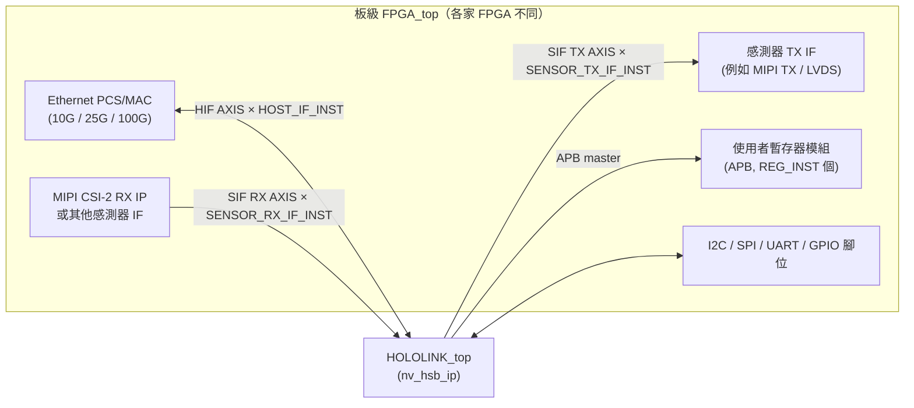
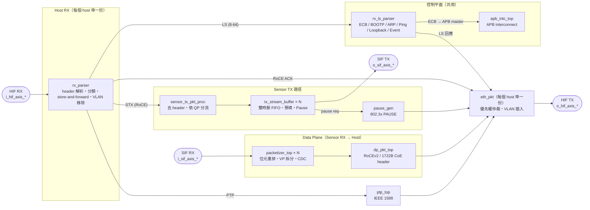
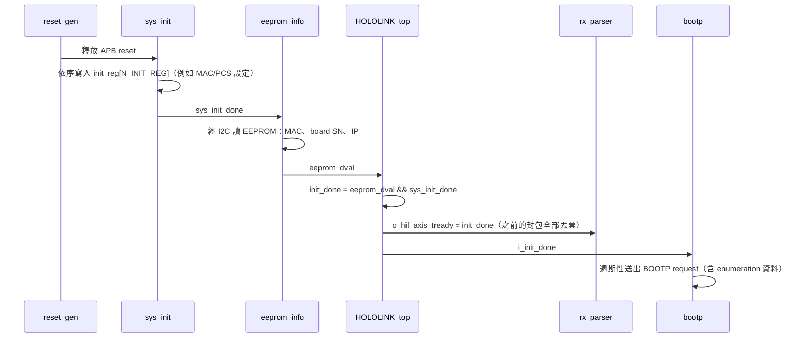

# 01 — Block View（頂層架構）

原始碼：`fpga/nv_hsb_ip/top/HOLOLINK_top.sv`（1933 行）

## 1. HSB IP 在 FPGA 裡的位置

`HOLOLINK_top` 不含 MAC、PCS 或 MIPI PHY。板級 top（例如 `FPGA_top.sv`）負責實例化這些 IP，再用 AXIS 接到 `HOLOLINK_top`。



## 2. 頂層方塊圖

下圖是非 Bridge 模式（沒有定義 `BRIDGE_IF_INST`）的資料流。每個 host 埠（`HOST_IF_INST`）各有一份 `rx_parser` 與 `eth_pkt`。`rx_ls_parser`、`dp_pkt_top`、`ptp_top` 只有一份，由所有 host 埠共用。



## 3. 時脈域

`HOLOLINK_top` 有 5 種時脈域。所有 reset 都由 `reset_gen` 同步到各自的時脈。

| 時脈 | 用途 | CPNX100 參考值 |
|---|---|---|
| `i_hif_clk` | Host/Ethernet 資料路徑。`rx_parser`、`eth_pkt`、`dp_pkt_top`、`sensor_tx_pkt_proc` 都在這個時脈 | 156.25 MHz（10G，64-bit） |
| `i_apb_clk` | 控制平面、暫存器、`sys_init`、`eeprom_info`、I2C/SPI/UART | 19.53125 MHz |
| `i_ptp_clk` | PTP 計時器 | 100.446545 MHz |
| `i_sif_rx_clk[n]` | 每個 SIF RX 介面各一個 | 由感測器 IP 提供 |
| `i_sif_tx_clk[n]` | 每個 SIF TX 介面各一個 | 由感測器 IP 提供 |

跨時脈的地方：

- `packetizer_top`：SIF RX → HIF。
- `tx_stream_buffer`：HIF → SIF TX（`axis_buffer_tx`，`DUAL_CLOCK=1`）。
- `s_apb_reg`：每個模組的暫存器都在 APB 時脈寫入，再同步到模組時脈。`SYNC_CLK_HIF_APB` 定義時，HIF 與 APB 視為同一時脈，省略同步器。
- `streaming_cdc`：PTP 時間（80 bit：48 bit 秒 + 32 bit 奈秒）同步到 HIF 與 APB。

## 4. 主要編譯參數（`HOLOLINK_def.svh`）

`HOLOLINK_top` 的規模全部由板級的 `HOLOLINK_def.svh` 決定。下表是 CPNX100 參考設計的值。

| Define / 參數 | 意義 | CPNX100 |
|---|---|---|
| `HOST_IF_INST` | Host（Ethernet）埠數 | 2 |
| `HOST_WIDTH` | HIF AXIS 寬度 | 64 |
| `HOST_MTU` | 最大封包長度 | 4096 |
| `SENSOR_RX_IF_INST` | SIF RX 介面數 | 3 |
| `SIF_RX_WIDTH[]` | 每個 SIF RX 的寬度 | {32, 64, 64} |
| `SIF_RX_PACKETIZER_EN[]` | 每個 SIF RX 是否啟用 packetizer | {0, 1, 1} |
| `SIF_RX_VP_COUNT[]` | 每個 SIF RX 的 VP 數 | {2, 2, 2} |
| `SENSOR_TX_IF_INST` | SIF TX 介面數 | 1 |
| `SIF_TX_WIDTH[]` | 每個 SIF TX 的寬度 | {32} |
| `SIF_TX_BUF_SIZE[]` | 每個 SIF TX 的 FIFO 深度 | 4096 |
| `DATAPATH_WIDTH` | SIF 埠的實體寬度（取 RX/TX 最大值） | 64 |
| `I2C_INST` / `SPI_INST` / `UART_INST` / `GPIO_INST` | 周邊數量 | 4 / 2 / 1 / 31 |
| `REG_INST` | 使用者 APB slave 數 | 8 |
| `N_INIT_REG` | 開機自動寫入的暫存器數 | 22 |
| `ENUM_EEPROM` | MAC/SN 從 EEPROM 讀 | 有定義 |

其他會改變結構的 define：

| Define | 效果 |
|---|---|
| `BRIDGE_IF_INST` | Bridge 模式。SIF 當作 Ethernet 埠使用，Data Plane 與 Sensor TX 路徑全部移除，改用 `routing_table` + `bridge_pkt_proc` |
| `EXT_PTP` | 不實例化 `ptp_top`，PTP 時間從外部輸入 |
| `DISABLE_VLAN` | 移除 VLAN 解析與插入 |
| `DISABLE_COE` | 合成時移除 1722B CoE header（模擬時一律保留） |
| `SIF_RX_DATA_GEN` | 每個 SIF RX 前面加一個測試資料產生器 |
| `SIF_TX_ROCE_RC_ENABLE` | `rx_parser` 啟用 RoCE RC ACK（`roce_ack`） |

## 5. 四條資料路徑

### 5.1 Host RX → 控制平面（LS 路徑）

```
MAC → rx_parser → (8-bit LS AXIS) → rx_ls_parser → ECB / BOOTP / ARP / Ping / Loopback
                                                  └→ ECB 轉成 APB master 讀寫 → apb_intc_top
```

回應封包由 `rx_ls_parser` 加上 Ethernet/IPv4/UDP header。資料線由所有 host 埠共用，`tvalid` 是向量，只對請求來源的 host 埠拉高，送進該埠 `eth_pkt` 的第 3 埠。

### 5.2 Host RX → Sensor TX（STX 路徑）

```
MAC → rx_parser → sensor_tx_pkt_proc → tx_stream_buffer[n] → o_sif_axis_*[n]
                  (去 54 byte header、去 4 byte ICRC、依 BTH dest QP 分流)
```

只接受 RoCEv2 封包（UDP 目的埠 4791，BTH opcode 為 UC SEND，或在 `ENABLE_ROCE_ACK` 時為 RC SEND/WRITE）。詳見 [03-rtl-sensor-tx.md](03-rtl-sensor-tx.md)。

### 5.3 Sensor RX → Host（Data Plane）

```
i_sif_axis_*[n] → (data_gen mux) → packetizer_top[n] → dp_pkt_top → eth_pkt 第 0 埠 → MAC
```

`dp_pkt_top` 依每個 VP 的設定 RAM，產生 RoCEv2 WRITE（含 Immediate / metadata）或 IEEE 1722B CoE 封包。詳見 [04-rtl-dataplane.md](04-rtl-dataplane.md)。

### 5.4 PTP

```
MAC → rx_parser (EtherType 0x88F7 + PTP multicast MAC) → ptp_top → eth_pkt 第 1 埠 → MAC
```

只有 host 埠 0 參與 PTP。其他 host 埠的 PTP TX 綁 0。

## 6. `eth_pkt` 輸出埠分配

每個 host 埠的 `eth_pkt` 有 6 個輸入，使用固定優先權仲裁（index 小的優先）。順序以 `HOLOLINK_top.sv` 第 924–957 行的 concat 為準：

| Index | 來源 | 說明 |
|---|---|---|
| 0 | `dp_axis_*` | Data Plane（感測器資料） |
| 1 | `ptp_tx_axis_*` | PTP |
| 2 | `ack_axis_*` | RoCE ACK |
| 3 | `lso_axis_*` | LS 回應（ECB / BOOTP / ARP / Ping / Event / Loopback） |
| 4 | `pause_axis_*` | 802.3x PAUSE |
| 5 | `btx_axis_*` | Bridge |

> 注意：`HOLOLINK_top.sv` 第 897–902 行的註解寫「port 2 = Low Speed Control、port 3 = Pause、port 4 = Bridge」，少了 RoCE ACK，和實際 concat 不一致。以 concat 為準。

## 7. APB 位址空間

`apb_intc_top` 有 4 個 APB master，由 `apb_switch` 分層解碼。

| Master | 來源 |
|---|---|
| `m_apb[0]` | ECB（`rx_ls_parser` 內的 `ecb_rdwr_ctrl`），也就是 host 軟體 |
| `m_apb[1]` | `sys_init`（開機寫入 `init_reg` 表） |
| `m_apb[2]` | `eeprom_info`（開機讀 EEPROM） |
| `m_apb[3]` | `ctrl_bus_evt`（事件觸發的暫存器序列） |

位址解碼（取自 `apb_intc_top.sv` 註解）：

| 位址範圍 | 目標 |
|---|---|
| `0x0000_0000`–`0x00FF_FFFF` | Global 模組（`glb_ctrl_top`、PTP、Event、ECB 暫存器、RAM） |
| `0x0100_0000`–`0x011F_FFFF` | Sensor RX。每個通道 `0x1_0000`，每個模組 `0x100`（模組 0 = packetizer，模組 1 = data_gen） |
| `0x0120_0000`–`0x013F_FFFF` | Sensor TX（`tx_stream_buffer`） |
| `0x0200_0000`–`0x02FF_FFFF` | Host。每個 host 埠 `0x1_0000`，每個模組 `0x100`（0 = `rx_parser`、1 = `eth_pkt`、2 = 保留、3 = `dp_pkt`） |
| `0x0300_0000`–`0x03FF_FFFF` | 周邊（SPI、I2C、UART） |
| `0x1000_0000`–`0xFFFF_FFFF` | 使用者模組（`o_apb_*`，`REG_INST` 個 slave） |

Global 區內各模組的子位址，請直接查 `apb_intc_top.sv` 第 218–266 行。

APB 有 watchdog：transaction 卡住會逾時並回錯誤（`apb_intc_top.sv` 第 77 行起）。

## 8. 開機與初始化



要點：

- `init_done` 之前，`rx_parser` 的 `tvalid` 被 `init_done_hif_clk` 遮掉，`o_hif_axis_tready` 也是 0。
- 多個 host 埠的 MAC 位址是 EEPROM MAC + 埠號（`dev_mac_addr[i] <= eeprom_mac_addr + i`）。
- 沒有定義 `ENUM_EEPROM` 時，MAC、SN 由板級 top 從 `i_mac_addr`、`i_board_sn`、`i_enum_vld` 輸入。
- IP 位址由 `bootp` 決定：EEPROM 有 IP 就用 EEPROM 的值，否則預設 `192.168.0.2`（`IP_DEFAULT = 32'hC0A80002`），之後可由 BOOTP 回應改寫。

## 9. Reset 與軟體控制

- `o_sw_sys_rst = hsb_ctrl[3]`：軟體觸發系統 reset，回接 `reset_gen.i_cfg_rst`。
- `o_sw_sen_rst = ~hsb_ctrl[63:32]`：32 個感測器 reset，給板級使用。
- `hsb_ctrl` 是 `glb_ctrl_top` 的兩個 32-bit 控制暫存器（`hsb_ctrl_0`、`hsb_ctrl_1`）。

## 10. 事件向量

`event_vec`（32 bit）送進 `ctrl_bus_evt_int`，可在上升或下降緣觸發中斷封包或暫存器序列：

```
event_vec = { i_sif_event[15:0], 11'h0, uart_irq, 2'b00(內部), spi_busy, i2c_busy }
```

板級可以用 `i_sif_event` 把感測器事件（例如 frame start）送給 host。
