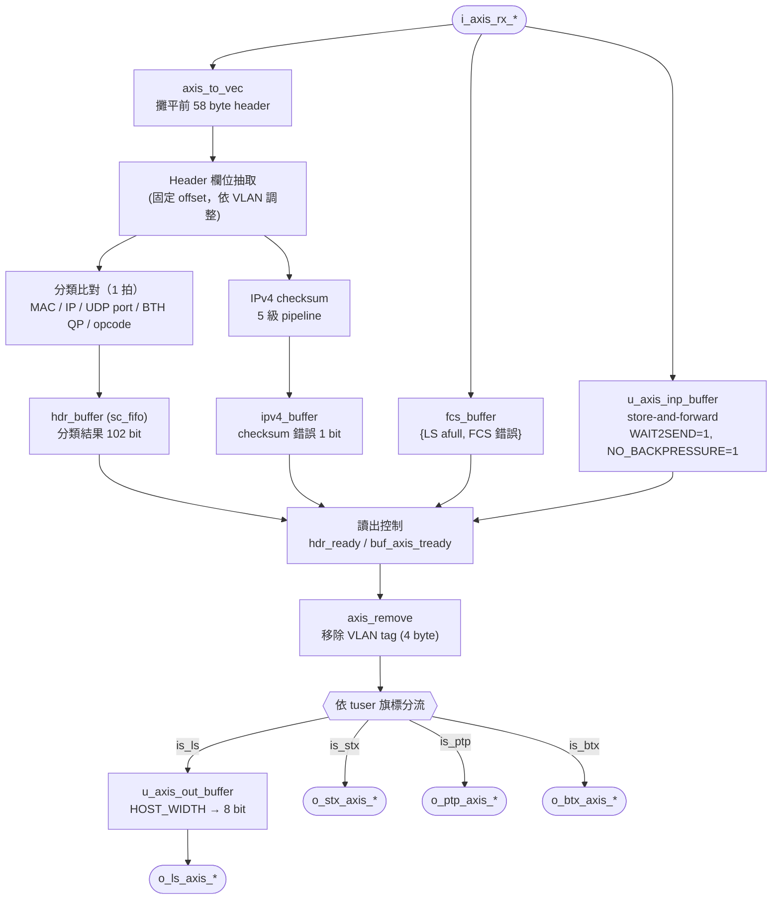
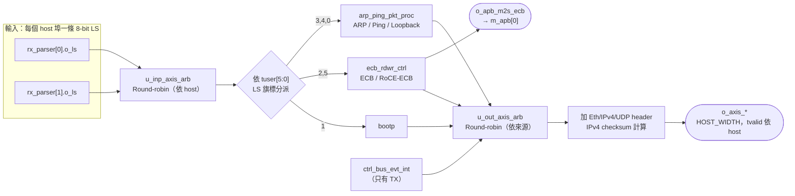

# 02 — RTL：Host RX 與控制平面

這一章說明封包從 Ethernet MAC 進入 HSB 後的處理：`rx_parser`（每個 host 埠一份）與 `rx_ls_parser`（共用）。

---

## 1. `rx_parser`

原始碼：`fpga/nv_hsb_ip/rx_parser/rx_parser.sv`（865 行）、`rx_parser_pkg.sv`

### 1.1 介面

| 方向 | 介面 | 寬度 | 去向 |
|---|---|---|---|
| in | `i_axis_rx_*` | `HOST_WIDTH` | 來自 MAC。`tuser` = FCS 錯誤（1 bit） |
| out | `o_stx_axis_*` | `HOST_WIDTH` | Sensor TX 路徑（RoCE 資料） |
| out | `o_ptp_axis_*` | `HOST_WIDTH` | `ptp_top` |
| out | `o_ls_axis_*` | **8 bit** | `rx_ls_parser`（控制封包） |
| out | `o_btx_axis_*` | `HOST_WIDTH` | `bridge_pkt_proc`（只在 Bridge 模式有用） |
| out | `o_ack_axis_*` | `HOST_WIDTH` | RoCE ACK → `eth_pkt` |
| out | `o_dest_info[71:0]` | 72 | `{BTH dest QP[23:0], dest MAC[47:0]}`，給 `sensor_tx_pkt_proc` 選感測器 |
| out | `o_ptp_sync_msg` | 1 | 收到 PTP Sync 的脈衝（給 Bridge 的 residence time） |
| in | `i_stx_ready[N_QP-1:0]` | | 來自 `tx_stream_buffer.o_stx_is_ready`，給 `roce_ack` 做背壓 |
| in | `i_dev_mac_addr`、`i_dev_ip_addr` | | 本機位址 |

只有 `o_ls_axis_*`、`o_btx_axis_*`、`o_ack_axis_*` 有 `tready`。`o_stx_axis_*` 與 `o_ptp_axis_*` 沒有背壓。

### 1.2 內部方塊圖



### 1.3 Header 抽取

`HDR_BYTES = 14 + 4(VLAN) + 20 + 8 + 12 = 58`。`axis_to_vec` 把封包前 58 byte 攤平成 `hdr_array[]`，`hdr_valid` 表示攤平完成。

- VLAN 判斷：`{hdr_array[12], hdr_array[13]} == 16'h8100`。是 VLAN 時，後面所有欄位的 offset 加 4。
- IPv4、UDP、BTH 欄位都是**固定 offset**。程式碼假設 IPv4 IHL = 5（沒有 IP option）。
- ARP 的 TPA、ICMP type 與 UDP 欄位共用同一段 byte，依封包種類解讀。

### 1.4 分類規則

分類在 `hdr_valid` 那一拍做比對（`always_ff`，第 493 行起），結果組成 `hdr_din` 寫入 `hdr_buffer`。

| 旗標 | 條件 |
|---|---|
| `is_ecb` | UDP && IP 相符 && MAC 相符 && UDP dport == `cfg_ecb_udp_port` |
| `is_roce_ecb` | UDP && IP 相符 && MAC 相符 && dport == `cfg_stx_udp_port` && BTH dest QP == `cfg_roce_ecb_dest_qp` && opcode 相符 |
| `is_stx` | 同上，但 BTH dest QP **!=** `cfg_roce_ecb_dest_qp` |
| `is_bootp` | UDP && MAC 相符 && dport == 12268 |
| `is_loopbk` | UDP && IP 相符 && MAC 相符 && dport == `16'h1000`（4096） |
| `is_ping` | ICMP && type == 8 && IP 相符 && MAC 相符 |
| `is_arp` | (廣播 MAC \|\| MAC 相符) && EtherType == 0x0806 && ARP TPA == 本機 IP |
| `is_ptp` | EtherType == 0x88F7 && dest MAC 是 PTP multicast：`01:1B:19:00:00:00`（`PTP_FW_MULTI_ADDR`）或 `01:80:C2:00:00:0E`（`PTP_NON_FW_MULTI_ADDR`） |
| `is_btx` | !MAC 相符 && !is_arp |

opcode 相符的定義：

```systemverilog
bth_tx_opcode_match <= (opcode_is_uc && opcode_is_send)
                    || (opcode_is_rc && (opcode_is_write || opcode_is_send) && ENABLE_ROCE_ACK);
```

觀察：

- 分類條件沒有直接檢查 EtherType == 0x0800。EtherType 0x0800 只用在 checksum 錯誤統計（`is_ipv4_type`）。IP 封包的判斷靠 protocol 欄位加上 MAC 與 IP 比對。
- **不屬於上表任何一類的封包會被丟棄。** 例如 dest MAC 是本機、但 EtherType 是 0x22F0（IEEE 1722）的封包，所有旗標都是 0，讀出時不會從任何輸出埠送出。
- dest MAC 不是本機的封包（例如 multicast），`is_btx = 1`。非 Bridge 模式下 `brx_axis_tready` 綁 1，等同丟棄。

### 1.5 暫存器（`inst_dec` 區，host 模組 0）

| Index | 名稱 | 位址 offset | Reset 值 | 用途 |
|---|---|---|---|---|
| 0 | `inst_dec_scratch` | 0x00 | 0 | scratch |
| 1 | `inst_dec_ctrl` | 0x04 | 0 | |
| 2 | `lpbk_udp_port` | 0x08 | 0 | 讀出到 `cfg_lpbk_udp_port`，但分類用的是常數 `LOOPBCK_UDP_PORT = 16'h1000` |
| 3 | `roce_ecb_dest_qp` | 0x0C | `0x1000` | RoCE 包裝的 ECB 所用的 QP |
| 4、5 | `inst_dec_rsvd_1`、`inst_dec_rsvd_2` | 0x10、0x14 | 0 | 保留，未使用 |
| 6 | `static_hif_qp` | 0x18 | 0 | 有定義名稱，RTL 與軟體都沒有引用 |
| 7 | `inst_dec_ack_ctrl` | 0x1C | 0 | 給 `roce_ack` |
| 8 | `ecb_udp_port` | 0x20 | `0x2000`（8192） | ECB UDP 埠 |
| 9 | `stx_udp_port` | 0x24 | `0x12B7`（4791，RoCEv2） | STX UDP 埠 |
| 33 | `ipv4_chksum_err_cnt` | 0x84 | — | IPv4 checksum 錯誤計數（飽和） |

Reset 值來自 `RST_VAL = {'0, 32'h12B7, 32'h2000, {(4*32){1'b0}}, 32'h1000, {(3*32){1'b0}}}`，低位是 index 0。

> 注意：`inst_dec_stat_rst = ctrl_reg[eth_pkt_ctrl][8]`。`eth_pkt_ctrl` 是 `eth_pkt` 暫存器區的 index 常數（值為 1），這裡拿來索引 `rx_parser` 自己的 `ctrl_reg`。所以實際作用的是 `inst_dec_ctrl`（0x04）的 bit 8：寫 1 清除 checksum 錯誤計數。

### 1.6 Store-and-forward 與丟棄

`u_axis_inp_buffer` 設定 `WAIT2SEND=1`：整個封包收完才能讀出。`NO_BACKPRESSURE=1`：不能對 MAC 背壓，滿了就丟。

FIFO 深度：

| 參數 | 寬匯流排（≥256 bit） | 窄匯流排 |
|---|---|---|
| `INP_FIFO_DEPTH` | 3 個 MTU | 2 個 MTU |
| `LS_FIFO_DEPTH` | 3 個 MTU | 2 個 MTU |
| `RLS_AFULL_DEPTH` | 2 個 MTU | 1 個 MTU |

讀出時序：

1. `hdr_ready` = 三個 metadata FIFO（`hdr`、`ipv4`、`fcs`）都非空，且 `ack_empty` 為 0。
2. `hdr_rden` 讀出一組 metadata，接著 `buf_axis_tready` 拉高，直到該封包 `tlast`。
3. `ipv4_invld = ipv4_iserr | fcs_iserr | ack_is_err`。有錯時 `buf_axis_tvalid` 被遮成 0，封包照樣讀出但不送往任何地方，等於丟棄。
4. LS 封包另外檢查 `ls_afull_iserr`：封包**開始**時 LS FIFO 已經 almost full，就整包丟掉。

### 1.7 `tuser` 側帶格式

讀出後，`hdr_dout` 重新排列成 `buf_axis_tuser`（第 733 行），跟著資料一起走。這是修改 `rx_parser` 時最需要對照的表。`NUM_LS_INST = 6`、`USER_WIDTH = 17`。

| Bit | 欄位 | 來源 |
|---|---|---|
| [0] | `is_loopbk` | LS index 0 |
| [1] | `is_bootp` | LS index 1 |
| [2] | `is_ecb` | LS index 2 |
| [3] | `is_ping` | LS index 3 |
| [4] | `is_arp` | LS index 4 |
| [5] | `is_roce_ecb` | LS index 5 |
| [21:6] | VLAN TCI | |
| [22] | `is_vlan` | |
| [23] | `is_stx` | |
| [24] | `is_btx` | |
| [25] | `is_ptp` | |
| [73:26] | dest MAC（byte 順序反轉） | `o_dest_info[47:0]` |
| [97:74] | BTH dest QP | `o_dest_info[71:48]` |

PTP message type（`hdr_dout[84:81]`）不放在 `tuser`，直接給 `o_btx_axis_tuser` 編碼（Sync = 1、Follow_Up = 2、Delay_Resp = 3）。

### 1.8 VLAN 移除

`axis_remove` 從 bit offset 96（byte 12）移除 32 bit（4 byte）。啟用條件：`buf_is_vlan && !buf_is_btx`。Bridge 封包保留 VLAN。`DISABLE_VLAN` 時整個 `axis_remove` 不存在。

所以 `rx_parser` 之後的模組看到的都是**沒有 VLAN** 的封包。`sensor_tx_pkt_proc` 的 54 byte header 長度就是以此為前提。

### 1.9 RoCE ACK（`ENABLE_ROCE_ACK`）

`SIF_TX_ROCE_RC_ENABLE` 定義時，`rx_parser` 實例化 `roce_ack`。它看 header、`is_stx`、`i_stx_ready`，產生 ACK 封包送到 `eth_pkt` 第 2 埠，並可透過 `ack_is_err` 讓 `rx_parser` 丟掉封包。`roce_ack` 內部本文件沒有逐行分析。

---

## 2. `rx_ls_parser`

原始碼：`fpga/nv_hsb_ip/rx_parser/rx_ls_parser.sv`（643 行）

所有 host 埠的 LS 串流在這裡匯合。整個模組跑在 8-bit 寬度，速度低但面積小。

### 2.1 方塊圖



### 2.2 RX / TX 索引

| RX index | 來源 | TX index | 來源 |
|---|---|---|---|
| 0 | Loopback | 0 | ECB 回應 |
| 1 | BOOTP | 1 | Event（中斷封包） |
| 2 | ECB | 2 | BOOTP |
| 3 | Ping | 3 | ARP / Ping / Loopback |
| 4 | ARP | | |
| 5 | RoCE-ECB | | |

### 2.3 輸出 header

TX 來源除了 ARP/Ping/Loopback（自己帶完整封包）以外，都只產生 UDP payload。`rx_ls_parser` 依來源的 `host_mac_addr`、`host_ip_addr`、`host_udp_port`、`dev_udp_port`、`pld_len` 組出 42 byte header：

- Ethernet：dst = host MAC，src = 本機 MAC（依 host index），EtherType 0x0800。
- IPv4：version 4、IHL 5、TTL 0x40、flag = DF（3'h2）、protocol UDP、checksum 由 `ipv4_chksum_state` 用 4 拍算出。
- UDP：checksum 固定 0（不使用）。

輸出的 `tvalid` 是一個向量，只拉高原請求封包所在的 host 埠。

---

## 3. `ecb_rdwr_ctrl`（ECB 控制協定）

原始碼：`fpga/nv_hsb_ip/ecb/ecb_rdwr_ctrl.sv`（776 行）、`ecb_pkg.sv`

ECB 是 host 軟體讀寫 HSB 暫存器的協定。封包經 `rx_ls_parser` 進來，轉成 APB transaction（`m_apb[0]`），再把結果組成回應封包。

### 3.1 封包格式（從 byte offset 解析邏輯整理）

`byte_cnt` 是從 Ethernet header 開頭算的 byte offset（VLAN 已移除）。

| Offset | 一般 ECB（UDP） | RoCE-ECB（UDP + BTH） |
|---|---|---|
| 6–11 | host MAC（src MAC） | 同左 |
| 26–29 | host IP（src IP） | 同左 |
| 34–37 | UDP 埠。回應時交換來源/目的埠 | UDP 埠。回應時不交換 |
| 38–39 | UDP length | 同左 |
| 42 | ECB cmd | BTH opcode |
| 43 | ECB flags | |
| 44–45 | ECB sequence | |
| 54 | | ECB cmd |
| 55 | | ECB flags |
| 56–57 | | ECB sequence |
| 之後 | `{addr[31:0], data[31:0]}` 重複 | 同左 |

`addr/data pair` 數量：一般 ECB 為 `(udp_len - 22) >> 3`，RoCE-ECB 為 `(udp_len - 38) >> 3`。

### 3.2 命令碼

`ecb_pkg.sv` 定義：

| 名稱 | 值 |
|---|---|
| `WR_BYTE` | 0x01 |
| `WR_WORD` | 0x02 |
| `WR_DWORD` | 0x04 |
| `WR_BLOCK` | 0x09 |
| `RMW_BYTE` | 0x0A |
| `RD_BYTE` | 0x11 |
| `RD_WORD` | 0x12 |
| `RD_DWORD` | 0x14 |
| `RD_BLOCK` | 0x19 |
| `GET_INFO` | 0x20 |

`ecb_rdwr_ctrl` 實際判斷讀寫只用 4 個：`ecb_wr = WR_DWORD || WR_BLOCK`、`ecb_rd = RD_DWORD || RD_BLOCK`。其他命令會走錯誤處理（`ecb_cmd_error`）。

### 3.3 處理流程

1. `decode_state`：`DCD_IDLE → DCD_HDR → … → DCD_DATA → DCD_DONE`，錯誤時進 `DCD_FLUSH`。
2. 每收到一組 addr/data，把命令送到 APB 時脈域（`apb_send_cmd` CDC），執行 APB 讀或寫。
3. Sequence 檢查：沒有錯誤才更新 `seq_num_latch`；錯誤時保留舊值。
4. 回應：命令碼、回應碼、讀回資料組成回應向量，經 `vec_to_axis` 送出。RoCE-ECB 的回應另外加 RoCE header（`ecb_is_roce` → `rx_ls_parser.hdr_crc`）。

---

## 4. 其他 LS 模組（摘要）

| 模組 | 功能 |
|---|---|
| `arp_ping_pkt_proc` | 回 ARP reply、ICMP echo reply（type 改為 0）；UDP Loopback（dport 4096）交換來源/目的 IP 與埠後送回 |
| `bootp` | `init_done` 後對每個 host 埠送出 BOOTP request，之後隨 PTP 同步訊號重複送出。vendor 欄位（tag 0xE0，字串 "NVDA"）帶 `i_enum_data`（board ID、board 版本、SN、HSB 版本等）。收到 BOOTP reply 時更新 `o_dev_ip_addr`。host 軟體的 `Enumerator` 靠這個找到裝置 |
| `ctrl_bus_evt_int` | 偵測 `event_vec` 的上升/下降緣，送出中斷 UDP 封包到設定的 host MAC/IP/埠；內含 `ctrl_bus_evt_fsm`，可在事件發生時經 `m_apb[3]` 執行暫存器序列（推斷：序列存在 evt RAM） |
