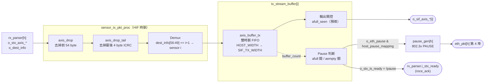

# 03 — RTL：Ethernet → Sensor TX（STX 路徑）

這條路徑把 host 送來的資料轉給感測器端的 TX 介面（`o_sif_axis_*`）。如果要讓 HSB 收 Ethernet 資料再送到 MIPI TX，這就是要修改的路徑。



---

## 1. 進入條件（在 `rx_parser`）

封包要走 STX 路徑，`rx_parser` 必須判定 `is_stx = 1`：

- IPv4 + UDP，dest MAC 與 dest IP 都是本機。
- UDP 目的埠 == `stx_udp_port`（預設 4791，RoCEv2）。
- BTH dest QP != `roce_ecb_dest_qp`（預設 0x1000）。
- BTH opcode 是 UC SEND（First / Middle / Last / Only），或在 `ENABLE_ROCE_ACK` 時為 RC SEND / RC WRITE。

VLAN 在 `rx_parser` 已移除。`o_stx_axis_tuser` 固定為 0。

---

## 2. `sensor_tx_pkt_proc`

原始碼：`fpga/nv_hsb_ip/sensor_tx/sensor_tx_pkt_proc.sv`（148 行）

只有一個實例，處理所有 host 埠（`NUM_HOST`）到所有 SIF TX（`NUM_SENSOR`）。沒有任何 `tready`，所有下游都必須能吸收。

### 2.1 去 header

```
HDR_BYTES = ETH(14) + IP(20) + UDP(8) + BTH(12) = 54
```

`axis_drop` 從封包開頭去掉 54 byte。`axis_drop_tail` 去掉最後 32 bit（RoCE ICRC）。

觀察：

- 長度是固定值。RC WRITE 封包在 BTH 後面還有 16 byte RETH，這裡不會去掉；如果 `ENABLE_ROCE_ACK` 時使用 RC WRITE，RETH 會留在送給感測器的資料裡（推斷，沒有逐行驗證 `roce_ack` 是否另外處理）。
- 去 header 後的資料是「純 payload」。frame、line、data type 這類資訊都不在 `tuser` 裡。

### 2.2 選擇感測器

```systemverilog
// i_dest_info = {BTH dest QP[23:0], dest MAC[47:0]}
// i_dest_info[56:49] = dest QP[8:1]
if ((raw_axis_tuser[j] == (i+1)) && raw_axis_tvalid[j]) begin
  o_axis_tvalid[i] = raw_axis_tvalid[j];
  ...
```

- `dest_info[56:49]` 是 BTH dest QP 的 bit [8:1]。它在去 header 前就放進 `tuser`，跟著封包走，所以封包邊界與選擇結果一定對齊。
- 感測器 `i` 收 `QP[8:1] == i+1` 的封包。例如 QP = 0x002 → sensor 0，QP = 0x004 → sensor 1。
- 多個 host 埠同時送到同一個感測器時，`for` 迴圈後面的 host 會蓋過前面的。沒有仲裁，所以軟體必須保證同一時間只有一個 host 埠送給同一個感測器。

### 2.3 輸出到 `tx_stream_buffer`

`o_axis_tuser` 固定為 0。資料寬度仍是 `HOST_WIDTH`，寬度轉換在 `tx_stream_buffer` 裡做。

---

## 3. `tx_stream_buffer`

原始碼：`fpga/nv_hsb_ip/sensor_tx/tx_stream_buffer.sv`（372 行）

每個 SIF TX 一份。它的工作是把突發的 Ethernet 封包平滑成連續的感測器輸出串流。

### 3.1 FIFO

`axis_buffer_tx`：`IN_DWIDTH = HOST_WIDTH`、`OUT_DWIDTH = SIF_TX_WIDTH[i]`、`BUF_DEPTH = SIF_TX_BUF_SIZE[i]`、`DUAL_CLOCK = 1`。

- 寫入端在 `i_hif_clk`，讀出端在 `i_sif_tx_clk[i]`。
- `buffer_count`（寫入端計數）用來判斷 almost full / almost empty。

### 3.2 輸出閘控（預填）

```systemverilog
assign axis_buffer_tx_tready = (afull_seen_sync & i_axis_tready) || dbg_ena_output_sync;
assign o_axis_tvalid         = afull_seen_sync & axis_buffer_tvalid;
```

- `tx_data_output_ena`（`ctrl[0][0]`）= 1 之後，FIFO 第一次到達 almost full，`afull_seen` 才拉高，輸出才開始。
- `afull_seen` 一旦拉高就保持，直到 `tx_data_output_ena` 清為 0。
- 所以輸出開始前會先預填 3/4 FIFO（預設門檻）。這給感測器端一段緩衝，吸收 Ethernet 到達時間的抖動。
- `dbg_ena_output`（`ctrl[0][8]`）= 1 時，FIFO 一直讀出，但 `o_axis_tvalid` 仍受 `afull_seen_sync` 閘控（等於丟資料）。用於除錯清空 FIFO。

### 3.3 Almost full / empty 門檻

| 狀況 | Almost full | Almost empty |
|---|---|---|
| Reset 後預設 | `FIFO_DEPTH - FIFO_DEPTH/4`（3/4） | `FIFO_DEPTH/4`（1/4） |
| 軟體設定 | `ctrl[1]` | `ctrl[2]` |

軟體值只在 `prog_thresh_ena`（`ctrl[0][2]`）的**上升緣**載入。改門檻的步驟：寫 `ctrl[1]`、`ctrl[2]`，再把 `ctrl[0][2]` 從 0 寫成 1。

### 3.4 Pause（流量控制）

```systemverilog
if (pause_ena) begin
  if (buffer_afull)       pause <= 1'b1;
  else if (buffer_aempty) pause <= 1'b0;
end
assign o_eth_pause    = {NUM_HOSTS{pause}} & host_pause_mapping;  // ctrl[3]
assign o_stx_is_ready = !pause;
```

- 遲滯控制：到 almost full 開始 pause，降到 almost empty 才解除。
- `o_eth_pause` 依 `host_pause_mapping`（`ctrl[3]`，每個 bit 對應一個 host 埠）送到 `HOLOLINK_top`，所有 SIF TX 的請求 OR 起來，給每個 host 埠的 `pause_gen`。
- `o_stx_is_ready` 給 `rx_parser` 的 `roce_ack`，在 RC 模式下用 ACK/NAK 做背壓。
- `o_pause_quanta`：`ctrl[4]` 沒被改寫過時是 `0xFFFF`，改寫後用 `ctrl[4][15:0]`。

### 3.5 暫存器

Sensor TX 區 `0x0120_0000` 起，每個 SIF TX 一個模組。

| Index | 位元 | 名稱 | 說明 |
|---|---|---|---|
| ctrl 0 | [0] | `tx_data_output_ena` | 啟用輸出（清 0 會重設 `afull_seen` 與統計） |
| | [1] | `pause_ena` | 啟用 Ethernet PAUSE |
| | [2] | `prog_thresh_ena` | 上升緣載入 ctrl 1/2 |
| | [4] | `stat_rst` | 清除統計 |
| | [8] | `dbg_ena_output` | 除錯：強制讀出 FIFO |
| ctrl 1 | | `sw_almost_full_thresh` | |
| ctrl 2 | | `sw_almost_empty_thresh` | |
| ctrl 3 | `[NUM_HOSTS-1:0]` | `host_pause_mapping` | 哪些 host 埠要送 PAUSE |
| ctrl 4 | [15:0] | pause quanta | |
| stat 0 | | `high_watermark` | 啟用後 FIFO 最高水位 |
| stat 1 | | `low_watermark` | 開始輸出後的最低水位；碰到 0 時重設為全 1 |
| stat 2 | [1] / [0] | `saw_overflow` / `saw_underflow` | |

`saw_underflow` 在 `afull_seen` 之後 `buffer_count == 0` 時設定。對連續輸出的感測器介面（例如 MIPI TX 的 line 時序），underflow 代表 Ethernet 供應不及。

---

## 4. `pause_gen`

原始碼：`fpga/nv_hsb_ip/sensor_tx/pause_gen.sv`

每個 host 埠一份。產生 IEEE 802.3x PAUSE 幀：

- dest MAC `01:80:C2:00:00:01`、EtherType `0x8808`、opcode `0x0001`。
- `i_start` 期間依 quanta 倒數，倒數完重送。`i_start` 從 1 變 0 時，送一個 quanta = 0 的 PAUSE（解除）。
- 幀補到 60 byte（`PADDED_WIDTH = 60*8`）。

> 注意：`HOLOLINK_top` 把所有 host 埠的 `pause_gen.i_pause_time` 都接到 `tx_pause_quanta[0]`。有多個 SIF TX 時，只有 sensor 0 的 quanta 設定有效。

---

## 5. 這條路徑的限制（整合時要考慮）

| 限制 | 影響 |
|---|---|
| 只接受 RoCEv2（UDP 4791 + BTH） | 其他格式（例如 IEEE 1722，EtherType 0x22F0）在 `rx_parser` 就被丟掉 |
| 固定去 54 byte header + 4 byte ICRC | 換協定時 header 長度要改 |
| 感測器選擇用 BTH dest QP[8:1] | 換協定時要改成用別的欄位（例如 1722 stream ID） |
| 輸出 `tuser` 固定 0、沒有 frame/line 資訊 | 感測器端若需要 FS/FE/LS/LE、data type、VC，必須從 payload 自行解析，或另外加側帶 |
| 整條路徑沒有背壓 | 下游跟不上時只能靠 PAUSE 或 RoCE RC 的 ACK 機制；FIFO 滿了資料會遺失 |
| 多 host 埠送同一感測器沒有仲裁 | 軟體必須避免 |
