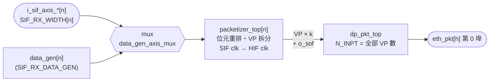
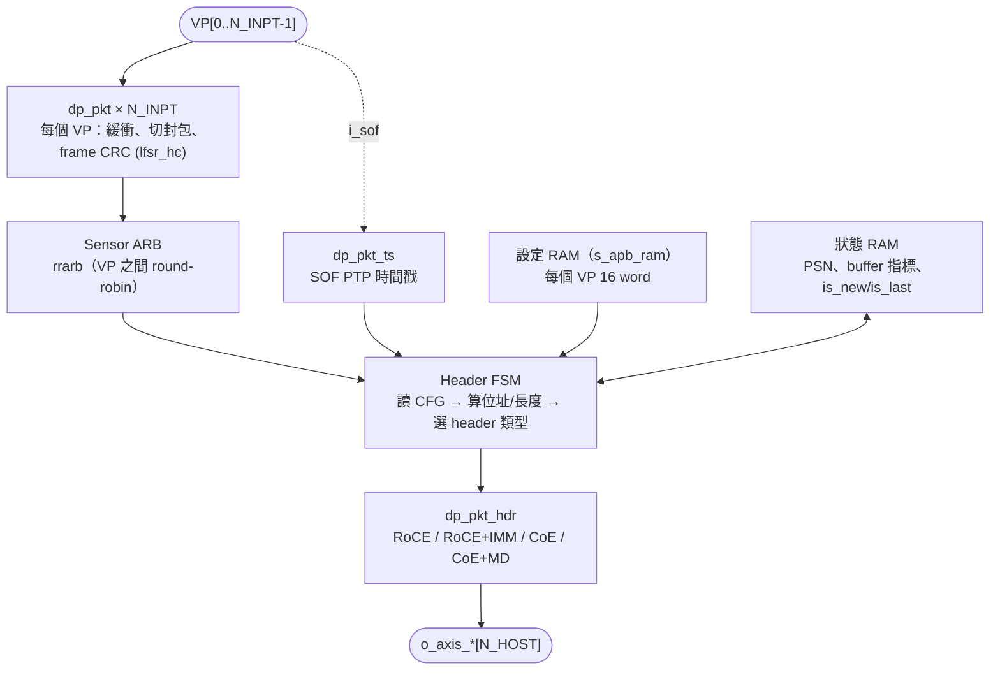

# 04 — RTL：Data Plane（Sensor RX → Host）

這條路徑把感測器資料（例如 MIPI CSI-2 RX 的輸出）打包成 Ethernet 封包送給 host。HSB 支援兩種封包格式：RoCEv2 WRITE（給 ConnectX 等 RDMA 網卡）與 IEEE 1722B CoE（Camera over Ethernet，給 Jetson Thor 等 FuSa CoE 接收端）。



---

## 1. Data Generator 多工

定義 `SIF_RX_DATA_GEN` 時，每個 SIF RX 前面有一個 `data_gen`（模式、長度、速率、PRBS seed 可由暫存器設定）。`data_gen_axis_mux = 1` 時用測試資料取代感測器輸入，同時 `o_sif_axis_tready` 綁 0，感測器端會被背壓。

---

## 2. `packetizer_top`

原始碼：`fpga/nv_hsb_ip/packetizer/packetizer_top.sv`（600 行）、`packetizer.sv`、`packetizer_static.sv`、`virtual_port.sv`

本節只分析結構與參數，沒有逐行讀排序邏輯。

### 2.1 模式（`PACKETIZER_ENABLE`）

| 值 | 模式 | 說明 |
|---|---|---|
| 0 | Bypass | 不重排，只做寬度轉換與 CDC；固定 1 個 VP |
| 1 | Programmable | 用暫存器寫入的程式（`pack_ram_addr` / `pack_ram_data`）重排位元 |
| 2 | Static（fixed-pattern） | 用內建的 pattern catalog。`pack_scratch[5:0]` 選 pattern；`PATTERN_MASK` 可在合成時刪掉用不到的 pattern |

板級用 `SIF_RX_PACKETIZER_EN[]` 指定每個 SIF 的模式，用 `SIF_RX_PCK_PATTERNS` 指定 static pattern mask。

### 2.2 參數

| 參數 | 來源 | 意義 |
|---|---|---|
| `DIN_WIDTH` | `SIF_RX_WIDTH[i]` | 感測器輸入寬度 |
| `DOUT_WIDTH` | `HOST_WIDTH` | 輸出寬度 |
| `VP_COUNT` | `SIF_RX_VP_COUNT[i]` | 拆成幾個 Virtual Port |
| `VP_SIZE` | `SIF_RX_VP_SIZE[i]` | 每個 VP 的寬度 |
| `SORT_RESOLUTION` | `SIF_RX_SORT_RESOLUTION[i]` | 排序粒度 |
| `NUM_CYCLES` | `SIF_RX_NUM_CYCLES[i]` | 一個排序循環的輸入拍數 |

用途：MIPI CSI-2 的 RAW10/RAW12 等格式是位元打包的。packetizer 把它重排成 host 好處理的格式（release notes 提到 RAW10 每行會補到 64 byte 的整數倍）。

### 2.3 輸出

- `o_axis_*[VP]`：每個 VP 一條 `HOST_WIDTH` 的 AXIS，在 HIF 時脈。
- `o_sof[VP]`：frame 開始脈衝（`pulse_sync` 跨時脈），給 `dp_pkt_top` 做 SOF 時間戳。

`HOLOLINK_top` 把所有 SIF 的 VP 依序攤平成一個向量（`calc_bit_position`），總數是 `TOTAL_VP_WIDTH`。

---

## 3. `dp_pkt_top`

原始碼：`fpga/nv_hsb_ip/dp_pkt/dp_pkt_top.sv`（1687 行）、`dp_pkt.sv`、`dp_pkt_hdr.sv`、`dp_pkt_ts.sv`

### 3.1 結構



### 3.2 每個 VP 的設定 RAM（16 word）

設定 RAM 的 word 位置以 host 軟體的定義為準（`src/hololink/core/data_channel.hpp`）。`HOLOLINK_top` 用 `BUFFER_4K_REG = 1` 實例化 `dp_pkt_top`，對應的是下面這組 4K page 格式：

| Offset | 名稱（host 軟體） | 內容 |
|---|---|---|
| 0x00 | `DP_QP` | `[23:0]` dest QP（1722B 時低 6 bit 當 `channel_number`）、**`[24]` `is_1722b`**、`[31:25]` line 門檻（log2） |
| 0x04 | `DP_RKEY` | RoCE rkey |
| 0x08 | `DP_PAGE_LSB` | buffer 起點（page） |
| 0x0C | `DP_PAGE_MSB` | buffer 位址高位 |
| 0x10 | `DP_PAGE_INC` | 每個 buffer 的 page 增量 |
| 0x14 | `DP_MAX_BUFF` | 起始與結束 buffer 指標 |
| 0x18 | `DP_BUFFER_LENGTH` | 收到這麼多 byte 就算 frame 結束 |
| 0x20 | `DP_HOST_MAC_LOW` | 目標 host MAC [31:0] |
| 0x24 | `DP_HOST_MAC_HIGH` | 目標 host MAC [47:32] |
| 0x28 | `DP_HOST_IP` | 目標 host IP |
| 0x2C | `DP_HOST_UDP_PORT` | `[15:0]` 目標 UDP 埠、`[16]` `md_disable` |
| 0x34 | `DP_VLAN` | VLAN（給 `eth_pkt` 的 `tuser`：`[15:0]` TCI、`[16]` 是否插入） |

`DataChannel::configure_coe()`（`data_channel.cpp` 第 297 行起）寫入 `(1 << 24) | (line_threshold_log2 << 25) | channel` 到 `vp_address_ + DP_QP`，切換這個 VP 為 1722B。

> 讀 RTL 時要注意：`dp_pkt_top.sv` 第 466–509 行用 `cfg_ram_addr[3:0] == N` 選擇欄位，但 `cfg_ram_addr = {sif_gnt_idx_r, fsm_cnt[3:0]}` 是**讀取位址**，資料比位址晚幾拍回來，而且 header FSM 不一定照順序讀。所以程式碼裡的 `N` 不等於 word 編號，不能直接拿來當位址表。第 222–238 行的註解與上表一致。

每個 VP 可以獨立選 RoCE 或 1722B。目標 host 的 MAC、IP、UDP 埠也是每個 VP 各自設定。

### 3.3 Header 類型

`hdr_type = {pkt_is_imm, pkt_is_1722b}`：

| `hdr_type` | 格式 | 說明 |
|---|---|---|
| `00` | RoCEv2 | Eth + IPv4 + UDP + BTH + RETH（`ROCE_HDR_WIDTH = 560` bit，70 byte） |
| `01` | CoE | IEEE 1722B header（`COE_HDR_WIDTH = 368` bit，46 byte） |
| `10` | RoCEv2 + WR IMM + metadata | frame 結束時送出 metadata（PSN、frame CRC、SOF 時間戳、frame 編號等） |
| `11` | CoE + metadata | |

1722B 封包不加 RoCE ICRC：`crc_en[n] = !hif_is_1722b[n]`。

### 3.4 IEEE 1722B CoE header（TX，已存在）

**HSB 3.0 的 data plane 已經有 1722B Talker。** Header 在 `dp_pkt_top.sv` 第 1256–1269 行組成，依序如下（共 46 byte，big endian 輸出）：

| Byte | 欄位 | 值 / 來源 |
|---|---|---|
| 0–5 | Destination MAC | `hif_mac_addr`（VP 設定 RAM） |
| 6–11 | Source MAC | 本機 MAC |
| 12–13 | EtherType | `0x22F0`（IEEE 1722） |
| 14 | subtype | `0x82` |
| 15–17 | `sv` + 23 bit | `sv = 1`，其餘 0 |
| 18–25 | stream_id | 常數 `0x0000_0000_AAAA_AAAA` |
| 26 | ACF msg type | `0x0C` |
| 27 | ACF msg length | 0 |
| 28 | `pad[1:0]`、`mtv`、5'b0 | `mtv = 1` |
| 29 | image_sensor_id | `sif_gnt_idx_r`（目前被仲裁選中的 VP index） |
| 30–37 | timestamp | `cur_ptp[63:0]` |
| 38 | sequence_number | `psn[7:0]` |
| 39–40 | `e`、`se`、`fcv`、`version[1:0]`、`exposure[1:0]`、3'b0、`channel_number[5:0]` | 前 7 個欄位為 0；channel = `roce_dest_qp[5:0]` |
| 41 | flags | `[3:0]`：1 = frame 開始（`is_new`），2 = metadata/IMM，0 = 其他；`[7:4]`：1 = line 結束 |
| 42–45 | `2'b00`、`frame_num[1:0]`、`byte_offset[27:0]` | offset = `roce_addr[27:0]` |

host 軟體把這 46 byte 分成四段（`data_channel.cpp`：`46U; // 14 Ethernet + 12 avtpdu + 12 gisf + 8 coe`），對應上表：

| Byte | 段落 |
|---|---|
| 0–13 | Ethernet header |
| 14–25 | AVTPDU common header（subtype、sv、stream_id） |
| 26–37 | GISF（ACF message header、image_sensor_id、timestamp） |
| 38–45 | CoE 專用欄位（sequence、channel、flags、frame_num、byte_offset） |

觀察：

- VLAN 欄位（`0x8100`、PCP 6、DEI 1、VID 0xCCC）在 concat 裡被註解掉。VLAN 改由 `eth_pkt` 的 `axis_insert` 依設定插入。
- `stream_id`、ACF msg type 等都是常數。欄位語意是否完全符合 IEEE 1722b 規格，需要用規格逐欄比對；本文件只記錄 RTL 的值。
- 這個格式可以作為你自己 1722 Listener 的對照組：用 HSB 的 Talker 產生封包，送進你的 Listener 驗證。host 端也有軟體 Talker（`src/hololink/emulation/.../coe_transmitter.cpp`）。

### 3.5 RoCEv2 header

- IPv4：IHL 5、TTL 0x40、DF、protocol UDP、IPv4 checksum 由 7 級加法器算出。
- UDP checksum 固定 0。
- `udp_len = dma_len + 40`（有 IMM 時 + 44）。
- RETH 的 virtual address = buffer 起點 + offset，`roce_buf_fixed_msb` 提供高位元，支援最多 4 個 buffer 輪替（`roce_buf_mask`）。

### 3.6 暫存器（host 模組 3，`dp_pkt`）

| Index | 名稱 | 位址 offset |
|---|---|---|
| 0 | `dp_pkt_scratch` | 0x00 |
| 1 | `dp_pkt_len` | 0x04 |
| 2 | `dp_pkt_dev_udp_port` | 0x08 |
| 3 | `dp_pkt_vip_mask` | 0x0C |
| 4 | `dp_pkt_crc_xor` | 0x10 |
| 5 | `dp_pkt_1722B` | 0x14 |
| 32 | `dp_pkt_stat` | 0x80 |

設定 RAM 掛在 RAM slave 0（`s_apb_m2s_ram[0]`），不在 host 模組區。

---

## 4. `eth_pkt`

原始碼：`fpga/nv_hsb_ip/eth_pkt/eth_pkt.sv`（384 行）

每個 host 埠一份，是封包送進 MAC 前的最後一級。

### 4.1 仲裁

- `axis_arb`，`ARB_TYPE = "PRIORITY"`，index 小的優先。輸入順序見 [01-block-view.md §6](01-block-view.md#6-eth_pkt-輸出埠分配)。
- 仲裁以封包為單位，封包中途不會被搶。
- Data plane（index 0）每送完一個封包，`data0_tlast_r` 會把 index 0 的 `tvalid` 遮一拍。這讓低優先權的控制封包有機會在兩個資料封包之間插入，避免連續的影像資料把控制平面餓死。

### 4.2 MAC 逾時丟棄

```systemverilog
if (!w_arb_axis_tready) begin
  if (tready_cnt == '1) tready_cnt <= '1;
  else                  tready_cnt <= tready_cnt + 1;
end
...
assign arb_axis_tready = drop_pkt ? '1 : w_arb_axis_tready;
```

MAC 的 `tready` 連續 2^16 拍（模擬時 2^12 拍）沒有拉高時，`eth_pkt` 強制 `tready = 1`，把資料丟掉。這避免 link down 時整個 HSB 卡住。

### 4.3 其他輸出

- `o_pkt_inc`：每送出一個封包脈衝一次，給 `bootp` 的封包計數。
- `o_ptp_val`：PTP 封包（index 1）送出時的脈衝，給 `ptp_top` 打 TX 時間戳。
- `o_del_req_val`：Delay_Req 送出的標記（Bridge 模式使用）。

### 4.4 VLAN 插入

沒有定義 `DISABLE_VLAN` 時，`axis_insert` 在 byte 12 插入 4 byte VLAN tag。tag 來自封包的 `tuser`（`USER_WIDTH = 17`）：

```systemverilog
assign vlan_tag[31:16] = 16'h8100;
assign vlan_tag[15:0]  = reg_axis_tuser[15:0];   // TCI
assign ins_vlan        = reg_axis_tuser[16];     // 是否插入
```

所以每個來源用 `tuser` 決定自己的封包要不要帶 VLAN。Data plane 的 `tuser` 來自 VP 設定 RAM 的 `DP_VLAN`（0x34）。
