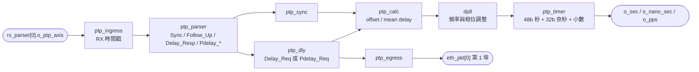

# 05 — RTL：基礎設施模組

本章是結構層級的說明，沒有逐行分析。

---

## 1. `reset_gen`

原始碼：`fpga/nv_hsb_ip/reset_gen/reset_gen.sv`

- 輸入：`i_sys_rst`（板級）、`i_cfg_rst`（= `o_sw_sys_rst` = `hsb_ctrl[3]`，軟體 reset）。
- 每個時脈域各一個 `reset_sync`：APB、HIF、PTP、每個 SIF RX、每個 SIF TX。
- 輸出 `o_*_rst` 同時回給板級（`o_apb_rst`、`o_hif_rst`、`o_ptp_rst`、`o_sif_rx_rst[]`、`o_sif_tx_rst[]`），讓板級 IP 用同一組 reset。

---

## 2. APB 子系統

原始碼：`fpga/nv_hsb_ip/lib_apb/`

| 模組 | 用途 |
|---|---|
| `apb_intc_top` | 4 master → 分層 `apb_switch` → 所有 slave；含 watchdog 逾時 |
| `apb_switch` | 依位址欄位分派到多個 slave |
| `s_apb_reg` | 標準暫存器區塊：`N_CTRL` 個 RW（offset 0 起）、`N_STAT` 個 RO（offset 0x80 起，`stat_ofst = 32`），跨到模組時脈 |
| `s_apb_ram` / `s_apb_ram_dyn` | APB 可讀寫的 RAM（`dp_pkt` 設定 RAM、evt RAM、RoCE QP RAM） |
| `apb_to_axi4l` | 給板級把使用者 APB 轉成 AXI4-Lite |

位址空間見 [01-block-view.md §7](01-block-view.md#7-apb-位址空間)。

`s_apb_reg` 的慣例：每個模組區塊 `0x100` byte（`w_ofst = 8`），控制暫存器從 0x00 開始，狀態暫存器從 0x80 開始。

---

## 3. `ptp_top`（IEEE 1588 / gPTP）

原始碼：`fpga/nv_hsb_ip/ptp/`

### 3.1 結構

### 3.2 Profile

`ptp_ctrl_profile[1:0]`：

| 值 | Profile | 延遲量測 |
|---|---|---|
| 0 | IEEE 1588 E2E | Delay_Req / Delay_Resp |
| 1 | gPTP（IEEE 802.1AS） | Pdelay_Req / Pdelay_Resp / Pdelay_Resp_Follow_Up |
| 2 | IEEE 1588 P2P | 同 gPTP |

其他控制：`ptp_ctrl_domain`、`ptp_ctrl_pcp`、`ptp_ctrl_dly`（延遲不對稱補償）、`ptp_ctrl_avg_fact`、DPLL 設定。

狀態：`ptp_ofm`（offset from master）、`ptp_mean_dly`、`ptp_sync_stat`（是否收到第一個 Sync / Delay 回應）等。

### 3.3 使用方式

- HSB 是 PTP slave，只在 host 埠 0 收送 PTP。
- PTP 時間經 `streaming_cdc` 同步到 HIF（給 `dp_pkt_top` 時間戳、`rx_ls_parser`）與 APB。
- `o_pps` 每秒一個脈衝；`o_ptp_sec`、`o_ptp_nanosec` 給板級（例如同步感測器觸發）。
- 定義 `EXT_PTP` 時不實例化 `ptp_top`，時間從 `i_ptp_sec`、`i_ptp_nanosec` 輸入，PPS 由秒數 bit 0 變化產生。

---

## 4. 事件（`ctrl_bus_evt_int` / `ctrl_bus_evt_fsm`）

- 輸入 `event_vec[31:0]`（見 [01-block-view.md §10](01-block-view.md#10-事件向量)）。
- 暫存器：`ctrl_evt_rising`、`ctrl_evt_falling`（觸發緣遮罩）、`ctrl_evt_clear`、目標 host MAC/IP/UDP 埠、`ctrl_evt_apb_interrupt_en`、`ctrl_evt_apb_timeout`、`ctrl_evt_sw_event`、`ctrl_evt_vlan`。
- 事件發生時：送出中斷 UDP 封包到設定的 host；`ctrl_bus_evt_fsm` 可以經 `m_apb[3]` 執行暫存器序列（序列存在 evt RAM，推斷）。

---

## 5. 周邊

| 模組 | 介面 | 說明 |
|---|---|---|
| `spi_ctrl_fsm` | `SPI_INST` 組 QSPI 腳位 | 多組匯流排共用一個控制器，`o_bus_en` 選擇目前驅動哪一組；未選中的 CS 保持高 |
| `i2c_ctrl_fsm` | `I2C_INST` 組 SCL/SDA | 同上，open-drain 用 `*_en` 輸出；EEPROM 讀取也走這裡 |
| `uart_ctrl_fsm` | 1 組 TX/RX/CTS/RTS | FIFO 256（模擬 64） |
| `glb_ctrl_top` | `GPIO_INST` 個 GPIO | `o_gpio`、`o_gpio_dir`；另有 HSB 版本、日期（`BUILD_REV`）、`hsb_ctrl` |

所有周邊的 busy 訊號進 `event_vec`，host 可以等事件而不必輪詢。

---

## 6. 開機模組

| 模組 | 說明 |
|---|---|
| `sys_init` | 經 `m_apb[1]` 依序寫入 `init_reg[N_INIT_REG]`（每筆 `{addr[31:0], data[31:0]}`）。CPNX100 用它設定 Lattice PCS 與 MAC |
| `eeprom_info` | `sys_init` 完成後經 `m_apb[2]` 驅動 I2C 讀 EEPROM：MAC、IP、board 版本、SN，並檢查 CRC |

---

## 7. Bridge 模式（`BRIDGE_IF_INST`）

定義 `BRIDGE_IF_INST` 時，HSB 變成一個小型 Ethernet switch：SIF 介面當作額外的 Ethernet 埠。

| 模組 | 說明 |
|---|---|
| `axis_buffer`（SIF RX） | 每個 SIF 一個雙時脈緩衝，深度 2 個 MTU |
| `routing_table` | 64 筆 CAM，學習各埠的來源 MAC；查詢目的 MAC 回傳目的埠；辨識 PTP Delay_Req |
| `bridge_pkt_proc` | HIF ↔ SIF 雙向轉送；host 封包等 CAM 回應前對 `rx_parser` 背壓；廣播封包依 `ctrl_reg[0]` 決定哪些埠可轉送；計算 PTP residence time 並修正 correction field（透明時鐘） |

Bridge 模式下，Data Plane（`packetizer`、`dp_pkt_top`）、Sensor TX、PAUSE 全部移除，`ptp_top` 的 TX 也被關掉。

這個模式對 1722 很重要：dest MAC 不是本機的封包（例如 AVTP multicast stream）在 `rx_parser` 會被標成 `is_btx`。只有 Bridge 模式會把這些封包送出去。
