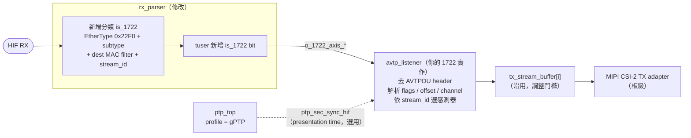

# 06 — 1722 整合筆記：把 HSB 的 RX 路徑改成 1722 Listener（Ethernet → MIPI）

本章根據 02–05 章的分析，整理把 `rx_parser` 改成 IEEE 1722 Listener 時需要修改的地方。這些是建議，還沒有實作或模擬驗證。

## 1. 現況：HSB 對 1722 的支援

| 方向 | 現況 | 位置 |
|---|---|---|
| TX（Talker）：Sensor → Ethernet | **已支援。** 每個 VP 可選 1722B CoE 格式 | `dp_pkt_top`，見 [04 §3.4](04-rtl-dataplane.md#34-ieee-1722b-coe-headertx已存在) |
| RX（Listener）：Ethernet → Sensor | **不支援。** `rx_parser` 只辨識 IPv4/UDP/RoCE、ARP、PTP | `rx_parser`，見 [02 §1.4](02-rtl-host-rx.md#14-分類規則) |
| 時間同步 | 支援 gPTP（802.1AS）slave，`ptp_ctrl_profile = 1` | `ptp_top`，見 [05 §3](05-rtl-infra.md#3-ptp_topieee-1588--gptp) |

1722 封包現在進到 `rx_parser` 會怎樣：

| dest MAC | 結果 |
|---|---|
| 本機 unicast MAC | 所有分類旗標都是 0 → 讀出時不送往任何輸出 → **丟棄** |
| Multicast（AVTP stream 常用 `91:E0:F0:xx:xx:xx`） | `is_btx = 1` → 非 Bridge 模式下 `brx_axis_tready` 綁 1 → **丟棄** |

## 2. 建議的資料流



`sensor_tx_pkt_proc` 保留給 RoCE 流量，1722 流量另走 `avtp_listener`。兩者在 `tx_stream_buffer` 前用 mux（或 `axis_arb`）合併。

## 3. 修改點

### 3.1 `rx_parser`：分類

在 `always_ff`（第 493 行起）的 `hdr_valid` 分支新增比對。`eth_hdr_i.ethertype` 已經處理過 VLAN offset，可以直接用：

```systemverilog
// 建議新增（尚未驗證）
eth_type_1722     <= (eth_hdr_i.ethertype == 16'h22F0);
avtp_subtype      <= hdr_array[is_vlan ? 18 : 14];
mac_1722_match    <= (eth_hdr_i.dest_mac == cfg_1722_mcast_mac) || eth_mac_dest_match;
stream_id_1722    <= /* hdr_array 第 22..29 或 18..25 byte */;
```

```systemverilog
assign is_1722 = eth_type_1722 && mac_1722_match && (avtp_subtype == cfg_1722_subtype);
// is_btx 要排除 is_1722，否則 Bridge 模式會重複轉送
assign is_btx  = !eth_mac_dest_match && !is_arp && !is_1722;
```

注意 `hdr_array` 只攤平前 58 byte（`HDR_BYTES`）。1722B CoE header 是 46 byte，加上 VLAN 是 50 byte，在範圍內。如果你的格式需要更深的欄位，要放大 `HDR_BYTES`。

### 3.2 `rx_parser`：設定暫存器

`inst_dec` 區有空的暫存器可以用：index 4、5（`inst_dec_rsvd_1`、`inst_dec_rsvd_2`）在 RTL 與 host 軟體都沒有被引用。index 6 在 `regmap_pkg` 叫 `static_hif_qp`，目前同樣沒有任何引用，但名稱代表 NVIDIA 可能保留給未來功能，使用前要注意上游更新。建議：

| Index | 用途（建議） |
|---|---|
| 4 | `cfg_1722_mcast_mac[31:0]` |
| 5 | `cfg_1722_mcast_mac[47:32]`、`cfg_1722_subtype[23:16]`、enable bit |
| 6 | 或改為擴充 `inst_dec_nctrl`，加入 stream_id 比對表 |

stream_id 有多筆時（多個感測器），比對表放在 listener 裡（例如用 `misc/cam.sv`），`rx_parser` 只做 EtherType/subtype/MAC 的粗分類，比較不會影響 `rx_parser` 的時序。

### 3.3 `rx_parser`：`tuser` 與輸出

`hdr_din` 目前 102 bit（[02 §1.7](02-rtl-host-rx.md#17-tuser-側帶格式)）。新增 `is_1722` 要同時改：

1. `AXI_HDR_WIDTH`（`85 + USER_WIDTH`）加 1。
2. `hdr_din` 的 concat。
3. `buf_axis_tuser` 的重排（第 733 行）與它的寬度宣告（第 666、709 行：`NUM_LS_INST+USER_WIDTH+2+72`）。
4. `axis_remove` 的 `W_USER`（第 748 行）。
5. 新的輸出埠 `o_1722_axis_*`，仿照 `o_stx_axis_*`：

```systemverilog
assign o_1722_axis_tvalid = buf_rmv_axis_tvalid && r_is_1722;
assign o_1722_axis_tdata  = buf_rmv_axis_tdata;
...
```

VLAN 會在 `axis_remove` 移除（`buf_is_vlan && !buf_is_btx`），所以 listener 看到的封包一定沒有 VLAN。如果 listener 需要 PCP（例如區分 SR class），要從 `buf_rmv_axis_tuser` 的 VLAN TCI 欄位另外帶出來。

### 3.4 去 header 與選感測器（listener 內）

`sensor_tx_pkt_proc` 的兩個寫死的地方不適用 1722：

| 現有行為 | 1722 需要 |
|---|---|
| 去 54 byte（Eth+IP+UDP+BTH） | 去 14 + AVTPDU header 長度（HSB CoE 格式為 46 byte） |
| 去尾端 4 byte ICRC | 1722 沒有 ICRC，不要去尾 |
| `dest_info[56:49] == i+1` 選感測器 | 用 stream_id、`channel_number` 或 `image_sensor_id` 選 |

可以直接沿用 `lib_axis/axis_drop.sv`（參數 `DROP_WIDTH`）。

### 3.5 Frame / line 資訊（MIPI TX 需要）

現有 STX 路徑送給感測器的 `tuser` 固定 0，只有 `tlast` 標出 Ethernet 封包邊界。MIPI CSI-2 TX 需要 frame start/end、line start/end、data type、virtual channel、word count。

HSB 的 1722B CoE header 已經帶了一部分：

| CoE 欄位 | 可對應的 MIPI 資訊 |
|---|---|
| `flags[3:0] == 1` | Frame start |
| `flags[7:4] == 1` | Line end |
| `channel_number` | Virtual channel（或感測器選擇） |
| `byte_offset` | frame 內位置，可用來偵測遺失封包 |
| `sequence_number` | 遺失封包偵測 |

傳遞方式有兩種：

1. **加寬 `tx_stream_buffer` 的 `tuser`**：目前是 1 bit。要改 `axis_buffer_tx` 的 user 寬度，影響 FIFO 面積。
2. **In-band**：listener 在每個封包的 payload 前塞一個 `HOST_WIDTH` 的描述字（flags、DT、VC、長度），MIPI TX adapter 讀出後移除。不必改 `tx_stream_buffer`。

建議先用方法 2，改動範圍最小。

### 3.6 Buffer 與流量控制

| 項目 | 說明 |
|---|---|
| `rx_parser` 不能背壓 MAC | 輸入 FIFO 只有 2–3 個 MTU。listener 的處理速率必須 ≥ 線速，否則在 `rx_parser` 就會丟 |
| `tx_stream_buffer` 預填 | 輸出前先填到 almost full（預設 3/4）。對 MIPI TX 這是好事：line 開始送出後不容易斷。門檻要依 frame/line 大小調整（[03 §3.3](03-rtl-sensor-tx.md#33-almost-full--empty-門檻)） |
| 802.3x PAUSE | TSN/AVB 網路通常不使用 PAUSE，Talker 端多半用 credit-based shaper 控制速率。建議 `pause_ena = 0`，改用足夠大的 `SIF_TX_BUF_SIZE` 吸收抖動 |
| Underflow 監控 | `saw_underflow`、`low_watermark` 可以直接看 Ethernet 供應是否不足 |

### 3.7 時間同步（選用）

- 把 `ptp_ctrl_profile` 設成 1（gPTP），HSB 就能跟 AVB/TSN 網路的 grandmaster 同步。
- `HOLOLINK_top` 已經有 HIF 時脈域的 PTP 時間（`ptp_sec_sync_hif`、`ptp_nano_sec_sync_hif`），listener 可以直接拿來和 AVTP timestamp（presentation time）比較，決定何時把資料放進 `tx_stream_buffer`。
- 注意 PTP 只走 host 埠 0。

## 4. 驗證建議

1. **Loopback**：同一塊 HSB 的 data plane 設成 1722B CoE（`configure_coe()`），dest MAC 設成自己，送進改好的 listener。Talker 與 Listener 格式一致，最容易起步。
2. **模擬**：`fpga/nv_hsb_ip_simple_tb/` 有 testbench（`make coe` 測 CoE data plane）。可以擴充 `hololink_host2sen_stim.svh`，產生 1722 封包打進 HIF RX。
3. **Host 端 Talker**：`src/hololink/emulation/` 有 `COETransmitter`（軟體 1722B Talker），可以在 Linux 主機上產生測試封包。
4. **你自己的 1722 實作**：和 HSB 的 CoE header 逐欄比對（[04 §3.4](04-rtl-dataplane.md#34-ieee-1722b-coe-headertx已存在)），確認 subtype、ACF msg type、stream_id 等欄位一致，或決定要以哪一邊為準。

## 5. 待確認事項

- HSB CoE header 的欄位是否完全符合你要遵循的 IEEE 1722 / 1722b 版本（HSB 的 stream_id 是常數 `0xAAAAAAAA`）。
- `roce_ack` 在 RC WRITE 時是否處理 RETH；如果 1722 與 RoCE 共存，會不會互相影響背壓。
- 目標板子的 MIPI CSI-2 TX IP 介面（是否需要 byte-level 的 line 時序、blanking）。
