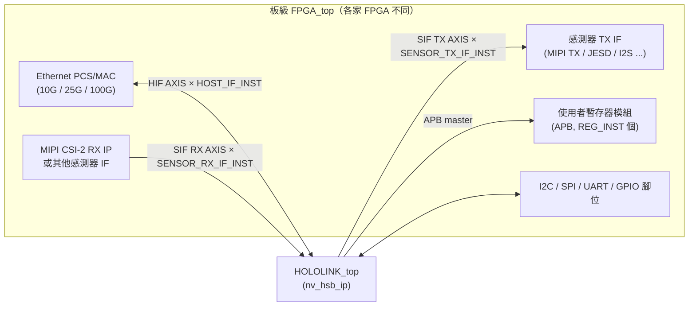
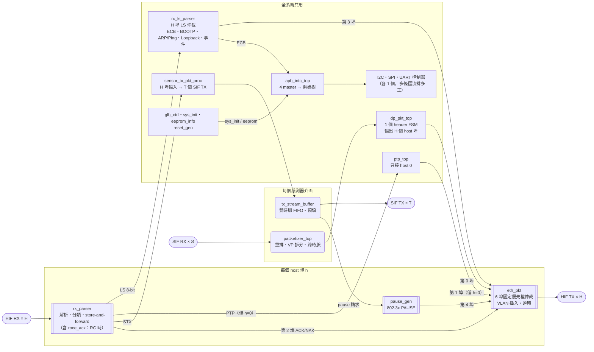
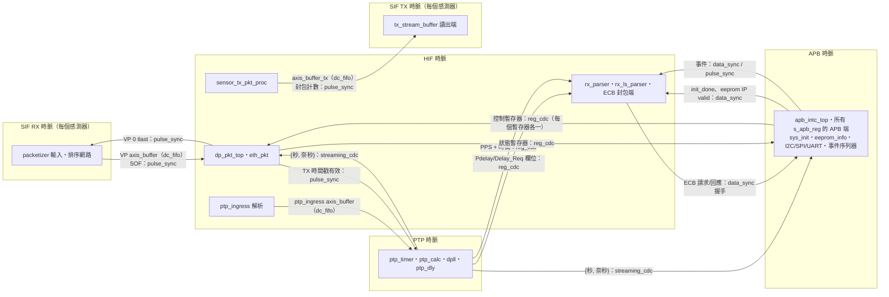
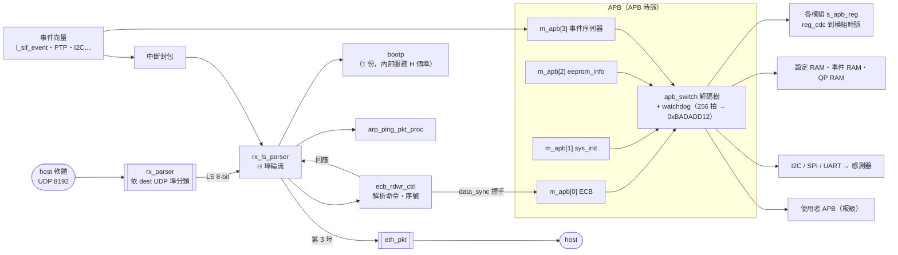
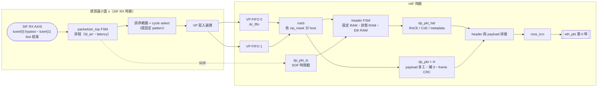
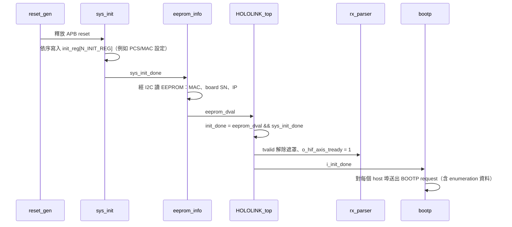

# 架構總覽

原始碼：[`top/HOLOLINK_top.sv`](https://github.com/nvidia-holoscan/holoscan-sensor-bridge/blob/41cecaa81ab906a55e7ec22e5e6989f7e602a4c8/fpga/nv_hsb_ip/top/HOLOLINK_top.sv)（1933 行，逐行分析）

## 1. HSB IP 在 FPGA 裡的位置

`HOLOLINK_top` 不含 MAC、PCS 或感測器 PHY。板級 top 實例化這些 IP，再用 AXIS 接到 `HOLOLINK_top`。



host 軟體裡已經有 SIF TX 的使用者：JESD（`src/hololink/core/jesd.cpp` 寫 `0x0120_0000` 啟用 TX）與 I2S。

## 2. 頂層方塊圖

非 Bridge 模式（沒有定義 `BRIDGE_IF_INST`）。圖中方塊依實例化次數分三種外框：

- **雙框** `[[ ]]`：每個 host 埠一份（`HOST_IF_INST` 份）。
- **圓角** `( )`：每個感測器介面一份（`SENSOR_RX_IF_INST` / `SENSOR_TX_IF_INST` 份）。
- **方框** `[ ]`：全系統一份。



實例化次數（[`HOLOLINK_top.sv`](https://github.com/nvidia-holoscan/holoscan-sensor-bridge/blob/41cecaa81ab906a55e7ec22e5e6989f7e602a4c8/fpga/nv_hsb_ip/top/HOLOLINK_top.sv)）：

| 模組 | 份數 | 迴圈 / 位置 |
|---|---|---|
| `rx_parser`（含 `roce_ack`） | H | `gen_rx_parser`（[L379](https://github.com/nvidia-holoscan/holoscan-sensor-bridge/blob/41cecaa81ab906a55e7ec22e5e6989f7e602a4c8/fpga/nv_hsb_ip/top/HOLOLINK_top.sv#L379)） |
| `eth_pkt` | H | `gen_eth_pkt`（[L922](https://github.com/nvidia-holoscan/holoscan-sensor-bridge/blob/41cecaa81ab906a55e7ec22e5e6989f7e602a4c8/fpga/nv_hsb_ip/top/HOLOLINK_top.sv#L922)） |
| `pause_gen` | H | `gen_pause`（[L1739](https://github.com/nvidia-holoscan/holoscan-sensor-bridge/blob/41cecaa81ab906a55e7ec22e5e6989f7e602a4c8/fpga/nv_hsb_ip/top/HOLOLINK_top.sv#L1739)） |
| `packetizer_top`、`data_gen` | S | `gen_pack_inst`、`gen_data_gen_inst` |
| `tx_stream_buffer` | T | `gen_stx_buf`（[L1680](https://github.com/nvidia-holoscan/holoscan-sensor-bridge/blob/41cecaa81ab906a55e7ec22e5e6989f7e602a4c8/fpga/nv_hsb_ip/top/HOLOLINK_top.sv#L1680)） |
| `rx_ls_parser`（含 `ecb_rdwr_ctrl`、`bootp`、`arp_ping_pkt_proc`、`ctrl_bus_evt_int` 各 1 份）、`ptp_top`、`dp_pkt_top`、`sensor_tx_pkt_proc`、`apb_intc_top`、`glb_ctrl_top`、`sys_init`、`eeprom_info`、`reset_gen`、I2C / SPI / UART 控制器 | 1 | |

共用資源對效能的影響：

- `dp_pkt_top` 只有一個 header FSM，所有 host 埠的 Data Plane 封包都要排隊經過它。逐拍模型顯示兩個 host 各一個 VP 時仍可同時達到單一 host 的速率（[performance §3](../performance.md#3-hsb-內部的封包間隔逐拍模型)）。
- `rx_ls_parser` 把所有 host 埠的控制封包合成一條 8-bit 路徑；它的輸出是一條共用的串流，只有 `tvalid` 依 host 分開（[L922–L960](https://github.com/nvidia-holoscan/holoscan-sensor-bridge/blob/41cecaa81ab906a55e7ec22e5e6989f7e602a4c8/fpga/nv_hsb_ip/top/HOLOLINK_top.sv#L922-L960) 中 `lso_axis_tdata` 沒有 index）。
- PTP 只在 host 0 收發：其他 host 埠的 PTP 輸出固定為 0（[L733–L740](https://github.com/nvidia-holoscan/holoscan-sensor-bridge/blob/41cecaa81ab906a55e7ec22e5e6989f7e602a4c8/fpga/nv_hsb_ip/top/HOLOLINK_top.sv#L733-L740)），`eth_pkt` 第 1 埠的 `tvalid` 也只在 host 0 接通（`ptp_tx_axis_tvalid_gated`，[L680–L687](https://github.com/nvidia-holoscan/holoscan-sensor-bridge/blob/41cecaa81ab906a55e7ec22e5e6989f7e602a4c8/fpga/nv_hsb_ip/top/HOLOLINK_top.sv#L680-L687)）。

## 3. 時脈域

| 時脈 | 用途 | CPNX100（其他板級見 [boards](../boards.md)） |
|---|---|---|
| `i_hif_clk` | Host 資料路徑：`rx_parser`、`eth_pkt`、`dp_pkt_top`、`sensor_tx_pkt_proc`、`tx_stream_buffer` 寫入端 | 156.25 MHz（10G，64-bit） |
| `i_apb_clk` | 暫存器、`sys_init`、`eeprom_info`、I2C/SPI/UART | 19.53125 MHz |
| `i_ptp_clk` | PTP 計時器 | 100.446545 MHz |
| `i_sif_rx_clk[n]` | 每個 SIF RX 一個 | 由感測器 IP 提供 |
| `i_sif_tx_clk[n]` | 每個 SIF TX 一個；`tx_stream_buffer` 讀出端 | 由感測器 IP 提供 |

### 跨時脈地圖



| 位置 | 方向 | 同步方式 | 原始碼 |
|---|---|---|---|
| `virtual_port` FIFO | SIF RX → HIF | `axis_buffer`（`DUAL_CLOCK = 1`，Gray code `dc_fifo`） | [`virtual_port.sv#L215`](https://github.com/nvidia-holoscan/holoscan-sensor-bridge/blob/41cecaa81ab906a55e7ec22e5e6989f7e602a4c8/fpga/nv_hsb_ip/packetizer/virtual_port.sv#L215) |
| `packetizer_top` SOF / VP 0 結尾 | SIF RX ↔ HIF | `pulse_sync` | [`packetizer_top.sv#L224–L240`](https://github.com/nvidia-holoscan/holoscan-sensor-bridge/blob/41cecaa81ab906a55e7ec22e5e6989f7e602a4c8/fpga/nv_hsb_ip/packetizer/packetizer_top.sv#L224-L240) |
| packetizer RAM 寫入脈衝 | APB → SIF RX | `data_sync`（取下降緣） | [`packetizer_top.sv#L155`](https://github.com/nvidia-holoscan/holoscan-sensor-bridge/blob/41cecaa81ab906a55e7ec22e5e6989f7e602a4c8/fpga/nv_hsb_ip/packetizer/packetizer_top.sv#L155) |
| `tx_stream_buffer` / `axis_buffer_tx` | HIF → SIF TX | `dc_fifo` + 封包計數 `pulse_sync` | [`tx_stream_buffer.sv#L155`](https://github.com/nvidia-holoscan/holoscan-sensor-bridge/blob/41cecaa81ab906a55e7ec22e5e6989f7e602a4c8/fpga/nv_hsb_ip/sensor_tx/tx_stream_buffer.sv#L155)、[`axis_buffer_tx.sv#L280`](https://github.com/nvidia-holoscan/holoscan-sensor-bridge/blob/41cecaa81ab906a55e7ec22e5e6989f7e602a4c8/fpga/nv_hsb_ip/sensor_tx/axis_buffer_tx.sv#L280) |
| `ptp_ingress` | HIF → PTP | `axis_buffer`（`DUAL_CLOCK = 1`） | [`ptp_ingress.sv#L116`](https://github.com/nvidia-holoscan/holoscan-sensor-bridge/blob/41cecaa81ab906a55e7ec22e5e6989f7e602a4c8/fpga/nv_hsb_ip/ptp/ptp_ingress.sv#L116) |
| PTP 送出請求欄位 | PTP → HIF | `reg_cdc`（一次 300 多 bit） | [`ptp_dly.sv#L165`](https://github.com/nvidia-holoscan/holoscan-sensor-bridge/blob/41cecaa81ab906a55e7ec22e5e6989f7e602a4c8/fpga/nv_hsb_ip/ptp/ptp_dly.sv#L165) |
| TX 時間戳有效 | HIF → PTP | `pulse_sync` | [`ptp_top.sv#L277`](https://github.com/nvidia-holoscan/holoscan-sensor-bridge/blob/41cecaa81ab906a55e7ec22e5e6989f7e602a4c8/fpga/nv_hsb_ip/ptp/ptp_top.sv#L277) |
| PTP 時間 | PTP → HIF、PTP → APB | `streaming_cdc`（80 bit） | [`HOLOLINK_top.sv#L1008–L1034`](https://github.com/nvidia-holoscan/holoscan-sensor-bridge/blob/41cecaa81ab906a55e7ec22e5e6989f7e602a4c8/fpga/nv_hsb_ip/top/HOLOLINK_top.sv#L1008-L1034) |
| BOOTP 用的 PPS 與時間 | PTP → HIF | `reg_cdc`（80 bit，PPS 觸發） | [`bootp.sv#L147`](https://github.com/nvidia-holoscan/holoscan-sensor-bridge/blob/41cecaa81ab906a55e7ec22e5e6989f7e602a4c8/fpga/nv_hsb_ip/bootp/bootp.sv#L147) |
| ECB → APB | HIF ↔ APB | 請求 / 回應各一組 `data_sync` 握手 | [`ecb_rdwr_ctrl.sv#L651–L692`](https://github.com/nvidia-holoscan/holoscan-sensor-bridge/blob/41cecaa81ab906a55e7ec22e5e6989f7e602a4c8/fpga/nv_hsb_ip/ecb/ecb_rdwr_ctrl.sv#L651-L692) |
| 事件 | 模組 → APB → HIF | `data_sync`、`pulse_sync` | [`ctrl_bus_evt_int.sv`](https://github.com/nvidia-holoscan/holoscan-sensor-bridge/blob/41cecaa81ab906a55e7ec22e5e6989f7e602a4c8/fpga/nv_hsb_ip/ctrl_bus_evt/ctrl_bus_evt_int.sv) |
| 所有模組暫存器 | APB ↔ 模組時脈 | `s_apb_reg`：每個暫存器一個 `reg_cdc`；`SYNC_CLK_HIF_APB` 時省略 | [apb §s_apb_reg](../modules/apb.md#s_apb_reg) |
| `s_apb_ram`（設定 RAM 等） | APB ↔ 模組時脈 | 讀寫請求 `data_sync` 握手 | [`s_apb_ram.sv`](https://github.com/nvidia-holoscan/holoscan-sensor-bridge/blob/41cecaa81ab906a55e7ec22e5e6989f7e602a4c8/fpga/nv_hsb_ip/lib_apb/s_apb_ram.sv) |
| `init_done`、EEPROM IP 有效 | APB → HIF | `data_sync`（只同步 valid，資料本身視為靜態） | [`HOLOLINK_top.sv#L583`](https://github.com/nvidia-holoscan/holoscan-sensor-bridge/blob/41cecaa81ab906a55e7ec22e5e6989f7e602a4c8/fpga/nv_hsb_ip/top/HOLOLINK_top.sv#L583)、[`#L886`](https://github.com/nvidia-holoscan/holoscan-sensor-bridge/blob/41cecaa81ab906a55e7ec22e5e6989f7e602a4c8/fpga/nv_hsb_ip/top/HOLOLINK_top.sv#L886) |
| `hsb_stat` | → HIF | 8 bit `data_sync` | [`bootp.sv#L363`](https://github.com/nvidia-holoscan/holoscan-sensor-bridge/blob/41cecaa81ab906a55e7ec22e5e6989f7e602a4c8/fpga/nv_hsb_ip/bootp/bootp.sv#L363) |

各同步元件的內部與正確使用條件見 [lib §跨時脈元件](../modules/lib.md#cdc-元件)。

## 4. 編譯參數（`HOLOLINK_def.svh`）

| Define / 參數 | 意義 | CPNX100（其他板級見 [boards](../boards.md)） |
|---|---|---|
| `HOST_IF_INST` | Host（Ethernet）埠數 | 2 |
| `HOST_WIDTH` | HIF AXIS 寬度 | 64 |
| `HOST_MTU` | 最大封包長度 | 4096 |
| `SENSOR_RX_IF_INST` | SIF RX 數 | 3 |
| `SIF_RX_WIDTH[]` / `SIF_RX_PACKETIZER_EN[]` / `SIF_RX_VP_COUNT[]` | 每個 SIF RX 的寬度 / packetizer 模式 / VP 數 | {32,64,64} / {0,1,1} / {2,2,2} |
| `SENSOR_TX_IF_INST` | SIF TX 數 | 1 |
| `SIF_TX_WIDTH[]` / `SIF_TX_BUF_SIZE[]` | 每個 SIF TX 的寬度 / FIFO 深度 | {32} / 4096 |
| `DATAPATH_WIDTH` | SIF 埠實體寬度（RX/TX 最大值） | 64 |
| `I2C_INST` / `SPI_INST` / `UART_INST` / `GPIO_INST` | 周邊數量 | 4 / 2 / 1 / 31 |
| `REG_INST` | 使用者 APB slave 數 | 8 |
| `N_INIT_REG` | 開機自動寫入的暫存器數 | 22 |
| `ENUM_EEPROM` | MAC/SN/IP 從 EEPROM 讀 | 定義 |

改變結構的 define：

| Define | 效果 |
|---|---|
| `BRIDGE_IF_INST` | Bridge 模式：SIF 當 Ethernet 埠，Data Plane / Sensor TX / PAUSE 全部移除 |
| `EXT_PTP` | 不實例化 `ptp_top`，PTP 時間由外部輸入 |
| `DISABLE_VLAN` | 移除 VLAN 解析與插入 |
| `DISABLE_COE` | 合成時移除 1722B CoE header（模擬時一律保留） |
| `SIF_RX_DATA_GEN` | 每個 SIF RX 前加測試資料產生器 |
| `SIF_TX_ROCE_RC_ENABLE` | `rx_parser` 實例化 `roce_ack`，接受 RC SEND/WRITE |
| `SYNC_CLK_HIF_APB` / `SYNC_CLK_HIF_PTP` | 宣告兩個時脈同源，省略同步器 |

## 5. 資料路徑

| 路徑 | 模組鏈 | 文件 |
|---|---|---|
| Host RX → 控制平面 | `rx_parser` → `rx_ls_parser`（ECB/BOOTP/ARP/Ping/Loopback）→ `eth_pkt` 第 3 埠；ECB → APB | [rx_ls_parser](../modules/rx_ls_parser.md)、[apb](../modules/apb.md) |
| Host RX → Sensor TX | `rx_parser` → `sensor_tx_pkt_proc` → `tx_stream_buffer[i]` → `o_sif_axis_*[i]` | [rx_parser](../modules/rx_parser.md)、[sensor_tx_pkt_proc](../modules/sensor_tx_pkt_proc.md)、[tx_stream_buffer](../modules/tx_stream_buffer.md) |
| Sensor RX → Host | `packetizer_top[n]` → `dp_pkt_top` → `eth_pkt` 第 0 埠 | [packetizer](../modules/packetizer.md)、[dp_pkt_top](../modules/dp_pkt_top.md) |
| PTP | `rx_parser` → `ptp_top` → `eth_pkt` 第 1 埠（只有 host 埠 0） | [ptp](../modules/ptp.md) |
| 事件 → Host | `i_sif_event` 等 → `ctrl_bus_evt_int` → 中斷封包 / 暫存器序列 | [event](../modules/event.md) |
| Bridge（`BRIDGE_IF_INST`） | `rx_parser` ↔ `bridge_pkt_proc` ↔ SIF | [bridge](../modules/bridge.md) |

### 控制平面全貌



| 步驟 | 模組 | 文件 |
|---|---|---|
| ECB 封包分類 | `rx_parser`：IPv4 / UDP、dest 埠 = `ecb_udp_port`（預設 8192） | [rx_parser](../modules/rx_parser.md) |
| LS 仲裁與解析 | `rx_ls_parser`、`ecb_rdwr_ctrl` | [rx_ls_parser](../modules/rx_ls_parser.md) |
| APB 存取 | `apb_intc_top`、`apb_switch`、`s_apb_reg` | [apb](../modules/apb.md) |
| 自主存取 | `sys_init`（開機）、`eeprom_info`（開機）、事件序列器（事件觸發） | [boot_and_reset](../modules/boot_and_reset.md)、[event](../modules/event.md) |

### Data Plane 全貌



| 階段 | 主要決策 | 文件 |
|---|---|---|
| 重排 | 每拍是否讀輸入（`ld_arr`）、輸出單位取自哪個歷史拍（cycle select）、寫哪個 VP | [packetizer](../modules/packetizer.md) |
| 跨時脈 | VP FIFO 累積到約一個封包或 frame 結尾才放行 | [packetizer §6](../modules/packetizer.md#6-virtual-portvirtual_portsv) |
| 仲裁 | 有 frame 結尾待送的 VP 優先；同一輪每個 VP 一次 | [dp_pkt_top §2](../modules/dp_pkt_top.md#2-vp--host-對應與仲裁) |
| 封包化 | 位址、長度、PSN、最後封包、metadata | [dp_pkt_top §5–§9](../modules/dp_pkt_top.md#5-header-fsm) |
| 傳出 | ICRC、Data Plane 優先權最高、每個封包後讓出 1 拍 | [roce](../modules/roce.md)、[eth_pkt](../modules/eth_pkt.md) |

## 6. `eth_pkt` 輸入埠分配

每個 host 埠的 `eth_pkt` 有 6 個輸入，固定優先權（index 小的優先）。以 [`HOLOLINK_top.sv#L924–L964`](https://github.com/nvidia-holoscan/holoscan-sensor-bridge/blob/41cecaa81ab906a55e7ec22e5e6989f7e602a4c8/fpga/nv_hsb_ip/top/HOLOLINK_top.sv#L924-L964) 的 concat 為準：

| Index | 來源 | 說明 |
|---|---|---|
| 0 | `dp_axis_*` | Data Plane |
| 1 | `ptp_tx_axis_*` | PTP（只有 host 0） |
| 2 | `ack_axis_*` | RoCE ACK/NAK |
| 3 | `lso_axis_*` | LS 回應 |
| 4 | `pause_axis_*` | 802.3x PAUSE |
| 5 | `btx_axis_*` | Bridge |

> ⚠️ [L897–L902](https://github.com/nvidia-holoscan/holoscan-sensor-bridge/blob/41cecaa81ab906a55e7ec22e5e6989f7e602a4c8/fpga/nv_hsb_ip/top/HOLOLINK_top.sv#L897-L902) 的註解少了 RoCE ACK，順序和 concat 不一致。

## 7. 位址空間

完整的位址表見 [memory-map.md](../registers/memory-map.md)；各暫存器見 [all-registers.md](../registers/all-registers.md)。

| 範圍 | 目標 |
|---|---|
| `0x0000_0000`–`0x0000_3FFF` | Global：`glb_ctrl`、PTP、Event、ECB、三個 APB RAM |
| `0x0100_0000`–`0x011F_FFFF` | SIF RX（packetizer、data_gen） |
| `0x0120_0000`–`0x013F_FFFF` | SIF TX（`tx_stream_buffer`） |
| `0x0200_0000`–`0x02FF_FFFF` | Host 埠（`rx_parser`、`eth_pkt`、`dp_pkt`） |
| `0x0300_0000`–`0x03FF_FFFF` | SPI / I2C / UART |
| `0x0600_0000` | Bridge（`BRIDGE_IF_INST`） |
| `0x1000_0000`–`0xFFFF_FFFF` | 使用者模組（`o_apb_*`） |

APB master 有 4 個：

| Master | 來源 |
|---|---|
| `m_apb[0]` | ECB（host 軟體） |
| `m_apb[1]` | `sys_init` |
| `m_apb[2]` | `eeprom_info` |
| `m_apb[3]` | `ctrl_bus_evt`（事件觸發的暫存器序列） |

## 8. 開機與初始化

詳見 [boot_and_reset](../modules/boot_and_reset.md)。



- `init_done` 之前，`rx_parser` 的 `tvalid` 被 `init_done_hif_clk` 遮掉（[L415](https://github.com/nvidia-holoscan/holoscan-sensor-bridge/blob/41cecaa81ab906a55e7ec22e5e6989f7e602a4c8/fpga/nv_hsb_ip/top/HOLOLINK_top.sv#L415)），`o_hif_axis_tready = init_done_hif_clk`（[L381](https://github.com/nvidia-holoscan/holoscan-sensor-bridge/blob/41cecaa81ab906a55e7ec22e5e6989f7e602a4c8/fpga/nv_hsb_ip/top/HOLOLINK_top.sv#L381)）。
- host 埠 `i` 的 MAC = EEPROM MAC + `i`（[L847](https://github.com/nvidia-holoscan/holoscan-sensor-bridge/blob/41cecaa81ab906a55e7ec22e5e6989f7e602a4c8/fpga/nv_hsb_ip/top/HOLOLINK_top.sv#L847)）。
- IP：EEPROM 有值就用；否則預設 `192.168.0.2`，之後可由 BOOTP reply 改寫。

## 9. Reset 與軟體控制

詳見 [boot_and_reset §glb_ctrl_top](../modules/boot_and_reset.md#glb_ctrl_top)。

- `o_sw_sys_rst = hsb_ctrl[3]`：軟體系統 reset，回接 `reset_gen.i_cfg_rst`（[L801](https://github.com/nvidia-holoscan/holoscan-sensor-bridge/blob/41cecaa81ab906a55e7ec22e5e6989f7e602a4c8/fpga/nv_hsb_ip/top/HOLOLINK_top.sv#L801)）。
- `o_sw_sen_rst = ~hsb_ctrl[63:32]`：32 個感測器 reset 給板級（[L800](https://github.com/nvidia-holoscan/holoscan-sensor-bridge/blob/41cecaa81ab906a55e7ec22e5e6989f7e602a4c8/fpga/nv_hsb_ip/top/HOLOLINK_top.sv#L800)）。

## 10. 事件向量

```
event_vec = { i_sif_event[15:0], 11'h0, uart_irq, 2'b00(內部), spi_busy, i2c_busy }
```

詳見 [event](../modules/event.md)。（[L528](https://github.com/nvidia-holoscan/holoscan-sensor-bridge/blob/41cecaa81ab906a55e7ec22e5e6989f7e602a4c8/fpga/nv_hsb_ip/top/HOLOLINK_top.sv#L528)）板級可以用 `i_sif_event` 把感測器事件送給 host。

## 11. 系統層級文件

- [端到端流程](../flow.md)：從上電到一個 frame 送達 host。
- [效能分析](../performance.md)：頻寬、延遲、緩衝餘裕。
- [完整暫存器索引](../registers/all-registers.md)。
