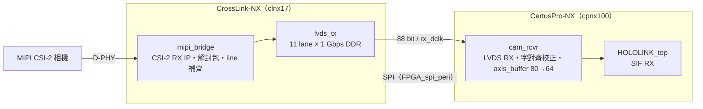

# 板級整合

`fpga/` 下有 6 個板級設計，示範如何把 `HOLOLINK_top` 接到不同 FPGA 的 MAC、PHY 與感測器介面。本章比較它們的設定與結構。分析深度：`HOLOLINK_def.svh` 逐行；CPNX100 / CLNX17 的感測器接收路徑讀主要邏輯；其他板級 top 只讀實例清單與註解。

## 設定比較

| | Lattice CPNX100 | Lattice CLNX17 | Microchip MPF200 | NV MIPI 參考 | PYNQ RFSoC | Terasic S10 |
|---|---|---|---|---|---|---|
| 目錄 | `lattice/cpnx100-eth-sensor-bridge/cpnx100` | `…/clnx17` | `microchip/mfp200-eth-sensor-bridge` | `nv_mipi_ref_design/mipi_cpnx_ref_design` | `pynq/rfsoc-pynq` | `terasic/s10_sensor_bridge` |
| FPGA | Lattice CertusPro-NX | Lattice CrossLink-NX | Microchip PolarFire | Lattice CertusPro-NX | AMD RFSoC | Intel Stratix 10 |
| 是否含 `HOLOLINK_top` | ✓ | ✗（CPNX100 的 MIPI 橋接副晶片） | ✓ | ✓ | ✓ | ✓ |
| Ethernet | 10G × 2 | | 10G × 2 | 10G × 1 | 100G × 1 | 100G × 2 |
| `HIF_CLK_FREQ` | 156.25 MHz | | 156.25 MHz | 156.25 MHz | 322.27 MHz | 201.42 MHz |
| `HOST_WIDTH` | 64 | | 64 | 64 | 512 | 512 |
| `HOST_IF_INST` | 2 | | 2 | 1 | 1 | 2 |
| `HOST_MTU` | 4096 | | 1500 | 4096 | 4096 | 4096 |
| `SENSOR_RX_IF_INST` | 3 | | 2 | 2 | 4 | 1 |
| `SIF_RX_WIDTH` | {32, 64, 64} | | 64 | 64 | 512 | 512 |
| packetizer | {0, 1, 1} | | 關 | 開 | 關 | 開 |
| `SENSOR_TX_IF_INST` | 1（32-bit） | | | | 4 | 1 |
| `SIF_RX_DATA_GEN` | | | | | ✓ | |
| `DISABLE_COE` | | | | | | ✓ |
| `ENUM_EEPROM` | ✓ | | ✓ | ✓ | | ✓ |
| `APB_CLK_FREQ` | 19.53 MHz | | 19.53 MHz | 19.53 MHz | 50 MHz | 100 MHz |
| `PTP_CLK_FREQ` | 100.45 MHz | | 104.16 MHz | 100.45 MHz | 100 MHz | 100.71 MHz |

## 各板級的周邊

| 板級 | 主要實例 |
|---|---|
| CPNX100 | `eth_10gb_top`、`cam_rcvr`（相機接收）、`vsync_gen`、`delayed_io`、`i2s_top`、`clk_n_rst`、`apb_switch`（使用者 APB 分派） |
| CLNX17 | `mipi_bridge`（MIPI CSI-2 接收後轉 LVDS 給 CPNX100）、`FPGA_spi_peri_ctrl_fsm`（從 CPNX100 經 SPI 控制） |
| MPF200 | `MAC_Hololink`（`MAC_BaseR` × 2 + `HoloLink_SD` 包住 `HOLOLINK_top`）、`IMX477_IF_TOP` × 2 |
| NV MIPI 參考 | `eth_10gb_top`、`mipi_cam_rcvr`、`vsync_gen` |
| PYNQ RFSoC | `eth_100gb_top`、`sensor_if_path`（含 `ram_player`、`s_apb_ila`）、`streaming_cdc` |
| Terasic S10 | `eth_top`（100G）、`jesd_top`（JESD204 資料轉換器介面，用 SIF TX / RX）、`mailbox_top`、`general_purpose_regs` |

## 感測器接收路徑

板級負責把感測器介面轉成 HSB 的 SIF RX AXIS。各板級的做法：

### Lattice CPNX100 + CLNX17（雙晶片）

| 項目 | 行為 | 原始碼 |
|---|---|---|
| CSI-2 解析（CLNX17） | Frame Start（DT 0x00）開始、Frame End（DT 0x01）產生 `tlast`；每條 line 補到 8 byte 的倍數；`tuser[0]` = embedded data（DT 0x12）、`tuser[1]` = line 結束、`tuser[3:2]` = virtual channel | [`mipi_bridge.v#L270–L345`](https://github.com/nvidia-holoscan/holoscan-sensor-bridge/blob/41cecaa81ab906a55e7ec22e5e6989f7e602a4c8/fpga/lattice/cpnx100-eth-sensor-bridge/clnx17/rtl/mipi_bridge/mipi_bridge.v#L270-L345) |
| 晶片間格式 | 每個 `rx_dclk` 88 bit：`{tuser[4:0], metadata[2:0], data[79:0]}`。metadata：0 = 無效、1 = 有效（10 byte）、2–7 = 最後一拍且有效 byte 數 10 / 8 / 6 / 4 / 2 / 0 | [`mipi_bridge.v#L470–L486`](https://github.com/nvidia-holoscan/holoscan-sensor-bridge/blob/41cecaa81ab906a55e7ec22e5e6989f7e602a4c8/fpga/lattice/cpnx100-eth-sensor-bridge/clnx17/rtl/mipi_bridge/mipi_bridge.v#L470-L486) |
| 字對齊校正（CPNX100） | CLNX17 在 LVDS 就緒前持續送 `0x005A55FEDCBA9876543210`；`cam_rcvr` 比對失敗就 slip 一個位元，連續 8 拍相符時 `cal_done`；32 次失敗後重設 LVDS | [`cam_rcvr.sv#L120–L183`](https://github.com/nvidia-holoscan/holoscan-sensor-bridge/blob/41cecaa81ab906a55e7ec22e5e6989f7e602a4c8/fpga/lattice/cpnx100-eth-sensor-bridge/cpnx100/rtl/cam_rcvr/cam_rcvr.sv#L120-L183) |
| 跨時脈 | `axis_buffer`（80 → 64 bit、深度 512、`NO_BACKPRESSURE = 1`）；HSB 停止接收時資料會遺失，不會反壓到相機 | [`cam_rcvr.sv#L207–L268`](https://github.com/nvidia-holoscan/holoscan-sensor-bridge/blob/41cecaa81ab906a55e7ec22e5e6989f7e602a4c8/fpga/lattice/cpnx100-eth-sensor-bridge/cpnx100/rtl/cam_rcvr/cam_rcvr.sv#L207-L268) |
| 送進 HSB 的 `tuser` | 只保留 `[1:0]`（`DATAUSER_WIDTH = 2`），virtual channel 被丟掉 | 同上 |
| 暫存器 | 只有 offset 0 = `cal_done` | [`cam_rcvr.sv#L272–L313`](https://github.com/nvidia-holoscan/holoscan-sensor-bridge/blob/41cecaa81ab906a55e7ec22e5e6989f7e602a4c8/fpga/lattice/cpnx100-eth-sensor-bridge/cpnx100/rtl/cam_rcvr/cam_rcvr.sv#L272-L313) |

`tuser` 與 HSB 的對應：`tuser[0]`（embedded data）在 packetizer 中就是「這個 beat 不重排」，所以感測器的 embedded line 會原樣通過，只有像素資料被 RAW10 / RAW12 重排；`tuser[1]`（line 結束）驅動 packetizer 的 line 補齊（見 [packetizer §2](modules/packetizer.md#2-排程-fsm)）。

### NV MIPI 參考設計（單晶片）

`mipi_cam_rcvr` 在 CertusPro-NX 內直接用 MIPI D-PHY RX IP（4 lane）接相機，CSI-2 解析邏輯與 `mipi_bridge` 相同（DT 0x12 為 embedded、line 補到 8 byte），之後經 `axis_packer` 與 `axis_reg` 送進 SIF RX；`o_axis_tidx` 輸出 virtual channel 編號（[`mipi_cam_rcvr.sv`](https://github.com/nvidia-holoscan/holoscan-sensor-bridge/blob/41cecaa81ab906a55e7ec22e5e6989f7e602a4c8/fpga/nv_mipi_ref_design/mipi_cpnx_ref_design/rtl/mipi_cam_rcvr/mipi_cam_rcvr.sv)）。

### 其他板級

| 板級 | SIF RX 來源 | SIF TX 去處 |
|---|---|---|
| Microchip MPF200 | `IMX477_IF_TOP` × 2：`CAM_IOD_TIP_TOP`（D-PHY I/O）+ `mipicsi2rxdecoderPF_C0`（Microchip CSI-2 IP）+ `HSB_AXIS` 轉接 | 無 |
| PYNQ RFSoC | `sensor_if_path` 中的 `ram_player`：從 RAM 重播資料；另有 `SIF_RX_DATA_GEN` 測試產生器 | `s_apb_ila`：擷取到 RAM 供 APB 讀回（測試用迴路） |
| Terasic S10 | `jesd_top`：JESD204 資料轉換器 | `jesd_top`（host 軟體 `jesd.cpp` 設定 SIF TX `0x0120_0000`） |

## 共通整合模式

1. **時脈**：板級提供 `i_hif_clk`（MAC 使用者時脈）、`i_apb_clk`、`i_ptp_clk`、各 SIF 時脈；`HOLOLINK_top` 回傳同步後的 reset。
2. **MAC 介面**：AXIS。`HOLOLINK_top` 的 HIF RX 沒有背壓能力（`o_hif_axis_tready` 只反映 `init_done`），MAC 端不能依賴 `tready`。HIF RX 的 `tuser[0]` 必須是 FCS 錯誤旗標。
3. **使用者暫存器**：`o_apb_*`（`REG_INST` 個 `psel`），板級再用 `apb_switch` 或 `apb_to_axi4l` 分派到 PCS / MAC / 感測器 IP。
4. **開機設定**：用 `init_reg` 在開機時設定 PCS / MAC（CPNX100 的 22 筆即為此用途）。
5. **感測器事件**：`i_sif_event[15:0]` 接 frame start / end、GPIO 等，供 host 等待事件。

## 建置

| 板級 | 工具 | 腳本 |
|---|---|---|
| Lattice | Radiant | `build/build.sh`、`build.tcl`；CPNX100 板子需要 cpnx100 與 clnx17 兩個 bitfile |
| PYNQ | Vivado | `build/build.sh`（`nv_hsb_ip` 須放在 `pynq` 的同層） |
| Microchip、Terasic | Libero、Quartus | 本 repo 只有 RTL 與部分設定 |
