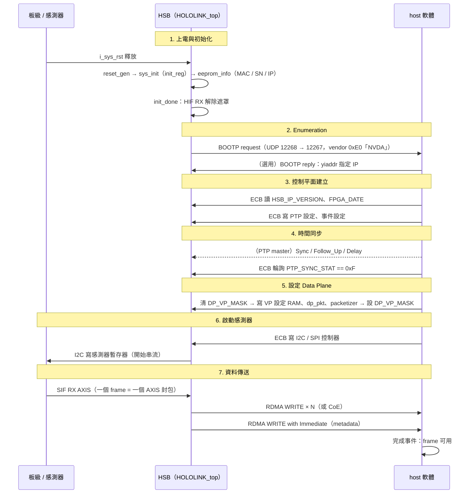
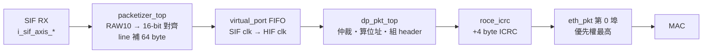

# 端到端流程

本章把模組文件串起來，從上電一路走到 host 收到一個完整的 frame。每一步列出 host 軟體做什麼（`src/hololink/core/`）、HSB 裡哪個模組回應。

- host 端的函式名稱與寫入值取自 `hololink.cpp`、`data_channel.cpp`、`packetizer_program.cpp`。
- RTL 行為的細節見各模組文件。
- 數值範例用 CPNX100 板級、64-bit HIF、MTU 1500、1920 × 1080 RAW10 感測器。

## 總覽

## 1. 上電與初始化

| 順序 | 模組 | 動作 | 文件 |
|---|---|---|---|
| 1 | `reset_gen` | 板級 reset 釋放後，依序釋放 APB、HIF、PTP、SIF 時脈域的 reset | [boot_and_reset](modules/boot_and_reset.md#reset_gen) |
| 2 | `sys_init` | 經 `m_apb[1]` 依序寫入 `init_reg[N_INIT_REG]`，通常是板級 PCS / MAC 設定（CPNX100 有 22 筆） | [boot_and_reset](modules/boot_and_reset.md#sys_init) |
| 3 | `eeprom_info` | 經 I2C（位址 0x50）讀 EEPROM：MAC、board SN、IP。IP 無效（byte 64 ≠ `0x17`）時用預設 `192.168.0.2 + 埠號`；EEPROM 不存在時 MAC 會被讀成殘留值而不是 `CA:FE:C0:FF:EE:00`（見 [boot_and_reset 注意事項](modules/boot_and_reset.md#注意事項)） | [boot_and_reset](modules/boot_and_reset.md#eeprom_info) |
| 4 | `HOLOLINK_top` | `init_done = eeprom_dval && sys_init_done`；之前 HIF RX 的 `tvalid` 被遮掉 | [overview §8](architecture/overview.md#8-開機與初始化) |

host 埠 `i` 的 MAC = EEPROM MAC + `i`。

## 2. Enumeration

| 步驟 | HSB | host |
|---|---|---|
| 送出 | `bootp`：`init_done` 後每個 host 埠送一次 BOOTP request，之後每個 PPS 重送。vendor 欄位（tag 0xE0、「NVDA」）帶 board 版本、SN、HSB 版本等 enumeration 資料，以及 `hsb_stat`（`[0]` = DPLL 啟用後已收到 Sync） | `Enumerator` 在 UDP 12267 收聽，解析成 enumeration metadata |
| 指定 IP | 收到 BOOTP reply 時把 `yiaddr` 設成這個 host 埠的 IP | `set-ip` 等工具送 reply |
| 位址解析 | `arp_ping_pkt_proc` 回應 ARP、ICMP Echo | reset 後 `seed_arp()` 預先寫入 ARP 快取，減少等待 |

詳見 [rx_ls_parser §bootp](modules/rx_ls_parser.md#bootp)。

## 3. 控制平面建立（`Hololink::start()` / `configure_hsb()`）

1. host 建立 control socket（ECB 用）與 async event socket（接收事件封包）。
2. `get_hsb_ip_version()`：ECB 讀 `HSB_IP_VERSION`（`0x80`，值 `HOLOLINK_REV`）。timeout 30 秒，因為 HSB 可能剛 reset。
3. 若啟用 PTP，依序寫：

   | 位址 | 暫存器 | 值 | RTL 效果 |
   |---|---|---|---|
   | `0x110` | `ptp_ctrl_dpll_cfg1` | 2 | 比例項右移 2 |
   | `0x114` | `ptp_ctrl_dpll_cfg2` | 2 | 積分項右移 2 |
   | `0x118` | `ptp_ctrl_avg_fact` | 3 | delay 平均 8 筆 |
   | `0x10C` | `ptp_ctrl_dly` | `0x33`（51 ns） | 不對稱補償；**RTL reset 值是 `0x38`，host 會覆寫** |
   | `0x104` | `ptp_ctrl` | 3 | DPLL 啟用 → `latch_sync`：下一個 Sync 直接設定時間 |

4. 關閉控制事件中斷（`CTRL_EVT_APB_INTERRUPT_EN = 0`），之後依需要開啟。

每個 ECB 請求都是 request / response，host 端用 mutex 保證同時只有一個請求在途。ECB 的格式與回應碼見 [rx_ls_parser §ECB](modules/rx_ls_parser.md#ecb_rdwr_ctrlecb-協定)。

**Reset**（`Hololink::reset()`）：寫 `0x08 = 0`（感測器 reset）→ 等 100 ms → 寫 `0x08 = 3` → 寫 `0x04 = 0x8`（`hsb_ctrl[3]`，系統軟體 reset，不等回應）。之後重新 enumeration、重做 `configure_hsb()`。

## 4. 時間同步

`Hololink::ptp_synchronize()` 每 100 ms 讀一次 `PTP_SYNC_STAT`（`0x188`），4 個 bit 都為 1 才算同步：

| Bit | 意義 | RTL 條件 |
|---|---|---|
| 0 | 收到 Sync | `first_sync_rx`：3 個 PPS 內有 Sync |
| 1 | 收到 Delay 回應 | `first_dly_rx && !pps_det[2]` |
| 2 | DPLL 啟用後收到 Sync | 首次同步（時間已直接設定）完成 |
| 3 | DPLL 啟用後收到 Delay 回應 | 之後 `ptp_calc` 開始算 mean delay |

流程：首次 Sync 直接把計時器設成 t1 → 之後每個 Sync 算 offset → DPLL 調整頻率。詳見 [ptp §7](modules/ptp.md#7-首次同步與-dpll)。

## 5. 設定 Data Plane（`DataChannel::configure_roce()`）

`hif_address` = `0x0200_0300 + host × 0x1_0000`（`dp_pkt` 暫存器）；`vp_address` = `0x1000 + VP × 0x40`（設定 RAM）；`sif_address` = `0x0100_0000 + SIF × 0x1_0000`（packetizer）。

| 順序 | 寫入 | 值 | RTL 效果 |
|---|---|---|---|
| 1 | `hif + DP_VP_MASK` | `&= ~vp_mask` | 這個 VP 停止參與仲裁（`sif_req = 0`），確保更新期間不送資料 |
| 2 | `hif + DP_PACKET_SIZE` | `PAGES(payload_size)` | `dp_pkt_len`：每個資料封包的 page 數 |
| 3 | `hif + DP_PACKET_UDP_PORT` | `0x3000` | 本機 UDP 來源埠 |
| 4 | `vp + DP_BUFFER_LENGTH` | frame byte 數 | `roce_buf_len`：決定最後封包、metadata 位址 |
| 5 | `vp + DP_HOST_MAC_LOW / HIGH`、`DP_HOST_IP`、`DP_HOST_UDP_PORT` | host NIC 的 MAC / IP / QP 埠 | 下次讀滿 18 個 word 時進 Eth RAM |
| 6 | `vp + DP_VLAN` | 0 | 不插 VLAN |
| 7 | `sif + PACKETIZER_MODE` 等 | 依像素格式（RAW10：`0x11F1FFF7` + RAM 內容） | 設定 packetizer（先寫 `pack_ctrl` 再寫 RAM） |
| 8 | `vp + DP_QP`、`DP_RKEY` | RoCE QP 編號、rkey | BTH dest QP、RETH R_Key |
| 9 | `vp + DP_PAGE_LSB / MSB` | frame buffer 起點的低 / 高 32 bit | `roce_buf_start`（page）、`roce_buf_fixed_msb` |
| 10 | `vp + DP_PAGE_INC` | `PAGES(page_size)` | 每個 buffer 的間距 |
| 11 | `vp + DP_MAX_BUFF` | `pages − 1` | 起始指標 0、結束指標 `pages − 1`：環狀 buffer |
| 12 | `hif + DP_VP_MASK` | `|= vp_mask` | 開始服務這個 VP |

host 端的檢查：`frame_memory` 與 `page_size` 必須 128 byte 對齊；`page_size ≥ round_up(frame_size, 128) + 128`（frame + metadata）；`pages ≤ 4096`；最高位址的 page 編號要放得進 32 bit。

**CoE**（`configure_coe()`）：步驟 1–7 相同（overhead 改成 46 byte），步驟 8 改寫 `DP_QP = (1 << 24) | (log2(pixel_width) << 25) | channel`；沒有 buffer 位址設定（CoE 模式下 RTL 把 buffer 起點、增量、高位強制為 0，`byte_offset` 是 frame 內相對位置）。

**`payload_size`**（`compute_payload_size()`）：`floor((MTU − overhead) / 128) × 128`。RoCE 的 overhead = 74（70 byte header + 4 byte ImmDt），CoE = 46。

## 6. 啟動感測器

感測器驅動（例如 `src/hololink/sensors/`）透過 ECB 操作 I2C 控制器（`0x0300_0200` 起）寫感測器暫存器。I2C 控制器的暫存器見 [peripherals §I2C](modules/peripherals.md#i2c)。感測器開始輸出後，板級的 CSI-2 接收 IP 把資料以 AXIS 送進 `i_sif_axis_*`：一個 frame 是一個 AXIS 封包，`tuser[1]` 標示 line 結束。

## 7. 一個 frame 的傳送

### 數值範例

| 項目 | 值 | 來源 |
|---|---|---|
| 感測器 line | 1920 px RAW10 = 2400 byte | |
| packetizer 輸出 line | ⌈2400 / 120⌉ × 128 = 2560 byte（已是 64 的倍數） | `Csi10ToPacked10::get_output_size()` |
| `frame_size` | 2560 × 1080 = 2,764,800 byte | |
| `payload_size` | ⌊(1500 − 74) / 128⌋ × 128 = 1408 byte = 11 page | `compute_payload_size()` |
| `dp_pkt_len` | 11 | |
| 每個資料封包 | 70 header + 1408 payload + 4 ICRC = 1482 byte（MAC 再加 4 byte FCS） | IPv4 total length = 1408 + 60 = 1468 |
| 封包數 | ⌈2,764,800 / 1408⌉ = 1964 | |
| 最後一個資料封包 | 2,764,800 − 1963 × 1408 = 896 byte = 7 page | `roce_len_left` |
| metadata 位址 | buffer 起點 + 21,600 page（= 2,764,800 byte） | `roce_imm_vaddr` |
| metadata 封包 | 70 + 4 + 128 + 4 = 206 byte | |
| 最小 `page_size` | 2,764,800 + 128 = 2,764,928 byte | host 檢查 |

### 模組依序的動作

| 階段 | 動作 | 文件 |
|---|---|---|
| SOF | frame 第一個 beat 被 packetizer 接收 → `o_sof` → `dp_pkt_ts` 記錄 PTP 時間 | [packetizer §7](modules/packetizer.md#7-sof)、[dp_pkt_top §13](modules/dp_pkt_top.md#13-sof-時間戳dp_pkt_ts) |
| 重排 | 每 16 列排程中 15 列讀一個 64-bit beat，產生 16 個輸出 beat | [packetizer §2](modules/packetizer.md#2-排程-fsm) |
| 跨時脈 | VP FIFO（MTU 1500 時約 2.8 KB）；almost empty 時暫不放行，確保 `dp_pkt` 取資料不斷流 | [packetizer §6](modules/packetizer.md#6-virtual-portvirtual_portsv) |
| 第 1 個封包 | 新 frame：讀滿 18 個設定 word、VA = buffer 起點、PSN 延續、CRC 初值全 1 | [dp_pkt_top §5–§6](modules/dp_pkt_top.md#5-header-fsm) |
| 中間封包 | 只讀 7 個 word；VA += 11 page；沿用 Eth RAM 的 checksum；header 計算與上一個封包的資料傳送重疊 | 同上 |
| 最後封包 | `nxt_pkt_is_last` 在倒數第二個封包時算出；長度 = 剩餘 7 page；之後設 `sif_eof[vp]` | 同上 |
| metadata | `sif_eof` 讓這個 VP 優先；送 RDMA WRITE with Immediate 到 frame 資料後面；ImmDt = `{PSN[19:0], buf_ptr}`；`buf_ptr` 前進、frame 編號 + 1 | [dp_pkt_top §9](modules/dp_pkt_top.md#9-metadata-封包) |
| 傳出 | `eth_pkt` 第 0 埠（Data Plane 優先權最高）；可插 VLAN | [eth_pkt](modules/eth_pkt.md) |

### host 端

RDMA WRITE 由 NIC 直接寫進 GPU 或 host 記憶體，CPU 不參與。WRITE with Immediate 在接收端產生 completion，ImmDt 告訴軟體是哪個 buffer（`buf_ptr`）、到哪個 PSN。軟體讀 buffer 尾端的 128 byte metadata（`parse_frame_metadata()`），取得 frame 編號、CRC、SOF 時間、有效 byte 數與旗標。

## 8. 停止

`DataChannel::unconfigure()`：清 `DP_VP_MASK` → 等 10 ms 讓在途資料送完 → `DP_BUFFER_LENGTH = 0` 等清除設定。

## 注意事項

1. RTL 的 buffer 位址計算是 26 bit page（33 bit byte 位址），`VA[63:33]` 固定取 `DP_PAGE_MSB[31:1]`。所以整個 buffer 環必須落在同一個 8 GB 對齊區間內，跨過 8 GB 邊界時 `VA[32:0]` 會回捲（R + X）：RTL 的 `roce_buf_addr = roce_buf_start + roce_buf_offset` 是 26-bit page 運算（[dp_pkt_top.sv#L1012–L1013](https://github.com/nvidia-holoscan/holoscan-sensor-bridge/blob/41cecaa81ab906a55e7ec22e5e6989f7e602a4c8/fpga/nv_hsb_ip/dp_pkt/dp_pkt_top.sv#L1012-L1013)），`roce_addr[63:33]` 固定取 `roce_buf_fixed_msb[31:1]`（[L1105–L1106](https://github.com/nvidia-holoscan/holoscan-sensor-bridge/blob/41cecaa81ab906a55e7ec22e5e6989f7e602a4c8/fpga/nv_hsb_ip/dp_pkt/dp_pkt_top.sv#L1105-L1106)）；host 的 `configure_roce()` 只檢查 `PAGES(frame_memory + page_size × pages)` 放得進 32 bit（[data_channel.cpp#L272–L275](https://github.com/nvidia-holoscan/holoscan-sensor-bridge/blob/41cecaa81ab906a55e7ec22e5e6989f7e602a4c8/src/hololink/core/data_channel.cpp#L272-L275)），沒有檢查 8 GB 邊界，`frame_msb = frame_memory >> 32` 直接寫入（[#L282–L289](https://github.com/nvidia-holoscan/holoscan-sensor-bridge/blob/41cecaa81ab906a55e7ec22e5e6989f7e602a4c8/src/hololink/core/data_channel.cpp#L282-L289)）。是否真的跨界取決於執行時 buffer 配置到的位址。
2. host 預設 MTU 是 1500（`DEFAULT_MTU`），即使板級 `HOST_MTU = 4096`。要用 jumbo frame 必須在 enumeration metadata 指定 `mtu`。
3. 步驟 5 的設定寫入期間 VP 已從 `vp_mask` 移除，但 VP FIFO 中殘留的資料仍在；若感測器還在送，重新啟用後第一個 frame 可能從中間開始（推斷）。
