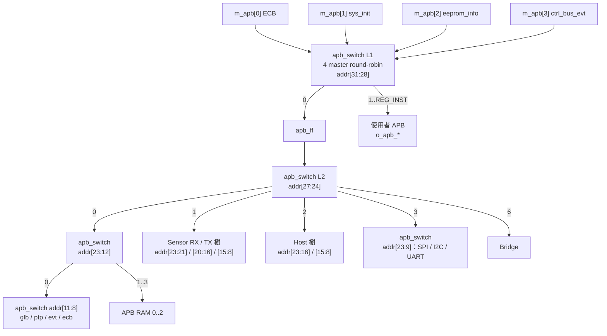

# APB 子系統（`lib_apb`）

## 概要

HSB 內部所有暫存器都掛在 32-bit APB 匯流排上。4 個 master（ECB、`sys_init`、`eeprom_info`、事件序列器）經 `apb_intc_top` 分層解碼到各模組。每個模組的暫存器用 `s_apb_reg` 實作，並由它負責跨到模組自己的時脈。

| 檔案 | 行數 | 功能 | 分析深度 |
|---|---|---|---|
| [`apb_pkg.sv`](https://github.com/nvidia-holoscan/holoscan-sensor-bridge/blob/41cecaa81ab906a55e7ec22e5e6989f7e602a4c8/fpga/nv_hsb_ip/lib_apb/apb_pkg.sv) | 42 | `apb_m2s` / `apb_s2m` struct | 逐行 |
| [`apb_intc_top.sv`](https://github.com/nvidia-holoscan/holoscan-sensor-bridge/blob/41cecaa81ab906a55e7ec22e5e6989f7e602a4c8/fpga/nv_hsb_ip/lib_apb/apb_intc_top.sv) | 486 | 解碼樹、watchdog | 逐行 |
| [`apb_switch.sv`](https://github.com/nvidia-holoscan/holoscan-sensor-bridge/blob/41cecaa81ab906a55e7ec22e5e6989f7e602a4c8/fpga/nv_hsb_ip/lib_apb/apb_switch.sv) | 226 | 多 master 仲裁 + 位址分派 | 逐行 |
| [`s_apb_reg.sv`](https://github.com/nvidia-holoscan/holoscan-sensor-bridge/blob/41cecaa81ab906a55e7ec22e5e6989f7e602a4c8/fpga/nv_hsb_ip/lib_apb/s_apb_reg.sv) | 219 | 暫存器區塊 + CDC | 逐行 |
| [`s_apb_ram.sv`](https://github.com/nvidia-holoscan/holoscan-sensor-bridge/blob/41cecaa81ab906a55e7ec22e5e6989f7e602a4c8/fpga/nv_hsb_ip/lib_apb/s_apb_ram.sv) | 184 | APB 可讀寫、模組也可讀寫的 RAM | 逐行 |
| [`m_apb_reg.sv`](https://github.com/nvidia-holoscan/holoscan-sensor-bridge/blob/41cecaa81ab906a55e7ec22e5e6989f7e602a4c8/fpga/nv_hsb_ip/lib_apb/m_apb_reg.sv) | 169 | APB master：依序寫一串 `{addr, data}` | 逐行 |
| [`apb_ff.sv`](https://github.com/nvidia-holoscan/holoscan-sensor-bridge/blob/41cecaa81ab906a55e7ec22e5e6989f7e602a4c8/fpga/nv_hsb_ip/lib_apb/apb_ff.sv) | 54 | APB 暫存級（時序） | 結構 |
| [`apb_to_axi4l.sv`](https://github.com/nvidia-holoscan/holoscan-sensor-bridge/blob/41cecaa81ab906a55e7ec22e5e6989f7e602a4c8/fpga/nv_hsb_ip/lib_apb/apb_to_axi4l.sv) | 147 | APB → AXI4-Lite 橋接，給板級使用者模組 | 結構 |
| [`apb_adapter.sv`](https://github.com/nvidia-holoscan/holoscan-sensor-bridge/blob/41cecaa81ab906a55e7ec22e5e6989f7e602a4c8/fpga/nv_hsb_ip/lib_apb/apb_adapter.sv) | 99 | 周邊資料匯流排轉接 | 結構 |
| [`s_apb_ram_dyn.sv`](https://github.com/nvidia-holoscan/holoscan-sensor-bridge/blob/41cecaa81ab906a55e7ec22e5e6989f7e602a4c8/fpga/nv_hsb_ip/lib_apb/s_apb_ram_dyn.sv) | 114 | 多 bank RAM | 結構（`ram_player`、`s_apb_ila` 使用） |
| [`s_apb_ila.sv`](https://github.com/nvidia-holoscan/holoscan-sensor-bridge/blob/41cecaa81ab906a55e7ec22e5e6989f7e602a4c8/fpga/nv_hsb_ip/lib_apb/s_apb_ila.sv) | 233 | 簡易邏輯分析儀（訊號擷取到 RAM，經 APB 讀出） | 結構（PYNQ 板級使用） |

## 解碼樹

完整位址表見 [memory-map.md](../registers/memory-map.md)。

## `apb_switch`

| 行為 | 說明 |
|---|---|
| 位址分派 | `addr[W_OFSET+W_SW-1 : W_OFSET]` 選 slave；**往下傳的位址只保留 `addr[W_OFSET-1:0]`**，所以每個模組看到的都是自己的區域位址 |
| 超出範圍 | index ≥ `N_SPORT` 時不選任何 slave，靠 watchdog 逾時結束 |
| 多 master | `rrarb` round-robin；一次 transaction 結束後進 `DELAY` 10 拍才回 `IDLE` |
| 回應合併 | `MERGE_COMPLETER_SIG = 1` 時把所有 slave 的 `pready` / `prdata` / `pserr` OR 起來（未選中的 slave 輸出 0） |

## Watchdog

[`apb_intc_top.sv#L77–L102`](https://github.com/nvidia-holoscan/holoscan-sensor-bridge/blob/41cecaa81ab906a55e7ec22e5e6989f7e602a4c8/fpga/nv_hsb_ip/lib_apb/apb_intc_top.sv#L77-L102)：任何 transaction 的 `penable` 持續 256 個 APB 時脈沒有完成，`apb_timeout` 拉高；各級 `apb_switch` 收到後回 `pready = 1`、`pserr = 1`、`prdata = 0xBADADD12`。ECB 因此回 `INVALID_ADDR`。

## `s_apb_reg`

每個模組的暫存器區塊（`W_OFST = 8`，0x100 byte）：

| 範圍 | 內容 |
|---|---|
| 0x00 – 0x7C | `N_CTRL` 個 RW 暫存器（`R_CTRL = 32`） |
| 0x80 – 0xFC | `N_STAT` 個 RO 暫存器 |
| 其他 | 讀回 `0xBADADD12`，`pserr = 1` |

時序：APB setup 那拍記下位址與資料，下一拍寫入並回 `pready`，所以每次存取 2 個 APB 時脈（加上匯流排各級延遲）。

跨時脈（[L156–L218](https://github.com/nvidia-holoscan/holoscan-sensor-bridge/blob/41cecaa81ab906a55e7ec22e5e6989f7e602a4c8/fpga/nv_hsb_ip/lib_apb/s_apb_reg.sv#L156-L218)）：

| 模式 | 控制暫存器（APB → 模組） | 狀態暫存器（模組 → APB） |
|---|---|---|
| `SAME_CLK` | 直接連線 | 直接連線 |
| `SYNC_CLK` | 一級暫存 | 一級暫存 |
| 預設 | 每個暫存器一個 `reg_cdc`，寫入時觸發 | 每個暫存器一個 `reg_cdc`，持續重新取樣 |

因為每個暫存器各自跨時脈，同一模組的多個控制暫存器在模組端**不保證同時更新**。需要原子性的地方，RTL 另外用「寫入觸發」的方式處理（例如 `tx_stream_buffer` 的 `prog_thresh_ena` 上升緣、`packetizer` 的 RAM 寫入）。

## `s_apb_ram`

[s_apb_ram.sv#L16–L184](https://github.com/nvidia-holoscan/holoscan-sensor-bridge/blob/41cecaa81ab906a55e7ec22e5e6989f7e602a4c8/fpga/nv_hsb_ip/lib_apb/s_apb_ram.sv#L16-L184)：APB 端與模組端共用一個**單埠** block RAM，RAM 本身在模組時脈域。用在 `dp_pkt` 設定 RAM（512 word）、事件序列 RAM（1024 word）與 RoCE QP RAM。

| 步驟 | 時脈域 | 行為 |
|---|---|---|
| 1 | APB | `penable` 時鎖住位址與資料，產生 `reg_wren` / `reg_rden`（電位，直到 `pready`） |
| 2 | 模組 | `data_sync` 後得到 `reg_wren_sync` / `reg_rden_sync`，**APB 優先佔用 RAM 埠**：位址、資料、寫入致能都切到 APB 的值 |
| 3 | 模組 | 下一拍設 `reg_rdy_prev`，鎖住讀回資料（超出範圍時為 `0xBADADD12`） |
| 4 | APB | `reg_rdy_prev` 同步回來後回 `pready` |

模組端的影響：

- APB 存取期間與之後一拍，`o_rd_data_valid = 0`，模組讀到的資料無效。`dp_pkt_top` 的 `fsm_cnt` 只在 `cfg_ram_rd_valid` 時前進，所以會等待而不會讀錯。
- 模組寫入（`i_wr_en`）在這段期間被忽略。`dp_pkt_top` 的 PSN 回寫在 `fsm_cnt == 15` 期間持續拉高 `wr_en`，而 `fsm_cnt` 這時也停住，所以 APB 結束後仍會寫入；若 host 剛好同時寫同一個 PSN word，最後的值是模組寫的那一個（R + I）。

## `m_apb_reg`

[m_apb_reg.sv#L16–L169](https://github.com/nvidia-holoscan/holoscan-sensor-bridge/blob/41cecaa81ab906a55e7ec22e5e6989f7e602a4c8/fpga/nv_hsb_ip/lib_apb/m_apb_reg.sv#L16-L169)：`sys_init` 用的 APB master。`i_init` 上升緣（或 `N_DELAY` 計數到 1）時啟動，依序執行 `N_REG` 筆 `{addr, data, wren}`，每筆完成後等 `N_DELAY` 拍。`pserr` 只被記錄，不會中止序列；讀回值存在 `reg_rdbk` 但沒有輸出。

