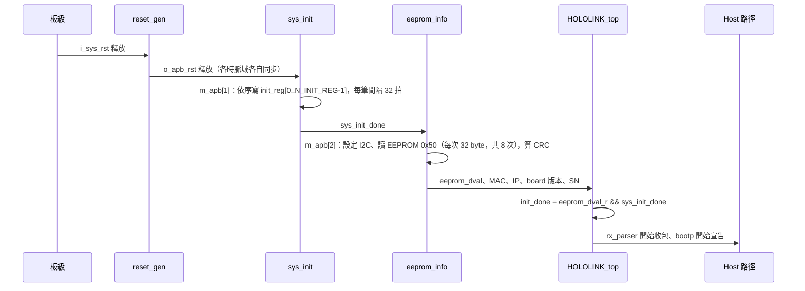
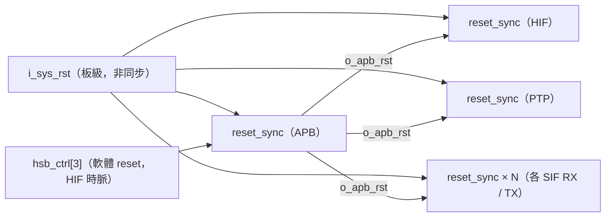

# 開機、Reset 與全域控制（`reset_gen`、`sys_init`、`eeprom_info`、`glb_ctrl_top`）

| 模組 | 原始碼 | 行數 | 分析深度 |
|---|---|---|---|
| `reset_gen` | [`reset_gen/reset_gen.sv`](https://github.com/nvidia-holoscan/holoscan-sensor-bridge/blob/41cecaa81ab906a55e7ec22e5e6989f7e602a4c8/fpga/nv_hsb_ip/reset_gen/reset_gen.sv) | 113 | 逐行 |
| `sys_init` | [`sys_init/sys_init.sv`](https://github.com/nvidia-holoscan/holoscan-sensor-bridge/blob/41cecaa81ab906a55e7ec22e5e6989f7e602a4c8/fpga/nv_hsb_ip/sys_init/sys_init.sv) | 107 | 逐行（`m_apb_reg` 見 [apb.md](apb.md)） |
| `eeprom_info` | [`sys_init/eeprom_info.sv`](https://github.com/nvidia-holoscan/holoscan-sensor-bridge/blob/41cecaa81ab906a55e7ec22e5e6989f7e602a4c8/fpga/nv_hsb_ip/sys_init/eeprom_info.sv) | 429 | 逐行 |
| `glb_ctrl_top` | [`glb_ctrl/glb_ctrl_top.sv`](https://github.com/nvidia-holoscan/holoscan-sensor-bridge/blob/41cecaa81ab906a55e7ec22e5e6989f7e602a4c8/fpga/nv_hsb_ip/glb_ctrl/glb_ctrl_top.sv) | 131 | 逐行 |

## 開機流程

## `reset_gen`

[reset_gen.sv#L16–L113](https://github.com/nvidia-holoscan/holoscan-sensor-bridge/blob/41cecaa81ab906a55e7ec22e5e6989f7e602a4c8/fpga/nv_hsb_ip/reset_gen/reset_gen.sv#L16-L113)、[reset_sync.sv#L16–L61](https://github.com/nvidia-holoscan/holoscan-sensor-bridge/blob/41cecaa81ab906a55e7ec22e5e6989f7e602a4c8/fpga/nv_hsb_ip/misc/reset_sync.sv#L16-L61)：

- `reset_sync`：板級 reset（或 PLL 未鎖定）先經 `aasr_rst` → `aasr_rst_q` 兩級；第三級 `arst` 只給 `o_arst`。同步 reset `o_srst` 是 `aasr_rst_q` 再經 `srst[1:0]` 兩級，共 4 級。HSB 只用同步輸出。
- **串接**：只有 APB 的 `reset_sync` 直接看 `i_sys_rst | i_cfg_rst`，HIF、PTP、每個 SIF 的 reset 都以 `o_apb_rst` 作為同步 reset 來源，所以其他時脈域一定比 APB 晚釋放。
- 某個 SIF 時脈沒有在跑時，它的 `reset_sync` 不會釋放（暫存器初值為 1），相關的 FIFO 經 `cdc_reset_handshake` 保持停用。
- **軟體 reset 會自我清除**：`hsb_ctrl[3]`（`glb_ctrl_top` 的控制暫存器，經 `reg_cdc` 到 HIF 時脈）→ APB reset → HIF reset → HIF 端的暫存器副本被 reset 成 0 → `hsb_ctrl[3]` 回到 0 → reset 釋放。整個脈衝約 6–8 個 APB 時脈（推斷）。這也是 host 寫入 `0x04 = 0x8` 後不等 ECB 回應的原因：回應路徑本身正在 reset。

## `sys_init`

把 `HOLOLINK_def.svh` 的 `init_reg[N_INIT_REG]`（每筆 `{addr[31:0], data[31:0]}`）在 APB reset 釋放後依序寫入。用途是開機時就設定板級 IP（例如 CPNX100 寫 `0x1000_xxxx` 的 PCS 與 `0x2000_xxxx` 的 MAC），不需要 host 介入。沒有定義 `N_INIT_REG` 時，`sys_init_done` 在 reset 後一拍就成立。

## `eeprom_info`

用 `m_apb[2]` 直接操作 I2C 控制器的暫存器（`0x0300_02xx`），從 I2C 裝置 0x50 讀出 EEPROM 前 256 byte（[eeprom_info.sv#L118–L256](https://github.com/nvidia-holoscan/holoscan-sensor-bridge/blob/41cecaa81ab906a55e7ec22e5e6989f7e602a4c8/fpga/nv_hsb_ip/sys_init/eeprom_info.sv#L118-L256)）。

**啟動**：`sys_init` 完成（`i_init`）後再等 32 個 APB 時脈。

**每一輪（共 8 輪，每輪 32 byte）的 APB 序列**：

| `reg_seq` | 位址 | 寫入值 | 用途 |
|---|---|---|---|
| 0 | `0x0300_0200` | 0 | 清除 start |
| 1 | `0x0300_020C` | `CLK_DIV_CNT` | SCL 分頻：`⌈f_APB / 400 kHz / 2⌉`，19.53 MHz 時為 25（390 kHz） |
| 2 | `0x0300_0208` | `{16'h0020, 寫入 byte 數}` | 讀 32 byte（**原始碼註解寫 28 byte，與實際值不符**） |
| 3 | `0x0300_0210` | `0x004C_4B40` | 逾時 5,000,000 個 APB 時脈 |
| 4 | `0x0300_0300` | EEPROM 內部位址 | `EEPROM_REG_ADDR_BITS = 16` 時寫 2 byte |
| 5 | `0x0300_0200` | `0x0050_0001` | 裝置 0x50、start |
| 6 | `0x0300_0280`（讀） | | `status[0]` busy 時重讀 |
| 7–14 | `0x0300_0300`–`0x0300_031C`（讀） | | 讀回 8 個 word，每個 word 拆 4 byte 處理 |

每次 APB 存取之間固定等 32 拍。

**欄位擷取**（[eeprom_info.sv#L325–L425](https://github.com/nvidia-holoscan/holoscan-sensor-bridge/blob/41cecaa81ab906a55e7ec22e5e6989f7e602a4c8/fpga/nv_hsb_ip/sys_init/eeprom_info.sv#L325-L425)）：讀到特定 word 時直接從 `prdata` 取出：

| EEPROM byte | 欄位 | 預設值（reset 值） |
|---|---|---|
| 20–39 | board 版本（20 byte） | 0 |
| 60–63 | IP 位址 | 0 |
| 64 | `0x17` 表示 IP 有效 | |
| 68–73 | MAC 位址 | `CA:FE:C0:FF:EE:00` |
| 74–80 | board SN（56 bit） | `0x56341278563412` |

**CRC**（[eeprom_info.sv#L276–L322](https://github.com/nvidia-holoscan/holoscan-sensor-bridge/blob/41cecaa81ab906a55e7ec22e5e6989f7e602a4c8/fpga/nv_hsb_ip/sys_init/eeprom_info.sv#L276-L322)）：

- 程式實際用 `0x8C` 右移，也就是反射多項式 `0x31`（x⁸ + x⁵ + x⁴ + 1，Dallas / Maxim CRC-8），初值 0。檔頭註解寫 x⁸ + x³ + x² + 1 / `0xB0`，與程式不符。
- 計算範圍是 byte 0–254，`eeprom_crc_err = (CRC ≠ 0)`。但 `fpga/script/eeprom/eeprom_utility.py` 的做法是把 byte 0–254 的 CRC 存在 byte 255，所以照工具正確寫入的 EEPROM，RTL 算出的值通常不為 0。 已用 [數值驗證](../verification-calcs.md) 確認：10000 個由工具寫入的隨機映像中有 9964 個被判為錯誤，而 RTL 算出的值每次都等於 byte 255；正確的判斷應是 `crc != byte255`。
- `eeprom_crc_err` 在 `HOLOLINK_top` 中**沒有連到任何地方**，CRC 結果不影響開機，欄位不論 CRC 是否正確都會被使用。

沒有定義 `ENUM_EEPROM` 時不實例化，改由板級從 `i_mac_addr`、`i_board_sn`、`i_enum_vld` 提供。

## `glb_ctrl_top`

基底 `0x0000_0000`（[regmap.md](../registers/regmap.md#global-register)）。

| Offset | 名稱 | 說明 |
|---|---|---|
| 0x04 | `hsb_ctrl_0` | `[3]` 軟體系統 reset（`o_sw_sys_rst`） |
| 0x08 | `hsb_ctrl_1` | `o_sw_sen_rst[31:0] = ~hsb_ctrl_1`（給板級的感測器 reset；極性由板級決定） |
| 0x0C–0x48 | GPIO | 見 [peripherals.md](peripherals.md#gpioglb_ctrl_top) |
| 0x80 | `hsb_ver` | `{BUILD_REV[15:0], HOLOLINK_REV}` |
| 0x84 | `hsb_date` | `BUILD_REV[47:16]` |
| 0x88 | `hsb_stat` | `HOLOLINK_top` 接 0 |

`glb_ctrl_top` 支援 `UUID_VAL` 參數（非 0 時在狀態區多 4 個暫存器放 UUID），但 `HOLOLINK_top` 沒有傳這個參數，所以 UUID 只出現在 BOOTP 封包裡。

## 注意事項
1. **EEPROM 不存在或沒有回應時，MAC 變成 I2C 資料緩衝區 RAM 的初始內容。** I2C 控制器在位址 byte 收到 NACK 時直接 `I2C_PERI_NACK → I2C_DONE`（[i2c_ctrl_fsm.sv#L288–L289](https://github.com/nvidia-holoscan/holoscan-sensor-bridge/blob/41cecaa81ab906a55e7ec22e5e6989f7e602a4c8/fpga/nv_hsb_ip/i2c/i2c_ctrl_fsm.sv#L288-L289)），不會進 `I2C_READ`，所以 `rd_data_valid`（[L213](https://github.com/nvidia-holoscan/holoscan-sensor-bridge/blob/41cecaa81ab906a55e7ec22e5e6989f7e602a4c8/fpga/nv_hsb_ip/i2c/i2c_ctrl_fsm.sv#L213)）不會寫入資料緩衝區。`eeprom_info` 只輪詢 `status[0]` busy（[eeprom_info.sv#L206](https://github.com/nvidia-holoscan/holoscan-sensor-bridge/blob/41cecaa81ab906a55e7ec22e5e6989f7e602a4c8/fpga/nv_hsb_ip/sys_init/eeprom_info.sv#L206)），不看 `status[3]` NACK，之後照常讀 `0x0300_0304` / `0x0300_0308` 並覆寫 `mac_addr`（[L388–L402](https://github.com/nvidia-holoscan/holoscan-sensor-bridge/blob/41cecaa81ab906a55e7ec22e5e6989f7e602a4c8/fpga/nv_hsb_ip/sys_init/eeprom_info.sv#L388-L402)）。這兩個 word 只有 I2C 讀取會寫入（`eeprom_info` 自己只寫 word 0 的 EEPROM 位址），而 `dp_ram` 沒有 reset 也沒有初始化：
   - 冷開機：FPGA block RAM 的上電內容，多數 FPGA 是 0，MAC 變成 `00:00:00:00:00:00`。
   - 軟體 reset 後再跑一次：host 之前 I2C 讀取留下的資料。
   - 模擬：`X`。

   無論哪一種，都**不會**保留 reset 值 `CA:FE:C0:FF:EE:00`（R，v7 逐行確認；v6 為推斷）。多塊沒有 EEPROM 的板子會拿到相同的 MAC。
2. EEPROM CRC 的檢查方式與寫入工具不一致，而且結果沒有被使用（見上）。
3. 軟體 reset 期間 APB、HIF、PTP、SIF 全部 reset，BOOTP 取得的 IP 也會遺失，host 必須重新 enumeration。
