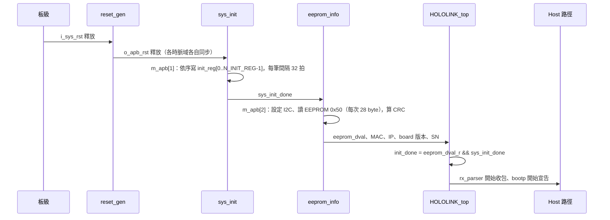

# 開機、Reset 與全域控制（`reset_gen`、`sys_init`、`eeprom_info`、`glb_ctrl_top`）

| 模組 | 原始碼 | 行數 | 分析深度 |
|---|---|---|---|
| `reset_gen` | [`reset_gen/reset_gen.sv`](https://github.com/nvidia-holoscan/holoscan-sensor-bridge/blob/41cecaa81ab906a55e7ec22e5e6989f7e602a4c8/fpga/nv_hsb_ip/reset_gen/reset_gen.sv) | 113 | 逐行 |
| `sys_init` | [`sys_init/sys_init.sv`](https://github.com/nvidia-holoscan/holoscan-sensor-bridge/blob/41cecaa81ab906a55e7ec22e5e6989f7e602a4c8/fpga/nv_hsb_ip/sys_init/sys_init.sv) | 107 | 逐行（`m_apb_reg` 見 [apb.md](apb.md)） |
| `eeprom_info` | [`sys_init/eeprom_info.sv`](https://github.com/nvidia-holoscan/holoscan-sensor-bridge/blob/41cecaa81ab906a55e7ec22e5e6989f7e602a4c8/fpga/nv_hsb_ip/sys_init/eeprom_info.sv) | 429 | 主要邏輯 |
| `glb_ctrl_top` | [`glb_ctrl/glb_ctrl_top.sv`](https://github.com/nvidia-holoscan/holoscan-sensor-bridge/blob/41cecaa81ab906a55e7ec22e5e6989f7e602a4c8/fpga/nv_hsb_ip/glb_ctrl/glb_ctrl_top.sv) | 131 | 逐行 |

## 開機流程

## `reset_gen`

- 輸入：`i_sys_rst`（板級）與 `i_cfg_rst`（= `hsb_ctrl[3]`，軟體 reset）。
- 每個時脈域一個 `reset_sync`：APB、HIF、PTP、每個 SIF RX、每個 SIF TX。
- 同步後的 reset 也輸出到 `HOLOLINK_top` 的 port，給板級 IP 用。

## `sys_init`

把 `HOLOLINK_def.svh` 的 `init_reg[N_INIT_REG]`（每筆 `{addr[31:0], data[31:0]}`）在 APB reset 釋放後依序寫入。用途是開機時就設定板級 IP（例如 CPNX100 寫 `0x1000_xxxx` 的 PCS 與 `0x2000_xxxx` 的 MAC），不需要 host 介入。沒有定義 `N_INIT_REG` 時，`sys_init_done` 在 reset 後一拍就成立。

## `eeprom_info`

用 `m_apb[2]` 直接操作 I2C 控制器的暫存器（`0x0300_02xx`），從 I2C 裝置 0x50 讀出 EEPROM 內容：

| EEPROM byte | 欄位 |
|---|---|
| 20–39 | board 版本（20 byte） |
| 60–63 | IP 位址 |
| 64 | `0x17` 表示 IP 有效 |
| 68–73 | MAC 位址 |
| 74–80 | board SN（56 bit） |
| 255 | CRC-8（0x00–0xFE 的 CRC） |

- 讀不到 EEPROM 時 MAC 預設 `CA:FE:C0:FF:EE:00`。
- `EEPROM_REG_ADDR_BITS`（8 或 16）決定 EEPROM 內部位址寬度。
- CRC 不符時 `eeprom_crc_err = 1`。
- 程式化工具：`fpga/script/eeprom/eeprom_utility.py`（經 ECB 操作 I2C）。

沒有定義 `ENUM_EEPROM` 時不實例化，改由板級從 `i_mac_addr`、`i_board_sn`、`i_enum_vld` 提供。

## `glb_ctrl_top`

基底 `0x0000_0000`（[regmap.md](../registers/regmap.md#global-register)）。

| Offset | 名稱 | 說明 |
|---|---|---|
| 0x04 | `hsb_ctrl_0` | `[3]` 軟體系統 reset（`o_sw_sys_rst`） |
| 0x08 | `hsb_ctrl_1` | `o_sw_sen_rst[31:0] = ~hsb_ctrl_1`（給板級的感測器 reset；極性由板級決定） |
| 0x0C–0x48 | GPIO | 見 [peripherals.md](peripherals.md#gpioglb_ctrl_top) |
| 0x80 | `hsb_ver` | `{BUILD_REV[15:0], HOLOLINK_REV}` |
| 0x84 | `hsb_date` | `BUILD_REV[47:16]` |
| 0x88 | `hsb_stat` | `HOLOLINK_top` 接 0 |

`glb_ctrl_top` 支援 `UUID_VAL` 參數（非 0 時在狀態區多 4 個暫存器放 UUID），但 `HOLOLINK_top` 沒有傳這個參數，所以 UUID 只出現在 BOOTP 封包裡。
