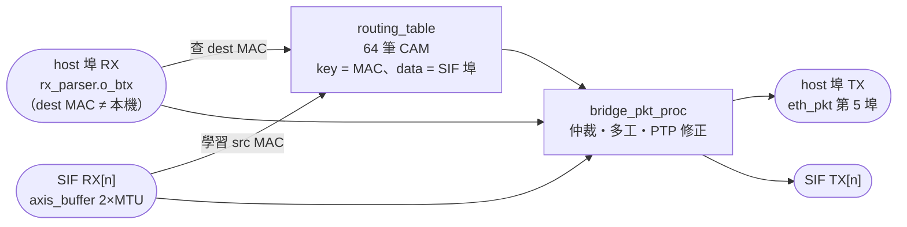

# Bridge 模式（`routing_table`、`bridge_pkt_proc`）

## 概要

定義 `BRIDGE_IF_INST` 時，HSB 不再是「感測器 → 封包」的轉換器，而是一個小型 Ethernet switch：SIF 介面被當作額外的 Ethernet 埠（例如接另一顆 PHY），封包在 host 埠與 SIF 埠之間轉送，並對 PTP 做透明時鐘（transparent clock）修正。

| 檔案 | 行數 | 功能 |
|---|---|---|
| [`routing_table/routing_table.sv`](https://github.com/nvidia-holoscan/holoscan-sensor-bridge/blob/41cecaa81ab906a55e7ec22e5e6989f7e602a4c8/fpga/nv_hsb_ip/routing_table/routing_table.sv) | 240 | MAC 學習與查詢（CAM） |
| [`routing_table/bridge_pkt_proc.sv`](https://github.com/nvidia-holoscan/holoscan-sensor-bridge/blob/41cecaa81ab906a55e7ec22e5e6989f7e602a4c8/fpga/nv_hsb_ip/routing_table/bridge_pkt_proc.sv) | 785 | 轉送、緩衝、PTP residence time |

實例：[`HOLOLINK_top.sv#L1168–L1330`](https://github.com/nvidia-holoscan/holoscan-sensor-bridge/blob/41cecaa81ab906a55e7ec22e5e6989f7e602a4c8/fpga/nv_hsb_ip/top/HOLOLINK_top.sv#L1168-L1330)。分析深度：兩個檔案逐行。**本 repo 的板級設定都沒有定義 `BRIDGE_IF_INST`**，這個模式沒有在任何板級上被使用。

Bridge 模式下被移除：`packetizer`、`dp_pkt_top`、`sensor_tx_pkt_proc`、`tx_stream_buffer`、`pause_gen`；`ptp_top` 的 TX 被關掉（只收不送）。

## 架構

## `routing_table`

- **學習**：只從 SIF 埠學。每個 SIF 封包的前 16 byte 被攤平，取 src MAC 寫入 CAM（data = 來源 SIF 的 one-hot）。CAM 已有相同 key 時不重寫；CAM 滿了就不再學。**沒有老化，也沒有刪除**（`cam_del` 恆為 0）。
- **學習細節**（[routing_table.sv#L85–L104](https://github.com/nvidia-holoscan/holoscan-sensor-bridge/blob/41cecaa81ab906a55e7ec22e5e6989f7e602a4c8/fpga/nv_hsb_ip/routing_table/routing_table.sv#L85-L104)）：每個 SIF 輸入用 `axis_to_vec` 攤平前 16 byte，`hdr_valid` 上升緣時取 byte 6–11（src MAC）並設 `mac_valid`；多個 SIF 同時有待學習的 MAC 時由 `rrarb` 輪流寫入。
- **查詢**：host 埠的封包用 dest MAC 查 CAM，**查詢優先於學習**（`|i_mac_req` 時不寫入，[routing_table.sv#L193–L202](https://github.com/nvidia-holoscan/holoscan-sensor-bridge/blob/41cecaa81ab906a55e7ec22e5e6989f7e602a4c8/fpga/nv_hsb_ip/routing_table/routing_table.sv#L193-L202)）。多個 host 同時查詢時依 `rrarb` 輪流；結果經 2 級暫存（`rr_cam_key`、`rr_dest_val`）後輸出。

  | dest MAC | 目的埠 |
  |---|---|
  | `FF:FF:FF:FF:FF:FF`、PTP multicast（`01:1B:19:00:00:00`、`01:80:C2:00:00:0E`） | 全部 |
  | 全 0 | 丟棄 |
  | CAM 命中 | 對應 SIF 埠 |
  | CAM 未命中（含其他 multicast，例如 IPv4 `01:00:5E:*`、IPv6 `33:33:*`） | `cam` 未命中時 `match_idx = 0`，輸出 `ram[0]` 的資料，而 `routing_table` 不看 `cam_data_val`。entry 0 還空著時資料是 0，等於**丟棄**；新 entry 寫在空位中，entry 0 最後才被填，**CAM 填滿 64 筆後，所有未命中都會被送到 entry 0 的 SIF 埠**（R，v6 稽核發現） |

- 同時辨識 SIF 端的 PTP Delay_Req（`o_is_del_req`），給 residence time 計算用。

CAM（`misc/cam.sv`）是平行比對的暫存器陣列，比對與寫入各有一拍暫存。

## `bridge_pkt_proc`

### 轉送規則

| 方向 | 規則 |
|---|---|
| host → SIF | 依 `routing_table` 查詢結果 |
| host → host | 查詢結果中的 host 位元 & `ctrl_reg[2h+1]`，並排除來源自己 |
| SIF → host | 不看 MAC：host `j` 接收 SIF `i` 的條件是 `ctrl_reg[2j+2][i] = 1`（訂閱）；PTP 封包改看 `ctrl_reg[0][j]`（廣播埠） |
| SIF → SIF | 不支援 |

一個來源只有在所有目的埠都不忙、緩衝也不快滿時才被授權（`will_rec` 檢查，[bridge_pkt_proc.sv#L408–L467](https://github.com/nvidia-holoscan/holoscan-sensor-bridge/blob/41cecaa81ab906a55e7ec22e5e6989f7e602a4c8/fpga/nv_hsb_ip/routing_table/bridge_pkt_proc.sv#L408-L467)），一次送到多個目的埠時同時寫入。仲裁分兩層：host 來源一個 `rrarb`、SIF 來源一個 `rrarb`，**host 的授權優先於 SIF**（`gnt_idx` 先取 SIF，再被 host 覆蓋，[bridge_pkt_proc.sv#L428–L435](https://github.com/nvidia-holoscan/holoscan-sensor-bridge/blob/41cecaa81ab906a55e7ec22e5e6989f7e602a4c8/fpga/nv_hsb_ip/routing_table/bridge_pkt_proc.sv#L428-L435)）。

### 緩衝

| 緩衝 | 深度 | 模式 | 原始碼 |
|---|---|---|---|
| host RX（每個 host 埠） | `axis_buffer` 預設 256 筆（64-bit 時 2 KB） | `WAIT2SEND = 1`（整包收完才送） | [bridge_pkt_proc.sv#L184–L206](https://github.com/nvidia-holoscan/holoscan-sensor-bridge/blob/41cecaa81ab906a55e7ec22e5e6989f7e602a4c8/fpga/nv_hsb_ip/routing_table/bridge_pkt_proc.sv#L184-L206) |
| host TX（每個 host 埠） | `HOST_MTU × 2 / 拍寬` | `NO_BACKPRESSURE`，almost full = 一半 | [bridge_pkt_proc.sv#L564–L603](https://github.com/nvidia-holoscan/holoscan-sensor-bridge/blob/41cecaa81ab906a55e7ec22e5e6989f7e602a4c8/fpga/nv_hsb_ip/routing_table/bridge_pkt_proc.sv#L564-L603) |
| SIF TX（每個 SIF 埠） | 同上，雙時脈 | 同上 | [bridge_pkt_proc.sv#L670–L699](https://github.com/nvidia-holoscan/holoscan-sensor-bridge/blob/41cecaa81ab906a55e7ec22e5e6989f7e602a4c8/fpga/nv_hsb_ip/routing_table/bridge_pkt_proc.sv#L670-L699) |

SIF TX 的保護（[bridge_pkt_proc.sv#L705–L724](https://github.com/nvidia-holoscan/holoscan-sensor-bridge/blob/41cecaa81ab906a55e7ec22e5e6989f7e602a4c8/fpga/nv_hsb_ip/routing_table/bridge_pkt_proc.sv#L705-L724)）：SIF 端的 `tready` 連續 65535 拍（模擬時 4095 拍）為 0 時，`drop_sif_pkt` 拉高，之後強制 `tready = 1` 把資料丟掉，避免一個卡住的 SIF 埠擋住整個 bridge。

host → SIF 方向：host 封包要等 CAM 回應才知道去哪，所以 `bridge_pkt_proc` 在查詢期間對 `rx_parser` 背壓（`o_hif_axis_tready = 0`）。這是 `rx_parser` 唯一會被背壓的輸出。

### PTP 透明時鐘

two-step 透明時鐘：把 Sync 與 Delay_Req 在 bridge 內停留的時間（residence time）加到對應的 Follow_Up 與 Delay_Resp 的 correctionField。

| 量測 | 開始 | 結束 | 寫進 | 原始碼 |
|---|---|---|---|---|
| host 端 Sync | `rx_parser` 判定收到 Sync（`i_ptp_sync_msg`） | **SIF 0** 送出 Sync 的第一拍（`tuser = 1`） | 轉往 SIF 的 Follow_Up | [bridge_pkt_proc.sv#L292–L315](https://github.com/nvidia-holoscan/holoscan-sensor-bridge/blob/41cecaa81ab906a55e7ec22e5e6989f7e602a4c8/fpga/nv_hsb_ip/routing_table/bridge_pkt_proc.sv#L292-L315) |
| SIF 端 Delay_Req | SIF `i` 收到 PTP multicast 封包 | `routing_table` 確認是 Delay_Req，並且它被轉往 host（`del_req_val`） | 轉往 SIF `i` 的 Delay_Resp | [bridge_pkt_proc.sv#L726–L750](https://github.com/nvidia-holoscan/holoscan-sensor-bridge/blob/41cecaa81ab906a55e7ec22e5e6989f7e602a4c8/fpga/nv_hsb_ip/routing_table/bridge_pkt_proc.sv#L726-L750) |

- 計時以 HIF 時脈拍數計（16 bit，`W_RES`），乘上 `default_inc`（每拍奈秒數，含 24 bit 小數）後取整數奈秒的低 24 bit（`W_NS_RES`）。
- 修正值放在 Ethernet frame 的 byte 22–27（`ptp_mask[223:176]`，[bridge_pkt_proc.sv#L752–L755](https://github.com/nvidia-holoscan/holoscan-sensor-bridge/blob/41cecaa81ab906a55e7ec22e5e6989f7e602a4c8/fpga/nv_hsb_ip/routing_table/bridge_pkt_proc.sv#L752-L755)）：14 byte Ethernet header + PTP header 的 offset 8，也就是 correctionField 的高 48 bit（整數奈秒）。**這個位置只對 Layer 2 PTP（EtherType `0x88F7`、沒有 VLAN）成立**；UDP / IPv4 上的 PTP 或帶 VLAN 的封包，修正會寫到錯誤的位置。
- 修正用 `axis_mask` 的 OR（見注意事項 2）。

## 暫存器

基底 `0x0600_0000`。`bridge_nctrl = 2 × NUM_HOST + 1`：

| Index | 說明 |
|---|---|
| 0 | `[NUM_HOST-1:0]` 哪些 host 埠是廣播 / PTP 埠 |
| 2h + 1 | host `h` 的封包可以轉給哪些 host 埠 |
| 2h + 2 | host `h` 訂閱哪些 SIF 埠 |

## 注意事項

1. 未知 unicast 一律丟棄；CAM 沒有老化與刪除，裝置更換 MAC 後要 reset 才能重新學習。
2. correctionField 的修正是用 `axis_mask` 的 **OR**（`OP = "OR"`），不是加法。只有在原本的 correctionField 對應位元為 0 時結果才等於相加；master 送來的 correctionField 不為 0 時，修正值會出錯（推斷，需以實際封包驗證）。
3. `rx_parser` 帶 VLAN 的 PTP 封包，messageType 從錯誤的 byte 讀出（見 [rx_parser 注意事項 3](rx_parser.md#注意事項)），會影響這裡的 PTP 類型編碼。
4. residence time 只用 16 bit 拍數計：在 156.25 MHz 時超過約 419 µs 會回捲；奈秒值只保留 24 bit。
5. host 端 Sync 的 residence time 一律量到 **SIF 0** 送出為止；Sync 被送往其他 SIF 埠時也用這個值。
6. 未知 unicast 與一般 multicast（IPv4 / IPv6 multicast、mDNS 等）都會被丟棄，IPv6 的鄰居探索因此無法通過 bridge（推斷）。
7. host RX 緩衝只有預設的 256 筆（64-bit 時 2 KB）且是 store-and-forward。almost full（7/8，約 1.8 KB）時對 `rx_parser` 反壓，但輸出要等 `tlast` 才開始，所以 **64-bit 設定下大於約 1.8 KB 的封包會讓這個 host 埠的 bridge 路徑卡死**，並經 `rx_parser` 擋住同一埠的所有流量（推斷：依 `axis_buffer` 的 `WAIT2SEND` 行為推論，未模擬確認）。
8. 仲裁固定讓 host 來源優先於 SIF 來源；host 流量持續時，SIF → host 的封包可能長時間等待。
9. **SIF 端 Delay_Req 的 `del_req_val` 永遠不會產生。** `eth_pkt` 以 `out_idx == 4` 判斷 Delay_Req 送出（[eth_pkt.sv#L303](https://github.com/nvidia-holoscan/holoscan-sensor-bridge/blob/41cecaa81ab906a55e7ec22e5e6989f7e602a4c8/fpga/nv_hsb_ip/eth_pkt/eth_pkt.sv#L303)、[#L307](https://github.com/nvidia-holoscan/holoscan-sensor-bridge/blob/41cecaa81ab906a55e7ec22e5e6989f7e602a4c8/fpga/nv_hsb_ip/eth_pkt/eth_pkt.sv#L307)），但 index 4 是 PAUSE，Bridge 是 index 5（[HOLOLINK_top.sv#L924–L929](https://github.com/nvidia-holoscan/holoscan-sensor-bridge/blob/41cecaa81ab906a55e7ec22e5e6989f7e602a4c8/fpga/nv_hsb_ip/top/HOLOLINK_top.sv#L924-L929)）。所以 Bridge 轉送的 Delay_Req 不會觸發 `rd_ptp_fifo`，上表「SIF 端 Delay_Req」的 residence time 量測不會照描述結束（R，v6 稽核發現；影響需模擬確認）。
10. **CAM 填滿後未命中會轉送到 entry 0 的埠。** 見上方 `routing_table` 表格（R）。
11. 學習請求可能遺失：`mac_valid` 在 `mac_grant` 時清除，即使那一拍 `cam_wr` 因為 host 查詢（`|i_mac_req`）被壓住（[routing_table.sv#L94–L96](https://github.com/nvidia-holoscan/holoscan-sensor-bridge/blob/41cecaa81ab906a55e7ec22e5e6989f7e602a4c8/fpga/nv_hsb_ip/routing_table/routing_table.sv#L94-L96)、[#L193–L202](https://github.com/nvidia-holoscan/holoscan-sensor-bridge/blob/41cecaa81ab906a55e7ec22e5e6989f7e602a4c8/fpga/nv_hsb_ip/routing_table/routing_table.sv#L193-L202)）。後果只是那個 src MAC 要等下一個封包才學到（I：`rrarb` 的授權時序未確認）。
