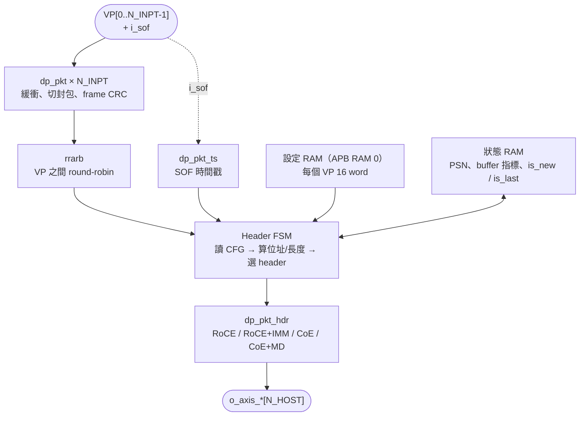

# `dp_pkt_top`（Data Plane 封包器，含 1722B Talker）

## 概要

把所有 VP（`packetizer` 拆出的子串流）的資料切成封包，加上 RoCEv2 WRITE 或 IEEE 1722B CoE header，送到指定的 host 埠。**HSB 3.0 的 1722B Talker 就在這裡。**

| 項目 | 值 |
|---|---|
| 原始碼 | [`dp_pkt/dp_pkt_top.sv`](https://github.com/nvidia-holoscan/holoscan-sensor-bridge/blob/41cecaa81ab906a55e7ec22e5e6989f7e602a4c8/fpga/nv_hsb_ip/dp_pkt/dp_pkt_top.sv)（1687 行）、`dp_pkt.sv`、`dp_pkt_hdr.sv`、`dp_pkt_ts.sv` |
| 實例 | [`HOLOLINK_top.sv#L1555`](https://github.com/nvidia-holoscan/holoscan-sensor-bridge/blob/41cecaa81ab906a55e7ec22e5e6989f7e602a4c8/fpga/nv_hsb_ip/top/HOLOLINK_top.sv#L1555)（一份） |
| 時脈 | `i_pclk`（HIF） |
| 分析深度 | CoE header、設定 RAM、header 類型逐行；header FSM 與 RoCE 位址計算只讀結構 |

## 參數

| 參數 | 傳入 | 說明 |
|---|---|---|
| `N_INPT` | `TOTAL_VP_WIDTH` | 所有 SIF 的 VP 總數 |
| `W_DATA` | `HOST_WIDTH` | |
| `N_HOST` | `HOST_IF_INST` | |
| `MTU` | `HOST_MTU` | |
| `BUFFER_4K_REG` | 1 | 設定 RAM 用 4K page 格式 |
| `DIS_COE` | `REMOVE_COE` | 1 = 移除 1722B header（`DISABLE_COE`，合成時） |

| 常數 | 值 |
|---|---|
| `ROCE_HDR_WIDTH` | 560 bit（70 byte：Eth 14 + IPv4 20 + UDP 8 + BTH 12 + RETH 16） |
| `ROCE_IMM_HDR_WIDTH` | 592 bit（+ 4 byte Immediate） |
| `COE_HDR_WIDTH` | 368 bit（46 byte） |

## 內部結構

## 行為

### 1. 設定 RAM

基底 `0x0000_1000`，每個 VP `0x40` byte（16 word）。位置以 host 軟體 [`data_channel.hpp`](https://github.com/nvidia-holoscan/holoscan-sensor-bridge/blob/41cecaa81ab906a55e7ec22e5e6989f7e602a4c8/src/hololink/core/data_channel.hpp) 為準，`hololink.hpp` 的 `FPGA_SENSOR_VP_VLAN_BASE = 0x1034`、`FPGA_SENSOR_VP_STRIDE = 0x40` 可以佐證：

| Offset | 名稱 | 內容 |
|---|---|---|
| 0x00 | `DP_QP` | `[23:0]` dest QP（1722B：低 6 bit = `channel_number`）、**`[24]` `is_1722b`**、`[31:25]` line 門檻（log2） |
| 0x04 | `DP_RKEY` | RoCE rkey |
| 0x08 | `DP_PAGE_LSB` | buffer 起點（page） |
| 0x0C | `DP_PAGE_MSB` | buffer 位址高位 |
| 0x10 | `DP_PAGE_INC` | 每個 buffer 的 page 增量 |
| 0x14 | `DP_MAX_BUFF` | 起始 / 結束 buffer 指標 |
| 0x18 | `DP_BUFFER_LENGTH` | 收到這麼多 byte 算 frame 結束 |
| 0x20 / 0x24 | `DP_HOST_MAC_LOW` / `HIGH` | 目標 host MAC |
| 0x28 | `DP_HOST_IP` | 目標 host IP |
| 0x2C | `DP_HOST_UDP_PORT` | `[15:0]` UDP 埠、`[16]` `md_disable` |
| 0x34 | `DP_VLAN` | `[15:0]` TCI、`[16]` 插入 VLAN |

> 讀 RTL 時注意：[L466–L509](https://github.com/nvidia-holoscan/holoscan-sensor-bridge/blob/41cecaa81ab906a55e7ec22e5e6989f7e602a4c8/fpga/nv_hsb_ip/dp_pkt/dp_pkt_top.sv#L466-L509) 用 `cfg_ram_addr[3:0] == N` 選欄位，但 `cfg_ram_addr = {sif_gnt_idx_r, fsm_cnt[3:0]}`（[L919](https://github.com/nvidia-holoscan/holoscan-sensor-bridge/blob/41cecaa81ab906a55e7ec22e5e6989f7e602a4c8/fpga/nv_hsb_ip/dp_pkt/dp_pkt_top.sv#L919)）是讀取位址，資料晚幾拍才回來，所以 `N` 不是 word 編號。[L222–L238](https://github.com/nvidia-holoscan/holoscan-sensor-bridge/blob/41cecaa81ab906a55e7ec22e5e6989f7e602a4c8/fpga/nv_hsb_ip/dp_pkt/dp_pkt_top.sv#L222-L238) 的註解才是 word 位置，與上表一致。

切換為 1722B：`DataChannel::configure_coe()`（[`data_channel.cpp#L297`](https://github.com/nvidia-holoscan/holoscan-sensor-bridge/blob/41cecaa81ab906a55e7ec22e5e6989f7e602a4c8/src/hololink/core/data_channel.cpp#L297)）寫 `(1 << 24) | (line_threshold_log2 << 25) | channel` 到 `DP_QP`。

### 2. Header 類型

`hdr_type = {pkt_is_imm, pkt_is_1722b}`（[L1359–L1363](https://github.com/nvidia-holoscan/holoscan-sensor-bridge/blob/41cecaa81ab906a55e7ec22e5e6989f7e602a4c8/fpga/nv_hsb_ip/dp_pkt/dp_pkt_top.sv#L1359-L1363)）：

| `hdr_type` | 格式 |
|---|---|
| `00` | RoCEv2 WRITE |
| `01` | 1722B CoE |
| `10` | RoCEv2 WRITE with Immediate + metadata（frame 結束時） |
| `11` | 1722B CoE + metadata |

1722B 封包不加 ICRC：`crc_en[n] = !hif_is_1722b[n]`（[L1543](https://github.com/nvidia-holoscan/holoscan-sensor-bridge/blob/41cecaa81ab906a55e7ec22e5e6989f7e602a4c8/fpga/nv_hsb_ip/dp_pkt/dp_pkt_top.sv#L1543)）。

### 3. 1722B CoE header

[L1193–L1269](https://github.com/nvidia-holoscan/holoscan-sensor-bridge/blob/41cecaa81ab906a55e7ec22e5e6989f7e602a4c8/fpga/nv_hsb_ip/dp_pkt/dp_pkt_top.sv#L1193-L1269)。46 byte，big endian 輸出。host 軟體把它分成四段（[`data_channel.cpp#L315`](https://github.com/nvidia-holoscan/holoscan-sensor-bridge/blob/41cecaa81ab906a55e7ec22e5e6989f7e602a4c8/src/hololink/core/data_channel.cpp#L315)：`14 Ethernet + 12 avtpdu + 12 gisf + 8 coe`）：

| Byte | 段落 | 欄位 | 值 / 來源 |
|---|---|---|---|
| 0–5 | Ethernet | dest MAC | `DP_HOST_MAC` |
| 6–11 | | src MAC | 本機 MAC |
| 12–13 | | EtherType | `0x22F0` |
| 14 | AVTPDU | subtype | `0x82` |
| 15–17 | | `sv`(1) + 23 bit | `sv = 1`，其餘 0 |
| 18–25 | | stream_id | 常數 `0x0000_0000_AAAA_AAAA` |
| 26 | GISF | ACF msg type | `0x0C` |
| 27 | | ACF msg length | 0 |
| 28 | | `pad[1:0]`、`mtv`、5'b0 | `mtv = 1` |
| 29 | | image_sensor_id | `sif_gnt_idx_r`（目前被選中的 VP index） |
| 30–37 | | timestamp | `cur_ptp[63:0]`（PTP 時間） |
| 38 | CoE | sequence_number | `psn[7:0]` |
| 39–40 | | `e`、`se`、`fcv`、`version[1:0]`、`exposure[1:0]`、3'b0、`channel_number[5:0]` | 前 7 個為 0；channel = `DP_QP[5:0]` |
| 41 | | flags | `[3:0]`：1 = frame 開始、2 = metadata、0 = 其他；`[7:4]`：1 = line 結束 |
| 42–45 | | `2'b00`、`frame_num[1:0]`、`byte_offset[27:0]` | offset = frame 內 byte 位置 |

## 暫存器

| 區塊 | 基底 | 說明 |
|---|---|---|
| `dp_pkt`（每個 host 埠） | `0x0200_0300 + host × 0x1_0000` | `dp_pkt_len`、`dp_pkt_dev_udp_port`、`dp_pkt_vip_mask`、`dp_pkt_crc_xor`、`dp_pkt_1722B`（[regmap.md](../registers/regmap.md#dataplane-packetizer)） |
| 設定 RAM | `0x0000_1000 + VP × 0x40` | 見上表 |

## 注意事項

1. VLAN 欄位（`0x8100`、PCP 6、DEI 1、VID `0xCCC`）在 CoE concat 裡被註解掉，VLAN 改由 `eth_pkt` 依 `DP_VLAN` 插入。
2. `stream_id`、ACF msg type 等是常數。欄位語意是否完全符合 IEEE 1722b，需要對照規格；本文件只記錄 RTL 的值。
3. `dp_pkt_1722B` 暫存器（0x14）的用途未分析。

## 與 1722 Listener 的關係

這是 Listener 最好的**對照組與測試來源**：

- 你的 Listener 可以先以這個格式為目標：subtype 0x82、46 byte header、flags 帶 frame / line 邊界。
- 驗證時讓 HSB 的 Data Plane 以 1722B 模式送出，dest MAC 設成 Listener，直接用真實封包測試。
- host 端還有軟體 Talker：`src/hololink/emulation/` 的 `COETransmitter`。
