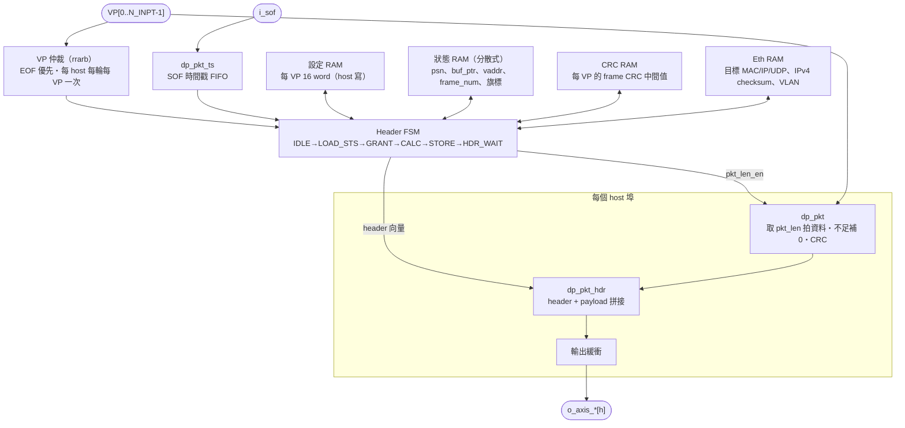
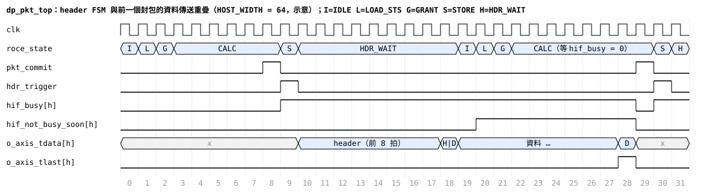

# `dp_pkt_top`（Data Plane 封包器）

## 概要

把所有 VP 的感測器資料切成封包，加上 header，送到對應的 host 埠。支援兩種傳輸格式：

- **RoCEv2 RDMA WRITE**：資料直接寫進 host 記憶體中的環狀 frame buffer；每個 frame 結束送一個 WRITE with Immediate 與 128 byte metadata，通知 host frame 完成。
- **IEEE 1722B CoE（Camera over Ethernet）**：L2 封包，給 Jetson Thor 等 CoE 接收端。

| 檔案 | 行數 | 功能 |
|---|---|---|
| [`dp_pkt_top.sv`](https://github.com/nvidia-holoscan/holoscan-sensor-bridge/blob/41cecaa81ab906a55e7ec22e5e6989f7e602a4c8/fpga/nv_hsb_ip/dp_pkt/dp_pkt_top.sv) | 1687 | 仲裁、設定與狀態 RAM、header FSM、位址計算、header 組裝 |
| [`dp_pkt.sv`](https://github.com/nvidia-holoscan/holoscan-sensor-bridge/blob/41cecaa81ab906a55e7ec22e5e6989f7e602a4c8/fpga/nv_hsb_ip/dp_pkt/dp_pkt.sv) | 261 | 每個 host 埠的 payload 多工、補零、frame CRC |
| [`dp_pkt_hdr.sv`](https://github.com/nvidia-holoscan/holoscan-sensor-bridge/blob/41cecaa81ab906a55e7ec22e5e6989f7e602a4c8/fpga/nv_hsb_ip/dp_pkt/dp_pkt_hdr.sv) | 252 | header 向量轉 AXIS |
| [`dp_pkt_ts.sv`](https://github.com/nvidia-holoscan/holoscan-sensor-bridge/blob/41cecaa81ab906a55e7ec22e5e6989f7e602a4c8/fpga/nv_hsb_ip/dp_pkt/dp_pkt_ts.sv) | 202 | frame 開始（SOF）的 PTP 時間戳 |

實例：[`HOLOLINK_top.sv#L1555`](https://github.com/nvidia-holoscan/holoscan-sensor-bridge/blob/41cecaa81ab906a55e7ec22e5e6989f7e602a4c8/fpga/nv_hsb_ip/top/HOLOLINK_top.sv#L1555)（一份，非 Bridge 模式且有 SIF RX 時）。分析深度：四個檔案逐行（assertion 區塊只讀規則）；RoCE ICRC 見 [roce.md](roce.md)。

## 參數

| 參數 | 傳入 | 說明 |
|---|---|---|
| `N_INPT` | `TOTAL_VP_WIDTH` | 所有 SIF 的 VP 總數 |
| `N_HOST` | `HOST_IF_INST` | |
| `W_DATA` | `HOST_WIDTH` | |
| `W_USER` | 17 | 輸出 `tuser`（VLAN） |
| `MTU` | `HOST_MTU` | |
| `BUFFER_4K_REG` | 1 | buffer 位址用「起點 + 增量 × 指標」，最多 4096 個 buffer |
| `DIS_COE` | `REMOVE_COE` | 合成時移除 CoE header |

| 常數 | 值 |
|---|---|
| 位址單位 | page = 128 byte（`NUM_PAD_BITS = 7`）；payload 長度都是 page 的整數倍 |
| `ROCE_HDR_WIDTH` | 560 bit（Eth 14 + IPv4 20 + UDP 8 + BTH 12 + RETH 16） |
| `COE_HDR_WIDTH` | 368 bit（46 byte） |
| `WR_IMM_SIZE` | 384 bit（metadata 本體 48 byte） |

## 介面

| 方向 | 名稱 | 說明 |
|---|---|---|
| in | `i_axis_*[N_INPT]` | 每個 VP 的資料（HIF 時脈） |
| in | `i_sof[N_INPT]` | frame 開始 |
| in | `i_cur_ptp[79:0]` | HIF 時脈的 PTP 時間 |
| in | `i_dev_mac_addr[N_HOST]`、`i_dev_ip_addr[N_HOST]` | 本機位址 |
| out | `o_axis_*[N_HOST]` | → 各 host 埠 `eth_pkt` 第 0 埠 |
| APB | `i_apb_m2s[N_HOST]` | 每個 host 埠的 `dp_pkt` 暫存器 |
| APB | `i_apb_m2s_cfg` | VP 設定 RAM（APB RAM 0） |

## 內部結構

## 行為

### 1. 輸入契約

`dp_pkt` 送出 payload 時**不看 VP 的 `tvalid`**：封包開始後每拍都把 `i_axis_tdata[gnt_idx]` 當成有效資料（[L197–L200](https://github.com/nvidia-holoscan/holoscan-sensor-bridge/blob/41cecaa81ab906a55e7ec22e5e6989f7e602a4c8/fpga/nv_hsb_ip/dp_pkt/dp_pkt.sv#L197-L200)）。正確性靠 VP 端保證，assertion 明文規定（[L1623–L1640](https://github.com/nvidia-holoscan/holoscan-sensor-bridge/blob/41cecaa81ab906a55e7ec22e5e6989f7e602a4c8/fpga/nv_hsb_ip/dp_pkt/dp_pkt_top.sv#L1623-L1640)）：

- `tkeep` 必須全 1。
- `tready` 為 1 時 `tvalid` 必須為 1，除非上一拍是 `tlast`。
- `tvalid` 只能在 `tlast` 之後或 `tready` 掉下來之後才掉。

這就是 `virtual_port` 輸出閘控（almost empty 時先不放行，見 [packetizer §6](packetizer.md#6-virtual-portvirtual_portsv)）存在的原因。

### 2. VP → host 對應與仲裁

[L649–L737](https://github.com/nvidia-holoscan/holoscan-sensor-bridge/blob/41cecaa81ab906a55e7ec22e5e6989f7e602a4c8/fpga/nv_hsb_ip/dp_pkt/dp_pkt_top.sv#L649-L737)：

| 訊號 | 定義 |
|---|---|
| `vp_mask[h]` | `dp_pkt_vip_mask`：host 埠 `h` 服務哪些 VP（[L145](https://github.com/nvidia-holoscan/holoscan-sensor-bridge/blob/41cecaa81ab906a55e7ec22e5e6989f7e602a4c8/fpga/nv_hsb_ip/dp_pkt/dp_pkt_top.sv#L145)） |
| `hif_sif_mask[h]` | 本輪已服務過的 VP；`hif_sif_served[h]`（所有有資料的 VP 都服務過）時清 0 |
| `hif_reserved[h]` | `hif_preempt[h]`，或 `hif_busy[h]` 且還沒「快結束」（[L685–L691](https://github.com/nvidia-holoscan/holoscan-sensor-bridge/blob/41cecaa81ab906a55e7ec22e5e6989f7e602a4c8/fpga/nv_hsb_ip/dp_pkt/dp_pkt_top.sv#L685-L691)） |
| `hif_mask` | 所有未保留 host 的 `vp_mask & ~(本輪已服務 & ~EOF)` 的聯集（[L693–L700](https://github.com/nvidia-holoscan/holoscan-sensor-bridge/blob/41cecaa81ab906a55e7ec22e5e6989f7e602a4c8/fpga/nv_hsb_ip/dp_pkt/dp_pkt_top.sv#L693-L700)） |
| `sif_req[s]` | 不在 `hif_mask` → 0；任何 VP 有 EOF 待送 → 只有 EOF 的 VP 請求；否則 = `i_axis_tvalid[s]`（[L662–L666](https://github.com/nvidia-holoscan/holoscan-sensor-bridge/blob/41cecaa81ab906a55e7ec22e5e6989f7e602a4c8/fpga/nv_hsb_ip/dp_pkt/dp_pkt_top.sv#L662-L666)） |
| 仲裁器 | `rrarb`（round-robin），`idle = (roce_state == ROCE_IDLE)`（[L711–L739](https://github.com/nvidia-holoscan/holoscan-sensor-bridge/blob/41cecaa81ab906a55e7ec22e5e6989f7e602a4c8/fpga/nv_hsb_ip/dp_pkt/dp_pkt_top.sv#L711-L739)） |
| `hif_gnt_idx` | 被選中 VP 所屬的 host；VP 同時屬於多個 host 時取編號最大的（[L724–L737](https://github.com/nvidia-holoscan/holoscan-sensor-bridge/blob/41cecaa81ab906a55e7ec22e5e6989f7e602a4c8/fpga/nv_hsb_ip/dp_pkt/dp_pkt_top.sv#L724-L737)） |

`hif_busy[h]`（[L676–L678](https://github.com/nvidia-holoscan/holoscan-sensor-bridge/blob/41cecaa81ab906a55e7ec22e5e6989f7e602a4c8/fpga/nv_hsb_ip/dp_pkt/dp_pkt_top.sv#L676-L678)）：`pkt_commit` 時設 1，送出 `tlast` 或 metadata 被略過（`imm_is_done`）時清 0。`hif_not_busy_soon`（[L94–L117](https://github.com/nvidia-holoscan/holoscan-sensor-bridge/blob/41cecaa81ab906a55e7ec22e5e6989f7e602a4c8/fpga/nv_hsb_ip/dp_pkt/dp_pkt.sv#L94-L117)）：封包長度 ≥ 8 拍且剩不到 10 拍時拉高，讓 FSM 在目前封包結束前就開始準備下一個。

`hif_preempt[h]`（[L669–L674](https://github.com/nvidia-holoscan/holoscan-sensor-bridge/blob/41cecaa81ab906a55e7ec22e5e6989f7e602a4c8/fpga/nv_hsb_ip/dp_pkt/dp_pkt_top.sv#L669-L674)）：FSM 拿到 grant 時目標 host 仍忙，就設 1；commit 或 preempt 後清 0。設 1 期間該 host 被視為保留，不再接受新請求。

### 3. 三個內部 RAM

| RAM | 每 VP 位元 | 內容 | 原始碼 |
|---|---|---|---|
| 狀態 RAM | 89 | `[0]` 已執行過、`[1]` 下一個是最後封包、`[2]` frame 已送完、`[3]` frame 進行中（非新 frame）、`[15:4]` `buf_ptr`、`[16]` line 結束旗標、`[40:17]` PSN、`[72:41]` 下一個位址（page）、`[88:73]` frame 編號 | [L303–L330](https://github.com/nvidia-holoscan/holoscan-sensor-bridge/blob/41cecaa81ab906a55e7ec22e5e6989f7e602a4c8/fpga/nv_hsb_ip/dp_pkt/dp_pkt_top.sv#L303-L330)、[L405–L423](https://github.com/nvidia-holoscan/holoscan-sensor-bridge/blob/41cecaa81ab906a55e7ec22e5e6989f7e602a4c8/fpga/nv_hsb_ip/dp_pkt/dp_pkt_top.sv#L405-L423) |
| CRC RAM | 32 | 每個 VP 的 frame CRC 中間值 | [L332–L353](https://github.com/nvidia-holoscan/holoscan-sensor-bridge/blob/41cecaa81ab906a55e7ec22e5e6989f7e602a4c8/fpga/nv_hsb_ip/dp_pkt/dp_pkt_top.sv#L332-L353) |
| Eth RAM | 112 + `W_USER` | 目標 MAC、IP、UDP 埠、**預先算好的 IPv4 checksum**、VLAN `tuser` | [L355–L378](https://github.com/nvidia-holoscan/holoscan-sensor-bridge/blob/41cecaa81ab906a55e7ec22e5e6989f7e602a4c8/fpga/nv_hsb_ip/dp_pkt/dp_pkt_top.sv#L355-L378)、[L520–L540](https://github.com/nvidia-holoscan/holoscan-sensor-bridge/blob/41cecaa81ab906a55e7ec22e5e6989f7e602a4c8/fpga/nv_hsb_ip/dp_pkt/dp_pkt_top.sv#L520-L540) |

三者都是分散式 RAM，讀取延遲 1 拍。狀態 RAM 在 `ROCE_STORE`、`fsm_cnt ≥ 9` 時回寫（[L898–L908](https://github.com/nvidia-holoscan/holoscan-sensor-bridge/blob/41cecaa81ab906a55e7ec22e5e6989f7e602a4c8/fpga/nv_hsb_ip/dp_pkt/dp_pkt_top.sv#L898-L908)）。

狀態 RAM 回寫規則（[L415–L423](https://github.com/nvidia-holoscan/holoscan-sensor-bridge/blob/41cecaa81ab906a55e7ec22e5e6989f7e602a4c8/fpga/nv_hsb_ip/dp_pkt/dp_pkt_top.sv#L415-L423)）：

| 欄位 | 寫入值 |
|---|---|
| PSN | CoE 的 metadata 封包後歸 0（CoE 的 sequence number 是每 frame 重新計數）；`md_disable` 時只有資料封包加 1；否則每個封包加 1 |
| `buf_ptr` | metadata 封包後前進到下一個 buffer |
| frame 編號 | metadata 封包後加 1 |
| frame 進行中 | 資料封包後設 1，metadata 封包後清 0（下一個封包是新 frame） |

### 4. 設定 RAM

基底 `0x0000_1000`（APB RAM 0，`R_CTRL = 512` word = 32 個 VP × 16 word），每個 VP `0x40` byte。位置以 host 軟體 `data_channel.hpp` 為準：

| Offset | Host 名稱 | 內容 |
|---|---|---|
| 0x00 | `DP_QP` | `[23:0]` RoCE dest QP（CoE：低 6 bit = channel）、`[24]` 1722B、`[31:25]` line 長度 log2（CoE line 結束旗標用） |
| 0x04 | `DP_RKEY` | RoCE rkey |
| 0x08 | `DP_PAGE_LSB` | `[31:7]` buffer 起點 page |
| 0x0C | `DP_PAGE_MSB` | `[0]` buffer 起點 bit 25、`[31:1]` 位址固定高位 |
| 0x10 | `DP_PAGE_INC` | 每個 buffer 的 page 增量 |
| 0x14 | `DP_MAX_BUFF` | `[27:16]` 起始 / `[11:0]` 結束 buffer 指標 |
| 0x18 | `DP_BUFFER_LENGTH` | frame 長度（byte） |
| 0x20 / 0x24 | `DP_HOST_MAC_LOW` / `HIGH` | |
| 0x28 | `DP_HOST_IP` | |
| 0x2C | `DP_HOST_UDP_PORT` | `[15:0]` UDP 埠、`[16]` `md_disable` |
| 0x34 | `DP_VLAN` | `[15:0]` TCI、`[16]` 插入 VLAN |
| 0x3C | （PSN） | FSM 回寫目前 PSN（`cfg_ram_wr_en`，[L924](https://github.com/nvidia-holoscan/holoscan-sensor-bridge/blob/41cecaa81ab906a55e7ec22e5e6989f7e602a4c8/fpga/nv_hsb_ip/dp_pkt/dp_pkt_top.sv#L924)） |

RTL 檔頭的註解（[L222–L238](https://github.com/nvidia-holoscan/holoscan-sensor-bridge/blob/41cecaa81ab906a55e7ec22e5e6989f7e602a4c8/fpga/nv_hsb_ip/dp_pkt/dp_pkt_top.sv#L222-L238)）是舊版（`BUFFER_4K_REG = 0`、4 個固定 buffer + mask）的配置，與 `HOLOLINK_top` 使用的 `BUFFER_4K_REG = 1` 不符；實際配置以上表為準（R + X）。

**讀取順序經過重排**（[L269–L300](https://github.com/nvidia-holoscan/holoscan-sensor-bridge/blob/41cecaa81ab906a55e7ec22e5e6989f7e602a4c8/fpga/nv_hsb_ip/dp_pkt/dp_pkt_top.sv#L269-L300)）：

| `fsm_cnt` | 0 | 1 | 2 | 3 | 4 | 5 | 6 | 7 | 8 | 9 | A | B |
|---|---|---|---|---|---|---|---|---|---|---|---|---|
| RAM word | 6 | 4 | 2 | 3 | 0 | 1 | 5 | A | B | 8 | 9 | D |
| 內容 | 長度 | 增量 | 起點 | 高位 | QP | rkey | 指標 | IP | UDP | MAC lo | MAC hi | VLAN |

RAM 讀取延遲 1 拍，所以 [L477–L513](https://github.com/nvidia-holoscan/holoscan-sensor-bridge/blob/41cecaa81ab906a55e7ec22e5e6989f7e602a4c8/fpga/nv_hsb_ip/dp_pkt/dp_pkt_top.sv#L477-L513) 中 `cfg_ram_addr[3:0] == N` 拿到的是 `fsm_cnt = N − 1` 的資料（例如 `N = 5` 時是 QP、`is_1722b` 與 line 長度 log2）。CoE 模式（`pkt_is_1722b`）下 buffer 起點、增量、高位強制為 0（[L481–L484](https://github.com/nvidia-holoscan/holoscan-sensor-bridge/blob/41cecaa81ab906a55e7ec22e5e6989f7e602a4c8/fpga/nv_hsb_ip/dp_pkt/dp_pkt_top.sv#L481-L484)）。

PSN 回寫：`ROCE_CALC` 且 `fsm_cnt == 15` 時把目前 PSN 寫回 word F（[L923–L924](https://github.com/nvidia-holoscan/holoscan-sensor-bridge/blob/41cecaa81ab906a55e7ec22e5e6989f7e602a4c8/fpga/nv_hsb_ip/dp_pkt/dp_pkt_top.sv#L923-L924)），只有讀完整 18 個 word 的封包才會到達這個計數，所以 host 讀到的 PSN 只在 frame 邊界附近更新。

### 5. Header FSM

狀態宣告在 [L429–L437](https://github.com/nvidia-holoscan/holoscan-sensor-bridge/blob/41cecaa81ab906a55e7ec22e5e6989f7e602a4c8/fpga/nv_hsb_ip/dp_pkt/dp_pkt_top.sv#L429-L437)，主體在 [L776–L917](https://github.com/nvidia-holoscan/holoscan-sensor-bridge/blob/41cecaa81ab906a55e7ec22e5e6989f7e602a4c8/fpga/nv_hsb_ip/dp_pkt/dp_pkt_top.sv#L776-L917)。`ROCE_WR_IMM` 有宣告但沒有使用。

| 狀態 | 動作 |
|---|---|
| `ROCE_IDLE` | 有 `sif_req`：鎖定 VP / host，讀狀態 RAM，→ `LOAD_STS`。每拍把 `sif_wtlast`（各 `dp_pkt` 看到的 VP `tlast`）併入 `sif_eof` |
| `ROCE_LOAD_STS` | 等設定 RAM 第一筆；`pkt_is_imm = sif_eof[vp]`（frame 已結束 → 這次送 metadata）；`pkt_len = dp_pkt_len << PAGES_TO_CYCLES`（page 轉拍數）；若前一個封包的 CRC 已就緒且 host 不忙，回寫 CRC RAM |
| `ROCE_GRANT` | 決定 `hdr_type = {pkt_is_imm, pkt_is_1722b}`；`fsm_cnt_max`（讀幾個 word）與 `fsm_cnt_target`（第幾個 word 時 commit）；`dma_len`（metadata 128、否則封包 byte 數） |
| `ROCE_CALC` | 逐拍讀設定 RAM 並更新位址計算；到 `fsm_cnt_target` 時嘗試 commit；到 `fsm_cnt_max` 且已 commit → `STORE`。`fsm_cnt == 17` 時寫 Eth RAM |
| `ROCE_STORE` | `fsm_cnt` 到 9 以上時回寫狀態 RAM；資料封包若是 frame 最後一個（或單封包 frame），設 `sif_eof[vp]` 讓下一輪送 metadata |
| `ROCE_HDR_WAIT` | 等 `dp_pkt_hdr` 不忙 → `IDLE` |

`fsm_cnt_max` / `fsm_cnt_target`（[L861–L865](https://github.com/nvidia-holoscan/holoscan-sensor-bridge/blob/41cecaa81ab906a55e7ec22e5e6989f7e602a4c8/fpga/nv_hsb_ip/dp_pkt/dp_pkt_top.sv#L861-L865)）：

| 情況 | 讀取 word 數（max） | commit 點（target） |
|---|---|---|
| 第一次執行 | 18 | 18 |
| 單封包 frame、`md_disable`、與上一次同一個 VP | 18（前一輪必定是 metadata 階段，狀態 RAM 的 bit 3 被寫成 0，所以 `is_new = 1`；[L861](https://github.com/nvidia-holoscan/holoscan-sensor-bridge/blob/41cecaa81ab906a55e7ec22e5e6989f7e602a4c8/fpga/nv_hsb_ip/dp_pkt/dp_pkt_top.sv#L861)） | 2 |
| 新 frame、最後封包、metadata | 18 | 18 |
| 同一 frame 的中間封包 | 7 | 7（`DUMP_CLK_CYCLES`） |

**Commit 握手**（[L931–L963](https://github.com/nvidia-holoscan/holoscan-sensor-bridge/blob/41cecaa81ab906a55e7ec22e5e6989f7e602a4c8/fpga/nv_hsb_ip/dp_pkt/dp_pkt_top.sv#L931-L963)）：

| 訊號 | 條件 |
|---|---|
| `at_commit_point` | `CALC` 且 `fsm_cnt == fsm_cnt_target` |
| `pkt_len_en_stall` | 到達 commit 點但 host 忙：`fsm_cnt` 停住 |
| `commit_arm_comb` | 到達 commit 點、host 不忙、VP 有資料（或是 metadata）：設 `commit_pending_r` |
| `pkt_commit` | `commit_pending_r` 且 host 不忙且資料仍有效：送出 `pkt_len_en`（啟動 `dp_pkt`）與 `hdr_trigger`（啟動 header） |

commit 之後若 `fsm_cnt < fsm_cnt_max`，FSM 繼續讀剩下的 word，與 header / 資料的傳送平行進行。

**Preempt**（[L949–L958](https://github.com/nvidia-holoscan/holoscan-sensor-bridge/blob/41cecaa81ab906a55e7ec22e5e6989f7e602a4c8/fpga/nv_hsb_ip/dp_pkt/dp_pkt_top.sv#L949-L958)）：在 `LOAD_STS` / `GRANT` / `CALC`、且這次不是 metadata 時，以下任一成立就放棄這次計算、回到 `IDLE`：

1. 這個 host 被保留（`hif_preempt`）且（它的某個 VP 有 EOF 待送，或目前 VP 已無資料：`pkt_no_data_abort`）。
2. 這個 host 的某個 VP 有 EOF 待送，但目前 VP 沒有。

效果是 metadata 封包永遠優先於資料封包，host 收到 frame 完成通知的延遲最小。

下圖示意 header 計算如何與前一個封包的資料傳送重疊：第二次計算在 `hif_not_busy_soon` 之後才被允許進行，到 commit 點時因 `hif_busy` 停住，前一個封包的 `tlast` 一送出就 commit。

### 6. 位址與長度計算

[L985–L1036](https://github.com/nvidia-holoscan/holoscan-sensor-bridge/blob/41cecaa81ab906a55e7ec22e5e6989f7e602a4c8/fpga/nv_hsb_ip/dp_pkt/dp_pkt_top.sv#L985-L1036)，單位都是 page（128 byte）或拍；`calc_hold` 時全部停住：

| 暫存器 | 公式 | 說明 |
|---|---|---|
| `roce_buf_addr` | `DP_PAGE_LSB + DP_PAGE_INC × buf_ptr` | 目前 buffer 起點 |
| `roce_vaddr` | 新 frame ? `roce_buf_addr` : 狀態 RAM 的下一個位址 | 這個封包的寫入位址 |
| `roce_rel_addr` | `roce_vaddr − roce_buf_addr` | frame 內已寫入的 page 數 |
| `roce_len_left` | `DP_BUFFER_LENGTH / W_KEEP − roce_rel_addr × (128 / W_KEEP)` | 剩餘拍數 |
| `single_pkt` | `DP_BUFFER_LENGTH / W_KEEP ≤ pkt_len` | 整個 frame 一個封包就放得下 |
| `cur_pkt_len` | 單封包 ? 整個 frame : 最後封包 ? 剩餘拍數 : `pkt_len` | |
| `nxt_pkt_is_last` | `roce_len_left ≤ 2 × pkt_len` | 下一個封包是最後一個（剩餘 ≤ 2 個封包長：這個封包送完後剩 ≤ 1 個） |
| `roce_nxt_vaddr` | `roce_vaddr + ⌈cur_pkt_len / (128 / W_KEEP)⌉` | 下一個封包位址（向上取整到 page） |
| `roce_imm_vaddr` | `roce_buf_addr + ⌈DP_BUFFER_LENGTH / 128⌉` | metadata 寫在 frame 資料後面的第一個 page |
| `roce_val_addr` | `(roce_rel_addr × 128/W_KEEP − unsync_cnt) × W_KEEP` | 實際有效 byte 數（扣掉補 0 的拍數），放進 metadata |
| `frame_crc` | CRC RAM 值 XOR `dp_pkt_crc_xor` | |

`buf_ptr_nxt`（[L1051–L1084](https://github.com/nvidia-holoscan/holoscan-sensor-bridge/blob/41cecaa81ab906a55e7ec22e5e6989f7e602a4c8/fpga/nv_hsb_ip/dp_pkt/dp_pkt_top.sv#L1051-L1084)）：`buf_ptr == DP_MAX_BUFF[11:0]` 時回到 `DP_MAX_BUFF[27:16]`，否則加 1。

RETH 虛擬位址（[L1105–L1106](https://github.com/nvidia-holoscan/holoscan-sensor-bridge/blob/41cecaa81ab906a55e7ec22e5e6989f7e602a4c8/fpga/nv_hsb_ip/dp_pkt/dp_pkt_top.sv#L1105-L1106)）：`VA[32:0] = 位址（page）× 128`、`VA[63:33] = DP_PAGE_MSB[31:1]`。

**Line 結束旗標**（CoE 用）：`DP_QP[31:25]` 是 line 長度的 log2（byte）。`r_threshold_idx` 換算成 page 位元，比較這個封包與下一個封包的位址在該位元是否不同（`nxt_pkt_le`）、或最後封包時比較 frame 長度（`le_last`）；line 長度小於封包長度時（`threshold_is_lt`）每個封包都標 line 結束（[L1020–L1034](https://github.com/nvidia-holoscan/holoscan-sensor-bridge/blob/41cecaa81ab906a55e7ec22e5e6989f7e602a4c8/fpga/nv_hsb_ip/dp_pkt/dp_pkt_top.sv#L1020-L1034)、[L1211](https://github.com/nvidia-holoscan/holoscan-sensor-bridge/blob/41cecaa81ab906a55e7ec22e5e6989f7e602a4c8/fpga/nv_hsb_ip/dp_pkt/dp_pkt_top.sv#L1211)）。

### 7. RoCEv2 header

[L1088–L1170](https://github.com/nvidia-holoscan/holoscan-sensor-bridge/blob/41cecaa81ab906a55e7ec22e5e6989f7e602a4c8/fpga/nv_hsb_ip/dp_pkt/dp_pkt_top.sv#L1088-L1170)：

| 層 | 欄位 | 值 |
|---|---|---|
| Ethernet | dest / src / type | Eth RAM 的 host MAC / 本機 MAC / `0x0800` |
| IPv4 | version, IHL, DSCP, ECN | 4, 5, 0, 0 |
| | total length | `dma_len + 60`（WRITE）或 `+ 64`（WRITE with Immediate） |
| | ID / flags / offset | 0 / `010`（DF）/ 0 |
| | TTL / protocol | 64 / 17（UDP） |
| | checksum | Eth RAM 中預先算好的值（見下） |
| UDP | src port | `dp_pkt_dev_udp_port`（預設 `0x3000`） |
| | dest port | `DP_HOST_UDP_PORT` |
| | length / checksum | `dma_len + 40`（或 `+ 44`）/ 0 |
| BTH | opcode | `0x2A` RDMA WRITE Only；`0x2B` RDMA WRITE Only with Immediate（RC opcode） |
| | SE / M / pad / TVer | 0 |
| | P_Key | `0xFFFF` |
| | dest QP | `DP_QP[23:0]` |
| | AckReq / PSN | 0 / PSN（24 bit） |
| RETH | VA / R_Key / DMA length | 見 §6 / `DP_RKEY` / `dma_len` |
| ImmDt | | `{psn[19:0], buf_ptr[11:0]}`（[L1309](https://github.com/nvidia-holoscan/holoscan-sensor-bridge/blob/41cecaa81ab906a55e7ec22e5e6989f7e602a4c8/fpga/nv_hsb_ip/dp_pkt/dp_pkt_top.sv#L1309)） |

**IPv4 checksum**（[L1173–L1188](https://github.com/nvidia-holoscan/holoscan-sensor-bridge/blob/41cecaa81ab906a55e7ec22e5e6989f7e602a4c8/fpga/nv_hsb_ip/dp_pkt/dp_pkt_top.sv#L1173-L1188)）：5 級管線計算 `src IP + dst IP + (dma_len + 32/36) + 0xC52D`，再做兩次進位折回、取反。常數 `0xC52D = 0x4500 + 0x4000 + 0x4011 + 28`：分別是 version/IHL/TOS、flags、TTL/protocol 三個固定 16-bit 欄位，加上 total length 與 `pld_len` 的差 28（`ipv4_len − pld_len = 60 − 32`）。結果在 `fsm_cnt == 17` 寫進 Eth RAM，**header 使用的是 Eth RAM 中的值**。同一 frame 的中間封包只讀 7 個 word、不重算，沿用快取（這些封包長度相同，所以 checksum 相同）；長度不同的封包（新 frame、最後封包、metadata）都會讀完 18 個 word、重新寫入（R + I：時序上依賴 header 在 Eth RAM 寫入後才組裝）。`md_disable` 時被略過的 metadata 階段（`pkt_is_imm`，不送出封包）寫回舊的 checksum，不會用 metadata 長度覆蓋資料封包的快取值；這不是指以 WRITE with Immediate 送出的最後一個資料封包（`is_data_wr_imm`）（[L539](https://github.com/nvidia-holoscan/holoscan-sensor-bridge/blob/41cecaa81ab906a55e7ec22e5e6989f7e602a4c8/fpga/nv_hsb_ip/dp_pkt/dp_pkt_top.sv#L539)）。

### 8. 1722B CoE header

[L1193–L1269](https://github.com/nvidia-holoscan/holoscan-sensor-bridge/blob/41cecaa81ab906a55e7ec22e5e6989f7e602a4c8/fpga/nv_hsb_ip/dp_pkt/dp_pkt_top.sv#L1193-L1269)。host 軟體把 46 byte 分成 `14 Ethernet + 12 avtpdu + 12 gisf + 8 coe`（`data_channel.cpp#L315`）：

| Byte | 欄位 | 值 / 來源 |
|---|---|---|
| 0–5 | dest MAC | `DP_HOST_MAC` |
| 6–11 | src MAC | 本機 MAC |
| 12–13 | EtherType | `0x22F0` |
| 14 | subtype | `0x82` |
| 15–17 | `sv`(1) + 23 bit | `sv = 1` |
| 18–25 | stream_id | 常數 `0x0000_0000_AAAA_AAAA` |
| 26 | ACF msg type | `0x0C` |
| 27 | ACF msg length | 0 |
| 28 | `pad[1:0]`、`mtv`、5'b0 | `mtv = 1` |
| 29 | image_sensor_id | VP index |
| 30–37 | timestamp | `cur_ptp[63:0]`：**`hdr_trigger` 時（封包送出時）**的 PTP 時間，不是 SOF 時間 |
| 38 | sequence_number | `psn[7:0]` |
| 39–40 | `e`、`se`、`fcv`、`version`、`exposure`、3'b0、`channel_number[5:0]` | channel = `DP_QP[5:0]` |
| 41 | flags | `[3:0]`：1 = frame 開始、2 = metadata（`md_disable` 時也用於以 WRITE with Immediate 送出的最後一個資料封包，`is_data_wr_imm`）、0 = 其他；`[7:4]`：1 = line 結束 |
| 42–45 | `2'b00`、`frame_num[1:0]`、`byte_offset[27:0]` | frame 內 byte 位置 |

RTL 中定義了 VLAN（`0x8100`、PCP 6、DEI 1、VID `0xCCC`）與 `line_type = 0x3F` 等常數，但在 concat 裡被註解掉，不會出現在封包中；VLAN 由 `eth_pkt` 依 `DP_VLAN` 插入（[L1236–L1268](https://github.com/nvidia-holoscan/holoscan-sensor-bridge/blob/41cecaa81ab906a55e7ec22e5e6989f7e602a4c8/fpga/nv_hsb_ip/dp_pkt/dp_pkt_top.sv#L1236-L1268)）。CoE 封包不計算 ICRC（`crc_en = !hif_is_1722b`，[L1543](https://github.com/nvidia-holoscan/holoscan-sensor-bridge/blob/41cecaa81ab906a55e7ec22e5e6989f7e602a4c8/fpga/nv_hsb_ip/dp_pkt/dp_pkt_top.sv#L1543)）。

### 9. Metadata 封包

[L1272–L1321](https://github.com/nvidia-holoscan/holoscan-sensor-bridge/blob/41cecaa81ab906a55e7ec22e5e6989f7e602a4c8/fpga/nv_hsb_ip/dp_pkt/dp_pkt_top.sv#L1272-L1321)。內容 48 byte，接在 header 後面，補 0 到 128 byte。與 host 軟體的 `parse_frame_metadata()`（`src/hololink/core/frame_metadata_parser.hpp`）一致：

| Byte | 欄位 | RTL 來源 | Host 名稱 |
|---|---|---|---|
| 0–3 | flags | `{30'h0, bpw_only, unsync}` | `flags` |
| 4–7 | PSN | `{8'h0, psn}` | `psn` |
| 8–11 | frame CRC | `frame_crc` | `crc` |
| 12–19 | SOF 秒 | `{16'h0, sof_ptp[79:32]}` | `timestamp_s` |
| 20–23 | SOF 奈秒 | `sof_ptp[31:0]` | `timestamp_ns` |
| 24–31 | 有效 byte 數 | `roce_val_addr` | `bytes_written` |
| 32–33 | 保留 | 0 | |
| 34–35 | frame 編號 | `frame_num` | `frame_number` |
| 36–43 | metadata 送出時的秒 | `{16'h0, cur_ptp[79:32]}` | `metadata_s` |
| 44–47 | metadata 送出時的奈秒 | `cur_ptp[31:0]` | `metadata_ns` |

旗標的實際語意（由 RTL 推導，[L1286–L1307](https://github.com/nvidia-holoscan/holoscan-sensor-bridge/blob/41cecaa81ab906a55e7ec22e5e6989f7e602a4c8/fpga/nv_hsb_ip/dp_pkt/dp_pkt_top.sv#L1286-L1307)）：

| 位元 | 名稱 | 成立條件 |
|---|---|---|
| 0 | `unsync` | VP 的 `tlast` 比 `DP_BUFFER_LENGTH` 早到（frame 比 buffer 短，後面補 0）；或送 metadata 時 frame 尚未送完 |
| 1 | `bpw_only` | buffer 已寫滿，但還沒看到 VP 的 `tlast`（frame 比 buffer 長，或感測器沒有送 `tlast`） |

`metadata_s/ns`（byte 36–47）是 `hdr_trigger` 時鎖住的時間（[L1323–L1332](https://github.com/nvidia-holoscan/holoscan-sensor-bridge/blob/41cecaa81ab906a55e7ec22e5e6989f7e602a4c8/fpga/nv_hsb_ip/dp_pkt/dp_pkt_top.sv#L1323-L1332)）；其他欄位在 `pkt_commit` 時鎖住（[L1312–L1319](https://github.com/nvidia-holoscan/holoscan-sensor-bridge/blob/41cecaa81ab906a55e7ec22e5e6989f7e602a4c8/fpga/nv_hsb_ip/dp_pkt/dp_pkt_top.sv#L1312-L1319)）。

封包大小（`dp_pkt_hdr` 的 `HDR_10` / `HDR_11`）：RoCE metadata = 70 + 4（ImmDt）+ 128 = 202 byte（+ 4 byte ICRC）；CoE metadata = 46 + 128 = 174 byte。

`md_disable = 1`（`DP_HOST_UDP_PORT[16]`）時不送 metadata 封包：frame 的最後一個資料封包改用 WRITE with Immediate（`is_data_wr_imm`，header type `100`），`imm_is_done` 讓 FSM 直接結束 metadata 階段。

### 10. Header 輸出（`dp_pkt_hdr`）

`i_header_type` 3 bit：`{is_data_wr_imm, hdr_type}`（[L1430](https://github.com/nvidia-holoscan/holoscan-sensor-bridge/blob/41cecaa81ab906a55e7ec22e5e6989f7e602a4c8/fpga/nv_hsb_ip/dp_pkt/dp_pkt_top.sv#L1430)；`DIS_COE` 時 bit 0 強制為 0）。

| Type | 內容 | 位元 | 64-bit 拍數 | 512-bit 拍數 |
|---|---|---|---|---|
| `000` | RoCE header | 560 | 9 | 2 |
| `?01` | CoE header | 368 | 6 | 1 |
| `010` | RoCE + ImmDt + 128 byte（metadata 在其中） | 1616 | 26 | 4 |
| `?11` | CoE + 128 byte | 1392 | 22 | 3 |
| `100` | RoCE + ImmDt（之後接資料） | 592 | 10 | 2 |

（[L57–L115](https://github.com/nvidia-holoscan/holoscan-sensor-bridge/blob/41cecaa81ab906a55e7ec22e5e6989f7e602a4c8/fpga/nv_hsb_ip/dp_pkt/dp_pkt_hdr.sv#L57-L115)）狀態機 `IDLE → SEND → LAST`（[L118–L190](https://github.com/nvidia-holoscan/holoscan-sensor-bridge/blob/41cecaa81ab906a55e7ec22e5e6989f7e602a4c8/fpga/nv_hsb_ip/dp_pkt/dp_pkt_hdr.sv#L118-L190)）：`hdr_trigger` 上升緣啟動，依 `cnt` 逐拍輸出 `hdr[W_DATA × cnt +: W_DATA]`；最後一拍 `tkeep` 只標有效 byte。輸出經 `axis_reg`（skid buffer）。`o_busy = r_busy || o_axis_tvalid`。

### 11. Header 與 payload 拼接

[L1432–L1507](https://github.com/nvidia-holoscan/holoscan-sensor-bridge/blob/41cecaa81ab906a55e7ec22e5e6989f7e602a4c8/fpga/nv_hsb_ip/dp_pkt/dp_pkt_top.sv#L1432-L1507)，每個 host 埠一份：

- header 最後一拍的空位用 payload 的開頭補上：`dwh = {payload[PAD_BITS−1:0], header 剩餘位元}`。例如 64-bit 時 RoCE header 70 byte = 8 拍 + 6 byte，第 9 拍是 6 byte header + 2 byte payload。
- 之後每拍輸出 `dwd = {本拍 payload 低位, 上一拍 payload 高位}`，整個 payload 錯位 `PAD_BITS`。
- metadata（`hdr_type[1] = 1`）只輸出 header，不讀 payload（`dp_axis_tready = 0`）。
- 最後一拍的 `tkeep` 依 header 類型預先算好（`dp_axis_tkeep_r`），因為 payload 長度都是 page 的整數倍，錯位後最後一拍的有效 byte 數是常數。
- `cycle_32byte`（`W_DATA ≥ 512` 且 `DP_BUFFER_LENGTH == 32`）：32 byte 的極小 frame，header 與資料在同一拍結束。

之後經 `roce_icrc` 附加 ICRC（CoE 不附加），`N_INPT > 16` 時中間多一級 `axis_reg`（[L1522–L1570](https://github.com/nvidia-holoscan/holoscan-sensor-bridge/blob/41cecaa81ab906a55e7ec22e5e6989f7e602a4c8/fpga/nv_hsb_ip/dp_pkt/dp_pkt_top.sv#L1522-L1570)）。

### 12. Payload 多工（`dp_pkt`）

[L134–L204](https://github.com/nvidia-holoscan/holoscan-sensor-bridge/blob/41cecaa81ab906a55e7ec22e5e6989f7e602a4c8/fpga/nv_hsb_ip/dp_pkt/dp_pkt.sv#L134-L204)：

| 項目 | 行為 |
|---|---|
| 啟動 | `pkt_len_en` 時記住 VP 編號與長度，`pkt_active = 1` |
| 每拍 | 輸出 `i_axis_tdata[gnt_idx]`，`tvalid = pkt_active`；`tready` 只回給被選中的 VP（`gnt_onehot`） |
| VP 提早 `tlast` | 之後每拍輸出 0（`pkt_pad`），設 `unsync`，計數補 0 的拍數 `pkt_pad_cnt`；`unsync_cnt = pkt_pad_cnt + 最後一個 page 的補齊` |
| 結束 | `pkt_cnt == pkt_len` 時輸出 `tlast` |
| `o_tlast[vp]` | 看到 VP 的 `tlast` 後保持，直到 FSM 確認（`i_tlast_done`）；這是 `sif_wtlast` 的來源 |

Frame CRC（[L207–L249](https://github.com/nvidia-holoscan/holoscan-sensor-bridge/blob/41cecaa81ab906a55e7ec22e5e6989f7e602a4c8/fpga/nv_hsb_ip/dp_pkt/dp_pkt.sv#L207-L249)）：`lfsr_hc`（CRC-32，每拍 `W_DATA` bit），只累加非補 0 的拍。`pkt_len_en` 後第 2 拍從 CRC RAM 載入（新 frame 載入全 1），每拍前進；中間值在下次 FSM 處理同一 host 時寫回 CRC RAM。

### 13. SOF 時間戳（`dp_pkt_ts`）

[L33–L200](https://github.com/nvidia-holoscan/holoscan-sensor-bridge/blob/41cecaa81ab906a55e7ec22e5e6989f7e602a4c8/fpga/nv_hsb_ip/dp_pkt/dp_pkt_ts.sv#L33-L200)：

1. 任一 VP 的 `i_sof` 拉高時，把 `{SOF 遮罩, PTP[63:0]}` 推入深度 `N_INPT` 的 FIFO。
2. 依優先權把 FIFO 頭的遮罩逐一分配：每個 VP 有 4 筆的環狀時間戳 RAM，寫入 `wr_ptr[vp]`；所有 VP 都分配完才彈出 FIFO。
3. FSM 在 `IDLE` 且上一個 metadata 封包時 VP 有 `tlast`（`tlast_aligned`）時，讀指標前進（[L516](https://github.com/nvidia-holoscan/holoscan-sensor-bridge/blob/41cecaa81ab906a55e7ec22e5e6989f7e602a4c8/fpga/nv_hsb_ip/dp_pkt/dp_pkt_top.sv#L516)）。

時間戳以「感測器 frame」為單位（一個 SOF 對應一個 `tlast`），不是以 buffer 為單位：`bpw_only` 的 buffer 不會讓讀指標前進。輸出 `{16'h0, PTP[63:0]}`：秒只保留低 32 bit。

## 暫存器

| 區塊 | 基底 | 內容 |
|---|---|---|
| `dp_pkt`（每 host） | `0x0200_0300 + h × 0x1_0000` | 見下表 |
| VP 設定 RAM | `0x0000_1000 + VP × 0x40` | 見 §2 |

| Offset | 名稱 | Reset | 說明 |
|---|---|---|---|
| 0x04 | `dp_pkt_len` | `0x5CE`（[L123](https://github.com/nvidia-holoscan/holoscan-sensor-bridge/blob/41cecaa81ab906a55e7ec22e5e6989f7e602a4c8/fpga/nv_hsb_ip/dp_pkt/dp_pkt_top.sv#L123)） | `[7:0]` 每個資料封包的 page 數。host 以 `PAGES(payload_size)` 寫入 |
| 0x08 | `dp_pkt_dev_udp_port` | `0x3000`（12288） | 本機 UDP 來源埠（host `DATA_SOURCE_UDP_PORT`） |
| 0x0C | `dp_pkt_vip_mask` | 0 | 這個 host 服務的 VP |
| 0x10 | `dp_pkt_crc_xor` | 0 | frame CRC 最後 XOR 的值 |
| 0x00 | `dp_pkt_scratch` | 0 | 未使用 |
| 0x14 | `dp_pkt_1722B` | 0 | **RTL 沒有使用**（CoE 由每個 VP 的 `DP_QP[24]` 選擇）；host 軟體也不寫 |

## 注意事項

1. `dp_pkt_len` 的 reset 值 `0x5CE` 只有低 8 bit 被使用（`0xCE` = 206 page = 26 KB），超過 MTU，必須由軟體設定。host 寫 `PAGES(payload_size)`。
2. `dp_pkt` 不檢查 VP 的 `tvalid`。VP 在封包中途斷流（違反 §1 的契約）時，會把無效資料當成 payload 送出且不報錯（R；`virtual_port` 的閘控在正常情況下避免這件事）。
3. `ROCE_WR_IMM` 狀態沒有使用；RTL 檔頭的設定 RAM 註解是舊配置。
4. CoE 的 timestamp 是封包送出時間，不是 SOF 時間；SOF 時間只出現在 metadata。
5. CoE 的 `stream_id`、ACF msg type 等是常數，與 IEEE 1722b 規格的逐欄對照不在本文件範圍。
6. `dp_pkt_ts` 的 FIFO 與每 VP 4 筆 RAM 都沒有溢位檢查。一個 VP 累積超過 4 個「已 SOF、未送 metadata」的 frame 時，時間戳會被覆寫（推斷；正常情況下 metadata 優先，不會累積）。
7. 同一個 VP 被多個 host 的 `vp_mask` 選中時，`hif_gnt_idx` 取編號最大的 host，其他 host 收不到（R）。
