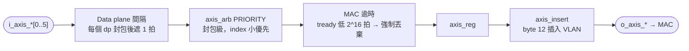

# `eth_pkt`

## 概要

每個 host 埠一份，是封包進 MAC 前的最後一級：6 個來源做封包級優先權仲裁，視需要插入 VLAN tag，並在 MAC 長時間不接收時丟棄資料，避免整個 HSB 卡住。

| 項目 | 值 |
|---|---|
| 原始碼 | [`eth_pkt/eth_pkt.sv`](https://github.com/nvidia-holoscan/holoscan-sensor-bridge/blob/41cecaa81ab906a55e7ec22e5e6989f7e602a4c8/fpga/nv_hsb_ip/eth_pkt/eth_pkt.sv)（384 行） |
| 實例 | [`HOLOLINK_top.sv#L966`](https://github.com/nvidia-holoscan/holoscan-sensor-bridge/blob/41cecaa81ab906a55e7ec22e5e6989f7e602a4c8/fpga/nv_hsb_ip/top/HOLOLINK_top.sv#L966) |
| 時脈 | `i_pclk`（HIF） |
| 分析深度 | 仲裁、逾時、輸出逐行；`axis_insert` 內部未讀 |

## 參數

| 參數 | 傳入 | 說明 |
|---|---|---|
| `N_INPT` | `PORT_NUM = 6` | |
| `W_DATA` | `HOST_WIDTH` | |
| `W_USER` | `VLAN_TUSER = 17` | `{插入 VLAN, TCI[15:0]}` |
| `VLAN_DISABLE` | | |

## 介面

| 方向 | 名稱 | 說明 |
|---|---|---|
| in | `i_axis_*[N_INPT]` | 6 個來源，順序見下表 |
| out | `o_axis_*` | → MAC |
| out | `o_pkt_inc` | 每送出一個封包脈衝一次 → `bootp` |
| out | `o_ptp_val` | PTP（index 1）封包送完的脈衝 → `ptp_top` 打 TX 時間戳 |
| out | `o_del_req_val` | PTP Delay_Req 送出（Bridge 用） |

| Index | 來源 |
|---|---|
| 0 | Data Plane（`dp_pkt_top`） |
| 1 | PTP |
| 2 | RoCE ACK/NAK |
| 3 | LS 回應（ECB / BOOTP / ARP / Ping / Event / Loopback） |
| 4 | 802.3x PAUSE |
| 5 | Bridge |

## 內部結構



## 行為

### 1. Data plane 間隔

[L98–L110](https://github.com/nvidia-holoscan/holoscan-sensor-bridge/blob/41cecaa81ab906a55e7ec22e5e6989f7e602a4c8/fpga/nv_hsb_ip/eth_pkt/eth_pkt.sv#L98-L110)：index 0 每送完一個封包（`tlast` 被接受），下一拍把它的 `tvalid` 與 `tready` 遮掉。因為仲裁是固定優先權，沒有這一拍，連續的影像資料會讓其他來源永遠拿不到匯流排。

### 2. 仲裁

`axis_arb`，`ARB_TYPE = "PRIORITY"`（[L117](https://github.com/nvidia-holoscan/holoscan-sensor-bridge/blob/41cecaa81ab906a55e7ec22e5e6989f7e602a4c8/fpga/nv_hsb_ip/eth_pkt/eth_pkt.sv#L117)）。以封包為單位，封包中途不換來源。`SKID = 5'b01011` 對高速來源加 skid buffer（註解寫 data plane、PTP、pause、bridge）。

### 3. MAC 逾時

[L180–L201](https://github.com/nvidia-holoscan/holoscan-sensor-bridge/blob/41cecaa81ab906a55e7ec22e5e6989f7e602a4c8/fpga/nv_hsb_ip/eth_pkt/eth_pkt.sv#L180-L201)：

```systemverilog
if (!w_arb_axis_tready) tready_cnt <= (tready_cnt == '1) ? '1 : tready_cnt + 1;
else                    tready_cnt <= '0;
drop_pkt <= (tready_cnt == '1);
assign arb_axis_tready = drop_pkt ? '1 : w_arb_axis_tready;
```

下游連續 2^16 拍（模擬時 2^12）不接收，就強制 `tready = 1` 把資料倒掉，直到下游恢復。以 156.25 MHz 計約 0.42 ms。link down 時這可以避免各來源 FIFO 塞滿、控制平面卡死。

### 4. VLAN 插入

[L246–L280](https://github.com/nvidia-holoscan/holoscan-sensor-bridge/blob/41cecaa81ab906a55e7ec22e5e6989f7e602a4c8/fpga/nv_hsb_ip/eth_pkt/eth_pkt.sv#L246-L280)：

```systemverilog
assign vlan_tag[31:16] = 16'h8100;
assign vlan_tag[15:0]  = reg_axis_tuser[15:0];   // TCI
assign ins_vlan        = reg_axis_tuser[16];
```

每個來源用自己的 `tuser` 決定要不要帶 VLAN。Data plane 的 `tuser` 來自 VP 設定 RAM 的 `DP_VLAN`；Event 封包來自 `ctrl_evt_vlan`。

## 暫存器

基底 `0x0200_0100 + host × 0x1_0000`（[regmap.md](../registers/regmap.md#ethernet-packet)）：`eth_pkt_scratch`（0x00）、`eth_pkt_ctrl`（0x04）、`eth_pkt_hp_cnt`（0x08）、`eth_pkt_stat`（0x80）。各位元意義本文件沒有分析。

## 注意事項

1. `HOLOLINK_top.sv` 的埠號註解與實際順序不一致，見 [overview §6](../architecture/overview.md#6-eth_pkt-輸入埠分配)。
2. 逾時丟棄是「倒掉直到恢復」，不是整包丟。恢復的那一刻 MAC 可能收到半個封包（推斷）。

## 與 1722 Listener 的關係

Listener 是 RX 方向，不經過 `eth_pkt`。如果 Listener 要回送任何封包（例如 1722 的 AECP/ACMP 控制回應），就要在這裡新增一個輸入埠，並決定它的優先權。
