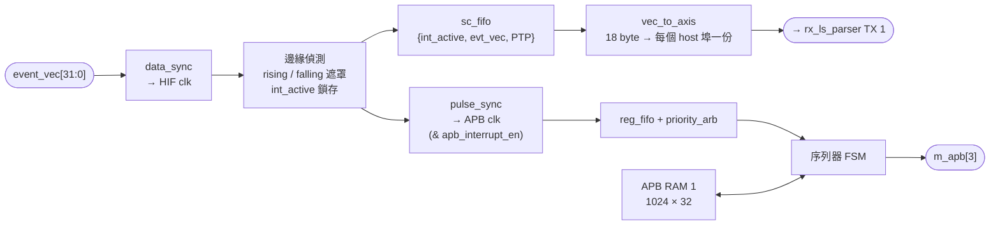

# 事件與暫存器序列器（`ctrl_bus_evt_int`、`ctrl_bus_evt_fsm`）

## 概要

HSB 的事件機制有兩個用途：

1. **中斷封包**：事件（GPIO、周邊 busy 變化、軟體觸發等）發生時，送一個 UDP 封包通知 host。
2. **暫存器序列器**：事件發生時，從 APB RAM 讀出預先寫好的「程式」，自動執行一連串 APB 讀、寫、輪詢。host 軟體用它做 I2C 交易等需要多步暫存器操作的工作，省掉多次 ECB 往返。

| 檔案 | 行數 | 功能 |
|---|---|---|
| [`ctrl_bus_evt/ctrl_bus_evt_int.sv`](https://github.com/nvidia-holoscan/holoscan-sensor-bridge/blob/41cecaa81ab906a55e7ec22e5e6989f7e602a4c8/fpga/nv_hsb_ip/ctrl_bus_evt/ctrl_bus_evt_int.sv) | 415 | 邊緣偵測、中斷封包、暫存器 |
| [`ctrl_bus_evt/ctrl_bus_evt_fsm.sv`](https://github.com/nvidia-holoscan/holoscan-sensor-bridge/blob/41cecaa81ab906a55e7ec22e5e6989f7e602a4c8/fpga/nv_hsb_ip/ctrl_bus_evt/ctrl_bus_evt_fsm.sv) | 391 | 序列器 FSM、APB RAM |

實例：`rx_ls_parser` 內（`u_evt_int`）。分析深度：逐行。

## 事件向量

`HOLOLINK_top` 輸入（[L528](https://github.com/nvidia-holoscan/holoscan-sensor-bridge/blob/41cecaa81ab906a55e7ec22e5e6989f7e602a4c8/fpga/nv_hsb_ip/top/HOLOLINK_top.sv#L528)），`ctrl_bus_evt_int` 再把 bit 2、3 換成內部來源（[L84–L87](https://github.com/nvidia-holoscan/holoscan-sensor-bridge/blob/41cecaa81ab906a55e7ec22e5e6989f7e602a4c8/fpga/nv_hsb_ip/ctrl_bus_evt/ctrl_bus_evt_int.sv#L84-L87)）：

| Bit | 來源 |
|---|---|
| 0 | `i2c_busy` |
| 1 | `spi_busy` |
| 2 | 軟體事件（`ctrl_evt_sw_event[0]`） |
| 3 | 序列器逾時或 APB 錯誤 |
| 4 | `uart_irq` |
| 15:5 | 0 |
| 31:16 | `i_sif_event[15:0]`（板級） |

host 軟體的 `Hololink::Event` 列舉（`hololink.hpp` 第 465 行起）使用同一組 bit，並約定了板級事件的用法：

| Bit | `Hololink::Event` |
|---|---|
| 0 | `I2C_BUSY` |
| 2 | `SW_EVENT` |
| 16 / 17 | `SIF_0_FRAME_END` / `SIF_1_FRAME_END` |
| 18 / 19 | `GPIO0` / `GPIO1` |
| 20 / 21 | `SIF_0_FRAME_START` / `SIF_1_FRAME_START` |

bit 16 以上的實際接法由各板級 top 決定。

## 內部結構



## 行為

### 1. 邊緣偵測與中斷封包（HIF 時脈）

[L191–L228](https://github.com/nvidia-holoscan/holoscan-sensor-bridge/blob/41cecaa81ab906a55e7ec22e5e6989f7e602a4c8/fpga/nv_hsb_ip/ctrl_bus_evt/ctrl_bus_evt_int.sv#L191-L228)：每個 bit 依 `rising` / `falling` 遮罩偵測上升、下降或兩者。偵測到時 `int_active[i]` 設 1 並保持，直到 `ctrl_evt_clear[i]` 出現上升緣。`int_active` 期間同一 bit 不再觸發。

每次有新事件，把 `{int_active, evt_vec, ptp_time[63:0]}`（16 byte）推入 FIFO；狀態機依序對**每個 host 埠**送一個 18 byte 的 UDP 封包到 `ctrl_evt_host_mac/ip/udp_port`。

### 2. 序列器（APB 時脈）

`int_det & apb_interrupt_en` 的事件經 `pulse_sync` 進入序列器（[`ctrl_bus_evt_fsm.sv`](https://github.com/nvidia-holoscan/holoscan-sensor-bridge/blob/41cecaa81ab906a55e7ec22e5e6989f7e602a4c8/fpga/nv_hsb_ip/ctrl_bus_evt/ctrl_bus_evt_fsm.sv)）。多個事件同時發生時，用 `priority_arb` 依序服務（index 小的先），全部服務完才處理下一批。

**RAM 配置**（APB RAM 1，基底 `0x0000_2000`，host `APB_RAM`）：

| Word | 內容 |
|---|---|
| 0–31 | 事件 `i` 的序列起點（byte 位址，`>> 2` 後當 word index） |
| 其他 | 序列內容 |

**序列格式**：

```
cmd word      : 16 個 2-bit opcode，bit [2k+1:2k] 是第 k 個指令
指令 k        : addr, data[, mask]
...
addr = 0xFFFF_FFFF 表示序列結束
16 個指令用完後讀下一個 cmd word
```

| Opcode | 名稱 | 字數 | 動作 |
|---|---|---|---|
| `01` | WRITE | addr, data | APB 寫 |
| `10` | READ | addr, (空位) | APB 讀，結果**寫回 RAM** 的空位，host 之後用 ECB 讀 |
| `00` | POLL | addr, value, mask | APB 讀，重複直到 `(rd & mask) == value` |
| `11` | 名為 NOP | addr | **不是空操作**：`OPCODE_NOP` 有定義但狀態機沒有判斷它。opcode bit 1 為 1，所以和 READ 一樣不前進 RAM 位址，`pwdata` 與 `val_mask` 都載入 addr 這個字本身；接著對 addr 做 APB 讀，進 `APB_COMPARE`，重複直到 `(rd & addr) == addr`（[ctrl_bus_evt_fsm.sv#L304–L360](https://github.com/nvidia-holoscan/holoscan-sensor-bridge/blob/41cecaa81ab906a55e7ec22e5e6989f7e602a4c8/fpga/nv_hsb_ip/ctrl_bus_evt/ctrl_bus_evt_fsm.sv#L304-L360)；R） |

POLL 每次重讀之間有一段由計數器 `cnt` 決定的間隔。

**逾時與錯誤**：序列執行超過 `ctrl_evt_apb_timeout` 個 APB 時脈（0 = 不限）、或 APB 回 `pserr`，序列中止；同時觸發事件 bit 3，並在 `ctrl_evt_stat` 記錄是哪個事件逾時。計數器 `timer_cnt` 在 `i_aclk` 上加一（[ctrl_bus_evt_fsm.sv#L197–L214](https://github.com/nvidia-holoscan/holoscan-sensor-bridge/blob/41cecaa81ab906a55e7ec22e5e6989f7e602a4c8/fpga/nv_hsb_ip/ctrl_bus_evt/ctrl_bus_evt_fsm.sv#L197-L214)），`HOLOLINK_top` 給 `u_rx_ls_parser`（`ctrl_bus_evt_int` 在它裡面）的 `i_aclk` 是 `i_apb_clk`（[HOLOLINK_top.sv#L480](https://github.com/nvidia-holoscan/holoscan-sensor-bridge/blob/41cecaa81ab906a55e7ec22e5e6989f7e602a4c8/fpga/nv_hsb_ip/top/HOLOLINK_top.sv#L480)），所以單位是一個 APB 週期。host 固定用 51.2 ns 換算（`hololink.hpp` 的 `APB_TIMEOUT_SCALE`），只對 APB 19.53 MHz 的 CPNX100、MPF200、NV MIPI 正確；PYNQ（50 MHz）的逾時是預期的 0.41 倍，S10（100 MHz）是 0.20 倍（R + X，[PE-16](../issues.md)）。

### 3. host 的用法範例

`hololink.cpp` 的 I2C 實作（約第 2600 行）：把一整筆 I2C 交易（設定位址、啟動、輪詢 busy、讀資料）編成序列，掛在軟體事件上，然後寫 `CTRL_EVT_SW_EVENT = 1 → 0` 觸發，最後從 RAM 讀結果。

## 暫存器

基底 `0x0000_0200`（[all-registers.md](../registers/all-registers.md#區塊總覽)）：

| Offset | 名稱 | 說明 |
|---|---|---|
| 0x04 | `ctrl_evt_rising` | 上升緣觸發遮罩 |
| 0x08 | `ctrl_evt_falling` | 下降緣觸發遮罩 |
| 0x0C | `ctrl_evt_clear` | 上升緣清除 `int_active` |
| 0x10 / 0x14 | `ctrl_evt_host_mac_addr_lo/hi` | 中斷封包目的 MAC |
| 0x18 | `ctrl_evt_host_ip_addr` | |
| 0x1C | `ctrl_evt_host_udp_port` | |
| 0x20 | `ctrl_evt_dev_udp_port` | 本機來源埠 |
| 0x24 | `ctrl_evt_apb_interrupt_en` | 哪些事件啟動序列器 |
| 0x28 | `ctrl_evt_apb_timeout` | `[23:0]` 序列逾時 |
| 0x2C | `ctrl_evt_sw_event` | `[0]` 軟體事件 |
| 0x30 | `ctrl_evt_vlan` | `[15:0]` TCI、`[16]` 啟用 |
| 0x80 | `ctrl_evt_stat` | `int_active` |
| 0x84 | | `[4:0]` 逾時的事件 index、`[29]` 逾時、`[28]` APB 錯誤 |

## 注意事項

1. `HOLOLINK_top` 中 `event_vec` 的 bit 2、3 是 `event_internal_int = 0`，實際值在 `ctrl_bus_evt_int` 內被取代。（[NT-14](../issues.md#註解與死碼不影響功能)）
2. 中斷封包對每個 host 埠都送一份，目的位址相同。
