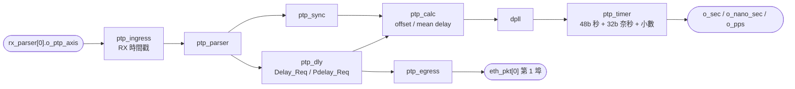

# 其他模組（結構層級）

這些模組不在 Listener 路徑上，只分析到結構與介面。

| 模組 | 章節 |
|---|---|
| `packetizer_top` | [§1](#packetizer_top) |
| `ptp_top` | [§2](#ptp_top) |
| `reset_gen` | [§3](#reset_gen) |
| APB 子系統 | [§4](#apb-子系統) |
| `ctrl_bus_evt_*` | [§5](#ctrl_bus_evt) |
| `bootp`、`arp_ping_pkt_proc` | [§6](#bootp--arp_ping_pkt_proc) |
| 周邊（SPI / I2C / UART / GPIO） | [§7](#周邊) |
| `sys_init`、`eeprom_info` | [§8](#sys_init--eeprom_info) |
| Bridge 模式 | [§9](#bridge-模式) |

---

## `packetizer_top`

原始碼：[`packetizer/`](https://github.com/nvidia-holoscan/holoscan-sensor-bridge/tree/41cecaa81ab906a55e7ec22e5e6989f7e602a4c8/fpga/nv_hsb_ip/packetizer)。每個 SIF RX 一份（[`HOLOLINK_top.sv#L1482`](https://github.com/nvidia-holoscan/holoscan-sensor-bridge/blob/41cecaa81ab906a55e7ec22e5e6989f7e602a4c8/fpga/nv_hsb_ip/top/HOLOLINK_top.sv#L1482)）。

| `PACKETIZER_ENABLE` | 模式 | 說明 |
|---|---|---|
| 0 | Bypass | 只做寬度轉換與 CDC，1 個 VP |
| 1 | Programmable | host 寫入程式（`pack_ram_addr` / `pack_ram_data`）重排位元 |
| 2 | Static | 內建 pattern catalog，`pack_scratch[5:0]` 選擇；`SIF_RX_PCK_PATTERNS` 可在合成時刪掉不用的 pattern |

| 參數 | 來源 | 意義 |
|---|---|---|
| `VP_COUNT` / `VP_SIZE` | `SIF_RX_VP_COUNT[]` / `SIF_RX_VP_SIZE[]` | 拆成幾個 VP、每個 VP 寬度 |
| `SORT_RESOLUTION` / `NUM_CYCLES` | `SIF_RX_SORT_RESOLUTION[]` / `SIF_RX_NUM_CYCLES[]` | 排序粒度與循環長度 |

輸出：每個 VP 一條 `HOST_WIDTH` AXIS（HIF 時脈），加 `o_sof` 脈衝。MIPI CSI-2 的 RAW10/12 等打包格式在這裡重排成 host 好處理的格式；host 軟體 `PacketizerProgram` 負責產生程式。

## `ptp_top`

原始碼：[`ptp/`](https://github.com/nvidia-holoscan/holoscan-sensor-bridge/tree/41cecaa81ab906a55e7ec22e5e6989f7e602a4c8/fpga/nv_hsb_ip/ptp)。一份，只接 host 埠 0（[`HOLOLINK_top.sv#L689`](https://github.com/nvidia-holoscan/holoscan-sensor-bridge/blob/41cecaa81ab906a55e7ec22e5e6989f7e602a4c8/fpga/nv_hsb_ip/top/HOLOLINK_top.sv#L689)）。

| `ptp_ctrl_profile` | Profile | 延遲量測 |
|---|---|---|
| 0 | IEEE 1588 E2E | Delay_Req / Delay_Resp |
| 1 | **gPTP（802.1AS）** | Pdelay_Req / Pdelay_Resp / Pdelay_Resp_Follow_Up |
| 2 | IEEE 1588 P2P | 同 gPTP |

host 軟體常數：`FPGA_PTP_PROFILE = 0x108`、`FPGA_PTP_PROFILE_GPTP = 0x1`。HSB 是 PTP slave。PTP 時間經 `streaming_cdc` 同步到 HIF 與 APB 時脈。定義 `EXT_PTP` 時改由外部輸入時間。

## `reset_gen`

`i_sys_rst`（板級）與 `i_cfg_rst`（= `hsb_ctrl[3]`）合併後，每個時脈域各一個 `reset_sync`：APB、HIF、PTP、每個 SIF RX、每個 SIF TX。同步後的 reset 也輸出給板級。

## APB 子系統

| 模組 | 用途 |
|---|---|
| `apb_intc_top` | 4 master → 分層 `apb_switch` → slave；含 watchdog 逾時 |
| `apb_switch` | 依位址欄位分派 |
| `s_apb_reg` | 暫存器區塊：`N_CTRL` 個 RW（0x00 起）、`N_STAT` 個 RO（0x80 起），跨到模組時脈 |
| `s_apb_ram` | APB 可讀寫的 RAM |
| `apb_to_axi4l` | 給板級把使用者 APB 轉 AXI4-Lite |

讀到未定義位址回 `0xBADADD12`（`INVAID_RD_DATA`）。位址解碼見 [memory-map.md](../registers/memory-map.md)。

## `ctrl_bus_evt`

`ctrl_bus_evt_int` 在 `rx_ls_parser` 內。

- 輸入 `event_vec[31:0]`。`ctrl_evt_rising` / `ctrl_evt_falling` 選觸發緣，`ctrl_evt_clear` 清除。
- 事件發生時送中斷 UDP 封包到 `ctrl_evt_host_mac/ip/udp_port`。
- `ctrl_bus_evt_fsm` 可在事件發生時經 `m_apb[3]` 執行暫存器序列，序列存在 APB RAM 1（`0x0000_2000`，host 軟體 `APB_RAM`）。`ctrl_evt_apb_interrupt_en`、`ctrl_evt_apb_timeout` 控制這個功能（推斷）。

## `bootp` / `arp_ping_pkt_proc`

| 模組 | 功能 |
|---|---|
| `bootp` | `init_done` 後對每個 host 埠送 BOOTP request，之後隨 PTP 同步訊號重複。vendor 欄位（tag 0xE0、"NVDA"）帶 enumeration 資料（board ID / 版本 / SN、HSB 版本）。收到 reply 時更新本機 IP。host 的 `Enumerator` 靠它找裝置 |
| `arp_ping_pkt_proc` | ARP reply；ICMP echo reply（type 改 0）；UDP Loopback（dport 4096）交換來源 / 目的後送回 |

## 周邊

| 模組 | 基底 | 說明 |
|---|---|---|
| `spi_ctrl_fsm` | `0x0300_0000` | `SPI_INST` 組匯流排共用一個控制器，`o_bus_en` 選擇；未選中的 CS 保持高 |
| `i2c_ctrl_fsm` | `0x0300_0200` | 同上，open-drain 用 `*_en`；EEPROM 也走這裡 |
| `uart_ctrl_fsm` | `0x0300_0400` | FIFO 256（模擬 64） |
| `glb_ctrl_top` | `0x0000_0000` | GPIO、`hsb_ctrl`、版本（0x80）、日期（0x84） |

周邊的 busy 訊號都進 `event_vec`。

## `sys_init` / `eeprom_info`

| 模組 | 說明 |
|---|---|
| `sys_init` | 經 `m_apb[1]` 依序寫 `init_reg[N_INIT_REG]`（每筆 `{addr, data}`）。CPNX100 用它設定 PCS 與 MAC |
| `eeprom_info` | `sys_init` 完成後經 `m_apb[2]` 驅動 I2C 讀 EEPROM：MAC、IP、board 版本、SN、CRC |

## Bridge 模式

定義 `BRIDGE_IF_INST` 時，HSB 變成小型 Ethernet switch，SIF 介面當作額外的 Ethernet 埠。

| 模組 | 說明 |
|---|---|
| `axis_buffer`（SIF RX） | 每個 SIF 雙時脈緩衝，2 個 MTU |
| `routing_table` | 64 筆 CAM，學習來源 MAC、查目的 MAC；辨識 PTP Delay_Req |
| `bridge_pkt_proc` | HIF ↔ SIF 轉送；等 CAM 回應時對 `rx_parser` 背壓；廣播依 `ctrl_reg[0]` 決定可轉送的埠；PTP residence time 修正（透明時鐘） |

Data Plane、Sensor TX、PAUSE、PTP TX 全部移除。dest MAC 不是本機的封包（`is_btx`）只有在這個模式下才會被轉送。
