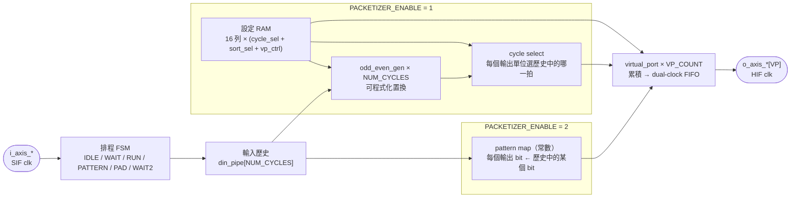
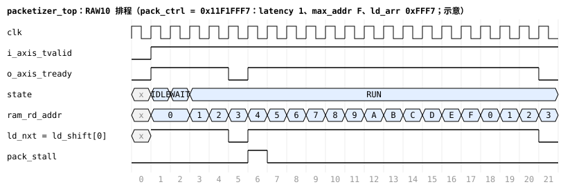

# Packetizer（`packetizer_top` 與子模組）

## 概要

每個 SIF RX 一份。把感測器時脈下的 AXIS 串流（例如 MIPI CSI-2 RX 的輸出）在位元層級重新排列，拆成一或多個 Virtual Port（VP），跨到 HIF 時脈後交給 `dp_pkt_top`。用途是把感測器的打包格式（RAW10、RAW12 等）轉成 host 好處理的格式，並把同一條感測器串流分到多個目的地。

| 檔案 | 行數 | 功能 |
|---|---|---|
| [`packetizer_top.sv`](https://github.com/nvidia-holoscan/holoscan-sensor-bridge/blob/41cecaa81ab906a55e7ec22e5e6989f7e602a4c8/fpga/nv_hsb_ip/packetizer/packetizer_top.sv) | 600 | 暫存器、排程狀態機、模式選擇 |
| [`packetizer.sv`](https://github.com/nvidia-holoscan/holoscan-sensor-bridge/blob/41cecaa81ab906a55e7ec22e5e6989f7e602a4c8/fpga/nv_hsb_ip/packetizer/packetizer.sv) | 279 | 可程式化資料路徑：設定 RAM、排序網路、VP |
| [`packetizer_static.sv`](https://github.com/nvidia-holoscan/holoscan-sensor-bridge/blob/41cecaa81ab906a55e7ec22e5e6989f7e602a4c8/fpga/nv_hsb_ip/packetizer/packetizer_static.sv) | 254 | 固定 pattern 資料路徑：查表式位元路由 |
| [`packetizer_pkg.sv`](https://github.com/nvidia-holoscan/holoscan-sensor-bridge/blob/41cecaa81ab906a55e7ec22e5e6989f7e602a4c8/fpga/nv_hsb_ip/packetizer/packetizer_pkg.sv) | 121 | 固定 pattern catalog（自動產生） |
| [`odd_even_gen.sv`](https://github.com/nvidia-holoscan/holoscan-sensor-bridge/blob/41cecaa81ab906a55e7ec22e5e6989f7e602a4c8/fpga/nv_hsb_ip/packetizer/odd_even_gen.sv) | 90 | Batcher odd-even merge 排序網路（當作可程式化置換網路用） |
| [`virtual_port.sv`](https://github.com/nvidia-holoscan/holoscan-sensor-bridge/blob/41cecaa81ab906a55e7ec22e5e6989f7e602a4c8/fpga/nv_hsb_ip/packetizer/virtual_port.sv) | 257 | VP：位元累積、跨時脈 FIFO |

實例：[`HOLOLINK_top.sv#L1482`](https://github.com/nvidia-holoscan/holoscan-sensor-bridge/blob/41cecaa81ab906a55e7ec22e5e6989f7e602a4c8/fpga/nv_hsb_ip/top/HOLOLINK_top.sv#L1482)。分析深度：所有 RTL 逐行；pattern catalog 的內容（`packetizer_pkg.sv` 中自動產生的常數）未逐位元檢查。

## 參數

| 參數 | `HOLOLINK_top` 來源 | 說明 |
|---|---|---|
| `DIN_WIDTH` | `SIF_RX_WIDTH[i]` | 感測器輸入寬度 |
| `DOUT_WIDTH` | `HOST_WIDTH` | |
| `PACKETIZER_ENABLE` | `SIF_RX_PACKETIZER_EN[i]` | 0 = bypass、1 = 可程式化、2 = 固定 pattern |
| `VP_COUNT` | `SIF_RX_VP_COUNT[i]` | VP 數（最多 4） |
| `VP_SIZE` | `SIF_RX_VP_SIZE[i]` | 每個 VP 的寫入寬度（bit） |
| `SORT_RESOLUTION` | `SIF_RX_SORT_RESOLUTION[i]` | 排序網路的單位（bit） |
| `NUM_CYCLES` | `SIF_RX_NUM_CYCLES[i]` | 保留幾個輸入 beat 的歷史 |
| `MIXED_VP_SIZE`、`DYNAMIC_VP` | 固定 0 | `HOLOLINK_top` 不啟用 |
| `PATTERN_MASK` | `SIF_RX_PCK_PATTERNS` | 固定 pattern 模式下保留哪些 pattern |
| `W_USER` | `DATAUSER_WIDTH` | 輸入 `tuser` 寬度 |

## 介面

| 方向 | 名稱 | 時脈 | 說明 |
|---|---|---|---|
| in | `i_axis_*` | SIF | 感測器串流。**一個 AXIS 封包 = 一個 frame**；`tuser[0]` = 這個 beat 不經過重排（bypass），`tuser[1]` = line 結束 |
| out | `o_axis_tready` | SIF | |
| out | `o_axis_*[VP_COUNT]` | HIF | 每個 VP 一條 AXIS |
| out | `o_sof[VP_COUNT]` | HIF | frame 開始脈衝（所有 VP 相同） |

## 內部結構

## 行為

### 1. 輸入接收與 frame 追蹤（`packetizer_top`）

| 訊號 | 定義 | 原始碼 |
|---|---|---|
| `buf_rd_val` | `i_axis_tvalid && o_axis_tready`：這一拍有 beat 被接收 | [L403](https://github.com/nvidia-holoscan/holoscan-sensor-bridge/blob/41cecaa81ab906a55e7ec22e5e6989f7e602a4c8/fpga/nv_hsb_ip/packetizer/packetizer_top.sv#L403) |
| `pkt_active` | 收到 frame 第一個 beat 後設 1，收到 `tlast` 清 0 | [L212–L214](https://github.com/nvidia-holoscan/holoscan-sensor-bridge/blob/41cecaa81ab906a55e7ec22e5e6989f7e602a4c8/fpga/nv_hsb_ip/packetizer/packetizer_top.sv#L212-L214) |
| `sif_sof` | `tvalid && !pkt_active && tready`：frame 的第一個 beat | [L242](https://github.com/nvidia-holoscan/holoscan-sensor-bridge/blob/41cecaa81ab906a55e7ec22e5e6989f7e602a4c8/fpga/nv_hsb_ip/packetizer/packetizer_top.sv#L242) |
| `last_buf` | 2 bit 計數：SIF 端收到 `tlast` 加 1；VP 0 在 HIF 端送出 `tlast`（經 `pulse_sync` 回來）減 1 | [L211](https://github.com/nvidia-holoscan/holoscan-sensor-bridge/blob/41cecaa81ab906a55e7ec22e5e6989f7e602a4c8/fpga/nv_hsb_ip/packetizer/packetizer_top.sv#L211)、[L221–L240](https://github.com/nvidia-holoscan/holoscan-sensor-bridge/blob/41cecaa81ab906a55e7ec22e5e6989f7e602a4c8/fpga/nv_hsb_ip/packetizer/packetizer_top.sv#L221-L240) |
| `last_tready` | `last_buf` 達 2（或為 1 且這拍又收到 `tlast`）時拉低：最多 2 個 frame 結尾在途 | [L217](https://github.com/nvidia-holoscan/holoscan-sensor-bridge/blob/41cecaa81ab906a55e7ec22e5e6989f7e602a4c8/fpga/nv_hsb_ip/packetizer/packetizer_top.sv#L217) |
| `inp_tuser` / `buf_tuser` | `W_USER < 2` 時補 0；`pack_ctrl[28] = 0` 時強制 `tuser[0] = 1`（整個串流走 bypass） | [L264–L267](https://github.com/nvidia-holoscan/holoscan-sensor-bridge/blob/41cecaa81ab906a55e7ec22e5e6989f7e602a4c8/fpga/nv_hsb_ip/packetizer/packetizer_top.sv#L264-L267) |

`last_buf` 只看 VP 0 的輸出（`out_is_last` 用 `o_axis_tvalid[0]`），所以其他 VP 的 frame 結尾不會釋放這個額度（[L222](https://github.com/nvidia-holoscan/holoscan-sensor-bridge/blob/41cecaa81ab906a55e7ec22e5e6989f7e602a4c8/fpga/nv_hsb_ip/packetizer/packetizer_top.sv#L222)）。

### 2. 排程 FSM

狀態用 one-hot 編碼（[L177–L185](https://github.com/nvidia-holoscan/holoscan-sensor-bridge/blob/41cecaa81ab906a55e7ec22e5e6989f7e602a4c8/fpga/nv_hsb_ip/packetizer/packetizer_top.sv#L177-L185)），轉移在 [L406–L452](https://github.com/nvidia-holoscan/holoscan-sensor-bridge/blob/41cecaa81ab906a55e7ec22e5e6989f7e602a4c8/fpga/nv_hsb_ip/packetizer/packetizer_top.sv#L406-L452)：

| 狀態 | 進入條件 | 行為 | 離開 |
|---|---|---|---|
| `IDLE` | reset、line / frame 處理完 | `buf_rd_req = 1`：每拍都可收 beat | 非 bypass beat 進來：`latency = 0` → `RUN`（若同拍 `tlast` 且 `max_addr = 0` 則留在 `IDLE`），否則 → `WAIT`；bypass 的 line 結尾（`tuser[1]`）且 `pad_enable` → `PAD` |
| `WAIT` | `latency ≠ 0` | 累積 `latency` 拍歷史；`ram_rd_addr` 只在最後一拍前進 | `latency_cnt == latency − 1` → `RUN` |
| `RUN` | | 每拍依 `ld_shift[0]`（目前列的 `ld_arr` bit）決定是否讀新 beat | 收到 `tlast` 或 `tuser[1]`、或列號到 `max_addr` 且上一個 beat 是 `tlast`：`latency ≠ 0` → `WAIT2`；列未跑完 → `PATTERN`；否則依補齊需求 → `PAD` / `IDLE` |
| `WAIT2` | line / frame 結束且有 latency | 不讀輸入，讓管線中剩下的歷史排出 | 到 `latency − 1` 後 → `PATTERN` / `PAD` / `IDLE` |
| `PATTERN` | line 結束時列還沒跑到 `max_addr` | 不讀輸入，用 0 補滿 pattern 剩下的列 | 列跑完 → `PAD` / `IDLE` |
| `PAD` | `pad_enable = 1` | 輸出 0，直到這條 line 的輸出拍數是 `PAD_CYCLES` 的倍數 | `cnt == PAD_CYCLES − 2` → `IDLE` |
| `PACK_DELAY` | **無**：沒有任何轉移會進入此狀態 | 停讀 `PACK_LATENCY = 0xF` 拍 | 死碼 |

輔助邏輯：

- **`buf_rd_req`**（[L456–L460](https://github.com/nvidia-holoscan/holoscan-sensor-bridge/blob/41cecaa81ab906a55e7ec22e5e6989f7e602a4c8/fpga/nv_hsb_ip/packetizer/packetizer_top.sv#L456-L460)）：`WAIT2` / `PATTERN` / `PAD` 與 `DELAY` 不讀；上一拍 VP 快滿（`r_pack_tready = 0`）不讀；`IDLE` 一律讀；其他狀態只在 `ld_nxt` 為 1 時讀。最後 `o_axis_tready = last_tready & buf_rd_req`（[L598](https://github.com/nvidia-holoscan/holoscan-sensor-bridge/blob/41cecaa81ab906a55e7ec22e5e6989f7e602a4c8/fpga/nv_hsb_ip/packetizer/packetizer_top.sv#L598)）。注意 `o_axis_tready` 依賴 `i_axis_tvalid`（`ld_nxt && i_axis_tvalid`），這不符合 AXIS「`tready` 不應依賴 `tvalid`」的建議，但不違反規範。
- **列計數**（[L344–L370](https://github.com/nvidia-holoscan/holoscan-sensor-bridge/blob/41cecaa81ab906a55e7ec22e5e6989f7e602a4c8/fpga/nv_hsb_ip/packetizer/packetizer_top.sv#L344-L370)）：`ram_sos`（`IDLE` 且這拍沒收 beat、或 `latency ≠ 0`）把列號歸 0 並重新載入 `ld_shift = ld_arr`；`ram_advance` 時列號加 1、`ld_shift` 右移；列號 ≥ `max_addr` 時繞回 0。**APB 寫 RAM 也會把列號設成 `pack_ram_addr[3:0]`**（[L353–L356](https://github.com/nvidia-holoscan/holoscan-sensor-bridge/blob/41cecaa81ab906a55e7ec22e5e6989f7e602a4c8/fpga/nv_hsb_ip/packetizer/packetizer_top.sv#L353-L356)），所以串流進行中寫 RAM 會打亂排程。
- **`pack_dvalid`**（[L394–L397](https://github.com/nvidia-holoscan/holoscan-sensor-bridge/blob/41cecaa81ab906a55e7ec22e5e6989f7e602a4c8/fpga/nv_hsb_ip/packetizer/packetizer_top.sv#L394-L397)）：送進資料路徑的有效旗標。`IDLE` 時 = `buf_rd_val`（包括 bypass beat，IDLE 是 bypass 的主要路徑）；PAD 類狀態一律有效（輸出 0 或歷史資料）；`DELAY` 為 0；其他狀態 = 讀到非 bypass beat，或這一列不讀輸入（`!ld_nxt`，用歷史產生輸出）。
- **`pack_stall`**（[L390](https://github.com/nvidia-holoscan/holoscan-sensor-bridge/blob/41cecaa81ab906a55e7ec22e5e6989f7e602a4c8/fpga/nv_hsb_ip/packetizer/packetizer_top.sv#L390)）：上一列不讀輸入，資料路徑的歷史暫存器不前移。
- **`cnt`**（[L463–L468](https://github.com/nvidia-holoscan/holoscan-sensor-bridge/blob/41cecaa81ab906a55e7ec22e5e6989f7e602a4c8/fpga/nv_hsb_ip/packetizer/packetizer_top.sv#L463-L468)）：每條 line 的輸出拍數，用來決定補齊長度。`PAD_CYCLES = 64 / (DIN_WIDTH / 8)`（[L68–L71](https://github.com/nvidia-holoscan/holoscan-sensor-bridge/blob/41cecaa81ab906a55e7ec22e5e6989f7e602a4c8/fpga/nv_hsb_ip/packetizer/packetizer_top.sv#L68-L71)）：64-bit 輸入時 8 拍；`DIN_WIDTH ≥ 512` 時 `NO_PAD`。

下圖是 host 軟體 `Csi10ToPacked10` 使用的 RAW10 排程：每 16 列有 1 列不讀輸入，所以每 15 個輸入 beat（120 byte）產生 16 個輸出 beat（128 byte）。

### 3. 設定 RAM 寫入

| 步驟 | 時脈 | 原始碼 |
|---|---|---|
| APB 寫 offset 0x08（`pack_ram_data`）且 `pready` → `wr_en` | APB | [L140](https://github.com/nvidia-holoscan/holoscan-sensor-bridge/blob/41cecaa81ab906a55e7ec22e5e6989f7e602a4c8/fpga/nv_hsb_ip/packetizer/packetizer_top.sv#L140) |
| `wr_en` 先在 APB 時脈打一拍（避免同步器取樣組合邏輯 glitch） | APB | [L145–L153](https://github.com/nvidia-holoscan/holoscan-sensor-bridge/blob/41cecaa81ab906a55e7ec22e5e6989f7e602a4c8/fpga/nv_hsb_ip/packetizer/packetizer_top.sv#L145-L153) |
| 3 級 `data_sync` 到 SIF 時脈；`wr_en_fall` 偵測同步後脈衝的**下降緣** | SIF | [L155–L175](https://github.com/nvidia-holoscan/holoscan-sensor-bridge/blob/41cecaa81ab906a55e7ec22e5e6989f7e602a4c8/fpga/nv_hsb_ip/packetizer/packetizer_top.sv#L155-L175)、[L590](https://github.com/nvidia-holoscan/holoscan-sensor-bridge/blob/41cecaa81ab906a55e7ec22e5e6989f7e602a4c8/fpga/nv_hsb_ip/packetizer/packetizer_top.sv#L590) |
| `ram_addr = {pack_ram_addr[15:4], ram_rd_addr}`：上半選 RAM 區塊、下半是列號（寫入時列號已被設成 `pack_ram_addr[3:0]`） | SIF | [L591–L592](https://github.com/nvidia-holoscan/holoscan-sensor-bridge/blob/41cecaa81ab906a55e7ec22e5e6989f7e602a4c8/fpga/nv_hsb_ip/packetizer/packetizer_top.sv#L591-L592) |

時脈關係的限制（推斷）：`wr_en_r` 只有 1 個 APB 時脈寬。SIF 時脈比 APB 時脈慢時，`data_sync` 可能取樣不到這個脈衝，寫入會遺失。整合時要確認 SIF RX 時脈不低於 APB 時脈（本文件未逐一確認各板級的 SIF 時脈頻率）。

寫入順序：host 軟體與 testbench 都**先寫 `pack_ctrl`，再寫 RAM**（testbench 註解說明原因：每次 RAM 寫入都會把 `ld_arr` 重新載入 `ld_shift`）。

### 4. 可程式化資料路徑（`packetizer.sv`）

**RAM 組織**（[L69–L134](https://github.com/nvidia-holoscan/holoscan-sensor-bridge/blob/41cecaa81ab906a55e7ec22e5e6989f7e602a4c8/fpga/nv_hsb_ip/packetizer/packetizer.sv#L69-L134)）：設定分成三組，每組由若干個 32-bit × 16 列的分散式 RAM 組成，依序排成 `[CLEAR][SORT][VP]`。`pack_ram_addr[15:4]` 是 RAM 編號，`[3:0]` 是列號。

| 組 | 每列位元數 | 讀取時機 |
|---|---|---|
| CLEAR（cycle select） | `(DIN_WIDTH / SORT_RESOLUTION) × ⌈log2(NUM_CYCLES + 1)⌉` | 取 `ram_addr_pipe[PACK_PIPE_COUNT − 1]`，`pipe[0]` 已晚 1 拍，所以實際延遲 `PACK_PIPE_COUNT` 拍（與排序網路輸出對齊） |
| SORT | `CTRL_WIDTH_SORT × NUM_CYCLES` | 目前列號（選擇訊號隨資料在排序網路中一起前進） |
| VP | `CTRL_WIDTH_VP × VP_COUNT` | 同 CLEAR，延遲 `PACK_PIPE_COUNT` 拍 |

各板級的實際配置（由參數計算，並與 testbench 的 `pack_vp_ram_index()` 公式一致）：

| 板級 / SIF | DIN / RES / VP_SIZE / NUM_CYCLES / VP | 排序開關 | 級數 | 管線 | CLEAR / SORT / VP RAM 數 | 總 RAM | 完整寫入次數 |
|---|---|---|---|---|---|---|---|
| CPNX100 SIF 0、1 | 64 / 2 / 64 / 3 / 2 | 191 | 15 | 4 | 2 / 18 / 1 | 21 | 336 |
| NV MIPI 參考 | 64 / 2 / 64 / 3 / 1 | 191 | 15 | 4 | 2 / 18 / 1 | 21 | 336 |
| Terasic S10（512-bit，預設） | 512 / 16 / 128 / 1 / 4 | 191 | 15 | 4 | 1 / 6 / 1 | 8 | 128 |

（CPNX100 SIF 2 是 32-bit，`SIF_RX_PACKETIZER_EN = 0`，只有 bypass VP。）

**輸入歷史**（[L146–L179](https://github.com/nvidia-holoscan/holoscan-sensor-bridge/blob/41cecaa81ab906a55e7ec22e5e6989f7e602a4c8/fpga/nv_hsb_ip/packetizer/packetizer.sv#L146-L179)）：`din_pipe[0..NUM_CYCLES−1]` 是移位暫存器，`adv_pipe = din_valid && (!din_stall || din_wait)` 時前移；`WAIT` 期間即使 stall 也前移，用來累積歷史。

**排序網路**（[L193–L226](https://github.com/nvidia-holoscan/holoscan-sensor-bridge/blob/41cecaa81ab906a55e7ec22e5e6989f7e602a4c8/fpga/nv_hsb_ip/packetizer/packetizer.sv#L193-L226)、[L39–L86](https://github.com/nvidia-holoscan/holoscan-sensor-bridge/blob/41cecaa81ab906a55e7ec22e5e6989f7e602a4c8/fpga/nv_hsb_ip/packetizer/odd_even_gen.sv#L39-L86)）：每個歷史拍各一個 `odd_even_gen`。它照 Batcher odd-even merge sort 的結構產生交換點，但每個交換點由一個設定位元控制，而不是比較大小。任何排序網路在適當的「比較結果」下都能實現任意置換，所以這是一個可實現任意置換的網路。每 3 級插一級暫存器；`bypass`（beat 的 `tuser[0]`）隨管線前進，為 1 時所有交換點不動作。

**Cycle select**（[L213–L217](https://github.com/nvidia-holoscan/holoscan-sensor-bridge/blob/41cecaa81ab906a55e7ec22e5e6989f7e602a4c8/fpga/nv_hsb_ip/packetizer/packetizer.sv#L213-L217)）：每個 `SORT_RESOLUTION` 寬的輸出單位，從第 `cycle_sel − 1` 個歷史拍的排序結果取值；`cycle_sel = 0` 輸出 0。bypass beat 直接取第 0 拍的排序結果。

**VP 寫入**（[L237–L277](https://github.com/nvidia-holoscan/holoscan-sensor-bridge/blob/41cecaa81ab906a55e7ec22e5e6989f7e602a4c8/fpga/nv_hsb_ip/packetizer/packetizer.sv#L237-L277)）：

| 條件 | `vp_ctrl` |
|---|---|
| `CTRL_WIDTH_VP == 2` 且 `W_USER > 2` | `commit = (tuser[3:2] == VP 編號)`；bypass beat 一律寫 VP 0 |
| `duplicate = 1` | `'b1`（數值 1，不是全 1）= `{select = 0, commit = 1}`：每個 VP 都寫入 slice 0，也就是和 VP 0 相同的資料 |
| bypass beat | VP 0 寫 `{select = 0, commit = 1}` |
| 其他 | VP RAM 該列的值 |

bypass 的副作用：`VP_SIZE < DIN_WIDTH` 時，bypass beat 只把 `din[VP_SIZE−1:0]` 寫進 VP 0，上半部被丟掉。testbench 的 `program_packetizer_passthrough()` 為此特別寫了一個「每個輸入 beat 分 `DIN/VP_SIZE` 列依序寫出」的 pattern 來取代 bypass。

### 5. 固定 pattern 資料路徑（`packetizer_static.sv`）

| 項目 | 說明 | 原始碼 |
|---|---|---|
| 可用 pattern | `PATTERN_MASK & FIXED_PATTERN_ALL_MASK` | [L57](https://github.com/nvidia-holoscan/holoscan-sensor-bridge/blob/41cecaa81ab906a55e7ec22e5e6989f7e602a4c8/fpga/nv_hsb_ip/packetizer/packetizer_static.sv#L57) |
| 歷史深度 | 所有啟用 pattern 中最大的 `NUM_CYCLES`（合成時計算） | [L66–L86](https://github.com/nvidia-holoscan/holoscan-sensor-bridge/blob/41cecaa81ab906a55e7ec22e5e6989f7e602a4c8/fpga/nv_hsb_ip/packetizer/packetizer_static.sv#L66-L86) |
| 排程 | `IDLE` 時依 `pack_scratch[5:0]` 查表取得 `ld_arr` / `max_addr` / `latency`，進入其他狀態後鎖住直到這筆交易結束；不支援的 ID 用「每列都讀」的排程（等同 bypass） | [L269–L312](https://github.com/nvidia-holoscan/holoscan-sensor-bridge/blob/41cecaa81ab906a55e7ec22e5e6989f7e602a4c8/fpga/nv_hsb_ip/packetizer/packetizer_top.sv#L269-L312)、[L108–L115](https://github.com/nvidia-holoscan/holoscan-sensor-bridge/blob/41cecaa81ab906a55e7ec22e5e6989f7e602a4c8/fpga/nv_hsb_ip/packetizer/packetizer_static.sv#L108-L115) |
| 路由 | 每個 pattern、每列、每個輸出 bit 都是合成時決定的接線；執行時只剩「依列號選列」與「依 ID 選 pattern」兩級多工器，再打一拍 | [L164–L209](https://github.com/nvidia-holoscan/holoscan-sensor-bridge/blob/41cecaa81ab906a55e7ec22e5e6989f7e602a4c8/fpga/nv_hsb_ip/packetizer/packetizer_static.sv#L164-L209) |
| VP | 只寫 VP 0；`duplicate` 時複製到所有 VP；VP 寬度 = `DIN_WIDTH` | [L213–L250](https://github.com/nvidia-holoscan/holoscan-sensor-bridge/blob/41cecaa81ab906a55e7ec22e5e6989f7e602a4c8/fpga/nv_hsb_ip/packetizer/packetizer_static.sv#L213-L250) |

列號與資料的相位：`pattern_cycle` 延遲 2 拍（`pattern_cycle_pipe[1]`），和可程式化路徑中 SORT RAM 讀取的相位一致（[L95–L97](https://github.com/nvidia-holoscan/holoscan-sensor-bridge/blob/41cecaa81ab906a55e7ec22e5e6989f7e602a4c8/fpga/nv_hsb_ip/packetizer/packetizer_static.sv#L95-L97)）。

### 6. Virtual Port（`virtual_port.sv`）

`HOLOLINK_top` 使用 `DYNAMIC_VP = 0`：`ctrl = {select, commit}`，`commit && din_valid` 時把 `din[select × VP_SIZE +: VP_SIZE]` 寫進 FIFO（[L153–L170](https://github.com/nvidia-holoscan/holoscan-sensor-bridge/blob/41cecaa81ab906a55e7ec22e5e6989f7e602a4c8/fpga/nv_hsb_ip/packetizer/virtual_port.sv#L153-L170)）。`DYNAMIC_VP = 1` 的可變長度累積邏輯（[L60–L147](https://github.com/nvidia-holoscan/holoscan-sensor-bridge/blob/41cecaa81ab906a55e7ec22e5e6989f7e602a4c8/fpga/nv_hsb_ip/packetizer/virtual_port.sv#L60-L147)）在 `HOLOLINK_top` 不會被合成。

FIFO 大小（[L24–L30](https://github.com/nvidia-holoscan/holoscan-sensor-bridge/blob/41cecaa81ab906a55e7ec22e5e6989f7e602a4c8/fpga/nv_hsb_ip/packetizer/virtual_port.sv#L24-L30)）：

| 參數 | 公式 | `MTU = 4096`、64-bit | `MTU = 1500`、64-bit | `MTU = 4096`、512-bit |
|---|---|---|---|---|
| `AE_FLAG` | `(MTU − 79) / (DOUT_WIDTH/8) + 1` | 503 | 178 | 63 |
| 深度 | `2 × AE_FLAG` | 1006（約 8 KB） | 356（約 2.8 KB） | 126（約 8 KB） |
| 實體深度（`dc_fifo` 補到 2 的次方） | | 1024 | 512 | 128 |
| `AF_FLAG` | `((深度 + 1) / 8) × 7` | 875 | 308 | 105 |

`AE_FLAG` 約等於一個封包的 payload（MTU 扣掉 79 byte header 預留），所以 FIFO 能放約 2 個封包的資料，almost-full 在 7/8。FIFO 設定 `NO_BACKPRESSURE = 1`，不會對寫入端背壓，防止溢位完全依賴上游看 `almost_full` 停止讀取（`pack_tready`）。排序網路管線約 `PACK_PIPE_COUNT + 3` 拍，遠小於 1/8 深度的餘裕。

輸出閘控（[L243–L256](https://github.com/nvidia-holoscan/holoscan-sensor-bridge/blob/41cecaa81ab906a55e7ec22e5e6989f7e602a4c8/fpga/nv_hsb_ip/packetizer/virtual_port.sv#L243-L256)）：`tvalid` 只在「FIFO 不是 almost empty」「下游 ready」「FIFO 中已有完整 frame 結尾（`tlast_buffered`）」三者之一成立時放行。效果是 `dp_pkt_top` 在一個封包內不會斷流，除非 frame 已經結束。

`o_axis_tkeep` 固定全 1、`o_axis_tuser` 固定 0（[L254–L255](https://github.com/nvidia-holoscan/holoscan-sensor-bridge/blob/41cecaa81ab906a55e7ec22e5e6989f7e602a4c8/fpga/nv_hsb_ip/packetizer/virtual_port.sv#L254-L255)）：frame 最後一個輸出 word 若未填滿，多出的 byte 仍標成有效，長度由 `dp_pkt_top` 依設定計算。

### 7. SOF

`sif_sof` 經 `pulse_sync` 到 HIF 時脈，所有 VP 共用同一個 `o_sof`（[L224–L249](https://github.com/nvidia-holoscan/holoscan-sensor-bridge/blob/41cecaa81ab906a55e7ec22e5e6989f7e602a4c8/fpga/nv_hsb_ip/packetizer/packetizer_top.sv#L224-L249)）。`dp_pkt_ts` 用它記錄 frame 開始的 PTP 時間。

### 8. host 軟體的排程（交叉比對）

`src/hololink/core/packetizer_program.cpp`：

| 程式 | `pack_ctrl` | 解碼 |
|---|---|---|
| `Csi10ToPacked10` | `0x11F1FFF7` | enable、latency 1、`max_addr` F、pad、`ld_arr` 0xFFF7：每 16 列有 1 列（第 3 列）不讀輸入 |
| `Csi12ToPacked12` | `0x11210007` | enable、latency 1、`max_addr` 2、pad、`ld_arr` 0x0007 |
| `disable()` | `0` | `pack_ctrl[28] = 0` → bypass |

`Csi10ToPacked10::get_output_size()` 以「每 120 輸入 byte 產生 128 輸出 byte、line 結尾補完整個循環」計算；`padded_output_size()` 再補到 64 byte（`LINE_PAD_BYTES`），與 RTL 的 `PAD` 狀態一致。

## 暫存器

基底 `0x0100_0000 + SIF × 0x1_0000`（[regmap.md](../registers/regmap.md#packetizer-register)）。

| Offset | 名稱 | 位元 | 說明 |
|---|---|---|---|
| 0x00 | `pack_scratch` | [5:0] | 固定 pattern 模式的 pattern ID |
| 0x04 | `pack_ram_addr` | [15:0] | 設定 RAM 位址 |
| 0x08 | `pack_ram_data` | [31:0] | 寫入即觸發 RAM 寫入 |
| 0x0C | `pack_ctrl` | [15:0] | `ld_arr`（可程式化模式） |
| | | [16] | `pad_enable`：line 補到 64 byte |
| | | [17] | `duplicate`：寫入所有 VP |
| | | [23:20] | `max_addr` |
| | | [27:24] | `latency` |
| | | [28] | 啟用 packetizer（0 = bypass） |
| 0x80 | `pack_tvalid_cnt` | | 輸入 `tvalid` 拍數 |
| 0x84 | `pack_psn_cnt` | | 輸入 frame 數 |

## 注意事項

1. 暫存器的 `s_apb_reg` 跨到 SIF 時脈（`i_pclk = i_sclk`），不是 HIF。
2. **`latency` 是 4 bit，但 `latency_cnt` 只有 3 bit**（[L117](https://github.com/nvidia-holoscan/holoscan-sensor-bridge/blob/41cecaa81ab906a55e7ec22e5e6989f7e602a4c8/fpga/nv_hsb_ip/packetizer/packetizer_top.sv#L117)）。`latency ≥ 9` 時 `latency_cnt == latency − 1` 永遠不成立，FSM 會停在 `WAIT` / `WAIT2`，串流卡住（推斷；host 軟體只用 latency 1）。合法範圍實際上是 0–8。
3. `PACK_DELAY` 狀態沒有進入路徑，是死碼。
4. 串流進行中寫設定 RAM 會改變列號與 `ld_shift`，打亂當前 line 的排程；應在串流停止時設定。
5. `last_buf` 只追蹤 VP 0 的輸出。只用 VP 1 以上（例如 `tuser[3:2]` 分流且 VP 0 沒有流量）時，2 個 frame 之後 `last_tready` 會一直為 0（推斷）。
6. bypass 模式且 `VP_SIZE < DIN_WIDTH` 時，每個 beat 只保留低 `VP_SIZE` bit（見 §4）。
7. VP FIFO 不背壓，溢位保護靠 `almost_full` 提前停讀；若 `dp_pkt_top` 長時間不讀某個 VP，該 SIF 的輸入會被整個停住（所有 VP 共用 `pack_tready`）。
