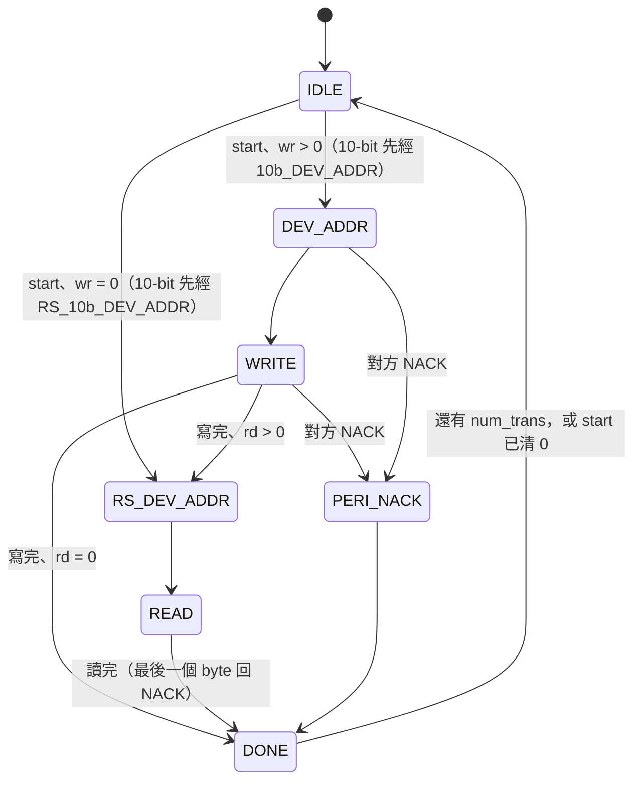
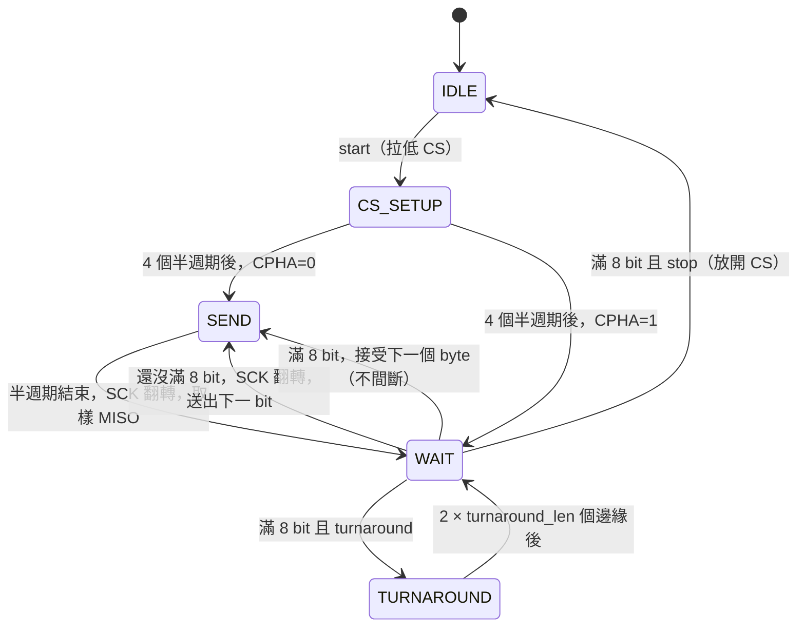

# 周邊控制器（I2C、SPI、UART、GPIO）

## 概要

三個周邊控制器都掛在 APB 周邊區（`0x0300_0000`），在 APB 時脈下運作，結構相同：

- 控制 / 狀態暫存器（APB 位址 bit 8 = 0）
- 資料緩衝 RAM（APB 位址 bit 8 = 1，offset 0x100 起）
- 一個協定引擎
- 多組實體匯流排共用一個控制器，用 `bus_en` 選擇目前驅動哪一組

| 控制器 | 原始碼 | 行數 | 基底 | 實例 |
|---|---|---|---|---|
| I2C | [`i2c/i2c_ctrl_fsm.sv`](https://github.com/nvidia-holoscan/holoscan-sensor-bridge/blob/41cecaa81ab906a55e7ec22e5e6989f7e602a4c8/fpga/nv_hsb_ip/i2c/i2c_ctrl_fsm.sv)、`i2c.sv` | 378 + 304 | `0x0300_0200` | [`HOLOLINK_top.sv#L1105`](https://github.com/nvidia-holoscan/holoscan-sensor-bridge/blob/41cecaa81ab906a55e7ec22e5e6989f7e602a4c8/fpga/nv_hsb_ip/top/HOLOLINK_top.sv#L1105) |
| SPI / QSPI | [`spi/spi_ctrl_fsm.sv`](https://github.com/nvidia-holoscan/holoscan-sensor-bridge/blob/41cecaa81ab906a55e7ec22e5e6989f7e602a4c8/fpga/nv_hsb_ip/spi/spi_ctrl_fsm.sv)、`spi.sv` | 341 + 324 | `0x0300_0000` | [L1055](https://github.com/nvidia-holoscan/holoscan-sensor-bridge/blob/41cecaa81ab906a55e7ec22e5e6989f7e602a4c8/fpga/nv_hsb_ip/top/HOLOLINK_top.sv#L1055) |
| UART | [`uart/uart_ctrl_fsm.sv`](https://github.com/nvidia-holoscan/holoscan-sensor-bridge/blob/41cecaa81ab906a55e7ec22e5e6989f7e602a4c8/fpga/nv_hsb_ip/uart/uart_ctrl_fsm.sv)、`uart.sv` | 628 + 690 | `0x0300_0400` | [L1137](https://github.com/nvidia-holoscan/holoscan-sensor-bridge/blob/41cecaa81ab906a55e7ec22e5e6989f7e602a4c8/fpga/nv_hsb_ip/top/HOLOLINK_top.sv#L1137) |
| GPIO | [`glb_ctrl/glb_ctrl_top.sv`](https://github.com/nvidia-holoscan/holoscan-sensor-bridge/blob/41cecaa81ab906a55e7ec22e5e6989f7e602a4c8/fpga/nv_hsb_ip/glb_ctrl/glb_ctrl_top.sv) | 131 | `0x0000_0000` | [L776](https://github.com/nvidia-holoscan/holoscan-sensor-bridge/blob/41cecaa81ab906a55e7ec22e5e6989f7e602a4c8/fpga/nv_hsb_ip/top/HOLOLINK_top.sv#L776) |

分析深度：I2C、SPI、UART 的控制器與位元引擎都逐行讀過。

## 匯流排多工（`HOLOLINK_top`）

[L1036–L1131](https://github.com/nvidia-holoscan/holoscan-sensor-bridge/blob/41cecaa81ab906a55e7ec22e5e6989f7e602a4c8/fpga/nv_hsb_ip/top/HOLOLINK_top.sv#L1036-L1131)：

| | 選中的匯流排 | 未選中的匯流排 |
|---|---|---|
| SPI | 驅動 CS、SCK、SDIO | CS = 1、SCK = 0、SDIO 不驅動 |
| I2C | SCL / SDA 由控制器驅動 | `*_en = 1`（釋放，open-drain 拉高） |

一次只能使用一組匯流排。

## I2C

| Offset | 位元 | 說明 |
|---|---|---|
| 0x00 | `[0]` | start |
| | `[1]` | 10-bit 位址 |
| | `[25:16]` | 裝置位址 |
| 0x04 | `[log2(N):0]` | `bus_en`：選擇匯流排 |
| 0x08 | `[15:0]` / `[31:16]` | 寫入 byte 數 / 讀取 byte 數 |
| 0x0C | `[15:0]` | `clk_cnt`：SCL 分頻 |
| 0x10 | | SCL stretch 逾時（reset `0x004C_4B40` = 5,000,000） |
| 0x14 | `[7:0]` | `num_trans` |
| 0x80 | `[0]` busy、`[2]` arbitration lost、`[3]` NACK、`[4]` done | 狀態 |
| 0x100– | | 資料緩衝：先寫入要送出的 byte，交易後讀回收到的 byte |

一次交易：送裝置位址（寫）→ 寫 `num_wr_bytes` → 若 `num_rd_bytes > 0`，repeated start 送裝置位址（讀）→ 讀 `num_rd_bytes`。host 軟體常數：`I2C_REG_BUS_EN = 4`、`I2C_REG_NUM_BYTES = 8`、`I2C_REG_CLK_CNT = 0xC`、`I2C_REG_STATUS = 0x80`、`I2C_REG_DATA_BUFFER = 0x100`。

`eeprom_info` 開機時也用這組暫存器讀 EEPROM（裝置位址 0x50），見 [boot_and_reset.md](boot_and_reset.md)。

### I2C 交易狀態機（`i2c_ctrl_fsm`）

[i2c_ctrl_fsm.sv#L125–L136](https://github.com/nvidia-holoscan/holoscan-sensor-bridge/blob/41cecaa81ab906a55e7ec22e5e6989f7e602a4c8/fpga/nv_hsb_ip/i2c/i2c_ctrl_fsm.sv#L125-L136)、[i2c_ctrl_fsm.sv#L286–L367](https://github.com/nvidia-holoscan/holoscan-sensor-bridge/blob/41cecaa81ab906a55e7ec22e5e6989f7e602a4c8/fpga/nv_hsb_ip/i2c/i2c_ctrl_fsm.sv#L286-L367)：



| 項目 | 行為 | 原始碼 |
|---|---|---|
| 啟動條件 | `ctrl[0] = 1` 且 `cmd_valid`；`num_trans ≠ 0` 時要求 `num_wr_bytes ≥ num_rd_bytes` | [i2c_ctrl_fsm.sv#L278](https://github.com/nvidia-holoscan/holoscan-sensor-bridge/blob/41cecaa81ab906a55e7ec22e5e6989f7e602a4c8/fpga/nv_hsb_ip/i2c/i2c_ctrl_fsm.sv#L278)、[i2c_ctrl_fsm.sv#L293–L298](https://github.com/nvidia-holoscan/holoscan-sensor-bridge/blob/41cecaa81ab906a55e7ec22e5e6989f7e602a4c8/fpga/nv_hsb_ip/i2c/i2c_ctrl_fsm.sv#L293-L298) |
| 狀態前進 | 位元引擎每完成一個 byte（`cmd_ack` 上升緣）前進一次 | [i2c_ctrl_fsm.sv#L353–L354](https://github.com/nvidia-holoscan/holoscan-sensor-bridge/blob/41cecaa81ab906a55e7ec22e5e6989f7e602a4c8/fpga/nv_hsb_ip/i2c/i2c_ctrl_fsm.sv#L353-L354) |
| 對方 NACK | 寫入階段收到 NACK → `PERI_NACK` → STOP，`status[3]` | [i2c_ctrl_fsm.sv#L288–L290](https://github.com/nvidia-holoscan/holoscan-sensor-bridge/blob/41cecaa81ab906a55e7ec22e5e6989f7e602a4c8/fpga/nv_hsb_ip/i2c/i2c_ctrl_fsm.sv#L288-L290) |
| 讀取 | 最後一個 byte 回 NACK（`ack_in`），之後 STOP | [i2c_ctrl_fsm.sv#L369–L370](https://github.com/nvidia-holoscan/holoscan-sensor-bridge/blob/41cecaa81ab906a55e7ec22e5e6989f7e602a4c8/fpga/nv_hsb_ip/i2c/i2c_ctrl_fsm.sv#L369-L370) |
| 資料緩衝 | 128 word（512 byte）BRAM。寫入資料從 byte 0 依序取出；**讀回的資料也從 byte 0 寫回**，覆蓋原本的寫入資料 | [i2c_ctrl_fsm.sv#L161–L216](https://github.com/nvidia-holoscan/holoscan-sensor-bridge/blob/41cecaa81ab906a55e7ec22e5e6989f7e602a4c8/fpga/nv_hsb_ip/i2c/i2c_ctrl_fsm.sv#L161-L216) |
| `num_trans` | 一次啟動執行多筆相同格式的交易，緩衝指標不歸 0，依序使用後面的 byte | [i2c_ctrl_fsm.sv#L357–L365](https://github.com/nvidia-holoscan/holoscan-sensor-bridge/blob/41cecaa81ab906a55e7ec22e5e6989f7e602a4c8/fpga/nv_hsb_ip/i2c/i2c_ctrl_fsm.sv#L357-L365) |
| busy 期間讀緩衝 | 讀回 0 | [i2c_ctrl_fsm.sv#L215](https://github.com/nvidia-holoscan/holoscan-sensor-bridge/blob/41cecaa81ab906a55e7ec22e5e6989f7e602a4c8/fpga/nv_hsb_ip/i2c/i2c_ctrl_fsm.sv#L215) |

**位元引擎**（`i2c.sv`，[i2c.sv#L148–L187](https://github.com/nvidia-holoscan/holoscan-sensor-bridge/blob/41cecaa81ab906a55e7ec22e5e6989f7e602a4c8/fpga/nv_hsb_ip/i2c/i2c.sv#L148-L187)）：每個 SCL 週期分 4 個相位（`pcnt`），每個相位約 `clk_cnt / 2` 個 APB 時脈，所以

```
f_SCL ≈ f_APB / (2 × clk_cnt)
```

host 軟體固定寫 `clk_cnt = 0x19`（註解「400 kHz」，`hololink.cpp` `set_i2c_clock()`）。以 CPNX100 的 APB 19.53 MHz 計算是 390 kHz，與註解一致（X）。這個值沒有依板級調整，見注意事項 3（[PE-5](../issues.md#周邊)）；0x10 的 stretch 逾時 reset 值同樣以 APB 週期計，在 PYNQ / S10 從 256 ms 變成 100 ms / 50 ms。對方拉低 SCL（clock stretching）時分頻計數暫停。

**逾時**（[i2c.sv#L126](https://github.com/nvidia-holoscan/holoscan-sensor-bridge/blob/41cecaa81ab906a55e7ec22e5e6989f7e602a4c8/fpga/nv_hsb_ip/i2c/i2c.sv#L126)、[i2c.sv#L179](https://github.com/nvidia-holoscan/holoscan-sensor-bridge/blob/41cecaa81ab906a55e7ec22e5e6989f7e602a4c8/fpga/nv_hsb_ip/i2c/i2c.sv#L179)）：交易中 SDA 低、SCL 低或位元組傳送中，`timeout_cnt` 都會累加；到達 0x10 的值（預設 5,000,000 個 APB 時脈 ≈ 256 ms）時設 `al`，FSM 直接回 `IDLE` / `DONE`。**`status[2]`「arbitration lost」實際上是這個逾時**，RTL 沒有多 master 仲裁偵測。

## SPI / QSPI

| Offset | 位元 | 說明 |
|---|---|---|
| 0x00 | `[0]` | start |
| 0x04 | | `bus_en` |
| 0x08 | `[15:0]` / `[31:16]` | 寫入 / 讀取 byte 數 |
| 0x0C | `[3:0]` | prescaler |
| | `[5:4]` | SPI mode（CPOL / CPHA） |
| | `[9:8]` | 資料線寬度（1 / 2 / 4 線，只在資料階段） |
| 0x10 | `[7:0]` | turnaround 拍數 |
| | `[15:8]` | 命令 byte 數（命令階段固定單線） |
| 0x80 | `[0]` busy、`[1]` 命令錯誤、`[4]` done | 狀態 |
| 0x100– | | 資料緩衝 |

交易分三段：命令（`num_cmd_bytes`）→ turnaround → 資料（寫或讀）。`num_wr_bytes < num_cmd_bytes` 時回報命令錯誤。

### SPI 交易狀態機（`spi_ctrl_fsm`）

[spi_ctrl_fsm.sv#L261–L341](https://github.com/nvidia-holoscan/holoscan-sensor-bridge/blob/41cecaa81ab906a55e7ec22e5e6989f7e602a4c8/fpga/nv_hsb_ip/spi/spi_ctrl_fsm.sv#L261-L341)：`IDLE → CMD → WRITE → TURN → READ → DONE`，各段長度為 0 時跳過。

| 項目 | 行為 |
|---|---|
| 命令段 | `num_cmd_bytes` 個 byte，固定單線；命令 byte 也算在 `num_wr_bytes` 內（`num_wr_bytes ≥ num_cmd_bytes`，否則 `status[1]`） |
| 寫入段 | 剩下的 `num_wr_bytes − num_cmd_bytes` 個 byte，線寬依 `0x0C[9:8]` |
| turnaround | `0x10[7:0]` 個時脈，用於 QSPI flash 的 dummy cycle |
| 讀取段 | `num_rd_bytes` 個 byte；讀取計數在命令段就開始累加，所以讀回資料放在緩衝區 `num_cmd_bytes` 之後（R，見下方） |
| CS | 第一個 SCK 邊緣前固定等 2 個 SCK 週期（`spi.sv` 註解） |

時脈：`prescaler` 是每個 SCK 半週期的 APB 時脈數減 1，`f_SCK = f_APB / (2 × (prescaler + 1))`。`spi_mode = {CPHA, CPOL}`，CPOL 必須在新命令前至少一拍改好。

讀取段的資料位置已逐行確認（R）：命令段 `read = 1`，所以命令段期間 MISO 上的 byte 也會寫回緩衝區 byte `0 … num_cmd_bytes − 1`（蓋掉命令本身）；寫入段不擷取；讀取段的 byte 接著寫到 `num_cmd_bytes` 起的位置，也會蓋掉寫入段的資料。host 的 `spi_transaction()` 從 offset `num_cmd_bytes` 讀回結果，與此一致。

**APB 讀緩衝區要先清 start。** [spi_ctrl_fsm.sv#L154–L172](https://github.com/nvidia-holoscan/holoscan-sensor-bridge/blob/41cecaa81ab906a55e7ec22e5e6989f7e602a4c8/fpga/nv_hsb_ip/spi/spi_ctrl_fsm.sv#L154-L172)：`o_busy || fsm_start` 時 RAM 位址由 SPI 引擎控制，APB 讀到的是引擎目前的位址，不是 `paddr`。host 程式在讀回資料前寫 `control = 0` 並註明「Data doesn't show up until we clear done」，原因就在這裡。

### SPI 位元引擎（`spi.sv`）

[spi.sv#L135–L310](https://github.com/nvidia-holoscan/holoscan-sensor-bridge/blob/41cecaa81ab906a55e7ec22e5e6989f7e602a4c8/fpga/nv_hsb_ip/spi/spi.sv#L135-L310)。引擎一次處理 1 byte，`spi_ctrl_fsm` 在每個 `cmd_ack` 上升時給下一個 byte 的命令。



| 項目 | 行為 | 原始碼 |
|---|---|---|
| 命令暫存 | `rSpiCmd = {write, stop, read, CPHA, CPOL}`，在 IDLE 或前一個 byte 結束時鎖存；`prescaler`、`spi_width`、`turnaround_len` 也在這時鎖存 | [spi.sv#L156–L165](https://github.com/nvidia-holoscan/holoscan-sensor-bridge/blob/41cecaa81ab906a55e7ec22e5e6989f7e602a4c8/fpga/nv_hsb_ip/spi/spi.sv#L156-L165) |
| CS setup | `CS_SETUP` 數 4 個半週期（2 個 SCK 週期）才出第一個邊緣 | [spi.sv#L191–L208](https://github.com/nvidia-holoscan/holoscan-sensor-bridge/blob/41cecaa81ab906a55e7ec22e5e6989f7e602a4c8/fpga/nv_hsb_ip/spi/spi.sv#L191-L208) |
| 每拍位元數 | 單線 1、雙線 2、四線 4；`rd_data_valid` 在最後一次取樣時產生（`rSentCnt` = 7 / 6 / 4） | [spi.sv#L114–L133](https://github.com/nvidia-holoscan/holoscan-sensor-bridge/blob/41cecaa81ab906a55e7ec22e5e6989f7e602a4c8/fpga/nv_hsb_ip/spi/spi.sv#L114-L133) |
| 取樣與驅動 | `SEND` 結束時取樣（單線用 `SDIO[1]` 當 MISO；雙線 `SDIO[1:0]`、四線 `SDIO[3:0]`，高位線在前），`WAIT` 結束時送出下一組位元；MSB first | [spi.sv#L210–L252](https://github.com/nvidia-holoscan/holoscan-sensor-bridge/blob/41cecaa81ab906a55e7ec22e5e6989f7e602a4c8/fpga/nv_hsb_ip/spi/spi.sv#L210-L252) |
| IO 方向 | 單線寫入：`SDIO_en = 1101`，`SDIO[0]` = MOSI，`SDIO[2]` / `SDIO[3]` 固定驅動 1（WP# / HOLD#）；雙線、四線寫入：四條都驅動，雙線時 `SDIO[3:2] = 11`；**讀取時四條都放開**，單線讀取期間 WP# / HOLD# 也不再驅動 | [spi.sv#L100–L112](https://github.com/nvidia-holoscan/holoscan-sensor-bridge/blob/41cecaa81ab906a55e7ec22e5e6989f7e602a4c8/fpga/nv_hsb_ip/spi/spi.sv#L100-L112)、[spi.sv#L176–L179](https://github.com/nvidia-holoscan/holoscan-sensor-bridge/blob/41cecaa81ab906a55e7ec22e5e6989f7e602a4c8/fpga/nv_hsb_ip/spi/spi.sv#L176-L179) |
| 連續 byte | 沒有 stop 也沒有 turnaround 時，在第 8 bit 後的同一個邊緣直接接受下一個 byte，byte 之間沒有空檔；`spi_ctrl_fsm` 一定要在這時提供命令 | [spi.sv#L268–L283](https://github.com/nvidia-holoscan/holoscan-sensor-bridge/blob/41cecaa81ab906a55e7ec22e5e6989f7e602a4c8/fpga/nv_hsb_ip/spi/spi.sv#L268-L283) |
| 結束 | 第 8 bit 後 `stop` 為 1：放開 CS 回 IDLE。CPHA = 0 時最後一個邊緣（SCK 回到 CPOL）發生在 IDLE，比 CS 拉高晚 1 個 APB 時脈 | [spi.sv#L253–L258](https://github.com/nvidia-holoscan/holoscan-sensor-bridge/blob/41cecaa81ab906a55e7ec22e5e6989f7e602a4c8/fpga/nv_hsb_ip/spi/spi.sv#L253-L258) |
| turnaround | 進入時翻轉一次，之後每個半週期翻轉，直到 `rSentCnt == (turnaround_len − 1) × 2`，共 `turnaround_len` 個 SCK 週期；資料線放開 | [spi.sv#L289–L307](https://github.com/nvidia-holoscan/holoscan-sensor-bridge/blob/41cecaa81ab906a55e7ec22e5e6989f7e602a4c8/fpga/nv_hsb_ip/spi/spi.sv#L289-L307) |
| 目標選擇 | `targ_sel ≥ NUM_TARGETS` 時沒有 CS 被拉低，但交易照常進行；HSB 固定 `targ_sel = 0`、`NUM_TARGETS = 1`，多組匯流排靠 `bus_en` 選 | [spi.sv#L170–L172](https://github.com/nvidia-holoscan/holoscan-sensor-bridge/blob/41cecaa81ab906a55e7ec22e5e6989f7e602a4c8/fpga/nv_hsb_ip/spi/spi.sv#L170-L172) |


## UART

| Offset | 說明 |
|---|---|
| 0x00 | `[0]` 啟用、`[1]` TX、`[2]` RX、`[3]` loopback、`[5:4]` 資料位元（8/7/6/5）、`[7:6]` parity（無 / 奇 / 偶）、`[8]` / `[9]` TX / RX FIFO reset、`[13:12]` stop bit（1 / 1.5 / 2）、`[14]` 硬體流控、`[23:16]` / `[31:24]` RX FIFO almost full / empty 門檻 |
| 0x04 | `[15:0]` 鮑率除數、`[23:16]` / `[31:24]` TX FIFO 門檻 |
| 0x08 | 中斷啟用 |
| 0x0C | 中斷清除 |
| 0x10 | `[3:0]` 雜訊濾波視窗、`[7:4]` / `[11:8]` start / data bit 多數決門檻、`[16]` 濾波啟用 |
| 0x80 / 0x84 | 狀態 / 中斷狀態 |
| 0x140 | TX 資料（讀回：TX FIFO 滿時 0xFF） |
| 0x144 | RX 資料（讀取時彈出 RX FIFO） |
| 0x148 | 最後收到的 byte（`ctrl[10]` 清除） |

FIFO 深度 256（模擬 64）。`uart_irq` 進事件向量 bit 4。暫存器說明取自 RTL 與 `hololink.cpp` 第 85 行起的註解。

### UART 細節

| 項目 | 值 | 原始碼 |
|---|---|---|
| 鮑率 | 每 `baud_div + 1` 個 APB 時脈產生一次 `baud_tick`，每個位元 8 次取樣（`OVERSAMPLE = 8`）：`baud = f_APB / (8 × (baud_div + 1))`。埠的註解寫「16x oversampling」，與參數不符 | [uart.sv#L17](https://github.com/nvidia-holoscan/holoscan-sensor-bridge/blob/41cecaa81ab906a55e7ec22e5e6989f7e602a4c8/fpga/nv_hsb_ip/uart/uart.sv#L17)、[uart.sv#L64–L80](https://github.com/nvidia-holoscan/holoscan-sensor-bridge/blob/41cecaa81ab906a55e7ec22e5e6989f7e602a4c8/fpga/nv_hsb_ip/uart/uart.sv#L64-L80)（[NT-9](../issues.md#註解與死碼不影響功能)） |
| FIFO | TX、RX 各 256 byte；門檻 0 時預設 almost full 252、almost empty 4 | [uart_ctrl_fsm.sv#L21](https://github.com/nvidia-holoscan/holoscan-sensor-bridge/blob/41cecaa81ab906a55e7ec22e5e6989f7e602a4c8/fpga/nv_hsb_ip/uart/uart_ctrl_fsm.sv#L21)、[uart_ctrl_fsm.sv#L157–L160](https://github.com/nvidia-holoscan/holoscan-sensor-bridge/blob/41cecaa81ab906a55e7ec22e5e6989f7e602a4c8/fpga/nv_hsb_ip/uart/uart_ctrl_fsm.sv#L157-L160) |
| 流控 | `0x00[14]` 啟用時，CTS 為高就停止送出；RTS = RX FIFO almost full（或 RX 未啟用）；RTS 為高時接收端也不接受新的 start bit（[uart_ctrl_fsm.sv#L518](https://github.com/nvidia-holoscan/holoscan-sensor-bridge/blob/41cecaa81ab906a55e7ec22e5e6989f7e602a4c8/fpga/nv_hsb_ip/uart/uart_ctrl_fsm.sv#L518)） | [uart_ctrl_fsm.sv#L400–L404](https://github.com/nvidia-holoscan/holoscan-sensor-bridge/blob/41cecaa81ab906a55e7ec22e5e6989f7e602a4c8/fpga/nv_hsb_ip/uart/uart_ctrl_fsm.sv#L400-L404) |
| 雜訊濾波 | `0x10`：`[3:0]` 視窗、`[7:4]` start bit 多數決門檻、`[11:8]` 資料位元多數決門檻、`[16]` 啟用；多數決失敗設 glitch error | [uart_ctrl_fsm.sv#L213–L216](https://github.com/nvidia-holoscan/holoscan-sensor-bridge/blob/41cecaa81ab906a55e7ec22e5e6989f7e602a4c8/fpga/nv_hsb_ip/uart/uart_ctrl_fsm.sv#L213-L216) |
| 資料暫存器 | `0x140` TX（讀：FIFO 滿時 `0xFF`）、`0x144` RX、`0x148` 最後收到的 byte | [uart_ctrl_fsm.sv#L581–L600](https://github.com/nvidia-holoscan/holoscan-sensor-bridge/blob/41cecaa81ab906a55e7ec22e5e6989f7e602a4c8/fpga/nv_hsb_ip/uart/uart_ctrl_fsm.sv#L581-L600) |
| 狀態 `0x80` | `[0]` TX busy、`[1]` RX busy、`[2]` TX 滿、`[3]` TX 空、`[4]` RX 滿、`[5]` RX 非空、`[6]` parity error、`[7]` frame error、`[8]` / `[9]` TX / RX overflow、`[10]` last RX 有效、`[11]` CTS、`[12]` RTS、`[13]` glitch error | [uart_ctrl_fsm.sv#L220–L233](https://github.com/nvidia-holoscan/holoscan-sensor-bridge/blob/41cecaa81ab906a55e7ec22e5e6989f7e602a4c8/fpga/nv_hsb_ip/uart/uart_ctrl_fsm.sv#L220-L233) |
| 中斷 `0x08` / `0x84` | `[0]` TX 空、`[1]` TX almost full、`[2]` TX almost empty、`[3]` RX 非空、`[4]` glitch error | [uart_ctrl_fsm.sv#L200–L204](https://github.com/nvidia-holoscan/holoscan-sensor-bridge/blob/41cecaa81ab906a55e7ec22e5e6989f7e602a4c8/fpga/nv_hsb_ip/uart/uart_ctrl_fsm.sv#L200-L204)、[uart_ctrl_fsm.sv#L236–L240](https://github.com/nvidia-holoscan/holoscan-sensor-bridge/blob/41cecaa81ab906a55e7ec22e5e6989f7e602a4c8/fpga/nv_hsb_ip/uart/uart_ctrl_fsm.sv#L236-L240) |

### UART 位元引擎（`uart.sv`）

**傳送**（[uart.sv#L149–L249](https://github.com/nvidia-holoscan/holoscan-sensor-bridge/blob/41cecaa81ab906a55e7ec22e5e6989f7e602a4c8/fpga/nv_hsb_ip/uart/uart.sv#L149-L249)）：`baud_tick` 是自由運轉的分頻器（每 `baud_div + 1` 個時脈一次），TX 不重新對齊，所以 start bit 的起點會落在下一個 tick，最多晚 1/8 bit。每個 bit 持續 8 個 tick，LSB first；parity 在資料之後；stop bit 長度 8 / 12 / 16 tick（1 / 1.5 / 2 bit）。連續送出時 stop bit 剛好 8 tick，下一個 start bit 緊接著開始，沒有額外的 idle。`tx_en` 在一個 frame 中途清掉時狀態機凍結，TX 線停在當時的位準，可能一直是 0（break）。

**接收**（[uart.sv#L478–L644](https://github.com/nvidia-holoscan/holoscan-sensor-bridge/blob/41cecaa81ab906a55e7ec22e5e6989f7e602a4c8/fpga/nv_hsb_ip/uart/uart.sv#L478-L644)）：

| 項目 | 行為 | 原始碼 |
|---|---|---|
| 起始偵測 | 2 級同步後的下降緣；接收用獨立的 `rx_baud_counter`，在偵測到起始時設成 2 以補償同步器延遲 | [uart.sv#L277–L313](https://github.com/nvidia-holoscan/holoscan-sensor-bridge/blob/41cecaa81ab906a55e7ec22e5e6989f7e602a4c8/fpga/nv_hsb_ip/uart/uart.sv#L277-L313)、[uart.sv#L462–L475](https://github.com/nvidia-holoscan/holoscan-sensor-bridge/blob/41cecaa81ab906a55e7ec22e5e6989f7e602a4c8/fpga/nv_hsb_ip/uart/uart.sv#L462-L475) |
| 取樣點 | 沒有濾波時，在每個 bit 的第 4 個 tick（`OVERSAMPLE >> 1`）取樣，第 7 個 tick 決定。計數從起始後第一個 tick 算 0，所以實際取樣點約在 bit 的 5/8 處，不是正中間（R + M：[逐拍模型](../../tools/model/uart_rx_model.py) 量到 start bit 的取樣點在線上邊緣之後 0.626 bit） | [uart.sv#L344–L349](https://github.com/nvidia-holoscan/holoscan-sensor-bridge/blob/41cecaa81ab906a55e7ec22e5e6989f7e602a4c8/fpga/nv_hsb_ip/uart/uart.sv#L344-L349) |
| 雜訊濾波 | 在中心 ± `glitch_window_width` 個 tick 內取樣並計數，依多數決門檻判斷；start bit 判為 1 或判斷不出來時設 glitch error，但**仍然把整個 frame 收完**再丟棄（`rx_discard_frame`），不會回到 IDLE 重新找起始 | [uart.sv#L351–L406](https://github.com/nvidia-holoscan/holoscan-sensor-bridge/blob/41cecaa81ab906a55e7ec22e5e6989f7e602a4c8/fpga/nv_hsb_ip/uart/uart.sv#L351-L406)、[uart.sv#L500–L526](https://github.com/nvidia-holoscan/holoscan-sensor-bridge/blob/41cecaa81ab906a55e7ec22e5e6989f7e602a4c8/fpga/nv_hsb_ip/uart/uart.sv#L500-L526) |
| stop bit 檢查 | 只在 `rx_oversample_cnt == 7` 檢查一次，用的是第 4 個 tick 的取樣值。設定 2 stop bit 時第二個 stop bit 不檢查 | [uart.sv#L609–L624](https://github.com/nvidia-holoscan/holoscan-sensor-bridge/blob/41cecaa81ab906a55e7ec22e5e6989f7e602a4c8/fpga/nv_hsb_ip/uart/uart.sv#L609-L624) |
| frame 結束 | 等完整的 stop bit 長度（`rx_stop_bit_cycles` 個 tick）才結束；最後那個 tick 剛好看到下降緣時直接進 `RX_START`，否則回 IDLE | [uart.sv#L625–L636](https://github.com/nvidia-holoscan/holoscan-sensor-bridge/blob/41cecaa81ab906a55e7ec22e5e6989f7e602a4c8/fpga/nv_hsb_ip/uart/uart.sv#L625-L636) |
| 輸出 | `rx_valid` 在 frame 結束時設定，直到 `rx_ready`；5–7 bit 時資料在 shift register 高位，輸出前右移對齊 | [uart.sv#L656–L688](https://github.com/nvidia-holoscan/holoscan-sensor-bridge/blob/41cecaa81ab906a55e7ec22e5e6989f7e602a4c8/fpga/nv_hsb_ip/uart/uart.sv#L656-L688) |
| loopback | `loopback_en` 時 RX 輸入直接接 `tx_reg` | [uart.sv#L459–L460](https://github.com/nvidia-holoscan/holoscan-sensor-bridge/blob/41cecaa81ab906a55e7ec22e5e6989f7e602a4c8/fpga/nv_hsb_ip/uart/uart.sv#L459-L460) |


## GPIO（`glb_ctrl_top`）

| Offset | 名稱 | 說明 |
|---|---|---|
| 0x0C–0x28 | `gpio_o_0..7` | 輸出值（最多 256 個） |
| 0x2C–0x48 | `gpio_t_0..7` | 方向（`o_gpio_dir`，極性由板級決定） |
| 0x8C–0xA8 | `gpio_i_0..7` | 輸入值 |

reset 時 `gpio_o` = `GPIO_RESET_VALUE`（`HOLOLINK_def.svh`），`gpio_t` = 0。GPIO 輸入沒有同步器，跨時脈處理由 `s_apb_reg` 的狀態暫存器路徑負責（推斷）。

`glb_ctrl_top` 的其他暫存器見 [boot_and_reset.md](boot_and_reset.md#glb_ctrl_top)。

## 注意事項

1. I2C 的 10-bit 位址讀取不符合 I2C 規格：repeated start 後送出 `11110xx1`，接著又**寫出**一次低 8 bit 位址（`I2C_RS_DEV_ADDR` 狀態一律是寫入），規格中這時應該開始讀資料（R + I：只依程式推論，未對照實際裝置）。（[PE-6](../issues.md#周邊)）
2. I2C `status[2]` 名為 arbitration lost，實際是 SCL / SDA 逾時。（[NT-8](../issues.md#註解與死碼不影響功能)）
   `status[1]` 固定為 0，host 的 `I2C_FSM_ERR` 檢查因此不會成立（[NT-15](../issues.md#註解與死碼不影響功能)）。
3. host 固定寫 `clk_cnt = 0x19`。APB 時脈較高的板級（PYNQ 50 MHz、Terasic S10 100 MHz）上 SCL 會是約 1 MHz、2 MHz，超過 Fast-mode 400 kHz（R + X：host 的 `set_i2c_clock()` 不分板級寫 `0x19`，[hololink.cpp#L2586–L2591](https://github.com/nvidia-holoscan/holoscan-sensor-bridge/blob/41cecaa81ab906a55e7ec22e5e6989f7e602a4c8/src/hololink/core/hololink.cpp#L2586-L2591)）。（[PE-5](../issues.md#周邊)）
4. I2C 讀回資料覆蓋緩衝區開頭的寫入資料，連續使用時要重新寫入。
5. **SPI 只讀不寫的交易會卡死。** `num_cmd_bytes = 0` 且 `num_wr_bytes = 0` 時 `spi_ctrl_fsm` 直接進 `SPI_READ`，但 `start` 只在 `SPI_CMD` / `SPI_WRITE` 狀態送出（[spi_ctrl_fsm.sv#L256–L259](https://github.com/nvidia-holoscan/holoscan-sensor-bridge/blob/41cecaa81ab906a55e7ec22e5e6989f7e602a4c8/fpga/nv_hsb_ip/spi/spi_ctrl_fsm.sv#L256-L259)），引擎永遠不開始，`ack_rise` 不會發生，狀態停在 `SPI_READ`、`busy` 一直為 1。三個長度都是 0 時也一樣。沒有軟體 reset SPI 的方法（host 註解「Hololink FPGA doesn't support resetting the SPI interface」）。host `spi_transaction()` 不擋這種參數（R）。（[PE-1](../issues.md#周邊)）
6. **SPI `turnaround_len` > 32 會卡死。** 結束條件 `rSentCnt == (rTurnaroundLen − 1) × 2` 中的常數是 32-bit，比較在 32 bit 下進行，而 `rSentCnt` 只有 6 bit（最大 63）。`turnaround_len` ≥ 33 時右邊 ≥ 64，永遠不相等，SCK 一直翻轉、CS 一直拉低（[spi.sv#L295](https://github.com/nvidia-holoscan/holoscan-sensor-bridge/blob/41cecaa81ab906a55e7ec22e5e6989f7e602a4c8/fpga/nv_hsb_ip/spi/spi.sv#L295)）。暫存器有 8 bit，host 只檢查 `< 256`（R）。（[PE-2](../issues.md#周邊)）
7. **UART 接收端在連續資料下可能失去同步。** frame 要等完整的 stop bit 才結束，只有在最後一個 tick 剛好看到下降緣才會接著收下一個 frame（[uart.sv#L282–L283](https://github.com/nvidia-holoscan/holoscan-sensor-bridge/blob/41cecaa81ab906a55e7ec22e5e6989f7e602a4c8/fpga/nv_hsb_ip/uart/uart.sv#L282-L283)、[uart.sv#L625–L636](https://github.com/nvidia-holoscan/holoscan-sensor-bridge/blob/41cecaa81ab906a55e7ec22e5e6989f7e602a4c8/fpga/nv_hsb_ip/uart/uart.sv#L625-L636)）。對方的鮑率只要比 HSB 稍快、而且 frame 之間沒有 idle，下一個 start bit 的下降緣就會落在 stop bit 期間而被忽略；回到 IDLE 時線上已經是 start bit，要等到資料位元中下一個 1 → 0 才會「起始」，之後的 byte 都錯位。一般 UART 在 stop bit 中間就回到 idle 以容忍這個誤差。以 [逐拍模型](../../tools/model/uart_rx_model.py) 重現（R + M）：`baud_div = 107`（100 MHz 時約 115.7 kbaud）、64 個背靠背 8N1 frame，對方慢 0–2 % 時全部正確；對方快 116 ppm 以上時只收到 48 個、依序正確的只有 1 個。門檻大約是「每個 frame 快 1 個 HSB 時脈」，也就是 `10⁶ / (10 × 8 × (baud_div + 1))` ppm（`baud_div` = 15、53、107 時分別量到 795、235、116 ppm）。一般晶振的誤差就在這個範圍內，鮑率越低越容易發生。（[PE-3](../issues.md#周邊)）
8. UART 2 stop bit 模式不檢查第二個 stop bit；start bit 判為雜訊時仍佔用一整個 frame 的時間。（[PE-4](../issues.md#周邊)）
9. **I2C 與 SPI 控制器的輸入沒有同步器。** `i2c.sv` 直接在 APB 時脈取樣 `scl_i` / `sda_i`（例如 [L117](https://github.com/nvidia-holoscan/holoscan-sensor-bridge/blob/41cecaa81ab906a55e7ec22e5e6989f7e602a4c8/fpga/nv_hsb_ip/i2c/i2c.sv#L117)、[L187](https://github.com/nvidia-holoscan/holoscan-sensor-bridge/blob/41cecaa81ab906a55e7ec22e5e6989f7e602a4c8/fpga/nv_hsb_ip/i2c/i2c.sv#L187)），SPI 的 `SDIO_in` 也一樣；UART 則有兩級 `rx_sync`（[uart.sv#L464–L469](https://github.com/nvidia-holoscan/holoscan-sensor-bridge/blob/41cecaa81ab906a55e7ec22e5e6989f7e602a4c8/fpga/nv_hsb_ip/uart/uart.sv#L464-L469)）。同步交給板級，而板級的做法不一致：CPNX100 與 NV MIPI 在 `hif_clk` 上做 `glitch_filter` / `data_sync`，再送進 APB 時脈的控制器（兩個時脈不同）；MPF200 直接接 I/O buffer；只有 S10 的濾波器時脈就是 APB 時脈（R，`tools/scan_cdc_ports.py`）。後果是 APB 端用一級正反器取樣非同步變化的訊號，有亞穩態的機率；I2C / SPI 的訊號變化慢、取樣時多半已穩定，實際影響小（I）（[PE-17](../issues.md#周邊)）。
