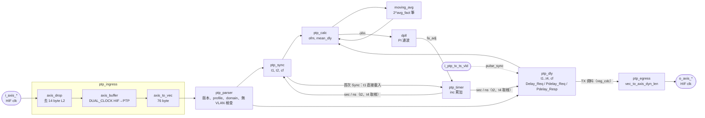
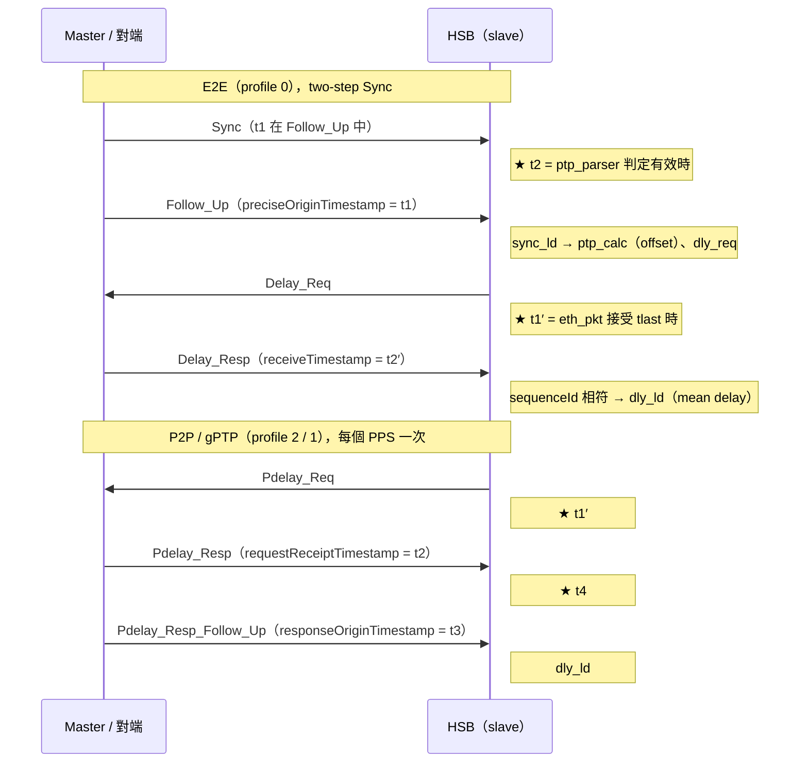

# PTP 子系統（`ptp_top` 與子模組）

## 概要

HSB 內建 IEEE 1588 v2 slave（ordinary clock）。從 host 埠 0 收 PTP 訊息，量測與 master 的時間差與路徑延遲，用數位 PLL 調整本地計時器的頻率，輸出秒、奈秒與 PPS 給 Data Plane 時間戳、BOOTP、事件與板級使用。支援三種 profile：1588 E2E、gPTP（802.1AS）、1588 P2P。

| 檔案 | 行數 | 功能 |
|---|---|---|
| [`ptp_top.sv`](https://github.com/nvidia-holoscan/holoscan-sensor-bridge/blob/41cecaa81ab906a55e7ec22e5e6989f7e602a4c8/fpga/nv_hsb_ip/ptp/ptp_top.sv) | 515 | 頂層、暫存器、首次同步控制 |
| [`ptp_pkg.sv`](https://github.com/nvidia-holoscan/holoscan-sensor-bridge/blob/41cecaa81ab906a55e7ec22e5e6989f7e602a4c8/fpga/nv_hsb_ip/ptp/ptp_pkg.sv) | 60 | 常數 |
| [`ptp_ingress.sv`](https://github.com/nvidia-holoscan/holoscan-sensor-bridge/blob/41cecaa81ab906a55e7ec22e5e6989f7e602a4c8/fpga/nv_hsb_ip/ptp/ptp_ingress.sv) | 227 | 去 L2 header、HIF → PTP 跨時脈、攤平 |
| [`ptp_parser.sv`](https://github.com/nvidia-holoscan/holoscan-sensor-bridge/blob/41cecaa81ab906a55e7ec22e5e6989f7e602a4c8/fpga/nv_hsb_ip/ptp/ptp_parser.sv) | 125 | 解析 PTP header 與 body |
| [`ptp_sync.sv`](https://github.com/nvidia-holoscan/holoscan-sensor-bridge/blob/41cecaa81ab906a55e7ec22e5e6989f7e602a4c8/fpga/nv_hsb_ip/ptp/ptp_sync.sv) | 131 | Sync / Follow_Up 配對，取 t1、t2 |
| [`ptp_dly.sv`](https://github.com/nvidia-holoscan/holoscan-sensor-bridge/blob/41cecaa81ab906a55e7ec22e5e6989f7e602a4c8/fpga/nv_hsb_ip/ptp/ptp_dly.sv) | 439 | Delay_Req / Pdelay 收送與時間戳 |
| [`ptp_calc.sv`](https://github.com/nvidia-holoscan/holoscan-sensor-bridge/blob/41cecaa81ab906a55e7ec22e5e6989f7e602a4c8/fpga/nv_hsb_ip/ptp/ptp_calc.sv) | 357 | offset 與 mean delay 計算 |
| [`dpll.sv`](https://github.com/nvidia-holoscan/holoscan-sensor-bridge/blob/41cecaa81ab906a55e7ec22e5e6989f7e602a4c8/fpga/nv_hsb_ip/ptp/dpll.sv) | 112 | PI 迴路濾波器 |
| [`ptp_timer.sv`](https://github.com/nvidia-holoscan/holoscan-sensor-bridge/blob/41cecaa81ab906a55e7ec22e5e6989f7e602a4c8/fpga/nv_hsb_ip/ptp/ptp_timer.sv) | 207 | 本地計時器、PPS、內部延遲補償 |
| [`ptp_egress.sv`](https://github.com/nvidia-holoscan/holoscan-sensor-bridge/blob/41cecaa81ab906a55e7ec22e5e6989f7e602a4c8/fpga/nv_hsb_ip/ptp/ptp_egress.sv) | 113 | TX 封包輸出 |

實例：[`HOLOLINK_top.sv#L689`](https://github.com/nvidia-holoscan/holoscan-sensor-bridge/blob/41cecaa81ab906a55e7ec22e5e6989f7e602a4c8/fpga/nv_hsb_ip/top/HOLOLINK_top.sv#L689)（`EXT_PTP` 未定義時）。分析深度：全部逐行。

## 參數

| 參數 | 傳入 | 說明 |
|---|---|---|
| `HIF_CLK_FREQ` | `HIF_CLK_FREQ` | 用來算 HIF 端的內部延遲 |
| `PTP_CLK_FREQ` | `PTP_CLK_FREQ` | 計時器時脈；決定每拍的奈秒增量 |
| `AXI_DWIDTH` | `HOST_WIDTH` | |
| `NUM_HOST` | `HOST_IF_INST` | 只有 host 0 接到 PTP，其他埠綁 0 |
| `W_USER` | 17 | 收到封包的 VLAN 資訊 |

`ptp_pkg` 常數：`W_DLY = W_OFM = W_FA = 24`（offset、delay、頻率調整都是 24-bit 有號數），`W_FRAC_NS = 24`（奈秒的小數位數）。

## 介面

| 方向 | 名稱 | 時脈 | 說明 |
|---|---|---|---|
| in | `i_axis_*` | HIF | `rx_parser[0].o_ptp_axis_*`（EtherType 0x88F7、PTP multicast MAC、已去 VLAN） |
| out | `o_axis_*` | HIF | → `eth_pkt[0]` 第 1 埠 |
| in | `i_ptp_tx_ts_vld` | HIF | `eth_pkt[0].o_ptp_val`：PTP 封包離開 `eth_pkt` 仲裁器 |
| in | `i_enable` | | `init_done`。⚠️ 在 `ptp_timer` 內沒有被使用 |
| out | `o_sec[47:0]`、`o_nano_sec[31:0]`、`o_frac_nano_sec[47:0]` | PTP | 本地時間 |
| out | `o_pps` | PTP | 奈秒進位到秒時的一拍脈衝 |
| out | `o_ptp_en_sync_rx` | PTP | 已在 DPLL 啟用後收到 Sync → `bootp` 的 `hsb_stat[0]` |

## 內部結構



## 行為

### 1. 接收（`ptp_ingress`、`ptp_parser`）

1. `axis_drop` 去掉 14 byte Ethernet header（VLAN 已由 `rx_parser` 移除）。
2. 雙時脈 `axis_buffer` 跨到 PTP 時脈，深度依時脈比與寬度決定（16 / 8 / 32 / 64 / 128）。
3. `axis_to_vec` 攤平前 76 byte（`PTP_INGRESS_WIDTH`，可容納 68 byte 的 Delay_Resp）。
4. `ptp_parser` 是純組合邏輯，固定 offset 解析：messageType（byte 0）、majorSdoId、versionPTP、domain、flags、correctionField、sourcePortIdentity、sequenceId、timestamp（byte 34–43）、requestingPortIdentity（byte 44–53）。
5. 訊息有效條件（[`ptp_parser.sv#L95–L106`](https://github.com/nvidia-holoscan/holoscan-sensor-bridge/blob/41cecaa81ab906a55e7ec22e5e6989f7e602a4c8/fpga/nv_hsb_ip/ptp/ptp_parser.sv#L95-L106)）：

   | 條件 | 說明 |
   |---|---|
   | `versionPTP == 2` | |
   | majorSdoId | gPTP 時必須 = 1；其他 profile = 0 |
   | `domainNumber == ptp_ctrl_domain` | |
   | `!tuser[16]` | **帶 VLAN 的 PTP 訊息一律丟棄** |

6. 只辨識 Sync（0）、Pdelay_Req（2）、Pdelay_Resp（3）、Follow_Up（8）、Delay_Resp（9）、Pdelay_Resp_Follow_Up（A）。**Announce、Signaling、Management 都被忽略，沒有 BMCA**：HSB 會跟隨 domain 內任何送 Sync 的 master。
7. correctionField 只取 byte 8–13（64-bit 欄位的高 48 bit = 整數奈秒，捨去 16 bit 小數），`twoStepFlag` = flags bit 9（{L('ptp_parser.sv',71,81)}）。

### 2. 接收時間戳

**RX 時間戳不是在 MAC 取的。** `ptp_sync` 與 `ptp_dly` 在 `ptp_parser` 判定訊息有效的那一拍，直接取樣 `ptp_timer` 的 `{sec, nano_sec}`（[`ptp_sync.sv#L80`](https://github.com/nvidia-holoscan/holoscan-sensor-bridge/blob/41cecaa81ab906a55e7ec22e5e6989f7e602a4c8/fpga/nv_hsb_ip/ptp/ptp_sync.sv#L80)）。這一拍已經經過 `rx_parser` 的 store-and-forward、IPv4 檢查、`axis_drop`、跨時脈 FIFO 與 `axis_to_vec`。

這段內部延遲由 `ptp_timer` 以參數估算（[`ptp_timer.sv#L101–L135`](https://github.com/nvidia-holoscan/holoscan-sensor-bridge/blob/41cecaa81ab906a55e7ec22e5e6989f7e602a4c8/fpga/nv_hsb_ip/ptp/ptp_timer.sv#L101-L135)），輸出 `o_dly_asymm_ns`（狀態暫存器 `ptp_ip_dly_asymm`），在 `ptp_calc` 裡加回 offset：

```systemverilog
NUM_CLK_DLY_ASYMM_HIF = (64/AXIS_BYTE) + mod + 8 + (14/AXIS_BYTE) + mod + 2   // PTP 較慢時
NUM_CLK_DLY_ASYMM_PTP = 2 + (50/AXIS_BYTE) + mod + 1 + 1
dly_asymm_tot = NUM_CLK_DLY_ASYMM_PTP × ptp_inc + NUM_CLK_DLY_ASYMM_HIF × hif_inc
```

它是固定的拍數估計，不包含 MAC 內部延遲與 FIFO 佔用量變化。剩下的誤差用 `ptp_ctrl_dly`（軟體設定的不對稱補償，預設 `0x38` = 56 ns）修正。

### 3. 傳送時間戳

TX 時間戳取在 PTP 封包的 `tlast` 被 `eth_pkt` 仲裁器接受時（`eth_pkt.o_ptp_val`），經 `pulse_sync` 跨到 PTP 時脈後取樣計時器（[`ptp_dly.sv#L349–L365`](https://github.com/nvidia-holoscan/holoscan-sensor-bridge/blob/41cecaa81ab906a55e7ec22e5e6989f7e602a4c8/fpga/nv_hsb_ip/ptp/ptp_dly.sv#L349-L365)）。這和 MAC 實際送出 SFD 的時間也有固定差距。

### 4. Sync 處理（`ptp_sync`）

狀態機 `IDLE ⇄ SYNC`：

| 事件 | 動作 |
|---|---|
| Sync（one-step，`flags[9] = 0`） | t1 = 訊息內 timestamp，t2 = 本地時間，`sync_ld`、`dly_req` 脈衝 |
| Sync（two-step） | 記下 t2、cf、sequenceId、sourcePortIdentity，進 `SYNC` |
| `SYNC` 中收到相符的 Follow_Up | t1 = Follow_Up 的 preciseOriginTimestamp，加上 Follow_Up 的 cf，`sync_ld`、`dly_req` |
| `SYNC` 中又收到 Sync | 以新的 Sync 取代 |
| `SYNC` 中收到不相符的 Follow_Up | 忽略，繼續等 |

Follow_Up 相符的條件是 sequenceId、sourcePortIdentity 的 clockIdentity 與 portNumber 都與 Sync 相同（[ptp_sync.sv#L110–L117](https://github.com/nvidia-holoscan/holoscan-sensor-bridge/blob/41cecaa81ab906a55e7ec22e5e6989f7e602a4c8/fpga/nv_hsb_ip/ptp/ptp_sync.sv#L110-L117)）。`dly_req` 只在 E2E 模式觸發 Delay_Req（每個 Sync 一次）。

### 5. 延遲量測（`ptp_dly`）

**E2E（profile 0）**：每個 Sync 後送一個 Delay_Req（dest `01:1B:19:00:00:00`，44 byte message、60 byte 封包）。TX 時間戳為 t1'；收到 Delay_Resp 且 sequenceId 與 requestingPortIdentity（本機 clockIdentity、portNumber）都相符時（`is_src_resp_match`，[ptp_dly.sv#L225](https://github.com/nvidia-holoscan/holoscan-sensor-bridge/blob/41cecaa81ab906a55e7ec22e5e6989f7e602a4c8/fpga/nv_hsb_ip/ptp/ptp_dly.sv#L225)），receiveTimestamp 為 t2'，`dly_ld`。sequenceId 從 0 開始，每次送出 Delay_Req / Pdelay_Req 加 1（[ptp_dly.sv#L244–L260](https://github.com/nvidia-holoscan/holoscan-sensor-bridge/blob/41cecaa81ab906a55e7ec22e5e6989f7e602a4c8/fpga/nv_hsb_ip/ptp/ptp_dly.sv#L244-L260)）。

下圖是兩種模式的訊息交換與 HSB 取時間戳的位置（★ = HSB 取樣本地計時器）：



**P2P / gPTP（profile 2 / 1）**：

- 每個 PPS 送一個 Pdelay_Req（dest `01:80:C2:00:00:0E`，54 byte message、68 byte 封包）。
- 收 Pdelay_Resp（記 t2 = requestReceiptTimestamp、t4 = 本地時間）與 Pdelay_Resp_Follow_Up（t3 = responseOriginTimestamp），比對 sequenceId 與 requestingPortIdentity。
- **也會回應**對方的 Pdelay_Req：送 two-step Pdelay_Resp，TX 後再送 Pdelay_Resp_Follow_Up 帶實際送出時間。
- 收到 Pdelay_Resp 時，只有 two-step 的才記錄 t4 並等 Follow_Up；**one-step 的 Pdelay_Resp 直接 `dly_ld`，但 t3、t4 沒有更新**（[ptp_dly.sv#L398–L410](https://github.com/nvidia-holoscan/holoscan-sensor-bridge/blob/41cecaa81ab906a55e7ec22e5e6989f7e602a4c8/fpga/nv_hsb_ip/ptp/ptp_dly.sv#L398-L410)），計算會用到舊值。也就是 P2P / gPTP 只支援 two-step 的對端。
- 送出新的請求時，接收狀態機回到等 Pdelay_Resp，舊的回應不再接受。

本機 clockIdentity = `{MAC[47:24], 0xFFFE, MAC[23:0]}`（EUI-64），portNumber = 1。TX 封包所有欄位在 PTP 時脈組好，經 `reg_cdc` 到 HIF 時脈，由 `ptp_egress` 的 `vec_to_axis_dyn_len` 依長度送出。PTP TX 封包的 `tuser = 0`，**不帶 VLAN**。

### 6. 計算（`ptp_calc`）

兩個獨立的狀態機（[ptp_calc.sv#L181–L336](https://github.com/nvidia-holoscan/holoscan-sensor-bridge/blob/41cecaa81ab906a55e7ec22e5e6989f7e602a4c8/fpga/nv_hsb_ip/ptp/ptp_calc.sv#L181-L336)）：Sync 路徑 `IDLE → TS1 → TS2 → SUB → CF_ADD → CORR → ADD_DLY`，Delay 路徑 `IDLE → TS1 → TS2 → SUB_SM → CF_SM →（P2P：TS3 → TS4 → SUB_MS）→ ADD_SM_MS → ABS → MEAN`。每個時間戳先轉成單一奈秒數 `sec[31:0] × 10^9 + ns[29:0]`（共用一組 DSP 乘法，輸入、乘法、輸出各一級暫存器，每個時間戳等 4 拍），再取低 `W_OFM = 24` bit 做差。correctionField 以**無號**數加入（`{1'b0, cf[23:0]}`），負的 correctionField 會被當成很大的正數。

`ptp_calc` 只在首次同步之後才啟動：`i_sync_ld = sync_ld && first_sync_rx_dpll_en`、`i_dly_ld = dly_ld && first_dly_rx_dpll_en`（[`ptp_top.sv#L453`](https://github.com/nvidia-holoscan/holoscan-sensor-bridge/blob/41cecaa81ab906a55e7ec22e5e6989f7e602a4c8/fpga/nv_hsb_ip/ptp/ptp_top.sv#L453)、[`#L462`](https://github.com/nvidia-holoscan/holoscan-sensor-bridge/blob/41cecaa81ab906a55e7ec22e5e6989f7e602a4c8/fpga/nv_hsb_ip/ptp/ptp_top.sv#L462)）。

```
offset (ofm)  = (t1 − t2) + cf_sync + (dly_asymm_cfg + dly_asymm_ip) + mean_delay_avg
mean_delay    = | (t1' − t2') + cf_dly + (t3 − t4) | / 2        // P2P
mean_delay    = | (t1' − t2') + cf_dly + (t1 − t2 + cf_sync) | / 2   // E2E
```

正負號：`ofm ≈ master 時間 − 本地時間`。`ofm > 0` 表示本地落後，DPLL 會加快計時器。E2E 的 `dly_ms` 是 Delay 狀態機在 `IDLE` 時持續追蹤的最新 `ofm_no_dly`，也就是「最近一次 Sync」的 t1 − t2 + cf，與這次 Delay_Req 之間沒有配對。`dly` 取絕對值後再除以 2，負的結果會被翻正而不是報錯。

`mean_delay` 經 `moving_avg`（視窗 2^`avg_fact` 筆，最多 8）平滑。內部延遲的處理（推斷）：RX 方向的內部延遲 `dly_asymm` 只加在 offset 上；Delay 計算中的 t2、t4（RX）與 t1'、t3（TX，取在 `eth_pkt` 而不是線上）都帶著內部延遲，所以 `mean_delay` 會包含 RX 與 TX 內部延遲和的一半，剩下的偏差由 `ptp_ctrl_dly` 吸收。`ofm` 是 24-bit 有號數，範圍約 ±8.4 ms；超出會回捲，所以需要下面的首次同步。

### 7. 首次同步與 DPLL

`ptp_top` 的首次同步邏輯（[`ptp_top.sv#L226–L273`](https://github.com/nvidia-holoscan/holoscan-sensor-bridge/blob/41cecaa81ab906a55e7ec22e5e6989f7e602a4c8/fpga/nv_hsb_ip/ptp/ptp_top.sv#L226-L273)）：

1. DPLL 啟用（`ptp_ctrl[1:0] != 0`）的上升緣，或連續 3 個 PPS 沒收到 Sync，設定 `latch_sync`。
2. 下一個 Sync 載入時，`ptp_timer` 直接把時間**設成 t1**（不含延遲修正），`latch_sync` 清除。
3. 之後的 Sync 才進 `ptp_calc` 算 offset，交給 DPLL 微調。

`dpll`（PI 濾波器，[`dpll.sv#L63–L107`](https://github.com/nvidia-holoscan/holoscan-sensor-bridge/blob/41cecaa81ab906a55e7ec22e5e6989f7e602a4c8/fpga/nv_hsb_ip/ptp/dpll.sv#L63-L107)）：

```
fa = (ofm >>> g1) + Σ (ofm >>> g2)       // g1 = dpll_cfg1[2:0]、g2 = dpll_cfg2[2:0]
```

增益是算術右移；`ptp_ctrl[0]` / `[1]` 分別開關比例項與積分項。積分項關閉時累加器清 0；累加器沒有飽和處理，長時間大偏差時會回捲（推斷）。`fa` 每次 `ofm_vld`（每個 Sync）更新一次，延遲 3 拍（[dpll.sv#L63–L107](https://github.com/nvidia-holoscan/holoscan-sensor-bridge/blob/41cecaa81ab906a55e7ec22e5e6989f7e602a4c8/fpga/nv_hsb_ip/ptp/dpll.sv#L63-L107)）。

**迴路增益估算**（推斷，以 CPNX100 的 `PTP_CLK_FREQ = 100.446545 MHz` 計算）：

| 量 | 值 |
|---|---|
| `fa` 的 1 個單位 | 每拍 2^-24 ns ≈ 0.0596 fs / 9.9555 ns ≈ **6 ppb** |
| `fa` 範圍（24-bit 有號） | ±2^23 單位 ≈ ±5 % |
| `ofm = 1 µs`、`g1 = 2` 的比例項 | 250 單位 ≈ 1.5 ppm，也就是每秒修正約 1.5 µs |
| 積分項（`g2 = 2`） | 每個 Sync 再累加 250 單位 |

所以預設設定下，µs 級的偏移在數秒內收斂；偏移很大時依賴首次同步（直接設定時間）而不是 DPLL。

### 8. 計時器（`ptp_timer`）

- `inc` = 每個 PTP 時脈的奈秒增量，24 bit 小數。預設 `10^9 × 2^24 / PTP_CLK_FREQ`，收到 `fa_adj` 時改成 `default_inc + fa_adj`。**DPLL 只調頻率，不跳時間**（除了首次同步）。
- 奈秒累加到 10^9 時進位秒並產生 `pps`。為了時序，用「下下拍」的值（`nano_sec_2inc`）提前一拍比較，比較再拆成高低兩段（`W_GT_BIL_COMP`）。
- 秒在內部是 **32 bit**（`logic [31:0] sec`），`o_sec = {16'd0, sec}`；首次同步載入 `i_sync_ts[79:32]` 時高 16 bit 被截掉（[ptp_timer.sv#L67–L70](https://github.com/nvidia-holoscan/holoscan-sensor-bridge/blob/41cecaa81ab906a55e7ec22e5e6989f7e602a4c8/fpga/nv_hsb_ip/ptp/ptp_timer.sv#L67-L70)、[ptp_timer.sv#L174–L201](https://github.com/nvidia-holoscan/holoscan-sensor-bridge/blob/41cecaa81ab906a55e7ec22e5e6989f7e602a4c8/fpga/nv_hsb_ip/ptp/ptp_timer.sv#L174-L201)）。奈秒輸出捨去小數（`o_nano_sec`），小數另外輸出（`o_frac_nano_sec`）。
- 「下下拍」的計算技巧：`nano_sec_2inc[W:1] = nano_sec[W:1] + inc`，等於 `nano_sec + 2 × inc`，只用一個加法器（[ptp_timer.sv#L146–L148](https://github.com/nvidia-holoscan/holoscan-sensor-bridge/blob/41cecaa81ab906a55e7ec22e5e6989f7e602a4c8/fpga/nv_hsb_ip/ptp/ptp_timer.sv#L146-L148)）。
- 進位比較拆成兩段：`ns[30:10] ≥ 10^9[30:10]` 且 `ns[9:8] ≥ 10^9[9:8]`，忽略低 8 bit（10^9 = `0x3B9A_CA00` 低 8 bit 為 0）。這兩段 AND 不等於完整比較，但奈秒每拍只前進約 10 ns、單調遞增，第一次跨過 10^9 時兩段一定同時成立，結果正確（[ptp_timer.sv#L150–L156](https://github.com/nvidia-holoscan/holoscan-sensor-bridge/blob/41cecaa81ab906a55e7ec22e5e6989f7e602a4c8/fpga/nv_hsb_ip/ptp/ptp_timer.sv#L150-L156)）。
- 首次同步載入（`i_sync_ts_vld`）時奈秒小數清 0，那一拍不產生 PPS。

## 暫存器

基底 `0x0000_0100`（[regmap.md](../registers/regmap.md#ptp-register)）。Reset 值取自 [`ptp_top.sv#L194`](https://github.com/nvidia-holoscan/holoscan-sensor-bridge/blob/41cecaa81ab906a55e7ec22e5e6989f7e602a4c8/fpga/nv_hsb_ip/ptp/ptp_top.sv#L194)。

| Offset | 名稱 | Reset | 說明 |
|---|---|---|---|
| 0x04 | `ptp_ctrl` | 3 | `[0]` 比例項啟用、`[1]` 積分項啟用 |
| 0x08 | `ptp_ctrl_profile` | 0 | 0 = 1588 E2E、1 = gPTP、2 = 1588 P2P |
| 0x0C | `ptp_ctrl_dly` | `0x38` | 不對稱補償（ns） |
| 0x10 | `ptp_ctrl_dpll_cfg1` | 2 | `[2:0]` 比例項右移量 |
| 0x14 | `ptp_ctrl_dpll_cfg2` | 2 | `[2:0]` 積分項右移量 |
| 0x18 | `ptp_ctrl_avg_fact` | 3 | `[1:0]` delay 平均視窗 2^n |
| 0x1C | `ptp_ctrl_domain` | 0 | |
| 0x20 | `ptp_ctrl_pcp` | 0 | ⚠️ `ptp_pcp` 讀出後沒有被使用 |
| 0x80 | `ptp_sync_ts_0` | | 最近 t1 的低 32 bit |
| 0x84 | `ptp_sync_cf_0` | | 最近 Sync cf |
| 0x88 | `ptp_sync_stat` | | `[0]` 收到 Sync、`[1]` 收到 Delay 回應、`[2]` / `[3]` DPLL 啟用後收到 Sync / Delay |
| 0x8C | `ptp_ofm` | | offset（有號） |
| 0x90 | `ptp_mean_dly` | | 平均延遲 |
| 0x94 | `ptp_inc` | | 目前的 `inc` |
| 0x98 | `ptp_fa_adj` | | 目前的頻率調整量 |
| 0x9C | `ptp_dly_cf_0` | | |
| 0xA0 | `ptp_ip_dly_asymm` | | 內部延遲估計（ns） |

host 軟體佐證：`FPGA_PTP_CTRL = 0x104`、`FPGA_PTP_PROFILE = 0x108`、`FPGA_PTP_OFM = 0x18C`。

## 注意事項

1. `dpll.sv` 註解寫 G1 = 1/2、G2 = 1/4096，但增益其實由暫存器決定，預設都是右移 2（1/4）。
2. `ptp_ctrl_pcp` 與 `i_enable` 沒有作用。PTP TX 不帶 VLAN，`ptp_pcp` 可能是預留給 VLAN 化 PTP 的。
3. offset 只取 24 bit，超過約 ±8.4 ms 的偏移會回捲。正常運作依賴「3 個 PPS 沒收到 Sync 就重新 latch」的機制。
4. E2E 的 mean delay 公式用的是最近一次 Sync 的 `ofm_no_dly`（`dly_ms <= ofm_no_dly`）。Delay_Resp 與 Delay_Req 有 sequenceId 配對，但 Delay 量測與「哪一個 Sync」之間沒有配對，靠時間先後。
6. 沒有 BMCA、忽略 Announce：網路上有多個 master 時，HSB 會被不同 master 的 Sync 輪流拉動。
7. correctionField 以無號 24 bit 處理；負值或超過 16.7 ms 的值會算錯。
8. P2P / gPTP 不支援 one-step 的 Pdelay_Resp（t3、t4 不更新）。
9. 秒只有 32 bit，2106 年回捲；`o_sec` 高 16 bit 固定 0。
10. DPLL 未啟用（`ptp_ctrl = 0`）時計時器從 0 自由執行，永遠不會與 master 對時。
5. 只有 host 埠 0 參與 PTP。
