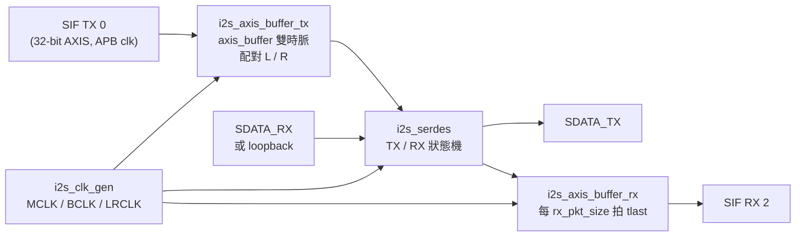
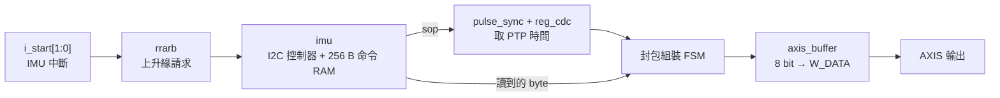

# 參考設計模組（`ref_design/`）

`nv_hsb_ip/ref_design/` 裡的模組不在 `HOLOLINK_top` 內，是給板級 top 選用的周邊。它們都以使用者 APB（`0x1000_0000` 以上）掛到 HSB。

| 模組 | 原始碼 | 行數 | 功能 | 使用的板級 |
|---|---|---|---|---|
| `vsync_gen` | [`vsync/vsync_gen.sv`](https://github.com/nvidia-holoscan/holoscan-sensor-bridge/blob/41cecaa81ab906a55e7ec22e5e6989f7e602a4c8/fpga/nv_hsb_ip/ref_design/vsync/vsync_gen.sv) | 215 | 以 PTP 時間同步的相機觸發訊號 | CPNX100、nv_mipi_ref_design |
| `delayed_io` | [`delayed_io/`](https://github.com/nvidia-holoscan/holoscan-sensor-bridge/tree/41cecaa81ab906a55e7ec22e5e6989f7e602a4c8/fpga/nv_hsb_ip/ref_design/delayed_io) | 350 + 124 | 延遲指定微秒後設定輸出腳位 | CPNX100 |
| `i2s_top` | [`i2s/`](https://github.com/nvidia-holoscan/holoscan-sensor-bridge/tree/41cecaa81ab906a55e7ec22e5e6989f7e602a4c8/fpga/nv_hsb_ip/ref_design/i2s) | 1600 | I2S 音訊 TX / RX，經 SIF 與 host 交換資料 | CPNX100 |
| `imu_top` | [`imu/`](https://github.com/nvidia-holoscan/holoscan-sensor-bridge/tree/41cecaa81ab906a55e7ec22e5e6989f7e602a4c8/fpga/nv_hsb_ip/ref_design/imu) | 733 | 經 I2C 讀 IMU，每筆樣本附 PTP 時間戳，以 AXIS 輸出 | 本 repo 的板級未使用 |

分析深度：`vsync_gen` 主要邏輯；`i2s_top`（`i2s_clk_gen`、`i2s_serdes`、TX / RX buffer）與 `imu_top` / `imu` 主要邏輯；`delayed_io` 逐行。

## `vsync_gen`

依 PTP 時間產生週期性觸發（vsync / strobe）給相機：

| 暫存器 | 位元 | 說明 |
|---|---|---|
| ctrl 0 | `[0]` | 啟用 |
| ctrl 1 | `[3:0]` | 模式：0 = 10 Hz、1 = 30 Hz、2 = 60 Hz、3 = 90 Hz、4 = 120 Hz、5 = 1 Hz（單次） |
| ctrl 2 | | 相對秒起點的延遲（ns） |
| ctrl 3 | `[0]` | 觸發訊號的初始電位 |
| ctrl 4 | | 曝光時間（觸發脈衝寬度） |
| ctrl 5 | `[9:0]` | GPIO 多工選擇 |

運作：每個 PPS 後，等奈秒計數到達延遲值時翻轉觸發訊號，之後依模式的週期產生固定次數的脈衝，下一個 PPS 重新對齊。因為以 PTP 秒為基準，多個同步到同一 grandmaster 的 HSB 可以同時觸發相機。

host 軟體佐證：`VSYNC_CONTROL = 0x7000_0000`、`VSYNC_FREQUENCY = 0x7000_0004`、`VSYNC_DELAY = 0x7000_0008`、`VSYNC_START = 0x7000_000C`、`VSYNC_EXPOSURE = 0x7000_0010`、`VSYNC_GPIO = 0x7000_0014`（CPNX100 板級把它放在使用者 APB `0x7000_0000`）。

## `delayed_io`

在軟體指定的延遲（微秒）之後把輸出腳位設為 1 或 0，也可以立即設定。每個輸出一個計數器（`delayed_io_ctrl_fsm`），延遲值所有輸出共用。

### 暫存器

[delayed_io.sv#L87–L161](https://github.com/nvidia-holoscan/holoscan-sensor-bridge/blob/41cecaa81ab906a55e7ec22e5e6989f7e602a4c8/fpga/nv_hsb_ip/ref_design/delayed_io/delayed_io.sv#L87-L161)（位址只看 `paddr[7:0]`）：

| Offset | 方向 | 說明 |
|---|---|---|
| 0x04 | RW | 延遲（µs），reset 1000 |
| 0x08 | W | 立即設 1（位元遮罩） |
| 0x0C | W | 立即清 0（位元遮罩） |
| 0x14 | W | 延遲後設 1（位元遮罩） |
| 0x18 | W | 延遲後清 0（位元遮罩） |
| 0x20 | W | 取消尚未執行的延遲操作（位元遮罩） |
| 0x80 | R | 目前輸出狀態 |
| 0x84 | R | 計數中的輸出 |
| 0xF0 | RW | `[0]` 全域啟用；關閉時所有輸出為 0、延遲操作被取消 |
| 0xF8 | R | `CYCLES_PER_US`（除錯） |

寫入不存在的位址回 `pslverr`；讀取不存在的位址回 `0xBADADD12` 並設 `pslverr`。

### 行為

| 項目 | 行為 | 原始碼 |
|---|---|---|
| 延遲換算 | `fsm_delay_cycles = delay_us × CYCLES_PER_US`，`CYCLES_PER_US = ⌈CLK_FREQ / 10⁶⌉`。`CLK_FREQ` 預設 19,541,250 → 20 | [delayed_io.sv#L54](https://github.com/nvidia-holoscan/holoscan-sensor-bridge/blob/41cecaa81ab906a55e7ec22e5e6989f7e602a4c8/fpga/nv_hsb_ip/ref_design/delayed_io/delayed_io.sv#L54)、[delayed_io.sv#L234](https://github.com/nvidia-holoscan/holoscan-sensor-bridge/blob/41cecaa81ab906a55e7ec22e5e6989f7e602a4c8/fpga/nv_hsb_ip/ref_design/delayed_io/delayed_io.sv#L234) |
| 優先順序 | 同一拍多個要求時：立即設 1 > 立即清 0 > 取消 > 延遲設 1 > 延遲清 0；延遲操作只在全域啟用時接受 | [delayed_io.sv#L252–L282](https://github.com/nvidia-holoscan/holoscan-sensor-bridge/blob/41cecaa81ab906a55e7ec22e5e6989f7e602a4c8/fpga/nv_hsb_ip/ref_design/delayed_io/delayed_io.sv#L252-L282) |
| 計數器 | `start` 上升緣時載入延遲並數到 1，進 `DONE`；延遲為 0 時直接 `DONE`。`DONE` 時依記下的操作類型更新輸出 | [delayed_io_ctrl_fsm.sv#L60–L99](https://github.com/nvidia-holoscan/holoscan-sensor-bridge/blob/41cecaa81ab906a55e7ec22e5e6989f7e602a4c8/fpga/nv_hsb_ip/ref_design/delayed_io/delayed_io_ctrl_fsm.sv#L60-L99)、[delayed_io.sv#L284–L291](https://github.com/nvidia-holoscan/holoscan-sensor-bridge/blob/41cecaa81ab906a55e7ec22e5e6989f7e602a4c8/fpga/nv_hsb_ip/ref_design/delayed_io/delayed_io.sv#L284-L291) |
| 輸出 | `o_io_pins = global_enable ? 狀態 : 0`；`o_io_busy` = 計數中或有待執行的操作 | [delayed_io.sv#L320–L321](https://github.com/nvidia-holoscan/holoscan-sensor-bridge/blob/41cecaa81ab906a55e7ec22e5e6989f7e602a4c8/fpga/nv_hsb_ip/ref_design/delayed_io/delayed_io.sv#L320-L321) |
| 跨時脈 | APB 寫入脈衝與設定值都只經**一級** `proc_clk` 暫存器 | [delayed_io.sv#L196–L226](https://github.com/nvidia-holoscan/holoscan-sensor-bridge/blob/41cecaa81ab906a55e7ec22e5e6989f7e602a4c8/fpga/nv_hsb_ip/ref_design/delayed_io/delayed_io.sv#L196-L226) |

### 板級連接（CPNX100）

[FPGA_top.sv#L420–L434](https://github.com/nvidia-holoscan/holoscan-sensor-bridge/blob/41cecaa81ab906a55e7ec22e5e6989f7e602a4c8/fpga/lattice/cpnx100-eth-sensor-bridge/cpnx100/rtl/top/FPGA_top.sv#L420-L434)：`NUM_OUTPUTS = 1`，`cmd_clk` 與 `proc_clk` 都接 APB 時脈（註解「Using same clock for simplicity」），所以上面的跨時脈問題在這個板級不會發生。輸出經 `gpio_mux_en[8]` 接到 GPIO 0（[FPGA_top.sv#L709](https://github.com/nvidia-holoscan/holoscan-sensor-bridge/blob/41cecaa81ab906a55e7ec22e5e6989f7e602a4c8/fpga/lattice/cpnx100-eth-sensor-bridge/cpnx100/rtl/top/FPGA_top.sv#L709)）。與 `vsync_gen` 共用同一個使用者 APB slave，以位址 bit 11 區分（[`FPGA_top.sv#L503`](https://github.com/nvidia-holoscan/holoscan-sensor-bridge/blob/41cecaa81ab906a55e7ec22e5e6989f7e602a4c8/fpga/lattice/cpnx100-eth-sensor-bridge/cpnx100/rtl/top/FPGA_top.sv#L503)）。

### 注意事項

1. **取消不會停止計數器。** 立即設定、立即清除、取消都只清掉 `delayed_op_type`，`delayed_io_ctrl_fsm` 沒有取消輸入，會繼續數到原本的時間（`countdown_active` 一直為 1）。這段期間再送新的延遲要求，`start` 的上升緣在 `DELAY` 狀態被忽略，新操作會在**舊的到期時間**執行，而不是從現在起算延遲（R）。（[PE-13](../issues.md#周邊)）
2. **計數中改變操作不會重新計時。** 延遲設 1 還沒到期時送延遲清 0，只會把操作類型換成清 0，到期時間不變（R）。（[PE-13](../issues.md#周邊)）
3. **延遲有 +2.4 % 的誤差。** CPNX100 的 APB 時脈是 19.53125 MHz，但用的是預設 `CLK_FREQ = 19,541,250`，`CYCLES_PER_US` 無條件進位成 20，所以 1 µs 實際是 20 / 19.53 ≈ 1.024 µs（R）。（[PE-14](../issues.md#周邊)）
4. `delay_us × CYCLES_PER_US` 是 32 bit，延遲超過約 214 秒（20 拍 / µs 時）會溢位。
5. 若 `proc_clk` 與 `cmd_clk` 不同，寫入脈衝只有 1 個 APB 時脈寬、而且沒有同步器：`proc_clk` 較慢時可能漏掉，任何情況下都有 metastability 風險（R；CPNX100 用同一個時脈，不受影響）。

## `i2s_top`

| 子模組 | 原始碼 | 功能 |
|---|---|---|
| `i2s_clk_gen` | [i2s_clk_gen.sv#L101–L262](https://github.com/nvidia-holoscan/holoscan-sensor-bridge/blob/41cecaa81ab906a55e7ec22e5e6989f7e602a4c8/fpga/nv_hsb_ip/ref_design/i2s/i2s_clk_gen.sv#L101-L262) | 在參考時脈下用計數器產生 MCLK、BCLK、LRCLK，並輸出每個 BCLK 邊緣前一拍的 enable 脈衝 |
| `i2s_serdes` | [i2s_serdes.sv#L93–L554](https://github.com/nvidia-holoscan/holoscan-sensor-bridge/blob/41cecaa81ab906a55e7ec22e5e6989f7e602a4c8/fpga/nv_hsb_ip/ref_design/i2s/i2s_serdes.sv#L93-L554) | I2S / LJ / RJ 格式的 TX 與 RX 狀態機 |
| `i2s_axis_buffer_tx` | [i2s_axis_buffer_tx.sv#L95–L215](https://github.com/nvidia-holoscan/holoscan-sensor-bridge/blob/41cecaa81ab906a55e7ec22e5e6989f7e602a4c8/fpga/nv_hsb_ip/ref_design/i2s/i2s_axis_buffer_tx.sv#L95-L215) | `axis_buffer`（AXIS 時脈 → 參考時脈、`AXI_DWIDTH` → 32 bit），把連續兩個 32-bit 字配成一組 L / R |
| `i2s_axis_buffer_rx` | [i2s_axis_buffer_rx.sv#L83–L185](https://github.com/nvidia-holoscan/holoscan-sensor-bridge/blob/41cecaa81ab906a55e7ec22e5e6989f7e602a4c8/fpga/nv_hsb_ip/ref_design/i2s/i2s_axis_buffer_rx.sv#L83-L185) | `axis_buffer`（32 bit → `AXI_DWIDTH`、參考時脈 → AXIS 時脈），每 `rx_pkt_size` 個輸出拍產生 `tlast` |

### 暫存器

[i2s_top.sv#L143–L159](https://github.com/nvidia-holoscan/holoscan-sensor-bridge/blob/41cecaa81ab906a55e7ec22e5e6989f7e602a4c8/fpga/nv_hsb_ip/ref_design/i2s/i2s_top.sv#L143-L159)、[i2s_pkg.sv#L57–L67](https://github.com/nvidia-holoscan/holoscan-sensor-bridge/blob/41cecaa81ab906a55e7ec22e5e6989f7e602a4c8/fpga/nv_hsb_ip/ref_design/i2s/i2s_pkg.sv#L57-L67)：9 個控制、4 個狀態暫存器，經 `s_apb_reg` 跨到參考時脈。CPNX100 的 `FPGA_top` 把它接在使用者 APB index 7（`0x8000_0000`），`APB_ADDR_WIDTH = 12` 傳給 `s_apb_reg` 的 `W_OFST`（[FPGA_top.sv#L628–L632](https://github.com/nvidia-holoscan/holoscan-sensor-bridge/blob/41cecaa81ab906a55e7ec22e5e6989f7e602a4c8/fpga/lattice/cpnx100-eth-sensor-bridge/cpnx100/rtl/top/FPGA_top.sv#L628-L632)），所以 `R_CTRL = (2¹² / 4) / 2 = 512`：控制暫存器在 0x00–0x20，**狀態暫存器在 0x800–0x80C**，不是 0x24 起（見注意事項 6）。

| 編號 | 位元 | 說明 | reset |
|---|---|---|---|
| CTRL0 | `[0]` TX 啟用、`[1]` RX 啟用 | 任一啟用時時脈產生器運作 | 0（檔頭註解寫「TX/RX enabled」，實際是關閉） |
| CTRL1 | | MCLK 分頻 `mclk_div`（只用低 16 bit） | 2 |
| CTRL2 | | BCLK 分頻代碼 `k`：BCLK = 2ᵏ 個 MCLK 計數脈衝；有效 1–7 | 3 |
| CTRL3 | `[1:0]` 位元深度（8 / 16 / 24 / 32）、`[3:2]` 格式（I2S / LJ / RJ / PCM） | | 2（24-bit、I2S） |
| CTRL4 | `[0]` mono、`[2]` loopback | `[1]`（時脈來源）沒有使用 | 0 |
| CTRL5 | `[15:0]` | RX 每個封包的 AXIS 拍數；0 = 不產生 `tlast` | 64 |
| CTRL6 | | 中斷啟用：**沒有使用**，`o_irq = underrun \| overrun` | 0 |
| CTRL7 | `[0]` | LRCLK 極性：0 = LRCLK 下降緣開始左聲道 | 0 |
| CTRL8 | `[0]` | slot：0 = 每聲道固定 32 BCLK，1 = 每聲道 = 位元深度 | 1 |
| STAT0 | `[0]` | locked：固定 1 | |
| STAT2 | `[0]` TX underrun、`[1]` RX overrun | 都是位準訊號，條件消失就清除 | |

### 時脈產生（`i2s_clk_gen`）

三個計數器都在參考時脈下運作：

- **MCLK**：每 `mclk_div / 2` 個時脈翻轉一次，`f_MCLK = f_ref / mclk_div`（奇數會被無條件捨去成偶數）。每次翻轉產生一個 `mclk_en` 脈衝；`mclk_div = 2` 時因為 `!mclk_en` 條件，脈衝變成每 MCLK 週期一次，其他值是每半週期一次。
- **BCLK**：數 `mclk_en` 脈衝，每 2ᵏ⁻¹ 個翻轉一次。
- **LRCLK**：數 `mclk_en` 脈衝，每 `slot_width × 2ᵏ` 個翻轉一次，所以每聲道剛好 `slot_width` 個 BCLK；LRCLK 的翻轉與 BCLK 下降緣對齊。
- 輸出腳位再經一級暫存器，並與 `enable` 做 AND。
- 參考時脈在 CPNX100 上由 `i2s_pll` 產生（註解 37 MHz，[clk_n_rst.sv#L84–L90](https://github.com/nvidia-holoscan/holoscan-sensor-bridge/blob/41cecaa81ab906a55e7ec22e5e6989f7e602a4c8/fpga/lattice/cpnx100-eth-sensor-bridge/cpnx100/rtl/clk_n_rst/clk_n_rst.sv#L84-L90)）。

### 序列化（`i2s_serdes`）

| 項目 | 行為 |
|---|---|
| 邊緣 | serdes 自己用 `bclk_en && !bclk_pin` 判斷「BCLK 即將上升」、`bclk_en && bclk_pin` 判斷「即將下降」。TX 在下降緣換資料，RX 在上升緣前一拍取樣 |
| 資料窗 | I2S：從 slot 第 1 個 BCLK 開始（延遲 1 bit）；LJ：第 0 個；RJ：`slot_width − active_bits`；PCM：程式走 `default`，**與 LJ 相同**，沒有 DSP 模式的短 frame sync |
| I2S + word-size slot | 資料比 slot 晚 1 bit，最後一個 bit 落到下一個 slot 的第 0 個 BCLK；TX 用 `tx_overflow_bit` 補送，RX 在換聲道時把那個 bit 補進來 |
| TX 起始 | `TX_IDLE → TX_LOAD_DATA → TX_WAIT_LRCLK`，等 LRCLK 的起始邊緣後送左聲道；之後 L / R 交替，在右聲道最後一個 bit 換下一組樣本 |
| TX `tlast` | 只有「`tlast` 且 FIFO 已空」的樣本才算結束；結束後回到 `TX_LOAD_DATA` 重新等 LRCLK。右聲道結束時剛好就是 LRCLK 邊緣，所以下一段資料會晚一整個 frame 才開始（推斷：依狀態轉移） |
| TX underrun | 沒有新資料時，右聲道結束仍會用 buffer 目前的輸出重新載入，等於重複前一組樣本（推斷） |
| mono | TX 右聲道輸出 0；RX 只輸出左聲道 |
| RX 輸出 | **每個聲道一個 32-bit 字**，L、R 交替，靠右對齊、高位補 0（不做符號延伸）。埠註解寫「stereo packed {R,L}」，與程式不符 |
| RX 反壓 | `i_rx_ready` 在 serdes 內沒有使用；FIFO 滿時樣本直接遺失 |

### 板級連接（CPNX100）

[FPGA_top.sv#L628–L676](https://github.com/nvidia-holoscan/holoscan-sensor-bridge/blob/41cecaa81ab906a55e7ec22e5e6989f7e602a4c8/fpga/lattice/cpnx100-eth-sensor-bridge/cpnx100/rtl/top/FPGA_top.sv#L628-L676)：`AXI_DWIDTH = 32`、TX / RX FIFO 深度都是 8，AXIS 時脈是 APB 時脈。TX 接 SIF TX 0；RX 接 SIF RX 2（埠註解寫「Not connected - TX only」，但實際有連），`tkeep` 複製成 8 bit。MCLK、LRCLK、BCLK、SDATA_TX 經 `gpio_mux_en[3]` 切到 GPIO 4–7（[FPGA_top.sv#L710–L714](https://github.com/nvidia-holoscan/holoscan-sensor-bridge/blob/41cecaa81ab906a55e7ec22e5e6989f7e602a4c8/fpga/lattice/cpnx100-eth-sensor-bridge/cpnx100/rtl/top/FPGA_top.sv#L710-L714)）。

### 注意事項

1. **`CTRL2 = 8` 時 BCLK 停止。** `bclk_div = 256` 存在 8-bit 變數裡變成 0，`(0 >> 1) − 1` 在 32 bit 下是 `0xFFFFFFFF`，計數器永遠到不了；LRCLK 的除數 `slot_width << 8` 卻照常，所以 LRCLK 在跑而 BCLK 不動。`CTRL2` 為 0 或 > 8 時 BCLK 直接用 MCLK、但 `bclk_en` 不產生，serdes 不會前進（R）。（[PE-9](../issues.md#周邊)）
2. **`mclk_div` 為 0 或 1 時 BCLK / LRCLK 不動。** 同樣的 `(mclk_div >> 1) − 1` 下溢，`mclk_en` 永遠不產生；`mclk_div = 1` 時 MCLK 腳位直接輸出參考時脈（R）。（[PE-9](../issues.md#周邊)）
3. `clk_gen` 的 `o_bclk_posedge` / `o_bclk_negedge` 命名與 serdes 的定義相反：`o_bclk_posedge` 在 BCLK 腳位即將下降時為 1。這兩個訊號只用來決定 TX / RX buffer 何時更新，RX 樣本的 valid 會維持一整個 BCLK，所以目前不影響功能（R + I）。
4. RX 的 L / R 沒有標記。FIFO 溢位丟掉單一樣本後，之後的左右聲道會整體對調（R）：`i2s_axis_buffer_rx` 的 `axis_buffer` 用預設 `NO_BACKPRESSURE = 0`，almost full 時 `gbx_axis_tready = 0`，但 `o_i2s_ready` 送到 `i2s_serdes` 的 `i_rx_ready` 沒有被使用，樣本照送、不寫入。CPNX100 的 `AXI_DWIDTH = 32`（[FPGA_top.sv#L628–L629](https://github.com/nvidia-holoscan/holoscan-sensor-bridge/blob/41cecaa81ab906a55e7ec22e5e6989f7e602a4c8/fpga/lattice/cpnx100-eth-sensor-bridge/cpnx100/rtl/top/FPGA_top.sv#L628-L629)），每個 beat 就是一個樣本，所以丟掉的是單一樣本；溢位期間丟掉奇數個樣本時，之後 L / R 對調直到 reset。`AXI_DWIDTH = 64` 時 gearbox 把兩個樣本拼成一拍，`tready = 0` 期間新樣本覆寫同一個位置（[axis_gearbox.sv#L80](https://github.com/nvidia-holoscan/holoscan-sensor-bridge/blob/41cecaa81ab906a55e7ec22e5e6989f7e602a4c8/fpga/nv_hsb_ip/lib_axis/axis_gearbox.sv#L80)、[#L93](https://github.com/nvidia-holoscan/holoscan-sensor-bridge/blob/41cecaa81ab906a55e7ec22e5e6989f7e602a4c8/fpga/nv_hsb_ip/lib_axis/axis_gearbox.sv#L93)），同樣可能錯位。（[PE-10](../issues.md#周邊)）
5. `o_locked` 固定為 1；CTRL6 中斷啟用沒有作用。（[NT-13](../issues.md#註解與死碼不影響功能)）
6. **host 讀 I2S 狀態的位址和 RTL 不一致**（R + X，由 [`tools/check_host_regs.py`](../../tools/check_host_regs.py) 找到）。host 的 `I2S_STAT0`–`I2S_STAT3` 是 `I2S_APB + 0x24`–`0x30`（[hololink.cpp#L165–L168](https://github.com/nvidia-holoscan/holoscan-sensor-bridge/blob/41cecaa81ab906a55e7ec22e5e6989f7e602a4c8/src/hololink/core/hololink.cpp#L165-L168)），緊接在 CTRL8 之後；RTL 的狀態區在 `0x800`（上面的 `R_CTRL` 計算）。`0x24`–`0x30` 是第 9–12 個暫存器，既不在控制區（0–8）也不在狀態區，`s_apb_reg` 回 `0xBADADD12` 並設 `pslverr`（[s_apb_reg.sv#L121–L136](https://github.com/nvidia-holoscan/holoscan-sensor-bridge/blob/41cecaa81ab906a55e7ec22e5e6989f7e602a4c8/fpga/nv_hsb_ip/lib_apb/s_apb_reg.sv#L121-L136)），ECB 回應碼 0x03（invalid address）。所以 host 的 `clock_locked()`、`tx_underrun()`、`rx_overrun()`（[hololink.cpp#L2286–L2307](https://github.com/nvidia-holoscan/holoscan-sensor-bridge/blob/41cecaa81ab906a55e7ec22e5e6989f7e602a4c8/src/hololink/core/hololink.cpp#L2286-L2307)）都讀不到狀態，走 `bad_read_response` 的錯誤路徑。（[PE-15](../issues.md#周邊)）
7. host 的 `I2S_CLOCK_CTRL = 0x7000_0014` 寫的是 `vsync_gen` 的 `VSYNC_GPIO`（GPIO 多工選擇），寫入 `0xF`；I2S 時脈能否輸出取決於這個多工設定，兩邊的命名不同但位址一致。

## `imu_top`

`imu_top` 沒有被任何板級實例化。

### `imu`：串流版 I2C 控制器

[imu.sv#L101–L518](https://github.com/nvidia-holoscan/holoscan-sensor-bridge/blob/41cecaa81ab906a55e7ec22e5e6989f7e602a4c8/fpga/nv_hsb_ip/ref_design/imu/imu.sv#L101-L518)。它是 `i2c_ctrl_fsm` 的修改版（同樣的 I2C 狀態機與位元引擎 `i2c.sv`），多了串流功能：

| 暫存器 | 位元 | 說明 |
|---|---|---|
| 0x00 | `[0]` start、`[1]` 10-bit、`[2]` multi_addr、`[3]` stream_en、`[25:16]` 裝置位址 | `stream_en` 時 start 改由中斷產生 |
| 0x04 | | `bus_en` |
| 0x08 | `[15:0]` / `[31:16]` | 每次交易的寫入 / 讀取 byte 數 |
| 0x0C / 0x10 | | `clk_cnt`、SCL 逾時 |
| 0x14 | `[7:0]` | `num_trans`：一次觸發連續執行的交易數 |
| 0x18 | `[7:0]` / `[15:8]` | `jump_addr[0]` / `[1]`：中斷 0 / 1 對應的命令起始位址 |
| | `[30:16]` | `samples_per_frame` |
| | `[31]` | `sync_int`：沒有使用 |
| 0x80 | `[0]` busy、`[2]` 逾時、`[3]` NACK、`[4]` done、`[8]` / `[9]` 中斷輸入目前位準 | |

流程（[imu.sv#L243–L351](https://github.com/nvidia-holoscan/holoscan-sensor-bridge/blob/41cecaa81ab906a55e7ec22e5e6989f7e602a4c8/fpga/nv_hsb_ip/ref_design/imu/imu.sv#L243-L351)）：

1. `i_start[k]` 的上升緣經 round-robin 仲裁；`stream_en` 且 I2C 閒置時接受一個請求。
2. 從 `jump_addr[k]` 開始讀命令 RAM，先輸出一個標頭 byte：中斷 0 是 `0xA0`、中斷 1 是 `0xA1`，同時送出 `sop`。
3. 執行 `num_trans` 次交易；寫入與讀取指標在交易之間不歸零，所以 RAM 裡可以排一串交易，但每次交易的寫入 / 讀取長度相同。
4. `stream_en` 時讀到的 byte 直接輸出，不寫回 RAM。
5. 全部完成時輸出尾端 byte `0xFF` 與 `eop`；每 `samples_per_frame + 1` 個樣本的尾端 byte 帶 `sample_last`。
6. `multi_addr` 時裝置位址不從暫存器取，而是 RAM 內容的一部分，在第一個 byte 與讀取前送 start。

### `imu_top`：封包組裝

[imu_top.sv#L89–L210](https://github.com/nvidia-holoscan/holoscan-sensor-bridge/blob/41cecaa81ab906a55e7ec22e5e6989f7e602a4c8/fpga/nv_hsb_ip/ref_design/imu/imu_top.sv#L89-L210)：`sop` 經 `pulse_sync` 進 PTP 時脈，用 `reg_cdc` 把當時的 `i_ptp_ts`（64 bit）帶回 APB 時脈。每個樣本的 byte 串流是：

| 順序 | 內容 |
|---|---|
| 0–7 | PTP 時間戳，低位 byte 先 |
| 8 | 標頭 `0xA0` / `0xA1` |
| 9… | I2C 讀到的資料 |
| 最後 | `0xFF`；frame 最後一個樣本在這個 byte 帶 `tlast` |

再經 `axis_buffer`（8 bit → `W_DATA`，深度 16）輸出。

### 注意事項

1. `axis_buffer` 的 `o_axis_rx_tready` 沒有接，下游反壓時資料直接遺失（R）。（[PE-12](../issues.md#周邊)）
2. 每 frame 實際是 `samples_per_frame + 1` 個樣本：比較用 `sample_cnt == samples_per_frame`，而計數從 0 開始（R）。（[PE-12](../issues.md#周邊)）
3. 時間戳是仲裁接受中斷的時間，加上 `pulse_sync` 的延遲，不是 IMU 實際取樣的時間（I）。
4. `num_trans ≠ 0` 時 `cmd_valid` 要求 `num_wr_bytes ≥ num_rd_bytes`，原因不明（R）。
