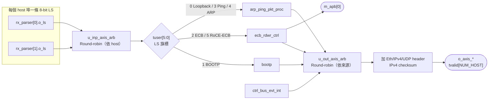

# 控制平面封包處理（`rx_ls_parser`、`ecb_rdwr_ctrl`、`bootp`、`arp_ping_pkt_proc`）

## 概要

`rx_ls_parser` 匯集所有 host 埠的低速（LS）封包，分派給四個處理器，並把它們的回應統一加上 Ethernet / IPv4 / UDP header 送回對應的 host 埠。整條路徑是 8-bit 寬。

| 檔案 | 行數 | 功能 |
|---|---|---|
| [`rx_parser/rx_ls_parser.sv`](https://github.com/nvidia-holoscan/holoscan-sensor-bridge/blob/41cecaa81ab906a55e7ec22e5e6989f7e602a4c8/fpga/nv_hsb_ip/rx_parser/rx_ls_parser.sv) | 643 | 輸入 / 輸出仲裁、UDP header 組裝 |
| [`ecb/ecb_rdwr_ctrl.sv`](https://github.com/nvidia-holoscan/holoscan-sensor-bridge/blob/41cecaa81ab906a55e7ec22e5e6989f7e602a4c8/fpga/nv_hsb_ip/ecb/ecb_rdwr_ctrl.sv) | 776 | ECB 暫存器讀寫協定 |
| [`ecb/ecb_pkg.sv`](https://github.com/nvidia-holoscan/holoscan-sensor-bridge/blob/41cecaa81ab906a55e7ec22e5e6989f7e602a4c8/fpga/nv_hsb_ip/ecb/ecb_pkg.sv) | 33 | 命令碼 |
| [`bootp/bootp.sv`](https://github.com/nvidia-holoscan/holoscan-sensor-bridge/blob/41cecaa81ab906a55e7ec22e5e6989f7e602a4c8/fpga/nv_hsb_ip/bootp/bootp.sv) | 481 | 裝置宣告（enumeration）與 IP 指派 |
| [`rx_parser/arp_ping_pkt_proc.sv`](https://github.com/nvidia-holoscan/holoscan-sensor-bridge/blob/41cecaa81ab906a55e7ec22e5e6989f7e602a4c8/fpga/nv_hsb_ip/rx_parser/arp_ping_pkt_proc.sv) | 279 | ARP、ICMP echo、UDP loopback |
| `ctrl_bus_evt_int` | | 中斷封包（只送不收），見 [event.md](event.md) |

實例：[`HOLOLINK_top.sv#L466`](https://github.com/nvidia-holoscan/holoscan-sensor-bridge/blob/41cecaa81ab906a55e7ec22e5e6989f7e602a4c8/fpga/nv_hsb_ip/top/HOLOLINK_top.sv#L466)。分析深度：`rx_ls_parser`、`ecb_rdwr_ctrl` 的解析與兩個 FSM、`bootp` 逐行；ECB 的 RoCE 回應 header 與 `arp_ping_pkt_proc` 主要邏輯。

## 內部結構

| RX index | 來源 | TX index | 來源 |
|---|---|---|---|
| 0 | Loopback | 0 | ECB 回應 |
| 1 | BOOTP | 1 | Event 中斷 |
| 2 | ECB | 2 | BOOTP |
| 3 | Ping | 3 | ARP / Ping / Loopback |
| 4 | ARP | | |
| 5 | RoCE-ECB | | |

## `rx_ls_parser`

1. **輸入仲裁**：round-robin，`o_axis_idx` 記下來源 host，回應時用來選本機 MAC / IP 與輸出埠。
2. **分派**：`tuser[5:0]` one-hot（`rx_parser` 產生），對應處理器的 `tvalid` 拉高。
3. **輸出仲裁**：4 個來源 round-robin。
4. **Header**：ARP / Ping / Loopback 自帶完整封包；其他來源只給 UDP payload 與 `host_mac/ip/udp_port`、`dev_udp_port`、`pld_len`，這裡組 42 byte header：Ethernet（EtherType 0x0800）、IPv4（version 4、IHL 5、TTL 0x40、DF、protocol 17、ID 0；checksum 由 `ipv4_chksum_state` 用 4 拍算完才放行資料）、UDP（checksum 0）。
5. **輸出**：資料線共用，`tvalid` 只對目標 host 埠拉高。

## `ecb_rdwr_ctrl`（ECB 協定）

ECB 是 host 讀寫 HSB 所有暫存器的協定。每個 ECB 封包被拆成一或多個 APB transaction，由 `m_apb[0]` 執行。

### 請求格式

offset 從 Ethernet header 開頭算（VLAN 已由 `rx_parser` 移除）：

| Offset | 一般 ECB（UDP 8192） | RoCE-ECB（UDP 4791 + BTH，dest QP = `roce_ecb_dest_qp`） |
|---|---|---|
| 6–11 | host MAC | 同左 |
| 26–29 | host IP | 同左 |
| 34–37 | UDP 埠（回應時對調） | UDP 埠（回應時不對調） |
| 38–39 | UDP length | 同左 |
| 42 | cmd | BTH opcode |
| 43 | flags | |
| 44–45 | sequence | |
| 46–47 | 保留 | |
| 54 / 55 / 56–57 | | cmd / flags / sequence |
| 48（RoCE：60）起 | `{addr[31:0], data[31:0]}` × N，big endian | 同左 |

N = `(udp_len − 22) >> 3`（RoCE：`(udp_len − 38) >> 3`）。

### 命令、flags、回應碼

| 命令 | 值 | 支援 |
|---|---|---|
| `WR_DWORD` | 0x04 | ✓（一組 addr/data） |
| `WR_BLOCK` | 0x09 | ✓（多組） |
| `RD_DWORD` | 0x14 | ✓ |
| `RD_BLOCK` | 0x19 | ✓ |
| 其他（`WR_BYTE`、`WR_WORD`、`RMW_BYTE`、`RD_BYTE`、`RD_WORD`、`GET_INFO`） | | ✗：回 `INVALID_CMD` |

| Flags | 意義 |
|---|---|
| bit 0 | `ACK_REQUEST`（host 軟體定義） |
| bit 1 | `SEQUENCE_CHECK`：要求 `sequence == 上一次成功的 sequence + 1` |
| bit 7:2 | 必須為 0，否則回 `INVALID_FLAGS` |

回應碼（[L558–L574](https://github.com/nvidia-holoscan/holoscan-sensor-bridge/blob/41cecaa81ab906a55e7ec22e5e6989f7e602a4c8/fpga/nv_hsb_ip/ecb/ecb_rdwr_ctrl.sv#L558-L574)），依優先順序：

| 條件 | 回應碼 |
|---|---|
| 命令不支援 | 0x04 `INVALID_CMD` |
| flags 保留位元不為 0 | 0x06 `INVALID_FLAGS` |
| sequence 檢查失敗 | 0x0B `SEQUENCE_CHECK_FAIL` |
| APB 回 `pserr`（例如位址不存在、逾時） | 0x03 `INVALID_ADDR` |
| 其他 | 0x00 `SUCCESS` |

host 軟體另外定義了 0x02、0x05、0x07–0x0A，RTL 沒有產生這些值。

### 回應格式

`{cmd_code, flags, sequence, resp_code, 0x00}`，之後每組 `{addr, data}`：

- `cmd_code`：命令有效時為 `{3'b100, is_read, cmd[3:0]}`，例如 `WR_DWORD` → 0x84、`RD_DWORD` → 0x94；無效時原樣送回。
- 寫入時 data 欄為 0；讀取時為讀回值。

### 兩個狀態機

**解碼（HIF 時脈，[L277–L424](https://github.com/nvidia-holoscan/holoscan-sensor-bridge/blob/41cecaa81ab906a55e7ec22e5e6989f7e602a4c8/fpga/nv_hsb_ip/ecb/ecb_rdwr_ctrl.sv#L277-L424)）**：

| 狀態 | 動作 |
|---|---|
| `DCD_IDLE` | 等 ECB 或 RoCE-ECB 封包 |
| `DCD_HDR` | 逐 byte 收 header 到 byte 47（RoCE：59） |
| `DCD_CHK_HDR` | 檢查 cmd / flags / sequence；有錯直接 `DCD_FLUSH` 並送回應 |
| `DCD_DATA` | 收 8 byte addr/data |
| `DCD_WAIT` | 送 APB 命令到 APB 時脈，等完成 |
| `DCD_WAIT_STATUS` | APB 錯誤 → `DCD_FLUSH`；block 命令且還有資料 → `DCD_LATCH_WRITE` 再回 `DCD_DATA`；否則 `DCD_FLUSH` |
| `DCD_FLUSH` | 吃掉封包剩餘部分，送出回應 |

**APB（APB 時脈，[L437–L482](https://github.com/nvidia-holoscan/holoscan-sensor-bridge/blob/41cecaa81ab906a55e7ec22e5e6989f7e602a4c8/fpga/nv_hsb_ip/ecb/ecb_rdwr_ctrl.sv#L437-L482)）**：`CMD_IDLE → CMD_SEND → CMD_DONE`，一次一個 APB transaction。位址低 2 bit 強制為 0（只支援 32-bit 對齊）。

每組 addr/data 都要等一次完整的 CDC 往返，所以 ECB 的吞吐量受 APB 時脈與 CDC 延遲限制。

## `bootp`

HSB 用 BOOTP 格式向 host 宣告自己，host 軟體的 `Enumerator` 收這些封包來找裝置。

### 傳送

- `init_done` 後對每個 host 埠依序送一次，之後每個 PPS 重送（`ptp_sync_vld` 是 PPS 經 `reg_cdc` 的結果）。
- 目的：廣播 MAC / IP，UDP 12268 → 12267。
- BOOTP 本體 300 byte（op = 1、chaddr = 本機 MAC），vendor 欄位（[L344–L375](https://github.com/nvidia-holoscan/holoscan-sensor-bridge/blob/41cecaa81ab906a55e7ec22e5e6989f7e602a4c8/fpga/nv_hsb_ip/bootp/bootp.sv#L344-L375)）：

| 欄位 | 內容 |
|---|---|
| tag | `0xE0`、長度、`"NVDA"`、埠號、enumeration 版本 2 |
| backward compat rev | `HOLOLINK_BACKWARD_COMPAT_REV`（0x2603） |
| UUID | `HOLOLINK_def.svh` 的 `UUID` |
| 封包計數 | 這個 host 埠送出的封包數（24 bit，來自 `eth_pkt.o_pkt_inc`） |
| enumeration 資料 | board 版本、SN、HSB 版本等（`i_enum_data`） |
| PTP 時間 | |
| PSN | BOOTP 輪次 |
| `hsb_stat` | `[0]` = DPLL 啟用後收到 Sync（`ptp_top.o_ptp_en_sync_rx`） |

### 接收

收到 op = 2（BOOTP reply）時，取 byte 58–61（BOOTP `yiaddr`）當作這個 host 埠的 IP（[L454–L460](https://github.com/nvidia-holoscan/holoscan-sensor-bridge/blob/41cecaa81ab906a55e7ec22e5e6989f7e602a4c8/fpga/nv_hsb_ip/bootp/bootp.sv#L454-L460)）。

IP 來源優先順序：BOOTP reply > EEPROM（`ip_addr_vld` 上升緣，host 埠 k 用 EEPROM IP + k）> 預設 `192.168.0.2 + k`。

## `arp_ping_pkt_proc`

| 封包 | 回應 |
|---|---|
| ARP request（TPA = 本機 IP） | ARP reply，sender = 本機 MAC / IP |
| ICMP echo request | echo reply（type 改 0），IP / MAC 對調 |
| UDP loopback（dport 4096） | 交換 IP、MAC、UDP 埠後原樣送回 |

## 暫存器

| 區塊 | 基底 | 內容 |
|---|---|---|
| ECB | `0x0000_0300` | `ecb_addr_lsb`（0x04）、`ecb_addr_msb`（0x08）、`ecb_rkey`（0x0C）、`ecb_pkey`（0x10）、`ecb_dest_qp`（0x14）：RoCE-ECB 回應用 |

## 注意事項

1. `regmap_pkg.sv` 的 `ecb_addr_lsb` / `ecb_addr_msb` 註解位址寫反（[regmap.md](../registers/regmap.md#註解與程式不一致的項目)）。
2. `bootp` 的 IP 變數名為 `ciaddr`，實際讀的是 BOOTP 的 `yiaddr` 位置。
3. LS 路徑吞吐量 = 1 byte / HIF 時脈。
