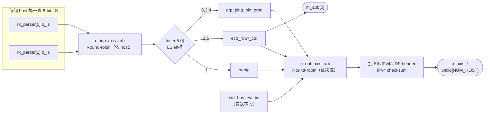

# `rx_ls_parser` 與 `ecb_rdwr_ctrl`

## 概要

`rx_ls_parser` 匯集所有 host 埠的 LS（控制）封包，分派給 ECB、BOOTP、ARP/Ping/Loopback 處理；回應封包統一在這裡加上 Ethernet/IPv4/UDP header。`ecb_rdwr_ctrl` 是其中的 ECB 協定處理器，把 host 的暫存器讀寫命令轉成 APB transaction。

| 項目 | 值 |
|---|---|
| 原始碼 | [`rx_parser/rx_ls_parser.sv`](https://github.com/nvidia-holoscan/holoscan-sensor-bridge/blob/41cecaa81ab906a55e7ec22e5e6989f7e602a4c8/fpga/nv_hsb_ip/rx_parser/rx_ls_parser.sv)（643 行）、[`ecb/ecb_rdwr_ctrl.sv`](https://github.com/nvidia-holoscan/holoscan-sensor-bridge/blob/41cecaa81ab906a55e7ec22e5e6989f7e602a4c8/fpga/nv_hsb_ip/ecb/ecb_rdwr_ctrl.sv)（776 行）、[`ecb/ecb_pkg.sv`](https://github.com/nvidia-holoscan/holoscan-sensor-bridge/blob/41cecaa81ab906a55e7ec22e5e6989f7e602a4c8/fpga/nv_hsb_ip/ecb/ecb_pkg.sv) |
| 實例 | [`HOLOLINK_top.sv#L466`](https://github.com/nvidia-holoscan/holoscan-sensor-bridge/blob/41cecaa81ab906a55e7ec22e5e6989f7e602a4c8/fpga/nv_hsb_ip/top/HOLOLINK_top.sv#L466)（一份） |
| 時脈 | `i_pclk`（HIF）；ECB 的 APB 端在 `i_aclk` |
| 分析深度 | `rx_ls_parser` 主要邏輯；`ecb_rdwr_ctrl` 解析與命令 FSM；回應組裝只讀結構 |

## 內部結構

| RX index | 來源 | TX index | 來源 |
|---|---|---|---|
| 0 | Loopback | 0 | ECB 回應 |
| 1 | BOOTP | 1 | Event（中斷） |
| 2 | ECB | 2 | BOOTP |
| 3 | Ping | 3 | ARP / Ping / Loopback |
| 4 | ARP | | |
| 5 | RoCE-ECB | | |

## `rx_ls_parser` 行為

1. **輸入仲裁**：各 host 埠的 LS 串流 round-robin，`o_axis_idx` 記下來源 host，回應時用來選本機 MAC/IP 與輸出埠。
2. **分派**：`tuser[5:0]` 是 one-hot 的 LS 旗標（見 [rx_parser §6](rx_parser.md#6-tuser-側帶格式)），對應的處理器 `tvalid` 拉高。
3. **輸出仲裁**：4 個 TX 來源 round-robin。
4. **Header**：除了 ARP/Ping/Loopback 自帶完整封包，其他來源只給 UDP payload 與目的位址，這裡組 42 byte header：

   | 欄位 | 值 |
   |---|---|
   | Ethernet | dst = 來源給的 host MAC；src = 本機 MAC；EtherType 0x0800 |
   | IPv4 | version 4、IHL 5、TTL 0x40、flags = DF、protocol 17、ID 0 |
   | IPv4 checksum | `ipv4_chksum_state` 用 4 拍算完才放行資料 |
   | UDP | checksum 0（不使用） |

5. **輸出**：資料線所有 host 埠共用，`tvalid` 只對請求來源的 host 埠拉高。

## `ecb_rdwr_ctrl`（ECB 協定）

### 封包格式

`byte_cnt` 是從 Ethernet 開頭算的 offset（VLAN 已移除），[L187–L249](https://github.com/nvidia-holoscan/holoscan-sensor-bridge/blob/41cecaa81ab906a55e7ec22e5e6989f7e602a4c8/fpga/nv_hsb_ip/ecb/ecb_rdwr_ctrl.sv#L187-L249)：

| Offset | 一般 ECB（UDP 8192） | RoCE-ECB（UDP 4791 + BTH） |
|---|---|---|
| 6–11 | host MAC | 同左 |
| 26–29 | host IP | 同左 |
| 34–37 | UDP 埠（回應時對調） | UDP 埠（回應時不對調） |
| 38–39 | UDP length | 同左 |
| 42 | **cmd** | BTH opcode |
| 43 | **flags** | |
| 44–45 | **sequence** | |
| 54 | | **cmd** |
| 55 | | **flags** |
| 56–57 | | **sequence** |
| 之後 | `{addr[31:0], data[31:0]}` × N（big endian） | 同左 |

`N = (udp_len − 22) >> 3`（RoCE：`(udp_len − 38) >> 3`）。

### 命令與回應碼

命令（`ecb_pkg.sv`）。`ecb_rdwr_ctrl` 只把 4 個當成合法讀寫：

| 命令 | 值 | 支援 |
|---|---|---|
| `WR_DWORD` | 0x04 | ✓ |
| `WR_BLOCK` | 0x09 | ✓ |
| `RD_DWORD` | 0x14 | ✓ |
| `RD_BLOCK` | 0x19 | ✓ |
| `WR_BYTE` / `WR_WORD` / `RMW_BYTE` / `RD_BYTE` / `RD_WORD` / `GET_INFO` | 0x01 / 0x02 / 0x0A / 0x11 / 0x12 / 0x20 | ✗（有定義，走錯誤處理） |

flags 與回應碼取自 host 軟體 `src/hololink/core/hololink.hpp`：

| Flags bit | 意義 |
|---|---|
| 0 | `ACK_REQUEST` |
| 1 | `SEQUENCE_CHECK` |

| 回應碼 | 值 |
|---|---|
| `SUCCESS` | 0x00 |
| `ERROR_GENERAL` | 0x02 |
| `INVALID_ADDR` | 0x03 |
| `INVALID_CMD` | 0x04 |
| `INVALID_PKT_LENGTH` | 0x05 |
| `INVALID_FLAGS` | 0x06 |
| `BUFFER_FULL` | 0x07 |
| `INVALID_BLOCK_SIZE` | 0x08 |
| `INVALID_INDIRECT_ADDR` | 0x09 |
| `COMMAND_TIMEOUT` | 0x0A |
| `SEQUENCE_CHECK_FAIL` | 0x0B |

### 處理流程

1. `decode_state`：`IDLE → HDR → … → DATA → DONE`，錯誤時 `FLUSH`。
2. 每組 addr/data 經 CDC 送到 APB 時脈，執行一次 APB 讀或寫（`m_apb[0]`）。
3. Sequence 檢查：沒有錯誤才更新 `seq_num_latch`。
4. 回應：命令碼、回應碼與讀回資料組成回應向量，經 `vec_to_axis` 送出。RoCE-ECB 另外加 RoCE header 與 ICRC。

## 暫存器

| 區塊 | 基底 | 內容 |
|---|---|---|
| ECB | `0x0000_0300` | `ecb_addr_lsb/msb`、`ecb_rkey`、`ecb_pkey`、`ecb_dest_qp`（RoCE-ECB 回應用） |
| Event | `0x0000_0200` | 見 [regmap.md](../registers/regmap.md#control-bus-event) |

## 注意事項

1. `regmap_pkg.sv` 裡 `ecb_addr_lsb` 與 `ecb_addr_msb` 的註解位址寫反了（`tools/gen_regmap.py` 自動偵測，見 [regmap.md](../registers/regmap.md#註解與程式不一致的項目)）。
2. 整條 LS 路徑是 8-bit，吞吐量 = 1 byte / HIF 時脈。控制封包量大時（例如大量 `WR_BLOCK`）會比 data plane 慢很多。

## 與 1722 Listener 的關係

Listener 的資料不走這條路。但如果要支援 1722 的控制協定（AECP / ACMP），可以仿照這裡：在 `rx_parser` 加一個 LS 旗標（`NUM_LS_INST` + 1），在 `rx_ls_parser` 加處理器。要注意 `rx_ls_parser` 只產生 **UDP** 回應 header，L2 的 1722 控制回應要像 ARP/Ping 一樣自己組完整封包。
