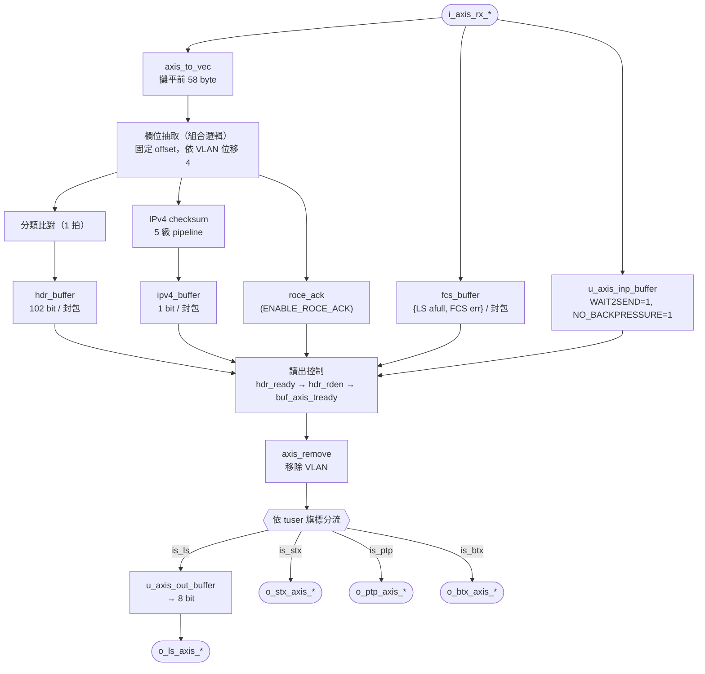
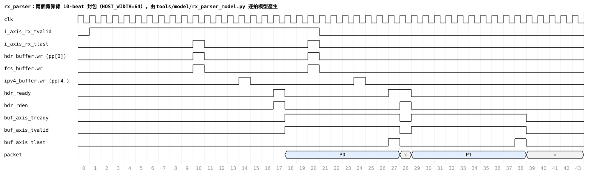

# `rx_parser`

## 概要

每個 host 埠一份。接收 Ethernet MAC 的 AXIS 串流，解析 header、分類，整包收完後依分類送到 5 個輸出之一，不屬於任何分類的封包丟棄。

| 項目 | 值 |
|---|---|
| 原始碼 | [`rx_parser/rx_parser.sv`](https://github.com/nvidia-holoscan/holoscan-sensor-bridge/blob/41cecaa81ab906a55e7ec22e5e6989f7e602a4c8/fpga/nv_hsb_ip/rx_parser/rx_parser.sv)（865 行）、[`rx_parser_pkg.sv`](https://github.com/nvidia-holoscan/holoscan-sensor-bridge/blob/41cecaa81ab906a55e7ec22e5e6989f7e602a4c8/fpga/nv_hsb_ip/rx_parser/rx_parser_pkg.sv) |
| 實例 | [`HOLOLINK_top.sv#L383`](https://github.com/nvidia-holoscan/holoscan-sensor-bridge/blob/41cecaa81ab906a55e7ec22e5e6989f7e602a4c8/fpga/nv_hsb_ip/top/HOLOLINK_top.sv#L383)（`gen_rx_parser`，每個 host 埠一份） |
| 時脈 | `host_clk`（= `i_hif_clk`）；暫存器在 `apb_clk` |
| 分析深度 | 逐行 |

## 參數

| 參數 | 預設 | `HOLOLINK_top` 傳入 | 說明 |
|---|---|---|---|
| `AXI_DWIDTH` | 64 | `HOST_WIDTH` | |
| `AXI_LS_DWIDTH` | 8 | 8 | LS 輸出寬度 |
| `USER_WIDTH` | 17 | `VLAN_TUSER = 17` | `{is_vlan, vlan_tci[15:0]}` |
| `NUM_LS_INST` | 6 | 6 | LS 封包種類數 |
| `MTU` | 1500 | `HOST_MTU` | |
| `N_QP` | 1 | `SENSOR_TX_IF_INST` | 給 `roce_ack` |
| `ENABLE_ROCE_ACK` | 0 | 1 if `SIF_TX_ROCE_RC_ENABLE` | |
| `VLAN_DISABLE` | 0 | 1 if `DISABLE_VLAN` | |
| `SYNC_CLK` | 0 | `SYNC_CLK_HIF_APB` | |

內部常數（[L104–L146](https://github.com/nvidia-holoscan/holoscan-sensor-bridge/blob/41cecaa81ab906a55e7ec22e5e6989f7e602a4c8/fpga/nv_hsb_ip/rx_parser/rx_parser.sv#L104-L146)）：

| 常數 | 值 | 說明 |
|---|---|---|
| `HDR_BYTES` | 14 + 4 + 20 + 8 + 12 = **58** | 攤平的 header 長度（含 VLAN、BTH） |
| `BOOTP_UDP_PORT` | 12268 | |
| `LOOPBCK_UDP_PORT` | `16'h1000`（4096） | 常數，不是暫存器 |
| `PKT_DEPTH` | ⌈MTU / KEEP_WIDTH⌉ | 一個 MTU 的 beat 數 |
| `INP_FIFO_DEPTH` | 3 × `PKT_DEPTH`（≥256 bit）或 2 × `PKT_DEPTH` | 輸入 store-and-forward FIFO |
| `LS_FIFO_DEPTH` | 同上 | LS 輸出 FIFO |
| `RLS_AFULL_DEPTH` | 2 × 或 1 × `PKT_DEPTH` | LS FIFO almost full |
| `META_FIFO_DEPTH` | 31（`AXI_DWIDTH` ≥ 32） | 每筆一個封包的 metadata FIFO |

## 介面

| 方向 | 名稱 | 寬度 | 背壓 | 說明 |
|---|---|---|---|---|
| in | `i_axis_rx_*` | `AXI_DWIDTH` | 無 | 來自 MAC。`tuser` = FCS 錯誤 |
| out | `o_stx_axis_*` | `AXI_DWIDTH` | **無** | RoCE 資料 → `sensor_tx_pkt_proc`。`tuser` 固定 0 |
| out | `o_ptp_axis_*` | `AXI_DWIDTH` | **無** | → `ptp_top`。`tuser` = VLAN 資訊 |
| out | `o_ls_axis_*` | 8 | 有 | → `rx_ls_parser`。`tuser` = `{VLAN, LS 旗標[5:0]}` |
| out | `o_btx_axis_*` | `AXI_DWIDTH` | 有（輕微） | → `bridge_pkt_proc`。`tuser` = PTP message 類型 |
| out | `o_ack_axis_*` | `AXI_DWIDTH` | 有 | `roce_ack` 產生的 ACK/NAK → `eth_pkt` |
| out | `o_dest_info[71:0]` | 72 | | `{BTH dest QP[23:0], dest MAC[47:0]（byte 反轉）}`，與輸出資料同步 |
| out | `o_ptp_sync_msg` | 1 | | PTP Sync 進來的脈衝（Bridge 用） |
| in | `i_stx_ready[N_QP-1:0]` | | | 來自 `tx_stream_buffer.o_stx_is_ready` |
| in | `i_dev_mac_addr`、`i_dev_ip_addr` | 48、32 | | 本機位址 |
| APB | `i_apb_m2s` / `o_apb_s2m` | | | `inst_dec` 暫存器區 |
| APB | `i_apb_m2s_qp_ram` / `o_apb_s2m_qp_ram` | | | `roce_ack` 的 QP RAM |

## 內部結構



資料（`u_axis_inp_buffer`）與 metadata（三個 `sc_fifo`）分開排隊，讀出時一筆 metadata 對一個封包。

## 行為

### 1. Header 攤平

[`axis_to_vec`](lib.md#axis_to_vec)（[L216](https://github.com/nvidia-holoscan/holoscan-sensor-bridge/blob/41cecaa81ab906a55e7ec22e5e6989f7e602a4c8/fpga/nv_hsb_ip/rx_parser/rx_parser.sv#L216)）把前 `HDR_BYTES` byte 收進暫存器，收滿（或封包提早結束）時 `hdr_valid` 脈衝一拍。`i_done` 綁 1，`o_axis_rx_tready` 沒接，所以它不會影響資料流。

64-bit 匯流排時，58 byte 需要 8 個 beat，`hdr_valid` 在第 8 個 beat 的下一拍出現。

### 2. 欄位抽取

[L242–L276](https://github.com/nvidia-holoscan/holoscan-sensor-bridge/blob/41cecaa81ab906a55e7ec22e5e6989f7e602a4c8/fpga/nv_hsb_ip/rx_parser/rx_parser.sv#L242-L276)，組合邏輯：

- `is_vlan = (byte[12:13] == 0x8100)`。是 VLAN 時，後面所有欄位 offset + 4。
- IPv4、UDP、BTH 都是固定 offset。**假設 IPv4 IHL = 5**（沒有 IP option）。
- ARP 的 TPA、ICMP type 與 UDP/BTH 欄位共用 byte，依封包種類解讀。

| 欄位 | 無 VLAN byte | 有 VLAN byte |
|---|---|---|
| dest MAC | 0–5 | 0–5 |
| src MAC | 6–11 | 6–11 |
| EtherType | 12–13 | 16–17 |
| IP protocol | 23 | 27 |
| IP dest | 30–33 | 34–37 |
| UDP dest port | 36–37 | 40–41 |
| UDP length | 38–39 | 42–43 |
| ARP TPA | 38–41 | 42–45 |
| ICMP type | 34 | 38 |
| BTH opcode | 42 | 46 |
| BTH dest QP | 47–49 | 51–53 |
| BTH PSN | 51–53 | 55–57 |
| PTP messageType | 14[3:0] | 14[3:0]（⚠️ 沒有依 VLAN 位移，見注意事項） |

### 3. 分類

在 `hdr_valid` 那拍比對並暫存（[L493–L547](https://github.com/nvidia-holoscan/holoscan-sensor-bridge/blob/41cecaa81ab906a55e7ec22e5e6989f7e602a4c8/fpga/nv_hsb_ip/rx_parser/rx_parser.sv#L493-L547)），下一拍組合成旗標（[L555–L565](https://github.com/nvidia-holoscan/holoscan-sensor-bridge/blob/41cecaa81ab906a55e7ec22e5e6989f7e602a4c8/fpga/nv_hsb_ip/rx_parser/rx_parser.sv#L555-L565)）：

| 旗標 | 條件 |
|---|---|
| `is_ecb` | UDP ∧ IP 相符 ∧ MAC 相符 ∧ dport == `cfg_ecb_udp_port` |
| `is_roce_ecb` | UDP ∧ IP 相符 ∧ MAC 相符 ∧ dport == `cfg_stx_udp_port` ∧ dest QP == `cfg_roce_ecb_dest_qp` ∧ opcode 相符 |
| `is_stx` | 同上，但 dest QP **≠** `cfg_roce_ecb_dest_qp` |
| `is_bootp` | UDP ∧ MAC 相符 ∧ dport == 12268（不比對 IP；推測是因為開機時 IP 可能還沒決定） |
| `is_loopbk` | UDP ∧ IP 相符 ∧ MAC 相符 ∧ dport == 4096 |
| `is_ping` | protocol == ICMP ∧ type == 8 ∧ IP 相符 ∧ MAC 相符 |
| `is_arp` | (廣播 ∨ MAC 相符) ∧ EtherType == 0x0806 ∧ TPA == 本機 IP |
| `is_ptp` | EtherType == 0x88F7 ∧ dest MAC ∈ {`01:1B:19:00:00:00`, `01:80:C2:00:00:0E`} |
| `is_btx` | ¬MAC 相符 ∧ ¬`is_arp` |

opcode 相符（[L541](https://github.com/nvidia-holoscan/holoscan-sensor-bridge/blob/41cecaa81ab906a55e7ec22e5e6989f7e602a4c8/fpga/nv_hsb_ip/rx_parser/rx_parser.sv#L541)）：

```systemverilog
bth_tx_opcode_match <= (opcode_is_uc && opcode_is_send)
                    || (opcode_is_rc && (opcode_is_write || opcode_is_send) && ENABLE_ROCE_ACK);
```

**所有旗標都是 0 的封包會被丟棄。** 讀出時 `buf_axis_tvalid` 正常，但沒有任何輸出的 `tvalid` 會拉高。

### 4. IPv4 checksum

[L325–L379](https://github.com/nvidia-holoscan/holoscan-sensor-bridge/blob/41cecaa81ab906a55e7ec22e5e6989f7e602a4c8/fpga/nv_hsb_ip/rx_parser/rx_parser.sv#L325-L379)：10 個 16-bit 字分 4 級相加（含進位回捲），第 5 級判斷結果是否為 `0xFFFF`。只有 EtherType == 0x0800 的封包會計算錯誤，錯誤時：

- `ipv4_chksum_err_cnt` + 1（飽和）。
- 結果寫入 `ipv4_buffer`，讀出時讓封包被丟棄。

### 5. Store-and-forward 與讀出

`u_axis_inp_buffer`（[L672–L700](https://github.com/nvidia-holoscan/holoscan-sensor-bridge/blob/41cecaa81ab906a55e7ec22e5e6989f7e602a4c8/fpga/nv_hsb_ip/rx_parser/rx_parser.sv#L672-L700)）是 [`axis_buffer`](lib.md#axis_buffer)，`WAIT2SEND = 1`（整包收完才放行）、`NO_BACKPRESSURE = 1`（永遠接收）。

讀出控制（[L712–L737](https://github.com/nvidia-holoscan/holoscan-sensor-bridge/blob/41cecaa81ab906a55e7ec22e5e6989f7e602a4c8/fpga/nv_hsb_ip/rx_parser/rx_parser.sv#L712-L737)）：

```systemverilog
hdr_ready <= (!ipv4_empty && !fcs_empty && !hdr_empty && !hdr_rden && !ack_empty);
if (buf_axis_tready) buf_axis_tready <= !buf_axis_eop;   // 送到 tlast 為止
else                 buf_axis_tready <= hdr_ready;
assign hdr_rden   = hdr_ready && !buf_axis_tready;      // 每個封包讀一次 metadata
assign ipv4_invld = ipv4_iserr | fcs_iserr | ack_is_err;
assign buf_axis_tvalid = ipv4_invld ? '0 : w_buf_axis_tvalid && buf_axis_tready;
```

- 三個 metadata FIFO 都有資料，代表封包已經收完（`fcs_buffer` 在 `tlast` 寫入）且 checksum 已經算完。
- 有錯（IPv4 checksum、FCS、`roce_ack` 判定）的封包照樣從 FIFO 讀出，但 `tvalid` 被遮成 0，等於丟棄。
- `w_buf_axis_tready = buf_axis_tready && (i_btx_axis_tready || !buf_is_btx)`：只有 Bridge 封包會受下游背壓。

LS 封包另外在**進入** LS FIFO 時檢查空間：`fcs_buffer` 在封包 `tlast` 時記下 `buf_rls_afull`，讀出時若為 1，整個 LS 封包不寫入（[L799](https://github.com/nvidia-holoscan/holoscan-sensor-bridge/blob/41cecaa81ab906a55e7ec22e5e6989f7e602a4c8/fpga/nv_hsb_ip/rx_parser/rx_parser.sv#L799)）。這避免半個封包進入 8-bit 的 LS 路徑。

### 6. `tuser` 側帶格式

`hdr_din`（[L588](https://github.com/nvidia-holoscan/holoscan-sensor-bridge/blob/41cecaa81ab906a55e7ec22e5e6989f7e602a4c8/fpga/nv_hsb_ip/rx_parser/rx_parser.sv#L588)，102 bit）讀出後重排成 `buf_axis_tuser`（[L733](https://github.com/nvidia-holoscan/holoscan-sensor-bridge/blob/41cecaa81ab906a55e7ec22e5e6989f7e602a4c8/fpga/nv_hsb_ip/rx_parser/rx_parser.sv#L733)），跟著資料走：

| Bit | 欄位 | 用途 |
|---|---|---|
| [0] | `is_loopbk` | LS index 0 |
| [1] | `is_bootp` | LS index 1 |
| [2] | `is_ecb` | LS index 2 |
| [3] | `is_ping` | LS index 3 |
| [4] | `is_arp` | LS index 4 |
| [5] | `is_roce_ecb` | LS index 5 |
| [21:6] | VLAN TCI | |
| [22] | `is_vlan` | |
| [23] | `is_stx` | `o_stx_axis_tvalid` |
| [24] | `is_btx` | `o_btx_axis_tvalid` |
| [25] | `is_ptp` | `o_ptp_axis_tvalid` |
| [73:26] | dest MAC（byte 反轉） | `o_dest_info[47:0]` |
| [97:74] | BTH dest QP | `o_dest_info[71:48]` |

`is_ls = |tuser[5:0]`（[L830](https://github.com/nvidia-holoscan/holoscan-sensor-bridge/blob/41cecaa81ab906a55e7ec22e5e6989f7e602a4c8/fpga/nv_hsb_ip/rx_parser/rx_parser.sv#L830)）。PTP messageType（`hdr_dout[84:81]`）不放進 `tuser`，直接編碼成 `o_btx_axis_tuser`：Sync = 1、Follow_Up = 2、Delay_Resp = 3。

### 7. VLAN 移除

[`axis_remove`](https://github.com/nvidia-holoscan/holoscan-sensor-bridge/blob/41cecaa81ab906a55e7ec22e5e6989f7e602a4c8/fpga/nv_hsb_ip/rx_parser/rx_parser.sv#L746-L769) 從 bit 96（byte 12）移除 32 bit，啟用條件 `buf_is_vlan && !buf_is_btx`。Bridge 封包保留 VLAN，其他輸出看到的都是**沒有 VLAN 的封包**。

## 時序



依 RTL 推導，未經模擬。重點：

- 封包 `tlast` 之後還要等 IPv4 checksum pipeline（`proc_pipeline[4]`），大約 4 拍。
- metadata FIFO 的 `empty` 是暫存輸出，再加 `hdr_ready` 暫存一拍，所以封包收完到開始輸出約 7 拍。
- 每個封包之間至少有 2 拍空檔（`hdr_rden` 一拍、`buf_axis_tready` 重新拉高一拍）。

## 暫存器

`inst_dec` 區，基底 `0x0200_0000 + host × 0x1_0000`（[regmap.md](../registers/regmap.md#instruction-decoder-registers)）。

| Offset | 名稱 | Reset | 說明 |
|---|---|---|---|
| 0x00 | `inst_dec_scratch` | 0 | |
| 0x04 | `inst_dec_ctrl` | 0 | bit 8：清除 `ipv4_chksum_err_cnt`（見注意事項 1） |
| 0x08 | `lpbk_udp_port` | 0 | 會讀出成 `cfg_lpbk_udp_port`，但**沒有被使用** |
| 0x0C | `roce_ecb_dest_qp` | `0x1000` | |
| 0x10、0x14 | `inst_dec_rsvd_1/2` | 0 | 未使用 |
| 0x18 | `static_hif_qp` | 0 | 未使用（RTL 與 host 軟體都沒有引用） |
| 0x1C | `inst_dec_ack_ctrl` | 0 | 給 `roce_ack`（[roce_ack.md](roce_ack.md#暫存器)） |
| 0x20 | `ecb_udp_port` | `0x2000`（8192） | |
| 0x24 | `stx_udp_port` | `0x12B7`（4791） | |
| 0x84 | `ipv4_chksum_err_cnt` | — | RO |

Reset 值來自 [`RST_VAL`（L164）](https://github.com/nvidia-holoscan/holoscan-sensor-bridge/blob/41cecaa81ab906a55e7ec22e5e6989f7e602a4c8/fpga/nv_hsb_ip/rx_parser/rx_parser.sv#L164)；`s_apb_reg` 用 `RST_VAL[j*32 +: 32]` 初始化第 `j` 個暫存器。

## 注意事項

1. **計數清除位元借用了別區的常數。** `inst_dec_stat_rst = ctrl_reg[eth_pkt_ctrl][8]`（[L193](https://github.com/nvidia-holoscan/holoscan-sensor-bridge/blob/41cecaa81ab906a55e7ec22e5e6989f7e602a4c8/fpga/nv_hsb_ip/rx_parser/rx_parser.sv#L193)）。`eth_pkt_ctrl` 是 `eth_pkt` 區的 index（= 1），所以實際是 `inst_dec_ctrl` bit 8。功能正確，但寫法容易誤讀。
2. **`lpbk_udp_port` 暫存器沒有作用。** 分類用的是常數 `LOOPBCK_UDP_PORT`。
3. **PTP messageType 沒有依 VLAN 位移。** `rx_msg_type_ptp_hdr <= hdr_array[14][3:0]`（[L536](https://github.com/nvidia-holoscan/holoscan-sensor-bridge/blob/41cecaa81ab906a55e7ec22e5e6989f7e602a4c8/fpga/nv_hsb_ip/rx_parser/rx_parser.sv#L536)）。帶 VLAN 的 PTP 封包，byte 14 是 VLAN TCI 的高位，不是 messageType。影響 `o_ptp_sync_msg` 與 Bridge 的 PTP 類型編碼。`ptp_top` 自己會再解析封包，不受影響（推斷）。
4. **分類沒有直接檢查 EtherType == 0x0800。** IP 類封包靠 protocol 欄位 + MAC + IP 比對。非 IP 封包剛好在這些 byte 出現相符的值時會誤判，但機率極低。
5. **輸入 FIFO 溢位行為。** `NO_BACKPRESSURE = 1` 時，`sc_fifo` 滿了會直接丟掉 beat（`wr_en = wr & ~full`），不是整包丟棄。被丟掉的若是 `tlast` beat，封包邊界會錯位（推斷，需模擬確認）。正常情況下 FIFO 只需容納約 2 個封包，所以只有讀出長時間停滯（例如 Bridge 背壓）才可能發生。
6. **Metadata FIFO 比資料 FIFO 先滿。** `META_FIFO_DEPTH = 31` 筆，資料 FIFO 可容納的最小封包數（2 × 4096 / 64 = 128）比它多。大量連續最小封包時，若讀出比進來慢，metadata 會先溢位（推斷）。以 64-bit 匯流排估算：每個封包讀出額外約 2 拍，進來時 IFG + preamble 約 2.5 拍，餘裕很小。

## 不屬於 HSB 的流量

`rx_parser` 只認得 ARP、BOOTP、PTP、ECB（UDP 8192）、RoCEv2（UDP 4791）。其他封包（例如未知 EtherType 或未知 UDP 埠）的結果：

| dest MAC | 結果 |
|---|---|
| 本機 unicast | 所有分類旗標為 0 → 丟棄 |
| Broadcast / multicast | `is_btx = 1`；非 Bridge 模式下 `brx_axis_tready` 固定為 1 → 丟棄；Bridge 模式下交給 `bridge_pkt_proc` |

`HDR_BYTES = 58` 可容納 Ethernet + VLAN + IPv4 + UDP + BTH + RETH，以及 1722B CoE header（46 byte，含 VLAN 50 byte）。
