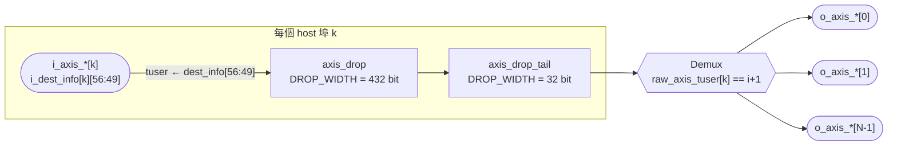
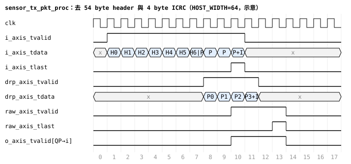

# `sensor_tx_pkt_proc`

## 概要

把 `rx_parser` 送來的 RoCE STX 封包去掉 header 與 ICRC，依 BTH dest QP 送到對應的 SIF TX。整個 HSB 只有一個實例，處理所有 host 埠。

| 項目 | 值 |
|---|---|
| 原始碼 | [`sensor_tx/sensor_tx_pkt_proc.sv`](https://github.com/nvidia-holoscan/holoscan-sensor-bridge/blob/41cecaa81ab906a55e7ec22e5e6989f7e602a4c8/fpga/nv_hsb_ip/sensor_tx/sensor_tx_pkt_proc.sv)（148 行） |
| 實例 | [`HOLOLINK_top.sv#L1659`](https://github.com/nvidia-holoscan/holoscan-sensor-bridge/blob/41cecaa81ab906a55e7ec22e5e6989f7e602a4c8/fpga/nv_hsb_ip/top/HOLOLINK_top.sv#L1659) |
| 時脈 | `host_clk`（HIF） |
| 分析深度 | 逐行 |

## 參數

| 參數 | 傳入 | 說明 |
|---|---|---|
| `AXI_DWIDTH` | `HOST_WIDTH` | |
| `NUM_HOST` | `HOST_IF_INST` | 輸入數 |
| `NUM_SENSOR` | `SENSOR_TX_IF_INST` | 輸出數 |

內部常數：`HDR_BYTES = 14 + 20 + 8 + 12 = 54`（不含 VLAN，VLAN 在 `rx_parser` 已移除）；尾端去 32 bit（ICRC）。

## 介面

| 方向 | 名稱 | 寬度 | 說明 |
|---|---|---|---|
| in | `i_axis_*[NUM_HOST]` | `AXI_DWIDTH` | `rx_parser.o_stx_axis_*`，**沒有 `tready`** |
| in | `i_dest_info[NUM_HOST]` | 72 | `rx_parser.o_dest_info`，與資料同拍有效 |
| out | `o_axis_*[NUM_SENSOR]` | `AXI_DWIDTH` | → `tx_stream_buffer[i]`，**沒有 `tready`**，`tuser` 固定 0 |

## 內部結構



## 行為

### 1. 帶著目的地走

`i_dest_info[k][56:49]`（= BTH dest QP 的 bit [8:1]）在去 header **之前**就放進 `tuser`（[L87](https://github.com/nvidia-holoscan/holoscan-sensor-bridge/blob/41cecaa81ab906a55e7ec22e5e6989f7e602a4c8/fpga/nv_hsb_ip/sensor_tx/sensor_tx_pkt_proc.sv#L87)），跟著每個 beat 穿過兩級去除邏輯。所以 demux 時看到的目的地一定屬於同一個封包。

### 2. 去 header

[`axis_drop`](lib.md#axis_drop)（[L77–L96](https://github.com/nvidia-holoscan/holoscan-sensor-bridge/blob/41cecaa81ab906a55e7ec22e5e6989f7e602a4c8/fpga/nv_hsb_ip/sensor_tx/sensor_tx_pkt_proc.sv#L77-L96)），`DROP_WIDTH = 54 × 8 = 432`。以 64-bit 為例：

- `DROP_CYCLES = 7`、`VAL_BITS = 432 mod 64 = 48`。
- 前 6 個 beat 整個丟掉；第 7 個 beat 的前 6 byte 是 header，後 2 byte 是 payload。
- 之後每個輸出 beat = `{本拍 [47:0], 前一拍 [63:48]}`，也就是把 payload 往前對齊 6 byte。
- 最後可能多一個 `STATE_SEND_PAD` beat 送出剩下的 byte。
- 輸出是組合邏輯（同一拍），`o_axis_rx_tready = i_axis_tx_tready`（這裡綁 1）。

### 3. 去 ICRC

[`axis_drop_tail`](lib.md#axis_drop_tail)（[L99–L116](https://github.com/nvidia-holoscan/holoscan-sensor-bridge/blob/41cecaa81ab906a55e7ec22e5e6989f7e602a4c8/fpga/nv_hsb_ip/sensor_tx/sensor_tx_pkt_proc.sv#L99-L116)），去掉最後 4 byte。它是 `DROP_CYCLES = 2` 級的延遲線：看到 `tlast` 後回頭調整最後 1～2 個 beat 的 `tkeep` / `tlast`。如果最後一個 beat 只剩 ICRC，那個 beat 整個不送，`tlast` 提早到前一個 beat。

### 4. Demux

[L127–L146](https://github.com/nvidia-holoscan/holoscan-sensor-bridge/blob/41cecaa81ab906a55e7ec22e5e6989f7e602a4c8/fpga/nv_hsb_ip/sensor_tx/sensor_tx_pkt_proc.sv#L127-L146)：

```systemverilog
for (int j=0; j<NUM_HOST; j=j+1) begin
  if ((raw_axis_tuser[j] == (i+1)) && raw_axis_tvalid[j]) begin
    o_axis_tvalid[i] = raw_axis_tvalid[j];
    ...
```

- 感測器 `i` 收 `QP[8:1] == i + 1` 的封包：QP `0x002`/`0x003` → sensor 0，`0x004`/`0x005` → sensor 1，依此類推。
- `QP[8:1] == 0` 或超出 `NUM_SENSOR` 的封包沒有任何輸出，等於丟棄。
- 兩個 host 埠同一拍送給同一個感測器時，迴圈中 index 較大的 host 覆蓋較小的。**沒有仲裁**，資料會混在一起。

## 時序



64-bit、10 beat 輸入的示意。`H0`–`H5` 整拍丟掉，`H6|P` 是 header 與 payload 交界的 beat，`I` 是 ICRC。依 RTL 推導，未經模擬。

## 暫存器

無。

## 注意事項

1. Header 長度寫死 54 byte。RC WRITE 封包在 BTH 後還有 16 byte RETH，這裡不會去掉。`ENABLE_ROCE_ACK` 時 `rx_parser` 會接受 RC WRITE，RETH 會留在送給感測器的資料裡（R + X：host 軟體送往 HSB 的只有 UC SEND，板級也都沒有定義 `SIF_TX_ROCE_RC_ENABLE`，所以只有第三方 RC requester 會觸發）。
2. 感測器選擇的位元範圍和 `roce_ack` 不同，見 [roce_ack 注意事項 1](roce_ack.md#注意事項)。
3. 整條路徑沒有 `tready`。下游只能靠 `tx_stream_buffer` 的 FIFO 吸收，滿了就遺失資料。
4. 輸出只保留 Ethernet 封包邊界（`tlast`）。frame、line 等資訊必須在 payload 裡。
