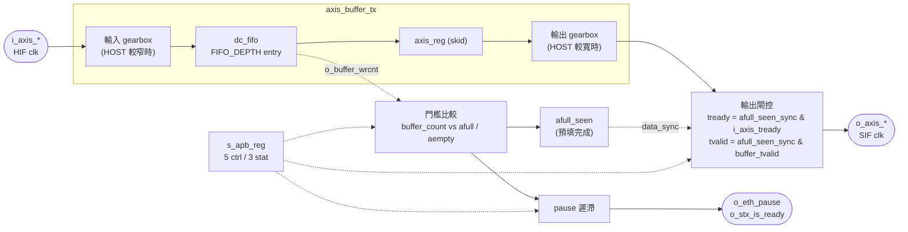
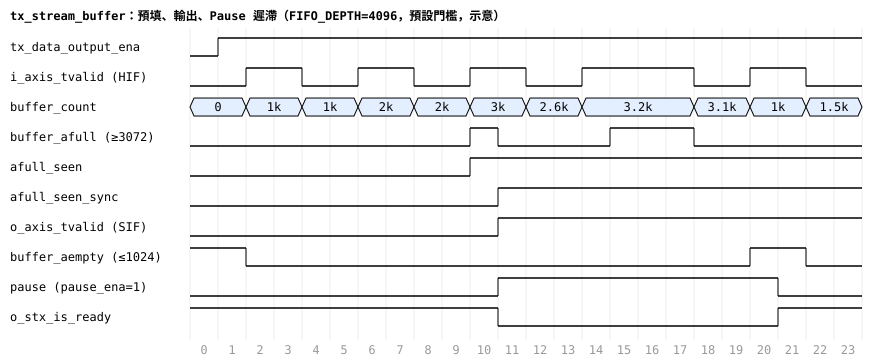

# `tx_stream_buffer`（含 `axis_buffer_tx`、`pause_gen`）

## 概要

每個 SIF TX 一份。把 HIF 時脈下突發到達的封包資料，轉成 SIF TX 時脈下連續輸出的串流：先預填 FIFO，再開始輸出；FIFO 太滿時要求 host 暫停（802.3x PAUSE 或 RoCE RNR NAK）。

| 項目 | 值 |
|---|---|
| 原始碼 | [`sensor_tx/tx_stream_buffer.sv`](https://github.com/nvidia-holoscan/holoscan-sensor-bridge/blob/41cecaa81ab906a55e7ec22e5e6989f7e602a4c8/fpga/nv_hsb_ip/sensor_tx/tx_stream_buffer.sv)（352 行）、[`axis_buffer_tx.sv`](https://github.com/nvidia-holoscan/holoscan-sensor-bridge/blob/41cecaa81ab906a55e7ec22e5e6989f7e602a4c8/fpga/nv_hsb_ip/sensor_tx/axis_buffer_tx.sv)、[`pause_gen.sv`](https://github.com/nvidia-holoscan/holoscan-sensor-bridge/blob/41cecaa81ab906a55e7ec22e5e6989f7e602a4c8/fpga/nv_hsb_ip/sensor_tx/pause_gen.sv) |
| 實例 | [`HOLOLINK_top.sv#L1688`](https://github.com/nvidia-holoscan/holoscan-sensor-bridge/blob/41cecaa81ab906a55e7ec22e5e6989f7e602a4c8/fpga/nv_hsb_ip/top/HOLOLINK_top.sv#L1688)（每個 SIF TX）、`pause_gen` 在 [L1740](https://github.com/nvidia-holoscan/holoscan-sensor-bridge/blob/41cecaa81ab906a55e7ec22e5e6989f7e602a4c8/fpga/nv_hsb_ip/top/HOLOLINK_top.sv#L1740)（每個 host 埠） |
| 時脈 | 寫入 `i_hif_clk`、讀出 `i_sif_clk`、暫存器 `i_apb_clk` |
| 分析深度 | `tx_stream_buffer` 逐行；`axis_buffer_tx` 讀出控制逐行；`pause_gen` 主要邏輯 |

## 參數

| 參數 | 傳入 | CPNX100 | 說明 |
|---|---|---|---|
| `HOST_DWIDTH` | `HOST_WIDTH` | 64 | |
| `NUM_HOSTS` | `HOST_IF_INST` | 2 | |
| `SENSOR_DWIDTH` | `SIF_TX_WIDTH[i]` | 32 | |
| `FIFO_DEPTH` | `SIF_TX_BUF_SIZE[i]` | 4096 | 單位是 **FIFO entry**，寬度 = max(`HOST_DWIDTH`, `SENSOR_DWIDTH`)。CPNX100 = 4096 × 64 bit = 32 KB |
| `MTU` | `HOST_MTU` | 4096 | 沒有被使用 |

## 介面

| 方向 | 名稱 | 時脈 | 說明 |
|---|---|---|---|
| in | `i_axis_*` | HIF | `sensor_tx_pkt_proc` 輸出，沒有 `tready`。`tuser` 1 bit |
| out | `o_axis_*` | SIF | 送給板級的感測器 TX IP |
| in | `i_axis_tready` | SIF | 感測器端背壓 |
| out | `o_eth_pause[NUM_HOSTS-1:0]` | HIF | 給 `pause_gen` |
| out | `o_pause_quanta[15:0]` | HIF | |
| out | `o_stx_is_ready` | HIF | = `!pause`，給 `roce_ack` |

## 內部結構



## 行為

### 1. FIFO（`axis_buffer_tx`）

`axis_buffer_tx` 是 `lib_axis/axis_buffer` 的修改版（檔頭註解 [L16–L21](https://github.com/nvidia-holoscan/holoscan-sensor-bridge/blob/41cecaa81ab906a55e7ec22e5e6989f7e602a4c8/fpga/nv_hsb_ip/sensor_tx/axis_buffer_tx.sv#L16-L21)）：

- 沒有 `WAIT2SEND`：不等整包，資料進來就可以出去。
- 輸入端 `gbx_axis_tready` 綁 1（[L248](https://github.com/nvidia-holoscan/holoscan-sensor-bridge/blob/41cecaa81ab906a55e7ec22e5e6989f7e602a4c8/fpga/nv_hsb_ip/sensor_tx/axis_buffer_tx.sv#L248)）：不能背壓。FIFO 滿時 `dc_fifo` 的 `wr_en = wr & ~full` 直接丟掉 beat。
- 寬度轉換：中間 FIFO 的寬度取兩端較寬者。HOST 較寬時（CPNX100：64 → 32），轉換在 FIFO **之後**做，FIFO 吸收寬度差帶來的速率差。
- `tkeep` 在 FIFO 裡存成「最高有效 byte 的 index」，假設 `tkeep` 是連續的低位 1。
- 讀出端有 `axis_reg` skid buffer，讓 `tvalid` 不會因為 FIFO 讀取延遲而斷續。

### 2. 預填與輸出閘控

[L146–L147](https://github.com/nvidia-holoscan/holoscan-sensor-bridge/blob/41cecaa81ab906a55e7ec22e5e6989f7e602a4c8/fpga/nv_hsb_ip/sensor_tx/tx_stream_buffer.sv#L146-L147)：

```systemverilog
assign axis_buffer_tx_tready = (afull_seen_sync & i_axis_tready) || dbg_ena_output_sync;
assign o_axis_tvalid         = afull_seen_sync & axis_buffer_tvalid;
```

`afull_seen`（[L233–L255](https://github.com/nvidia-holoscan/holoscan-sensor-bridge/blob/41cecaa81ab906a55e7ec22e5e6989f7e602a4c8/fpga/nv_hsb_ip/sensor_tx/tx_stream_buffer.sv#L233-L255)）：

| 條件 | `afull_seen` |
|---|---|
| `tx_data_output_ena = 0` | 清 0 |
| `tx_data_output_ena = 1` 且 `buffer_afull` | 設 1，之後保持 |

所以啟用後，FIFO 第一次達到 almost full 才開始輸出，之後就算水位下降也繼續輸出（不會再等預填）。`afull_seen` 在 HIF 時脈產生，經 2 級 `data_sync` 到 SIF 時脈。

### 3. 門檻

[L200–L230](https://github.com/nvidia-holoscan/holoscan-sensor-bridge/blob/41cecaa81ab906a55e7ec22e5e6989f7e602a4c8/fpga/nv_hsb_ip/sensor_tx/tx_stream_buffer.sv#L200-L230)：

| | Almost full | Almost empty |
|---|---|---|
| Reset 後 | `FIFO_DEPTH − FIFO_DEPTH/4`（CPNX100：3072） | `FIFO_DEPTH/4`（1024） |
| 軟體設定 | `ctrl[1]` | `ctrl[2]` |
| 比較 | `buffer_count >= afull_thresh` | `buffer_count <= aempty_thresh` |

軟體值只在 `prog_thresh_ena`（`ctrl[0][2]`）**上升緣**載入。`buffer_count` 是寫入端（HIF）計數。

### 4. Pause

[L258–L279](https://github.com/nvidia-holoscan/holoscan-sensor-bridge/blob/41cecaa81ab906a55e7ec22e5e6989f7e602a4c8/fpga/nv_hsb_ip/sensor_tx/tx_stream_buffer.sv#L258-L279)：

```systemverilog
if (pause_ena) begin
  if (buffer_afull)       pause <= 1'b1;
  else if (buffer_aempty) pause <= 1'b0;
end else pause <= 0;
assign o_eth_pause    = {NUM_HOSTS{pause}} & host_pause_mapping;
assign o_stx_is_ready = !pause;
```

遲滯：到 almost full 開始 pause，降到 almost empty 才解除。

`HOLOLINK_top` 把所有 SIF TX 的 `o_eth_pause` 依 host 埠 OR 起來（[L1729–L1736](https://github.com/nvidia-holoscan/holoscan-sensor-bridge/blob/41cecaa81ab906a55e7ec22e5e6989f7e602a4c8/fpga/nv_hsb_ip/top/HOLOLINK_top.sv#L1729-L1736)），每個 host 埠一個 `pause_gen`。

### 5. `pause_gen`

- 產生 802.3x PAUSE：dest `01:80:C2:00:00:01`、EtherType `0x8808`、opcode `0x0001`、補到 60 byte（[L53–L57](https://github.com/nvidia-holoscan/holoscan-sensor-bridge/blob/41cecaa81ab906a55e7ec22e5e6989f7e602a4c8/fpga/nv_hsb_ip/sensor_tx/pause_gen.sv#L53-L57)）。
- `i_start` 期間依 quanta 倒數（每 quanta = 512 bit time，換算成時脈數），倒數完再送一次，維持 pause。
- `i_start` 從 1 變 0 時送 quanta = 0 的 PAUSE，通知對方恢復。
- quanta：`ctrl[4][15:0]` 的值沒有改變過時用 `0xFFFF`（寫入與 reset 值相同的 0 不算改變），寫過後用 `ctrl[4][15:0]`（[L338–L350](https://github.com/nvidia-holoscan/holoscan-sensor-bridge/blob/41cecaa81ab906a55e7ec22e5e6989f7e602a4c8/fpga/nv_hsb_ip/sensor_tx/tx_stream_buffer.sv#L338-L350)）。

### 6. 統計

[L282–L326](https://github.com/nvidia-holoscan/holoscan-sensor-bridge/blob/41cecaa81ab906a55e7ec22e5e6989f7e602a4c8/fpga/nv_hsb_ip/sensor_tx/tx_stream_buffer.sv#L282-L326)：

| 統計 | 更新條件 |
|---|---|
| `high_watermark` | 啟用後的最大 `buffer_count` |
| `low_watermark` | `afull_seen` 後的最小值；碰到 0 時重設為全 1 |
| `saw_overflow` | `afull_seen` 且 `buffer_count == FIFO_DEPTH − 1` |
| `saw_underflow` | `afull_seen` 且 `buffer_count == 0` |

`tx_data_output_ena = 0` 或 `stat_rst` 時清除。

## 時序



預設門檻、`pause_ena = 1` 的示意。依 RTL 推導，未經模擬。重點：

- 輸出在 `afull_seen_sync` 拉高後才開始（第 11 拍），比 `afull_seen` 晚 2 個 SIF 時脈。
- Pause 從第 11 拍到第 21 拍：中間 `buffer_afull` 掉下又拉起都不影響，直到 `buffer_aempty` 才解除。

## 暫存器

基底 `0x0120_0000 + i × 0x1_0000`（[memory-map.md](../registers/memory-map.md)）。這組暫存器不在 `regmap_pkg.sv`，是模組內 `N_CTRL_REG = 5`、`N_STAT_REG = 3`（[L60–L61](https://github.com/nvidia-holoscan/holoscan-sensor-bridge/blob/41cecaa81ab906a55e7ec22e5e6989f7e602a4c8/fpga/nv_hsb_ip/sensor_tx/tx_stream_buffer.sv#L60-L61)）。

| Offset | 位元 | 名稱 | 說明 |
|---|---|---|---|
| 0x00 | [0] | `tx_data_output_ena` | 啟用輸出。清 0 會重設 `afull_seen` 與統計 |
| | [1] | `pause_ena` | |
| | [2] | `prog_thresh_ena` | 上升緣載入 0x04 / 0x08 |
| | [4] | `stat_rst` | |
| | [8] | `dbg_ena_output` | 強制讀出 FIFO（`o_axis_tvalid` 仍受閘控，等於清空 FIFO） |
| 0x04 | | `sw_almost_full_thresh` | |
| 0x08 | | `sw_almost_empty_thresh` | |
| 0x0C | `[NUM_HOSTS-1:0]` | `host_pause_mapping` | 哪些 host 埠送 PAUSE |
| 0x10 | [15:0] | pause quanta | |
| 0x80 | | `high_watermark` | RO |
| 0x84 | | `low_watermark` | RO |
| 0x88 | [1] / [0] | `saw_overflow` / `saw_underflow` | RO |

host 軟體的用法可以佐證：`jesd.cpp` 寫 `0x0120_0000 = 0x3`（啟用輸出 + pause）、`0x0120_000C = host_pause_mapping_mask_`。

## 注意事項

1. **多個 SIF TX 只有 sensor 0 的 quanta 有效。** `HOLOLINK_top` 把每個 `pause_gen.i_pause_time` 都接到 `tx_pause_quanta[0]`（[L1747](https://github.com/nvidia-holoscan/holoscan-sensor-bridge/blob/41cecaa81ab906a55e7ec22e5e6989f7e602a4c8/fpga/nv_hsb_ip/top/HOLOLINK_top.sv#L1747)）。
2. **FIFO 滿時遺失的是 beat，不是整包；`tlast` 遺失時兩個封包接成一個。** `axis_buffer_tx` 的 `gbx_axis_tready` 寫死為 1（`!fifo_afull` 被註解掉，[axis_buffer_tx.sv#L248](https://github.com/nvidia-holoscan/holoscan-sensor-bridge/blob/41cecaa81ab906a55e7ec22e5e6989f7e602a4c8/fpga/nv_hsb_ip/sensor_tx/axis_buffer_tx.sv#L248)），`o_axis_rx_tready` 也沒有接出去；`dc_fifo_generic` 滿時 `wr_en = wr & ~full & wr_init_done`（[dc_fifo_generic.sv#L139](https://github.com/nvidia-holoscan/holoscan-sensor-bridge/blob/41cecaa81ab906a55e7ec22e5e6989f7e602a4c8/fpga/nv_hsb_ip/misc/dc_fifo_generic.sv#L139)）直接不寫。`WAIT2SEND = 0`，輸出不依賴封包計數，所以和 [`rx_parser`](rx_parser.md#注意事項) 不同，這裡**不會**造成之後的封包永久錯位：受影響的只有溢位當下的封包（被截斷，或和下一個封包合併）。溢位有兩個來源：
   - host 送得比 SIF 消耗快，而 PAUSE 沒有啟用（`pause_ena` reset 值 0）或沒有及時生效。
   - `tx_data_output_ena = 0` 時輸出被 `afull_seen` 擋住，但輸入照樣寫入：在啟用前送來的資料會先把 FIFO 填滿再開始丟（R，v7 逐行確認；v6 為推斷）。
3. **`saw_overflow` 的判斷比實際溢位早一格。** 它看 `buffer_count == FIFO_DEPTH − 1`，而且只在 `afull_seen` 後有效；預填期間就溢位不會被記錄。
4. **`HALF_SECOND` 計數器（[L98–L114](https://github.com/nvidia-holoscan/holoscan-sensor-bridge/blob/41cecaa81ab906a55e7ec22e5e6989f7e602a4c8/fpga/nv_hsb_ip/sensor_tx/tx_stream_buffer.sv#L98-L114)）產生的 `heartbeat` 沒有被使用。** 常數假設 APB 時脈 100 MHz。

## 參數調整

這個模組不解析協定，只處理 AXIS 串流，調整重點：

| 項目 | 說明 |
|---|---|
| `FIFO_DEPTH` | 依下游一次不可中斷的傳輸長度與 Ethernet 抖動決定，至少要放得下預填量加上一次完整傳輸 |
| 預填門檻 | 下游一旦開始就不能中斷時，預填量要大於「最長 Ethernet 到達間隔 × SIF 輸出速率」 |
| `pause_ena` | 網路不使用 PAUSE 時設 0 |
| `tuser` | 目前 1 bit；要帶更多旁帶資訊需加寬 `W_USER` |
| 監控 | `saw_underflow`、`low_watermark` 反映 Ethernet 供應是否足夠 |
