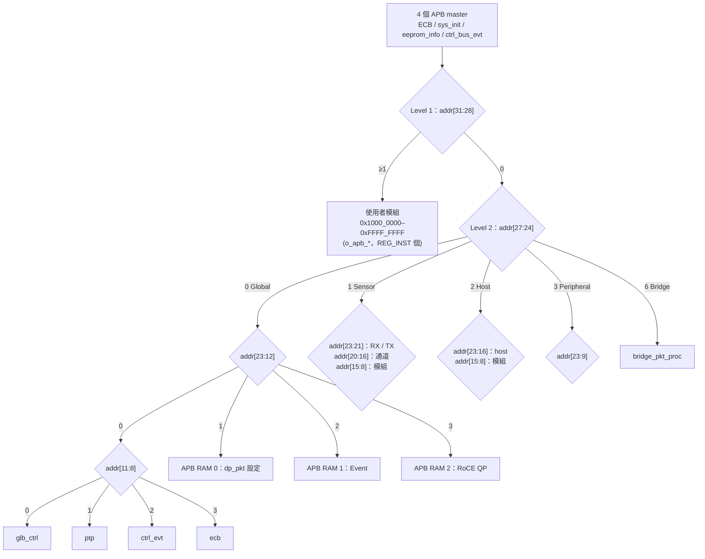

# 位址空間與 RAM

位址解碼取自 [`lib_apb/apb_intc_top.sv`](https://github.com/nvidia-holoscan/holoscan-sensor-bridge/blob/41cecaa81ab906a55e7ec22e5e6989f7e602a4c8/fpga/nv_hsb_ip/lib_apb/apb_intc_top.sv) 的 `apb_switch` 設定（`W_OFSET` / `W_SW`），與 [`regmap_pkg.sv`](https://github.com/nvidia-holoscan/holoscan-sensor-bridge/blob/41cecaa81ab906a55e7ec22e5e6989f7e602a4c8/fpga/nv_hsb_ip/reg_map/regmap_pkg.sv) 的 `ADDR_SW_*` 常數。「佐證」欄是 host 軟體裡用到同一位址的地方。

## 解碼層級

## 位址表

| 位址 | 目標 | RTL | 佐證 |
|---|---|---|---|
| `0x0000_0000` | Global 暫存器 | `glb_ctrl_top` | `HSB_IP_VERSION = 0x80` |
| `0x0000_0100` | PTP | `ptp_top` | `FPGA_PTP_CTRL = 0x104` |
| `0x0000_0200` | Event | `ctrl_bus_evt_int` | `CTRL_EVENT = 0x0000'0200` |
| `0x0000_0300` | ECB | `ecb_rdwr_ctrl` | |
| `0x0000_1000` + VP × `0x40` | Data Plane 設定 RAM | `dp_pkt_top` | `FPGA_SENSOR_VP_VLAN_BASE = 0x1034`、`FPGA_SENSOR_VP_STRIDE = 0x40` |
| `0x0000_2000` | Event APB RAM | `ctrl_bus_evt_int` | `APB_RAM = 0x2000` |
| `0x0000_3000` | RoCE QP RAM（只有 host 0 回應讀取） | `roce_ack` | |
| `0x0100_0000` + s × `0x1_0000` | SIF RX s：packetizer（+0x000）、data_gen（+0x100） | `packetizer_top`、`data_gen` | `enumerator.cpp`：`0x01000000 + 0x10000 * sensor_number` |
| `0x0120_0000` + t × `0x1_0000` | SIF TX t：`tx_stream_buffer` | `tx_stream_buffer` | `jesd.cpp`：`0x01200000`、`0x0120000C` |
| `0x0200_0000` + h × `0x1_0000` | Host h：`rx_parser`（+0x000）、`eth_pkt`（+0x100）、保留（+0x200）、`dp_pkt`（+0x300） | | |
| `0x0300_0000` | SPI | `spi_ctrl_fsm` | `SPI_CTRL = 0x0300'0000` |
| `0x0300_0200` | I2C | `i2c_ctrl_fsm` | `I2C_CTRL = 0x0300'0200` |
| `0x0300_0400` | UART | `uart_ctrl_fsm` | `UART = 0x0300'0400` |
| `0x0600_0000` | Bridge | `bridge_pkt_proc` | |
| `0x1000_0000`– | 使用者模組 | 板級 | CPNX100 `init_reg`：`0x1000_xxxx` PCS、`0x2000_xxxx` MAC |

未定義位址讀回 `0xBADADD12`。

## 不在 `regmap_pkg.sv` 的暫存器

| 模組 | 說明 |
|---|---|
| `tx_stream_buffer` | 5 ctrl / 3 stat，見 [tx_stream_buffer.md §暫存器](../modules/tx_stream_buffer.md#暫存器) |
| `roce_ack` | 使用 `inst_dec_ack_ctrl`，位元見 [roce_ack.md §暫存器](../modules/roce_ack.md#暫存器) |
| Data Plane 設定 RAM | 見 [dp_pkt_top.md §1](../modules/dp_pkt_top.md#1-設定-ram) |
| 周邊（SPI / I2C / UART） | 各模組自己的暫存器，未分析 |
