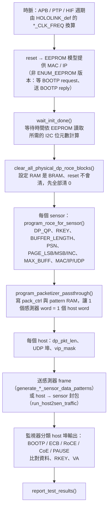

# 驗證環境（`nv_hsb_ip_simple_tb`）

原始碼：[`fpga/nv_hsb_ip_simple_tb/`](https://github.com/nvidia-holoscan/holoscan-sensor-bridge/tree/41cecaa81ab906a55e7ec22e5e6989f7e602a4c8/fpga/nv_hsb_ip_simple_tb)（約 5100 行）。分析深度：Makefile、檔案結構、初始化與設定流程（`hololink_init()` 及其呼叫的 task）、檢查項目。

## 組成

| 檔案 | 行數 | 內容 |
|---|---|---|
| `nv_hsb_ip_simple_tb.sv` | 2008 | 頂層：實例化 `HOLOLINK_top`，產生時脈、reset，執行測試流程 |
| `fpga_sensor_top_pkg.svh` | | 測試用的 `HOLOLINK_def` 設定 |
| `eeprom_i2c_model.sv` | 407 | I2C EEPROM 模型（讓 `eeprom_info` 能完成開機） |
| `tb_pkg/hololink_tb_pkg.sv` | 573 | 共用型別、log 巨集 |
| `tb_lib/hololink_ecb_tasks.svh` | 321 | 透過 Ethernet 送 ECB 讀寫 |
| `tb_lib/hololink_roce_helpers.svh` | 379 | RoCE 封包組裝與檢查 |
| `tb_lib/hololink_coe_helpers.svh` | 384 | 1722B CoE 封包檢查 |
| `tb_lib/hololink_sensor_stim.svh` | 334 | SIF RX 感測器資料激勵 |
| `tb_lib/hololink_host2sen_stim.svh` / `_scbd.svh` | 226 / 116 | host → SIF TX 激勵與 scoreboard |
| `tb_lib/hololink_monitors.svh` | 333 | HIF / SIF 監視器 |

## 測試模式

`make run` / `make coe`，以 `TEST_MODE` 選擇：

| `TEST_MODE` | 內容 |
|---|---|
| `SINGLE_SENSOR` | sensor 0 → host 0 |
| `ALL_SENSORS` | 所有 SIF RX → `TARGET_HOST` 指定的 host 埠 |
| `HOST2SEN` | host → sensor：UC RoCE SEND 經 STX 路徑到 SIF TX |

`make coe` 以 1722B CoE 格式跑 Data Plane。

## 測試流程

## 檢查項目

| 檢查 | 位置 | 內容 |
|---|---|---|
| ECB 回應 | `hololink_ecb_tasks.svh` `parse_ecb_response()` | 回應碼、sequence；`verify_register_access()` 讀回比對 |
| RoCE opcode | `hololink_roce_helpers.svh` `process_roce_fragment()` | 只接受 RDMA WRITE 類 opcode |
| R_Key | 同上 | 依 QP 推出 sensor，比對該 sensor 設定的 R_Key |
| 虛擬位址 | 同上 | 依 frame 計數推出 buffer 指標（`frame % 4`），比對 RETH VA |
| payload | 同上 | 與預先產生的 `expected_sensor_data` 逐 byte 比對 |
| frame 完整性 | `report_incomplete_frames()` | 結束時列出未收完的 frame |
| CoE | `hololink_coe_helpers.svh` | header 欄位與 payload |
| PAUSE | `hololink_monitors.svh` `honor_host_pause()` | 收到 PAUSE 時讓 host 端停止送封包，模擬 host 遵守 802.3x |
| Host → Sensor | `hololink_host2sen_scbd.svh` | SIF TX 輸出與送出的 RoCE SEND payload 比對 |
| AXIS 協定 | `dp_pkt_top` 內的 assertion（`ASSERT_ON`） | VP 輸入契約、輸出封包長度（見 [dp_pkt_top §1](modules/dp_pkt_top.md#1-輸入契約)） |

## 從 testbench 得到的設計資訊

- 設定 RAM 用 BRAM 實作，reset 不清除，軟體必須寫入所有用到的欄位（[`nv_hsb_ip_simple_tb.sv#L1355`](https://github.com/nvidia-holoscan/holoscan-sensor-bridge/blob/41cecaa81ab906a55e7ec22e5e6989f7e602a4c8/fpga/nv_hsb_ip_simple_tb/nv_hsb_ip_simple_tb.sv#L1362)）。
- 設定 RAM 的 word F（PSN）可以由軟體寫入初始 PSN（`program_roce_for_sensor()` 寫 `ROCE_OFF_PSN`）。
- 沒有 `ENUM_EEPROM` 時，HSB 在收到 BOOTP reply、取得 IP 之前不處理 ECB；IP 更新後要等約 10 µs 才能送第一個 ECB（跨時脈），否則第一筆寫入會遺失（[L1332–L1355](https://github.com/nvidia-holoscan/holoscan-sensor-bridge/blob/41cecaa81ab906a55e7ec22e5e6989f7e602a4c8/fpga/nv_hsb_ip_simple_tb/nv_hsb_ip_simple_tb.sv#L1332-L1355)）。
- packetizer 在 reset 值（bypass）且 `VP_SIZE < DIN_WIDTH` 時，只保留每個 beat 的低 `VP_SIZE` bit（[L1139–L1154](https://github.com/nvidia-holoscan/holoscan-sensor-bridge/blob/41cecaa81ab906a55e7ec22e5e6989f7e602a4c8/fpga/nv_hsb_ip_simple_tb/nv_hsb_ip_simple_tb.sv#L1139-L1154)，與 [packetizer §4](modules/packetizer.md#4-可程式化資料路徑packetizersv) 的 RTL 分析一致）。
- EEPROM 的 I2C 分頻由 `APB_CLK_FREQ` 換算到 400 kHz，SCL 週期 = 2 × 分頻值 個 APB 時脈（與 [peripherals §I2C](modules/peripherals.md#i2c) 的公式一致）。

## 需求

- 模擬器：VCS 或 Xcelium（`SIMULATOR=VCS|XCELIUM`）。
- `DUMP=1` 產生 FSDB 波形（VCS），`verdi_config_file` 為 Verdi 設定。
- `run_parallel_configs.py`：同一次編譯平行跑多個設定。
